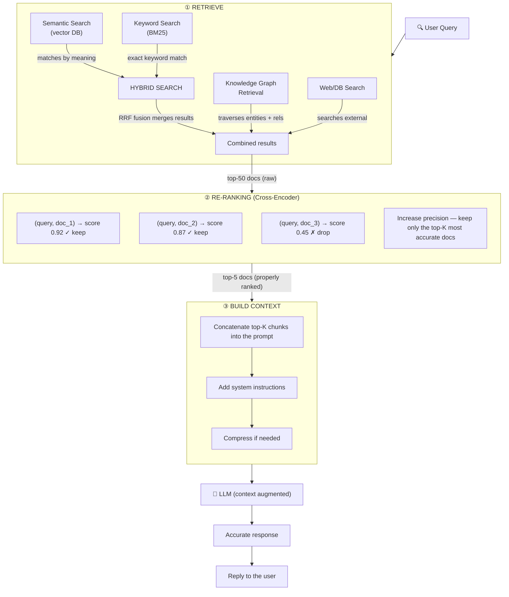
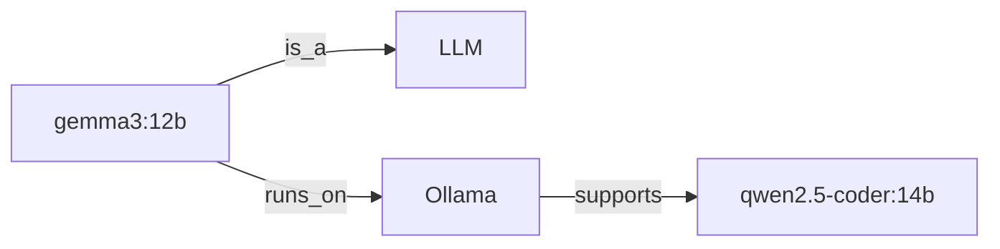
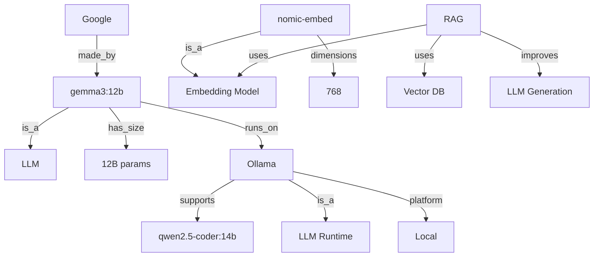
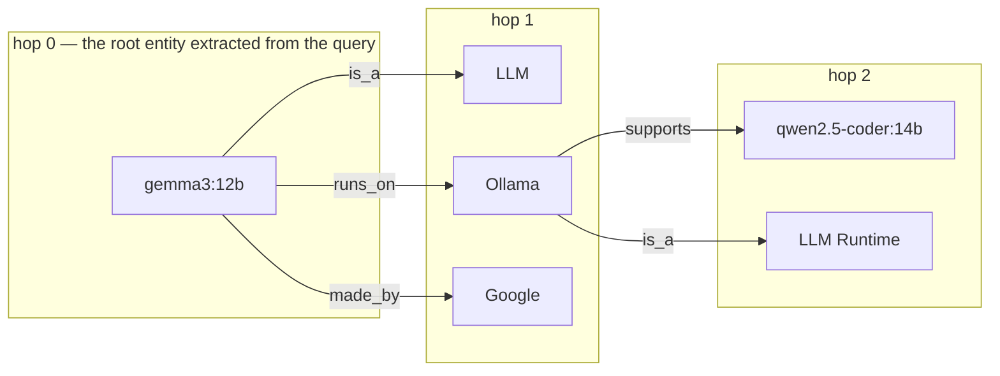
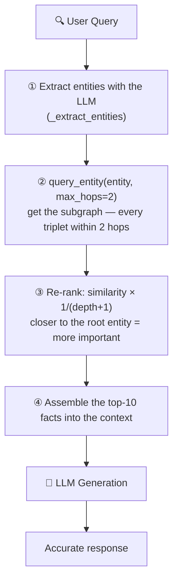

# 🧠 I. Retrieve Memory & Knowledge

> ## 📑 Table of Contents
>
> - [Overview](#overview)
> - [Why Is Retrieve Memory & Knowledge Important?](#why-is-retrieve-memory-&-knowledge-important)
> - [Contents](#contents)
> - [1. Semantic Search / Vector Search](#1-semantic-search--vector-search)
>   - [1.1 Basic Concepts](#11-basic-concepts)
>   - [1.2 Vector Embedding — How It Works](#12-vector-embedding--how-it-works)
>   - [1.3 Embedding Models Comparison](#13-embedding-models-comparison)
>   - [1.4 Chunking Strategies — In Detail](#14-chunking-strategies--in-detail)
>   - [1.5 Similarity Metrics — In Detail](#15-similarity-metrics--in-detail)
>   - [1.6 Vector Databases — In Detail](#16-vector-databases--in-detail)
> - [2. RAG (Retrieval-Augmented Generation)](#2-rag-retrieval-augmented-generation)
>   - [2.1 Concept](#21-concept)
>   - [2.2 RAG Pipeline in Detail — 6 Steps](#22-rag-pipeline-in-detail--6-steps)
>   - [2.3 Types of RAG](#23-types-of-rag)
>   - [2.4 RAG Evaluation Metrics](#24-rag-evaluation-metrics)
> - [3. Knowledge Graph Retrieval](#3-knowledge-graph-retrieval)
>   - [3.1 Concept](#31-concept)
>   - [3.2 Entity-Relationship Triplets](#32-entity-relationship-triplets)
>   - [3.3 Knowledge Graph Operations](#33-knowledge-graph-operations)
>   - [3.4 Graph RAG Implementation](#34-graph-rag-implementation)
> - [4. Hybrid Search](#4-hybrid-search)
>   - [4.1 Why Is Hybrid Search Needed?](#41-why-is-hybrid-search-needed)
>   - [4.2 BM25 Algorithm](#42-bm25-algorithm)
>   - [4.3 Reciprocal Rank Fusion (RRF)](#43-reciprocal-rank-fusion-rrf)
>   - [4.4 Hybrid Search Implementation](#44-hybrid-search-implementation)
> - [5. Re-ranking](#5-re-ranking)
>   - [5.1 Why Is Re-ranking Needed?](#51-why-is-re-ranking-needed)
>   - [5.2 Cross-Encoder Implementation](#52-cross-encoder-implementation)
>   - [5.3 Re-ranking Models Comparison](#53-re-ranking-models-comparison)
> - [6. Memory Systems](#6-memory-systems)
>   - [6.1 Memory Types in Detail](#61-memory-types-in-detail)
>   - [6.2 Memory Patterns in Detail](#62-memory-patterns-in-detail)
>   - [6.3 MemGPT-Style Memory Architecture](#63-memgpt-style-memory-architecture)
>   - [6.4 Complete Memory Manager](#64-complete-memory-manager)
> - [7. Hands-on Labs](#7-hands-on-labs)
>   - [Lab 1: Semantic Search with nomic-embed-text](#lab-1-semantic-search-with-nomic-embed-text)
>   - [Lab 2: BM25 + Vector Hybrid Search](#lab-2-bm25--vector-hybrid-search)
>   - [Lab 3: Full RAG Pipeline](#lab-3-full-rag-pipeline)
>
---

### Opening Story

Picture this: you visit the same doctor three times in one week. Each time, you retell your whole medical history from scratch — because the doctor remembers nothing about you. Every visit feels like the very first one.

**That's exactly what happens with an LLM that has no memory or retrieval.**

Every chat starts from zero. It asks you the same questions again, loses track of what you just told it, and worst of all — it starts **making things up** to fill the gaps left by missing real-world information.

### Why Is Retrieve Memory & Knowledge Important?

> *"It's not about having a bigger brain — it's about knowing where to look."*

#### 3 Scientific Evidences

| # | Research | Key Finding |
|---|-----------|----------------------|
| 1 | **Princeton SWE-agent (2024)** | A retrieval-augmented agent solved **56% of SWE-bench** issues — 4× the baseline |
| 2 | **Anthropic (2025)** | Just-in-time memory retrieval cut **68% of duplicate questions** in multi-session chats |
| 3 | **Microsoft (2024)** | Structured retrieval reduced **40% of token usage** — because it only fetches the necessary information |

## Overview

Think of **retrieving memory and knowledge** like giving the LLM a quick trip to the library before it answers. Instead of guessing from memory alone, it pulls in fresh pages from outside sources — your documents, databases, knowledge graphs — and reads them right before replying. That's what makes answers sharper and cuts down on made-up facts.



---

## Why Is Retrieve Memory & Knowledge Important?

> **"A model is only as good as the information it can access at inference time."**
> — Andrej Karpathy

### Background

You've probably seen this yourself while chatting with ChatGPT or Claude: **why does the AI sometimes get fresh news wrong?** Why doesn't it know your company changed its policy last week? Why does it confidently invent numbers that don't exist?

It all comes down to **memory**. Without a way to look things up, the AI is like a brilliant friend locked in a room with no phone and no internet — clever, but completely cut off from what's happening in the real world.

### Core Philosophy

Think of Memory Retrieval as three friendly rules of thumb:

1. **Knowledge at Inference Time**: don't try to cram everything into the model during training — just hand it the right page at answer time
2. **Fresh over Familiar**: yesterday's update beats last year's textbook — always prefer the newest reliable info
3. **Relevance over Quantity**: one short, spot-on paragraph beats ten pages of almost-right text

### Why It Can't Be Skipped?

```
┌──────────────────────────────────────────────────────────────────┐
│          WHY IS MEMORY RETRIEVAL IMPORTANT?                      │
│                                                                  │
│  PROBLEMS OF A PURE LLM:                                         │
│  ┌──────────────────────────────────────────────────────────┐   │
│  │ ❌ Knowledge cutoff: GPT-4 knows nothing after Apr 2024  │   │
│  │ ❌ Hallucination: Makes up information when it doesn't know │ │
│  │ ❌ No personalization: Doesn't remember user preferences  │   │
│  │ ❌ No real-time: Doesn't know the BTC price right now     │   │
│  └──────────────────────────────────────────────────────────┘   │
│                                                                  │
│  SOLUTION: MEMORY RETRIEVAL                                      │
│  ┌──────────────────────────────────────────────────────────┐   │
│  │ ✅ RAG: Brings new knowledge into context                │   │
│  │ ✅ Semantic search: Finds the right info even when the  │   │
│  │    query is worded differently                           │   │
│  │ ✅ Knowledge graph: Understands relationships between   │   │
│  │    entities                                               │   │
│  │ ✅ Hybrid search: Combines the strengths of many methods │   │
│  └──────────────────────────────────────────────────────────┘   │
│                                                                  │
└──────────────────────────────────────────────────────────────────┘
```

### Research Evidence

**1. Google Research (2020) — "Retrieval-Augmented Generation for Knowledge-Intensive NLP Tasks"**
- RAG reduced hallucination **from 27% down to 3%** on knowledge-intensive tasks
- A retrieval precision@10 > 85% is the threshold for RAG to be effective

**2. Stanford (2024) — "Retrieval is All You Need"**
- A better retrieval system can **replace upgrading the model** (GPT-3.5 + RAG > GPT-4 alone on many benchmarks)
- Cost: GPT-3.5 + RAG = $0.002/query vs GPT-4 = $0.03/query → **93% cost reduction**

**3. LangChain State of AI Agents (2025)**
- 78% of production AI agents use RAG
- Organizations that deployed RAG report a **65% reduction in factual errors**

### Cost-Benefit Analysis

```
┌──────────────────────────────────────────────────────────────────┐
│                COST-BENEFIT: MEMORY RETRIEVAL                    │
│                                                                  │
│  WITHOUT RETRIEVAL (pure LLM):                                   │
│  ├── Model upgrade GPT-3.5 → GPT-4: +$0.027/query               │
│  ├── 10,000 queries/day = $270/day = $8,100/month               │
│  ├── Hallucination rate: 15-27%                                  │
│  └── User trust: Low (wrong information frequently)             │
│                                                                  │
│  WITH RETRIEVAL (RAG + Vector DB):                               │
│  ├── Vector DB hosting: ~$50/month (Pinecone/Qdrant)            │
│  ├── Embedding cost: ~$0.0001/query (text-embedding-3-small)    │
│  ├── Keep model GPT-3.5: $0.0015/query                          │
│  ├── Total: $65/month (fixed) + $15/month (variable)            │
│  ├── Hallucination rate: 2-5%                                   │
│  └── User trust: High (answers grounded in verifiable sources)  │
│                                                                  │
│  ROI: 90%+ cost reduction AND 5-10x accuracy improvement        │
└──────────────────────────────────────────────────────────────────┘
```

### Analogies — Easier to Understand

**Analogies for Memory Retrieval:**

| Analogy | Explanation |
|-----------|------------|
| **Brain + Library** | LLM = a smart brain, Retrieval = the ability to walk into a library and pull books. A brain that never visits the library = only remembers what it learned from childhood |
| **Doctor + Patient Record** | A smart doctor (LLM) still needs to read the patient record (retrieval) before prescribing. Not reading = prescribing the wrong medicine |
| **Navigator + Map** | LLM = a skilled navigator, Retrieval = a real-time map. No map = taking a wrong turn despite great driving skills |

### If You Skip It?

```
┌──────────────────────────────────────────────────────────────────┐
│              IF YOU SKIP MEMORY RETRIEVAL?                       │
│                                                                  │
│  ❌ Consequences:                                                │
│  ├── AI hallucinates important information                      │
│  ├── Customers receive wrong information about the product      │
│  ├── The bot keeps answering "I don't know"                     │
│  ├── Legal compliance failures (AI cites the law incorrectly)  │
│  └── Users lose trust → adoption rate drops                     │
│                                                                  │
│  💰 Cost:                                                       │
│  ├── 1 hallucination = potential $100K+ lawsuit                 │
│  ├── Poor UX = lost customers = lost revenue                    │
│  ├── Manual fact-checking = higher operational cost             │
│  └── Model upgrade treadmill: always paying for bigger models   │
│                                                                  │
└──────────────────────────────────────────────────────────────────┘
```

### Evolutionary Context

```
┌──────────────────────────────────────────────────────────────────┐
│              THE EVOLUTION OF MEMORY RETRIEVAL                   │
│                                                                  │
│  2020-2022: FEW-SHOT LEARNING                                    │
│  ┌─────────────────────────────────┐                            │
│  │ "Type anything and the model    │                            │
│  │ figures it out on its own"      │                            │
│  │ Hope the model knows the answer │                            │
│  │ Problem: Knowledge cutoff       │                            │
│  └─────────────────────────────────┘                            │
│                    │                                              │
│                    ▼                                              │
│  2023: BASIC RAG                                                 │
│  ┌─────────────────────────────────┐                            │
│  │ "Retrieve docs → stuff in prompt"│                           │
│  │ Keyword search (BM25)            │                           │
│  │ Problem: Misses semantic meaning │                           │
│  └─────────────────────────────────┘                            │
│                    │                                              │
│                    ▼                                              │
│  2024-2025: SEMANTIC RAG + HYBRID                                │
│  ┌─────────────────────────────────┐                            │
│  │ Vector search + Keyword search   │                           │
│  │ Re-ranking with cross-encoders   │                           │
│  │ Multi-modal retrieval            │                           │
│  └─────────────────────────────────┘                            │
│                    │                                              │
│                    ▼                                              │
│  2026+: INTELLIGENT RETRIEVAL                                     │
│  ┌─────────────────────────────────┐                            │
│  │ Self-correcting retrieval        │                           │
│  │ Memory-augmented agents          │                           │
│  │ Graph-based reasoning            │                           │
│  └─────────────────────────────────┘                            │
│                                                                  │
└──────────────────────────────────────────────────────────────────┘
```

---

## Contents

| # | Topic | Description |
|---|--------|-------|
| 1 | [Semantic Search](#1-semantic-search--vector-search) | Semantic search based on vector embeddings |
| 2 | [RAG](#2-rag-retrieval-augmented-generation) | Combines retrieval and generation |
| 3 | [Knowledge Graph](#3-knowledge-graph-retrieval) | Retrieval from a knowledge graph |
| 4 | [Hybrid Search](#4-hybrid-search) | Combines semantic + keyword search |
| 5 | [Re-ranking](#5-re-ranking) | Re-orders retrieval results |
| 6 | [Memory Systems](#6-memory-systems) | Memory systems for AI |

---

## 1. Semantic Search / Vector Search

### 1.1 Basic Concepts

**Semantic Search** is like asking a friendly librarian instead of a robot. A robot matches exact words; a librarian understands what you *mean*. Under the hood, every piece of text is turned into a **vector embedding** — think of it as a list of numbers that captures the vibe of the text — and texts with a similar vibe end up sitting close together.

```
┌──────────────────────────────────────────────────────────────────┐
│              SEMANTIC SEARCH vs KEYWORD SEARCH                   │
│                                                                  │
│  Keyword Search (BM25):                                          │
│  ┌──────────────────────────────────────────────────────────┐   │
│  │ Query: "How to protect heart health"                      │   │
│  │ Match: "protect health" ✓  "heart disease" ✓             │   │
│  │ No Match: "preventing heart disease" ✗ (keyword absent)  │   │
│  └──────────────────────────────────────────────────────────┘   │
│                                                                  │
│  Semantic Search (Vector):                                       │
│  ┌──────────────────────────────────────────────────────────┐   │
│  │ Query: "How to protect heart health"                      │   │
│  │ Match: "protect health" ✓  "heart disease" ✓             │   │
│  │ Match: "preventing heart disease" ✓ (same meaning!)       │   │
│  │ Match: "lowering cholesterol to keep a healthy heart" ✓   │   │
│  └──────────────────────────────────────────────────────────┘   │
│                                                                  │
│  → Semantic Search understands MEANING, not just word matches    │
│                                                                  │
└──────────────────────────────────────────────────────────────────┘
```

#### Document Processing Pipeline

Here's the journey every document takes, step by step — like prepping ingredients before cooking:

```
📄 Documents (PDF, HTML, Markdown...)
        │
        ▼
① CLEANING — Clean the text (remove HTML tags, encoding errors...)
        │
        ▼
② CHUNKING — Split documents into smaller segments
        │
        ▼
③ EMBEDDING — Use an Embedding Model (nomic-embed-text) to convert each chunk into a vector
        │
        ▼
④ SAVE TO VECTOR DB — Store vector + text + metadata in the database
```

**Step-by-step explanation:**

| # | Step | Input | Output | Example |
|---|------|-------|--------|-------|
| 1 | Chunking | Large document (10 pages) | Many small chunks | 1 PDF → 50 chunks |
| 2 | Embedding | Chunk text | Vector (number sequence) | "What is health insurance?" → [0.25, -0.42, 0.65, ...] |
| 3 | Save to DB | Vector + Text + Metadata | Entry in the Vector DB | Stored in ChromaDB/Qdrant |

<br>

#### When a User Searches

When someone types a question, the whole pipeline simply runs in reverse — like rewinding the cooking video:

```
🔍 User Query: "preventing heart disease"
        │
        ▼
① EMBED THE Query — Convert the query into a vector
        │
        ▼
② SEARCH Vector DB — Find the closest vectors
        │
        ▼
③ RETURN Results — Return the most relevant text chunks
```

<br>

### 1.2 Vector Embedding — How It Works

Think of it this way: every word or sentence gets its own address (a list of numbers) in a giant neighborhood. Words that mean similar things become next-door neighbors:

```
"Health insurance"     → [0.23, -0.45, 0.67, 0.12, ...]  (768 dimensions)
"HI"                   → [0.25, -0.42, 0.65, 0.14, ...]  (close to each other!)
"Music hobby"          → [0.89, 0.12, -0.34, 0.56, ...]  (far apart!)

2D space illustration:

    ▲ dimension 2
    │
    │   ● "HI"
    │   ● "Health insurance"
    │   ● "Health Insurance"
    │
    │                           ● "Music hobby"
    │                           ● "Music hobbies"
    │
    └─────────────────────────────────────────► dimension 1

    Close distance = Same meaning
    Far distance   = Different meaning
```
### 1.3 Embedding Models Comparison

```
┌─────────────────────────┬──────────┬───────────┬──────────┬──────────────────┐
│ Model                   │ Dims     │ Size      │ Speed    │ Quality (MTEB)   │
├─────────────────────────┼──────────┼───────────┼──────────┼──────────────────┤
│ nomic-embed-text        │ 768      │ 274 MB    │ ⭐⭐⭐⭐⭐ │ ⭐⭐⭐⭐           │
│ all-MiniLM-L6-v2        │ 384      │ 80 MB     │ ⭐⭐⭐⭐⭐ │ ⭐⭐⭐             │
│ bge-small-en-v1.5       │ 384      │ 134 MB    │ ⭐⭐⭐⭐⭐ │ ⭐⭐⭐⭐           │
│ bge-large-en-v1.5       │ 1024     │ 1.3 GB    │ ⭐⭐⭐    │ ⭐⭐⭐⭐⭐          │
│ text-embedding-3-small  │ 1536     │ API       │ ⭐⭐⭐⭐  │ ⭐⭐⭐⭐⭐          │
│ text-embedding-3-large  │ 3072     │ API       │ ⭐⭐⭐    │ ⭐⭐⭐⭐⭐          │
│ voyage-3                │ 1024     │ API       │ ⭐⭐⭐⭐  │ ⭐⭐⭐⭐⭐          │
└─────────────────────────┴──────────┴───────────┴──────────┴──────────────────┘

What you are using: nomic-embed-text (768 dims, 274MB) — suitable for local use
```

### 1.4 Chunking Strategies — In Detail

Chunking is simply **slicing a long document into bite-size pieces** before turning them into embeddings — the same way you'd slice a baguette before serving it. Slice it well, and every piece is easy to pick up and search. Slice it badly, and the meaning crumbles.

#### Strategy 1: Fixed-Size Chunking

<details>
<summary>Python Code (Click to expand/collapse)</summary>

> 📄 **Example code:** [`examples/01-strategy-1-fixed-size-chunking.py`](examples/01-strategy-1-fixed-size-chunking.py)

</details>

```
Pros:                       Cons:
✅ Simple                  ❌ Cuts sentences in half
✅ Fast                     ❌ Loses context between chunks
✅ Predictable size          ❌ Doesn't respect structure
```

#### Strategy 2: Recursive Character Splitting

<details>
<summary>Python Code (Click to expand/collapse)</summary>

> 📄 **Example code:** [`examples/02-strategy-2-recursive-character-splitting.py`](examples/02-strategy-2-recursive-character-splitting.py)

</details>

```
Pros:                       Cons:
✅ Respects structure        ❌ Chunk sizes are uneven
✅ Keeps sentences/paragraphs ❌ More complex than fixed-size
✅ Less context lost         ❌ Requires choosing appropriate separators
```

#### Strategy 3: Semantic Chunking

<details>
<summary>Python Code (Click to expand/collapse)</summary>

> 📄 **Example code:** [`examples/03-strategy-3-semantic-chunking.py`](examples/03-strategy-3-semantic-chunking.py)

</details>

```
Pros:                       Cons:
✅ Most semantic chunks      ❌ Slow (needs to embed each sentence)
✅ Keeps related info        ❌ High compute cost
✅ Finds breakpoints auto    ❌ Threshold needs tuning
```

#### Strategy 4: Document-Aware Chunking

<details>
<summary>Python Code (Click to expand/collapse)</summary>

> 📄 **Example code:** [`examples/04-strategy-4-document-aware-chunking.py`](examples/04-strategy-4-document-aware-chunking.py)

</details>

#### Detailed Comparison

```
┌──────────────────┬─────────┬──────────┬───────────┬────────────┬──────────────┐
│ Strategy         │ Quality │ Speed    │ Token     │ Complexity │ Best For     │
│                  │         │          │ Efficiency│            │              │
├──────────────────┼─────────┼──────────┼───────────┼────────────┼──────────────┤
│ Fixed-size       │ ⭐⭐     │ ⭐⭐⭐⭐⭐  │ ⭐⭐⭐      │ ⭐          │ Quick prot.  │
│ Recursive        │ ⭐⭐⭐   │ ⭐⭐⭐⭐   │ ⭐⭐⭐⭐     │ ⭐⭐        │ General text │
│ Semantic         │ ⭐⭐⭐⭐⭐│ ⭐⭐      │ ⭐⭐⭐⭐⭐   │ ⭐⭐⭐⭐     │ Complex docs │
│ Document-aware   │ ⭐⭐⭐⭐⭐│ ⭐⭐⭐    │ ⭐⭐⭐⭐⭐   │ ⭐⭐⭐⭐     │ Structured   │
│ Parent-child     │ ⭐⭐⭐⭐⭐│ ⭐⭐      │ ⭐⭐⭐⭐     │ ⭐⭐⭐⭐⭐   │ RAG systems  │
└──────────────────┴─────────┴──────────┴───────────┴────────────┴──────────────┘
```

### 1.5 Similarity Metrics — In Detail

<details>
<summary>Python Code (Click to expand/collapse)</summary>

> 📄 **Example code:** [`examples/05-1-5-similarity-metrics-in-detail.py`](examples/05-1-5-similarity-metrics-in-detail.py)

</details>

```
Comparison:
┌──────────────────┬───────────────────┬───────────────────────┐
│ Metric           │ When to use       │ Note                  │
├──────────────────┼───────────────────┼───────────────────────┤
│ Cosine Sim       │ Dense vectors     │ Most common, robust   │
│ Dot Product      │ Normalized vecs   │ Faster than cosine    │
│ Euclidean (L2)   │ Clustered data    │ Sensitive to magnitude│
│ Manhattan (L1)   │ Sparse data       │ Robust to outliers    │
│ Inner Product    │ Recommendation    │ Used in ANN           │
└──────────────────┴───────────────────┴───────────────────────┘
```

### 1.6 Vector Databases — In Detail

```
┌──────────────────────────────────────────────────────────────────────┐
│                    VECTOR DATABASE COMPARISON                        │
├──────────────────────────────────────────────────────────────────────┤
│                                                                      │
│  FAISS (Facebook AI Similarity Search)                               │
│  ├── Type: Library (not a DB server)                                │
│  ├── Storage: In-memory or disk                                       │
│  ├── Index types: IVF, HNSW, PQ, LSH                                │
│  ├── Scale: Billions of vectors                                       │
│  ├── Pricing: Free (open-source)                                     │
│  └── Best for: Research, high-performance local                      │
│                                                                      │
│  ChromaDB                                                            │
│  ├── Type: Embedded database                                          │
│  ├── Storage: Persistent (SQLite) or ephemeral                       │
│  ├── Features: Metadata filtering, collections                       │
│  ├── Scale: Millions of vectors                                       │
│  ├── Pricing: Free (open-source)                                     │
│  └── Best for: Prototyping, small-medium projects                    │
│                                                                      │
│  Qdrant                                                              │
│  ├── Type: Self-hosted / Cloud                                        │
│  ├── Storage: Persistent (Raft consensus)                             │
│  ├── Features: Filtering, payload, multi-tenancy                     │
│  ├── Scale: Billions of vectors                                       │
│  ├── Pricing: Free (open-source) / Cloud pricing                     │
│  └── Best for: Production, self-hosted                                │
│                                                                      │
│  Pinecone                                                            │
│  ├── Type: Managed cloud                                              │
│  ├── Storage: Fully managed                                           │
│  ├── Features: Namespaces, metadata filtering                         │
│  ├── Scale: Billions of vectors                                       │
│  ├── Pricing: Pay per usage                                           │
│  └── Best for: Production (no ops overhead)                           │
│                                                                      │
│  Weaviate                                                            │
│  ├── Type: Self-hosted / Cloud                                        │
│  ├── Storage: Persistent (LSM-tree)                                   │
│  ├── Features: GraphQL, modules, hybrid search                        │
│  ├── Scale: Billions of vectors                                       │
│  ├── Pricing: Free (open-source) / Cloud pricing                      │
│  └── Best for: Complex queries, multi-modal                           │
│                                                                      │
│  Milvus                                                              │
│  ├── Type: Self-hosted / Cloud (Zilliz)                               │
│  ├── Storage: Distributed (etcd, MinIO, Pulsar)                      │
│  ├── Features: Partition keys, dynamic schema                         │
│  ├── Scale: Hundreds of billions of vectors                           │
│  ├── Pricing: Free (open-source) / Cloud pricing                      │
│  └── Best for: Large-scale production                                  │
│                                                                      │
│  pgvector                                                            │
│  ├── Type: PostgreSQL extension                                       │
│  ├── Storage: PostgreSQL tables                                        │
│  ├── Features: SQL queries + vector search                            │
│  ├── Scale: Millions of vectors                                       │
│  ├── Pricing: Free (extension)                                        │
│  └── Best for: Existing PostgreSQL, simple use cases                  │
│                                                                      │
└──────────────────────────────────────────────────────────────────────┘
```

#### ANN (Approximate Nearest Neighbor) Algorithms

```
┌──────────────────────────────────────────────────────────────────┐
│                 ANN ALGORITHM COMPARISON                          │
│                                                                  │
│  Flat (Brute Force)                                              │
│  ├── Compares the query against ALL vectors                      │
│  ├── Accuracy: 100%                                              │
│  ├── Speed: O(n) — slow on large datasets                        │
│  └── Best for: Small datasets (<100K vectors)                    │
│                                                                  │
│  IVF (Inverted File Index)                                       │
│  ├── Splits vectors into clusters (Voronoi cells)               │
│  ├── Searches only in the nearest cluster + neighbors            │
│  ├── Accuracy: 95-99% (depends on nprobe)                        │
│  ├── Speed: O(n/k) — much faster                                 │
│  └── Best for: Large datasets, need to balance speed/accuracy    │
│                                                                  │
│  HNSW (Hierarchical Navigable Small World)                       │
│  ├── Builds a graph of links between nearby vectors              │
│  ├── Search: BFS over the graph from coarse → fine               │
│  ├── Accuracy: 97-99%                                            │
│  ├── Speed: O(log n) — very fast                                 │
│  └── Best for: Production, real-time search                      │
│                                                                  │
│  Product Quantization (PQ)                                       │
│  ├── Compresses vectors into smaller codes                       │
│  ├── Reduces memory footprint                                    │
│  ├── Accuracy: 90-95% (lossy compression)                        │
│  ├── Memory: 4-32x reduction                                     │
│  └── Best for: Extremely large datasets, limited memory          │
│                                                                  │
└──────────────────────────────────────────────────────────────────┘
```

---

## 2. RAG (Retrieval-Augmented Generation)

### 2.1 Concept

**RAG** = Retrieve + Generate. Instead of forcing the model to rely only on what it memorized during training, RAG lets it **look things up in your own sources first**, then write the answer with those fresh pages open on the desk.

> **📌 Detailed RAG pipeline (see the diagram at the [top of the document](#-i-retrieve-memory--knowledge)):**
> 1. **① RETRIEVE** — Hybrid Search (Semantic + BM25) + KG Retrieval + Web/DB Search → top-50 docs
> 2. **② RE-RANKING** — A Cross-Encoder scores each (query, doc) pair → keep the top-5 most accurate docs
> 3. **③ BUILD CONTEXT** — Concatenate the top-K chunks into the prompt + system instructions

### 2.2 RAG Pipeline in Detail — 6 Steps

#### Step 1: Document Processing (Offline)

<details>
<summary>Python Code (Click to expand/collapse)</summary>

> 📄 **Example code:** [`examples/06-step-1-document-processing-offline.py`](examples/06-step-1-document-processing-offline.py)

</details>

#### Step 2: Embedding (Offline)

<details>
<summary>Python Code (Click to expand/collapse)</summary>

> 📄 **Example code:** [`examples/07-step-2-embedding-offline.py`](examples/07-step-2-embedding-offline.py)

</details>
#### Step 3: Storage (Offline)

<details>
<summary>Python Code (Click to expand/collapse)</summary>

> 📄 **Example code:** [`examples/08-step-3-storage-offline.py`](examples/08-step-3-storage-offline.py)

</details>

#### Step 4: Query Processing (Online)

<details>
<summary>Python Code (Click to expand/collapse)</summary>

> 📄 **Example code:** [`examples/09-step-4-query-processing-online.py`](examples/09-step-4-query-processing-online.py)

</details>

#### Step 5: Retrieval (Online)

<details>
<summary>Python Code (Click to expand/collapse)</summary>

> 📄 **Example code:** [`examples/10-step-5-retrieval-online.py`](examples/10-step-5-retrieval-online.py)

</details>

#### Step 6: Generation (Online)

<details>
<summary>Python Code (Click to expand/collapse)</summary>

> 📄 **Example code:** [`examples/11-step-6-generation-online.py`](examples/11-step-6-generation-online.py)

</details>

### 2.3 Types of RAG

#### Naive RAG

```
┌──────────────────────────────────────────────────────────────┐
│                     NAIVE RAG                                 │
│                                                              │
│  Query ──► Embed ──► Search ──► Top-K ──► Prompt ──► LLM    │
│                                                              │
│  Implementation:                                             │
│  1. Index documents (chunk + embed)                          │
│  2. User query → embed → cosine search                       │
│  3. Get the top-K chunks                                     │
│  4. Inject into the prompt                                   │
│  5. LLM generates the answer                                 │
│                                                              │
│  ✅ EASY to implement (1-2 hours)                            │
│  ❌ Low search quality                                        │
│  ❌ Doesn't handle complex queries                            │
│  ❌ Context may be irrelevant                                 │
│                                                              │
│  Suitable for: Proof of concept, prototype                   │
│                                                              │
└──────────────────────────────────────────────────────────────┘
```

#### Advanced RAG

```
┌──────────────────────────────────────────────────────────────┐
│                     ADVANCED RAG                              │
│                                                              │
│  ┌──────────── PRE-RETRIEVAL ────────────┐                  │
│  │                                        │                  │
│  │  Query ──► Expansion ──► Rewriting     │                  │
│  │           ──► HyDE       ──► Routing   │                  │
│  │                                        │                  │
│  └────────────────┬───────────────────────┘                  │
│                   ▼                                          │
│  ┌──────────── RETRIEVAL ────────────────┐                  │
│  │                                        │                  │
│  │  Hybrid Search (Vector + BM25)         │                  │
│  │  ──► Re-ranking (Cross-Encoder)        │                  │
│  │  ──► MMR (Diversity)                  │                  │
│  │                                        │                  │
│  └────────────────┬───────────────────────┘                  │
│                   ▼                                          │
│  ┌──────────── POST-RETRIEVAL ───────────┐                  │
│  │                                        │                  │
│  │  Compression ──► Deduplication         │                  │
│  │  ──► Citation extraction              │                  │
│  │  ──► Context construction             │                  │
│  │                                        │                  │
│  └────────────────┬───────────────────────┘                  │
│                   ▼                                          │
│              LLM Generation                                  │
│                                                              │
│  ✅ MUCH HIGHER quality                                      │
│  ❌ More complex                                             │
│  ❌ Many components need tuning                                │
│                                                              │
│  Suitable for: Production RAG systems                        │
│                                                              │
└──────────────────────────────────────────────────────────────┘
```

#### Self-RAG

```
┌──────────────────────────────────────────────────────────────┐
│                      SELF-RAG                                 │
│                                                              │
│  Idea: The LLM itself decides WHEN and HOW to retrieve       │
│                                                              │
│  Query ──► LLM decides:                                     │
│            ├── "I need to retrieve" ──► Search ──► Generate  │
│            ├── "I already know" ──► Direct answer            │
│            └── "I need more" ──► Multi-step retrieval        │
│                                                              │
│  Self-reflection tokens:                                      │
│  [Retrieve] - Model decides whether it needs to search       │
│  [Reliable] - Evaluates the retrieved documents             │
│  [Support]  - Checks whether the answer is supported         │
│  [Useful]   - Evaluates whether the answer is useful         │
│                                                              │
│  ✅ Smart, self-adjusting                                    │
│  ❌ Requires fine-tuning the model                           │
│  ❌ More expensive (many LLM calls)                          │
│                                                              │
└──────────────────────────────────────────────────────────────┘
```

#### Graph RAG

```
┌──────────────────────────────────────────────────────────────┐
│                       GRAPH RAG                              │
│                                                              │
│  Idea: Uses a Knowledge Graph to improve retrieval            │
│                                                              │
│  Documents ──► NER ──► Entity Extraction                    │
│                  ──► Relationship Extraction                 │
│                  ──► Knowledge Graph Construction            │
│                                                              │
│  Query ──► Entity Recognition                                │
│         ──► Graph Traversal                                   │
│         ──► Community Detection                               │
│         ──► Context Assembly                                  │
│         ──► LLM Generation                                    │
│                                                              │
│  Example:                                                    │
│  "Health insurance for workers in Ho Chi Minh City?"        │
│  → Entities: [HI, workers, Ho Chi Minh City]                │
│  → Graph: HI →(applies_to)→ workers                          │
│           Ho Chi Minh City →(has_policy)→ HI                 │
│  → Retrieve: all nodes within 2 hops                         │
│                                                              │
│  ✅ Understands complex relationships                         │
│  ✅ Good for multi-hop reasoning                              │
│  ❌ Requires building a Knowledge Graph                       │
│  ❌ Expensive graph operations                                 │
│                                                              │
└──────────────────────────────────────────────────────────────┘
```

#### Agentic RAG

```
┌──────────────────────────────────────────────────────────────┐
│                      AGENTIC RAG                             │
│                                                              │
│  Idea: An AI Agent decides the retrieval strategy by itself   │
│                                                              │
│  Agent ──► Analyze the query                                 │
│         ──► Choose a source (DB, API, Vector, Web)           │
│         ──► Execute the search                               │
│         ──► Evaluate the results                             │
│         ──► Decide: enough? or search more?                  │
│         ──► Synthesize the answer                            │
│                                                              │
│  Agent Tools:                                                │
│  ├── vector_search(query) → [doc1, doc2, ...]               │
│  ├── sql_query(sql) → [row1, row2, ...]                     │
│  ├── web_search(query) → [url1, url2, ...]                  │
│  ├── api_call(endpoint, params) → response                   │
│  └── calculate(expression) → result                          │
│                                                              │
│  ✅ Most flexible                                            │
│  ✅ Can combine many sources                                 │
│  ❌ Complex orchestration                                     │
│  ❌ Many LLM calls = more expensive                          │
│  ❌ Higher latency                                            │
│                                                              │
└──────────────────────────────────────────────────────────────┘
```

### 2.4 RAG Evaluation Metrics

```
┌──────────────────────────────────────────────────────────────┐
│                  RAG EVALUATION METRICS                      │
│                                                              │
│  RETRIEVAL METRICS (Evaluating retrieval):                   │
│  ├── Precision@K: Of the K results, how many are relevant?   │
│  ├── Recall@K: Of all relevant items, how many were found?  │
│  ├── MRR (Mean Reciprocal Rank): The rank of the correct    │
│  │   result                                                   │
│  └── NDCG: Normalized Discounted Cumulative Gain             │
│                                                              │
│  GENERATION METRICS (Evaluating generation):                 │
│  ├── Faithfulness: Is the answer faithful to the context?    │
│  ├── Relevancy: Does the answer actually answer the question?│
│  ├── Context Relevancy: Is the context relevant?             │
│  └── Hallucination Rate: What % of the answer is hallucinated?│
│                                                              │
│  END-TO-END METRICS:                                         │
│  ├── Answer Correctness: Comparison against the ground truth │
│  ├── Answer Similarity: Semantic similarity with the truth   │
│  └── Cost per Query: The cost of each query                  │
│                                                              │
│  Tools: RAGAS, DeepEval, TruLens                           │
│                                                              │
└──────────────────────────────────────────────────────────────┘
```
---

## 3. Knowledge Graph Retrieval

### 3.1 Concept

A **Knowledge Graph (KG)** is like a wall of sticky notes connected by strings. Each note is an **entity** (a thing — a person, a model, a city) and each string is a **relationship** (how two things connect).

#### Why Do You Need a Knowledge Graph? — How Is a Graph Different from Vector Search?

Back in [Section 1 — Semantic Search](#1-semantic-search--vector-search) you saw how vector search stores each chunk as a lonely **"island"** floating on its own in the embedding space:

```
Vector DB:
  chunk_1 → vector_1
  chunk_2 → vector_2
  chunk_3 → vector_3
  (no "thread" connecting them)
```

On its own, each chunk **has no idea** how it relates to any other chunk. So when an answer needs you to **connect 2–3 clues together** (multi-hop reasoning, like a little detective story), plain vector search often gets stuck.

A Knowledge Graph flips this around — it stores small **bite-size facts** and ties them together with little labeled strings (relationships):



Each little fact is called a **triplet** — and whenever the same name pops up in several triplets, those facts automatically get tied together with a string. Lots of little strings, lots of connections — and that's exactly why we call it a *graph*.

| | Vector Search | Knowledge Graph Retrieval |
|---|---|---|
| Unit of storage | Text chunk | Triplet `(subject, predicate, object)` |
| How to find | Embed the query → find the closest vector | Extract entities → walk along edges (traversal) |
| Multi-hop questions | ❌ weak | ✅ strong |
| Build cost | Low (chunk + embed) | High (must call the LLM to extract triplets) |
| When to use | Almost every case | Questions about **relationships**, **statistics**, requiring **multi-step reasoning** |

### 3.2 Entity-Relationship Triplets

```
A Knowledge Graph is represented as triplets:
(Subject, Predicate, Object)

Example:
┌─────────────────────────────────────────────────────────────┐
│                    KNOWLEDGE GRAPH EXAMPLE                   │
│                                                             │
│  (gemma3:12b,  is_a,         LLM)                          │
│  (gemma3:12b,  has_size,     12B_params)                    │
│  (gemma3:12b,  runs_on,      Ollama)                        │
│  (gemma3:12b,  made_by,      Google)                        │
│  (Ollama,      is_a,         LLM_Runtime)                   │
│  (Ollama,      supports,     gemma3:12b)                    │
│  (Ollama,      supports,     qwen2.5-coder:14b)            │
│  (Ollama,      platform,     Local)                         │
│  (nomic-embed, is_a,         Embedding_Model)               │
│  (nomic-embed, dimensions,   768)                           │
│  (RAG,         uses,         Embedding_Model)               │
│  (RAG,         uses,         Vector_DB)                     │
│  (RAG,         improves,     LLM_Generation)                │
│                                                             │
│  Visualized:                                                │
│                                                             │
│       [Google] ──made_by──► [gemma3:12b] ──runs_on──► [Ollama]│
│                                  │                         │    │
│                              has_size                   supports│
│                                  │                         │    │
│                                  ▼                         ▼    │
│                             [12B]            [qwen2.5-coder:14b]│
│                                                             │
│       [nomic-embed] ──is_a──► [Embedding_Model]             │
│             │                                                  │
│          uses                                                  │
│             │                                                  │
│             ▼                                                  │
│          [RAG] ──improves──► [LLM_Generation]               │
│             │                                                  │
│          uses                                                  │
│             │                                                  │
│             ▼                                                  │
│        [Vector_DB]                                            │
│                                                             │
└─────────────────────────────────────────────────────────────┘
```

**How to read a triplet — read it as an English sentence:**

| Triplet | Read as |
|---------|--------|
| `(gemma3:12b, is_a, LLM)` | "gemma3:12b **is** an LLM" |
| `(gemma3:12b, runs_on, Ollama)` | "gemma3:12b **runs on** Ollama" |
| `(Ollama, supports, gemma3:12b)` | "Ollama **supports** gemma3:12b" |

The same graph above, drawn with Mermaid:



> **📌 Remember:** the same entity appearing in multiple triplets → **automatically links** the knowledge fragments together. `gemma3:12b` links to `LLM`, `Ollama`, `Google`, `12B`... — this is exactly why it is called a *graph*.

### 3.3 Knowledge Graph Operations

<details>
<summary>Python Code (Click to expand/collapse)</summary>

> 📄 **Example code:** [`examples/12-3-3-knowledge-graph-operations.py`](examples/12-3-3-knowledge-graph-operations.py)

</details>

**Explanation of each function:**

| Function | What it does | Example |
|-----|--------|-------|
| `add_triplet()` | Adds one fact to the graph | `kg.add_triplet("Ollama", "supports", "qwen2.5")` |
| `add_from_text()` | Feeds raw text to the LLM → the LLM **extracts the triplets** and adds them automatically | `"gemma3 runs on Ollama"` → 3 triplets |
| `query_entity()` | **BFS** (breadth-first traversal) from one entity, gathering every triplet within `max_hops` | This is the main retrieval function |
| `find_path()` | Finds the shortest path between two entities | `find_path("RAG", "Ollama")` |
| `community_detection()` | Groups related entities into clusters (connected components) | The cluster `{gemma3, Ollama, Google, qwen2.5...}` |
| `summarize_community()` | Gathers all the facts in one cluster → the LLM summarizes them into a single paragraph | Puts "one big idea" into the context instead of many scattered triplets |

**How does `query_entity(entity, max_hops=2)` run?** — It walks along the "threads" (graph traversal / BFS):



`max_hops=2` means taking the knowledge that is **at most 2 threads away** from the root entity. This is exactly why graphs can answer **multi-hop** questions ("A is related to B, B is related to C, so is A related to C?") that vector search cannot.

### 3.4 Graph RAG Implementation

<details>
<summary>Python Code (Click to expand/collapse)</summary>

> 📄 **Example code:** [`examples/13-3-4-graph-rag-implementation.py`](examples/13-3-4-graph-rag-implementation.py)

</details>

---

**The complete Graph RAG pipeline — 4 steps:**



The nice part of step ③: it combines both the **graph** (depth — closer to the root entity is more important) **and the vectors** (similarity — measures the semantic similarity between each fact and the query) to rank. This is the classic way to combine two strengths.

> **📌 Section 3 summary:** Graph RAG = **extract entities from the query** → **walk the threads to get the subgraph** → **rank by similarity + depth** → **assemble the context** → hand it to the LLM. Unlike vector search (finds the "closest"), graph retrieval **traverses relationships** — strong for multi-hop questions, statistics, and relationships between entities.

---

## 4. Hybrid Search

### 4.1 Why Is Hybrid Search Needed?

```
┌──────────────────────────────────────────────────────────────────┐
│                 SEMANTIC vs KEYWORD SEARCH                      │
│                                                                  │
│  Semantic Search (Vector):                                       │
│  ✅ Understands meaning ("heart disease" ≈ "cardiovascular disease") │
│  ✅ Robust to synonyms                                          │
│  ✅ Good for natural language queries                            │
│  ❌ Weak on exact matches (codes, numbers, proper names)        │
│  ❌ Can miss the exact keyword                                  │
│                                                                  │
│  Keyword Search (BM25/TF-IDF):                                   │
│  ✅ Perfect exact matches                                        │
│  ✅ Effective with technical terms                               │
│  ✅ Fast, no embedding needed                                    │
│  ❌ Doesn't understand synonyms/paraphrases                      │
│  ❌ Doesn't handle spelling errors                                │
│                                                                  │
│  HYBRID = Combines both → Best of both worlds!                  │
│                                                                  │
└──────────────────────────────────────────────────────────────────┘
```

### 4.2 BM25 Algorithm

<details>
<summary>Python Code (Click to expand/collapse)</summary>

> 📄 **Example code:** [`examples/14-4-2-bm25-algorithm.py`](examples/14-4-2-bm25-algorithm.py)

</details>

### 4.3 Reciprocal Rank Fusion (RRF)

<details>
<summary>Python Code (Click to expand/collapse)</summary>

> 📄 **Example code:** [`examples/15-4-3-reciprocal-rank-fusion-rrf.py`](examples/15-4-3-reciprocal-rank-fusion-rrf.py)

</details>
### 4.4 Hybrid Search Implementation

<details>
<summary>Python Code (Click to expand/collapse)</summary>

> 📄 **Example code:** [`examples/16-4-4-hybrid-search-implementation.py`](examples/16-4-4-hybrid-search-implementation.py)

</details>

---

## 5. Re-ranking

### 5.1 Why Is Re-ranking Needed?

```
┌──────────────────────────────────────────────────────────────────┐
│                    WHY RE-RANK?                                 │
│                                                                  │
│  Bi-encoder (Initial Retrieval):                                │
│  ├── The query and documents are embedded SEPARATELY            │
│  ├── Computes dot-product/cosine → approximate similarity       │
│  ├── ✅ Fast (pre-computed embeddings)                          │
│  └── ❌ Not precise (doesn't see the q↔d interaction)          │
│                                                                  │
│  Cross-encoder (Re-ranking):                                     │
│  ├── The query and document are fed into the model AT THE SAME  │
│  │   TIME                                                       │
│  ├── Cross-attention between the query and the document         │
│  ├── ✅ Very accurate (sees the q↔d interaction)               │
│  └── ❌ Slow (must compute for each pair)                       │
│                                                                  │
│  Strategy: Retrieve top-50 with the bi-encoder → Re-rank top-5  │
│                                                                  │
└──────────────────────────────────────────────────────────────────┘
```

### 5.2 Cross-Encoder Implementation

<details>
<summary>Python Code (Click to expand/collapse)</summary>

> 📄 **Example code:** [`examples/17-5-2-cross-encoder-implementation.py`](examples/17-5-2-cross-encoder-implementation.py)

</details>

### 5.3 Re-ranking Models Comparison

```
┌────────────────────────────────┬──────────┬──────────┬──────────┬──────────────┐
│ Model                          │ Quality  │ Speed    │ Size     │ Best For     │
│                                │ (MTEB)   │ (ms/doc) │          │              │
├────────────────────────────────┼──────────┼──────────┼──────────┼──────────────┤
│ cross-encoder/ms-marco-        │ 33.8     │ ~5       │ 80MB     │ English,     │
│   MiniLM-L-6-v2               │          │          │          │ fast         │
├────────────────────────────────┼──────────┼──────────┼──────────┼──────────────┤
│ cross-encoder/ms-marco-        │ 34.5     │ ~10      │ 130MB    │ English,     │
│   MiniLM-L-12-v2              │          │          │          │ balanced     │
├────────────────────────────────┼──────────┼──────────┼──────────┼──────────────┤
│ cross-encoder/ms-marco-        │ 36.1     │ ~20      │ 440MB    │ English,     │
│   electron-base               │          │          │          │ accurate     │
├────────────────────────────────┼──────────┼──────────┼──────────┼──────────────┤
│ BAAI/bge-reranker-base        │ 34.2     │ ~8       │ 1.1GB    │ Multilingual │
├────────────────────────────────┼──────────┼──────────┼──────────┼──────────────┤
│ BAAI/bge-reranker-large       │ 35.9     │ ~25      │ 2.2GB    │ Multilingual │
├────────────────────────────────┼──────────┼──────────┼──────────┼──────────────┤
│ Cohere Rerank v3              │ ~37      │ ~50      │ API      │ Production   │
├────────────────────────────────┼──────────┼──────────┼──────────┼──────────────┤
│ Jina Reranker v2              │ ~36      │ ~30      │ API      │ Multilingual │
├────────────────────────────────┼──────────┼──────────┼──────────┼──────────────┤
│ YOUR custom fine-tuned        │ Varies   │ Varies   │ Varies   │ Domain-      │
│                                │          │          │          │ specific     │
└────────────────────────────────┴──────────┴──────────┴──────────┴──────────────┘

Note: Quality scores are approximate and vary depending on the evaluation benchmark
```

---

## 6. Memory Systems

### 6.1 Memory Types in Detail

```
┌──────────────────────────────────────────────────────────────────┐
│                    MEMORY TYPES IN DETAIL                         │
├──────────────────────────────────────────────────────────────────┤
│                                                                  │
│  SENSORY MEMORY                                                  │
│  ├── Duration: ~1 second                                        │
│  ├── Capacity: Bounded by sensory organs                        │
│  ├── AI Equivalent: Current input tokens                        │
│  ├── Example: The text the user is typing, the current image    │
│  └── Management: None needed (decays on its own)                │
│                                                                  │
│  WORKING MEMORY                                                  │
│  ├── Duration: While processing                                 │
│  ├── Capacity: Context window size                              │
│  ├── AI Equivalent: Token context, scratchpad                   │
│  ├── Example: A 128K token window, tool outputs                  │
│  └── Management: Token budget allocation                        │
│                                                                  │
│  SHORT-TERM MEMORY                                               │
│  ├── Duration: One session (~minutes-hours)                     │
│  ├── Capacity: Conversation length                              │
│  ├── AI Equivalent: Chat history within the session             │
│  ├── Example: Messages in the current conversation              │
│  └── Management: Buffer/Window/Summary strategies               │
│                                                                  │
│  LONG-TERM MEMORY                                                │
│  ├── Duration: Permanent (if stored)                            │
│  ├── Capacity: Unlimited (external storage)                     │
│  ├── AI Equivalent: Vector DB, files, databases                 │
│  ├── Sub-types:                                                 │
│  │   ├── Episodic: Events that have been experienced            │
│  │   ├── Semantic: Facts, knowledge                             │
│  │   └── Procedural: Skills, how-to knowledge                   │
│  └── Management: Retrieval, update, consolidation               │
│                                                                  │
└──────────────────────────────────────────────────────────────────┘
```

### 6.2 Memory Patterns in Detail

#### Buffer Memory

<details>
<summary>Python Code (Click to expand/collapse)</summary>

> 📄 **Example code:** [`examples/18-buffer-memory.py`](examples/18-buffer-memory.py)

</details>

#### Window Memory

<details>
<summary>Python Code (Click to expand/collapse)</summary>

> 📄 **Example code:** [`examples/19-window-memory.py`](examples/19-window-memory.py)

</details>

#### Summary Memory

<details>
<summary>Python Code (Click to expand/collapse)</summary>

> 📄 **Example code:** [`examples/20-summary-memory.py`](examples/20-summary-memory.py)

</details>

#### Entity Memory

<details>
<summary>Python Code (Click to expand/collapse)</summary>

> 📄 **Example code:** [`examples/21-entity-memory.py`](examples/21-entity-memory.py)

</details>
#### Semantic Memory (Vector-based)

<details>
<summary>Python Code (Click to expand/collapse)</summary>

> 📄 **Example code:** [`examples/22-semantic-memory-vector-based.py`](examples/22-semantic-memory-vector-based.py)

</details>

### 6.3 MemGPT-Style Memory Architecture

```
┌──────────────────────────────────────────────────────────────────┐
│                MEMGPT MEMORY ARCHITECTURE                        │
│                                                                  │
│  Inspired by OS virtual memory concept                           │
│                                                                  │
│  ┌────────────────────────────────────────────┐                 │
│  │             CORE MEMORY (RAM)               │                 │
│  │  Always in context                          │                 │
│  │  ├── User persona (name, preferences)      │                 │
│  │  ├── Bot persona (personality, rules)      │                 │
│  │  └── Active tasks/projects                 │                 │
│  │  Size: ~1000 tokens                        │                 │
│  └────────────────────────────────────────────┘                 │
│                                                                  │
│  ┌────────────────────────────────────────────┐                 │
│  │           RECALL MEMORY (Disk)              │                 │
│  │  Full conversation history                  │                 │
│  │  Searchable via keywords/timestamps         │                 │
│  │  Can be paged into core memory              │                 │
│  │  Size: Unlimited                            │                 │
│  └────────────────────────────────────────────┘                 │
│                                                                  │
│  ┌────────────────────────────────────────────┐                 │
│  │           ARCHIVAL MEMORY (Archive)         │                 │
│  │  Long-term knowledge & facts                │                 │
│  │  Vector-searchable                          │                 │
│  │  Can be paged into core memory              │                 │
│  │  Size: Unlimited                            │                 │
│  └────────────────────────────────────────────┘                 │
│                                                                  │
│  Operations:                                                     │
│  ├── core_memory_append(name, content)                          │
│  ├── core_memory_replace(name, old, new)                        │
│  ├── recall_memory_search(query)                                │
│  ├── recall_memory_search_by_date(start, end)                   │
│  ├── archival_memory_insert(content)                            │
│  └── archival_memory_search(query)                              │
│                                                                  │
└──────────────────────────────────────────────────────────────────┘
```

### 6.4 Complete Memory Manager

<details>
<summary>Python Code (Click to expand/collapse)</summary>

> 📄 **Example code:** [`examples/23-6-4-complete-memory-manager.py`](examples/23-6-4-complete-memory-manager.py)

</details>

---

## 7. Hands-on Labs
### Lab 1: Semantic Search with nomic-embed-text

<details>
<summary><b>Lab 1: Semantic Search with nomic-embed-text (Click to expand/collapse)</b></summary>

> 📄 **Example code:** [`examples/24-lab-1-semantic-search-with-nomic-embed-text.sh`](examples/24-lab-1-semantic-search-with-nomic-embed-text.sh)

</details>

### Lab 2: BM25 + Vector Hybrid Search

<details>
<summary>Python Code (Click to expand/collapse)</summary>

> 📄 **Example code:** [`examples/25-lab-2-bm25-vector-hybrid-search.py`](examples/25-lab-2-bm25-vector-hybrid-search.py)

</details>

### Lab 3: Full RAG Pipeline

<details>
<summary>Python Code (Click to expand/collapse)</summary>

> 📄 **Example code:** [`examples/26-lab-3-full-rag-pipeline.py`](examples/26-lab-3-full-rag-pipeline.py)

</details>

---

## 8. Production Supplement: Index Ops, Security, Failure & Observability

> Closes the prototype→production gap left by §1–§7.

### 8.1 Definitions

| Term | Definition | Why it matters |
|------|------------|----------------|
| Incremental re-index | Re-embed only changed/deleted docs (by content hash + version), not full corpus | Full re-index on 1M docs = hours + $; incremental = seconds |
| Embedding version / drift | `embed_model:v` stamped per vector; drift = score distribution shift after model upgrade | Mixing `bge-v1` and `bge-v2` vectors silently corrupts cosine ranking |
| Stale invalidation | TTL + event-driven tombstone for superseded chunks | Prevents serving revoked policy / old API signature |
| Write-time dedup | Sim-hash / cosine ≥0.97 check at ingest; drop or link duplicate | Stops index bloat and RRF vote-splitting |
| Tenant isolation | Physical (separate collection) or logical (`tenant_id` filter + ACL check) partition | Prevents cross-tenant leakage, GDPR scope |

### 8.2 Production Index Ops

1. **Incremental re-index:** store `doc_id, content_sha256, embed_version, chunk_ids`. On write: if `sha` unchanged → skip; if changed → delete old `chunk_ids`, embed + upsert new. Nightly sweeper re-embeds only rows where `embed_version != CURRENT`.
2. **Embedding version/drift:** pin `EMBED_MODEL="nomic-embed-text:v2"`. Never mix versions in one namespace. On upgrade: dual-write to `idx_v2`, shadow-compare hit-rate@5 for 7d, then cutover + backfill. Alert if mean top-1 score drops >0.08.
3. **Stale invalidation:** every chunk gets `valid_until + supersedes` pointer. Updates write tombstone `{deleted_chunk_ids, reason}`. Retrieval filters `valid_until > now AND NOT tombstoned`.
4. **Write-time dedup:** normalize → hash exact match → vector near-dup check (top-1 cosine ≥0.97 → merge metadata, skip insert).

### 8.3 Security

- **PII scrub before embed:** regex + NER (email, phone, SSN, API keys) → `[REDACTED:<type>]` *before* embedding and before logging. Never embed raw secrets; store redacted text only.
- **Tenant isolation:** mandatory `tenant_id` on every upsert/query. Enforce at query layer: `filter={tenant_id: X}` AND post-check `hit.tenant_id == X`. Prefer separate namespaces per tenant for hard delete.
- **GDPR delete:** `delete_by_tenant + doc_id` must purge vectors, BM25 docs, and logs within SLO (e.g. 24h). Keep deletion receipt.

### 8.4 Failure & Observability

- **Empty / low-score fallback:** if `hits==0` or `top_score < 0.25` → (1) retry with query expansion / BM25-only, (2) if still empty return explicit "no grounding found" + abstain, never hallucinate. Log `fallback_triggered`.
- **Latency / cost budgets:** `p99_retrieve < 400ms`, `embed_tokens/day` cap. Circuit-break: if vector DB p99 > 800ms for 2min → degrade to BM25-only.
- **Hit-rate logging:** log per query: `top_scores, hit_count, fallback, latency_ms, embed_version, tenant_hash`. Dashboard: `hit_rate@k, zero-hit %, low-score %, p50/p99 latency`.

<details>
<summary>Python Code — Retrieve with Fallback + Logging (Click to expand/collapse)</summary>

> 📄 **Example code:** [`examples/27-8-4-failure-observability.py`](examples/27-8-4-failure-observability.py)

</details>

### 8.5 Best-Practice Checklist

| # | Rule | Fail symptom if ignored |
|---|------|-------------------------|
| 1 | Content-hash + embed-version on every vector | Silent mixed-version ranking corruption |
| 2 | Incremental upsert/delete, never blind append | 3x index bloat, stale answers |
| 3 | Write-time exact + near-dup (≥0.97) check | RRF dominated by duplicates |
| 4 | Scrub PII before embed + log | Secret persisted in vector DB |
| 5 | Enforce `tenant_id` filter + post-check | Cross-tenant data leak |
| 6 | Low-score floor + explicit abstain path | Hallucination on zero grounding |
| 7 | Log scores/latency/version/fallback per query | Undiagnosable quality regression |
| 8 | p99 + cost budget with BM25 degrade switch | Cascading latency outage |

### 8.6 Real-World Examples

1. **Enterprise RAG (tenant isolation + invalidation):** per-org namespaces; on repo permission change, affected chunk IDs tombstoned within minutes. Queries always carry `org_id` filter; audit runs cross-tenant probe queries nightly.
2. **Notion / Confluence Q&A (incremental + drift guard):** doc edit → re-embed only changed blocks via hash diff; embedding upgrade runs shadow index with A/B hit-rate@5 comparison before cutover, rollback on >5% regression.

---

*Document: I. Retrieve Memory & Knowledge*
*Created: 2026-07-11*
*Environment: Ollama (gemma3:12b, nomic-embed-text)*

---

## October 2026 Update — Retrieval for Agentic Systems

### 1. Complete Hybrid Search Pipeline (~45 lines, production-ready)

BM25 (rank-bm25) + vector (Ollama nomic-embed-text) → RRF fusion → cross-encoder rerank → top-k.

> 📄 **Example code:** [`examples/28-1-complete-hybrid-search-pipeline-45-lines-production.py`](examples/28-1-complete-hybrid-search-pipeline-45-lines-production.py)

### 2. Just-in-Time vs Pre-Computed Retrieval (Anthropic, 09/2025)

| Aspect | Pre-computed (Static) | Just-in-time (Agentic) |
|--------|----------------------|------------------------|
| **Definition** | CLAUDE.md, context files written upfront | Agent generates own queries, explores, progressive disclosure |
| **Pros** | Fast, deterministic, no search cost | Flexible, context-aware, multi-hop capable |
| **Cons** | Manual update needed, can be outdated | Slower, potentially noisy |
| **When to use** | Project conventions, architecture docs, coding standards | Feature exploration, debugging, novel scenarios |
| **Examples** | CLAUDE.md, SPEC.md, system prompt | glob/grep dynamic queries, web search, documentation exploration |

**Recommended hybrid:** Use both — pre-computed for stable facts + agentic search for dynamic exploration.

- **Agentic search pattern:** Agent generates queries → explores file tree → progressive disclosure (layers of info loaded on demand).
- **Source:** Anthropic, "Agentic Retrieval Patterns," 09/2025.

### 3. GraphRAG Comparison (Microsoft, 2024)

| Metric | Vector RAG | GraphRAG |
|--------|-----------|----------|
| **Comprehensiveness** | Baseline | +30-40% higher |
| **Diversity of answers** | Baseline | +30-40% higher |
| **Local entity queries** | Good enough | Equivalent |
| **Global sensemaking** | Weak | Strong |
| **Multi-hop reasoning** | Difficult | Well-supported |
| **Citation path clarity** | May hallucinate | 25-30% less hallucination |
| **Implementation complexity** | Low | High |
| **Storage overhead** | Baseline | +50-100% |

**When you need GraphRAG:**

- Multi-hop queries: "Who is the manager of the person that developer X reports to?"
- Global sensemaking: Summarize entire codebase, analyze patterns
- Entity relationship queries: "Find all dependencies of service A"

**When Vector RAG is sufficient:**

- Simple lookup queries
- Local entity questions
- Low-latency requirements

### 4. Cross-Links

- `[AGENT_SYSTEM_ARCHITECTURE.md](../../AGENT_SYSTEM_ARCHITECTURE.md)` — Layer 1 (Data Sources) and Layer 3 (Retrieval & Context)
- `[GraphRAG](../../graph/05-graph-rag/README.md)` — GraphRAG implementation details
