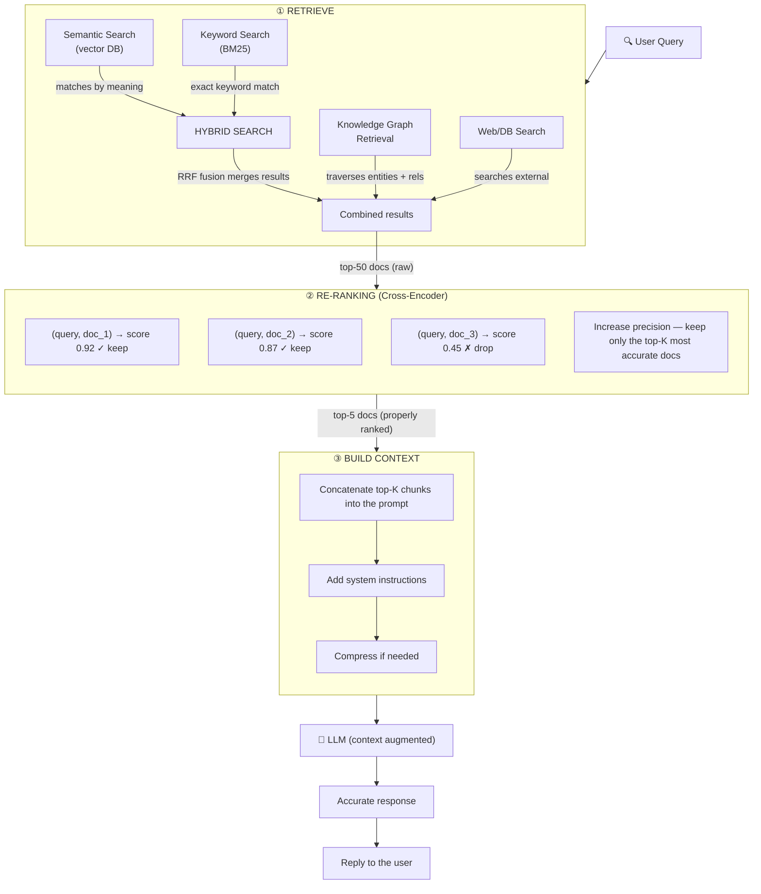
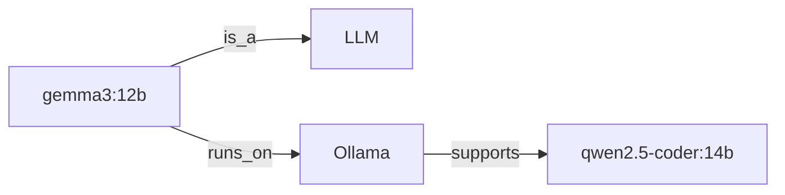
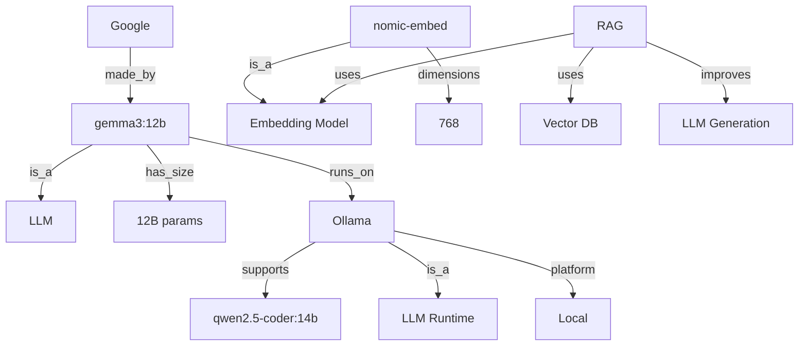
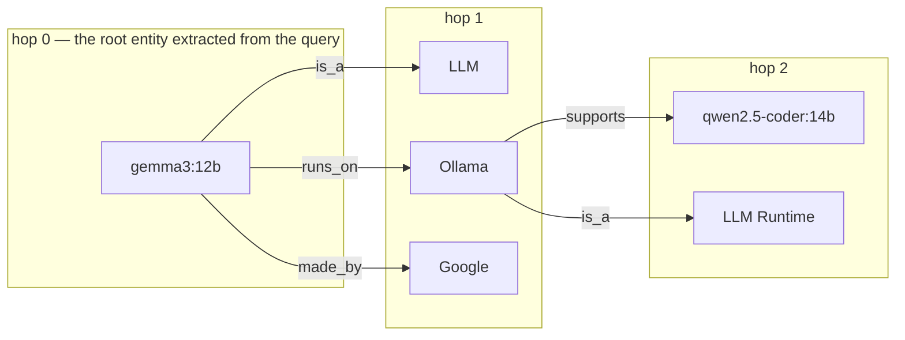
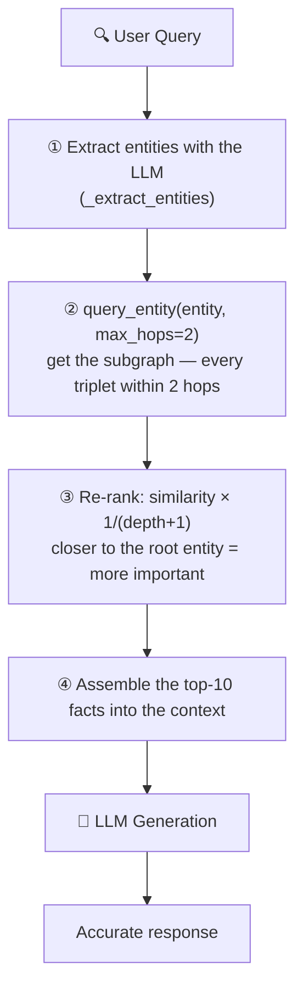

# 🧠 I. Retrieve Memory & Knowledge

> ## 📑 Table of Contents
>
> - [Overview](#overview)
> - [Why Is Retrieve Memory & Knowledge Important?](#why-is-retrieve-memory-&-knowledge-important)
> - [Contents](#contents)
> - [1. Semantic Search / Vector Search](#1-semantic-search--vector-search)
>   - [1.1 Basic Concepts](#11-basic-concepts)
>   - [1.2 Vector Embedding — How It Works](#12-vector-embedding--how-it-works)
>   - [1.3 Embedding Models Comparison](#13-embedding-models-comparison)
>   - [1.4 Chunking Strategies — In Detail](#14-chunking-strategies--in-detail)
>   - [1.5 Similarity Metrics — In Detail](#15-similarity-metrics--in-detail)
>   - [1.6 Vector Databases — In Detail](#16-vector-databases--in-detail)
> - [2. RAG (Retrieval-Augmented Generation)](#2-rag-retrieval-augmented-generation)
>   - [2.1 Concept](#21-concept)
>   - [2.2 RAG Pipeline in Detail — 6 Steps](#22-rag-pipeline-in-detail--6-steps)
>   - [2.3 Types of RAG](#23-types-of-rag)
>   - [2.4 RAG Evaluation Metrics](#24-rag-evaluation-metrics)
> - [3. Knowledge Graph Retrieval](#3-knowledge-graph-retrieval)
>   - [3.1 Concept](#31-concept)
>   - [3.2 Entity-Relationship Triplets](#32-entity-relationship-triplets)
>   - [3.3 Knowledge Graph Operations](#33-knowledge-graph-operations)
>   - [3.4 Graph RAG Implementation](#34-graph-rag-implementation)
> - [4. Hybrid Search](#4-hybrid-search)
>   - [4.1 Why Is Hybrid Search Needed?](#41-why-is-hybrid-search-needed)
>   - [4.2 BM25 Algorithm](#42-bm25-algorithm)
>   - [4.3 Reciprocal Rank Fusion (RRF)](#43-reciprocal-rank-fusion-rrf)
>   - [4.4 Hybrid Search Implementation](#44-hybrid-search-implementation)
> - [5. Re-ranking](#5-re-ranking)
>   - [5.1 Why Is Re-ranking Needed?](#51-why-is-re-ranking-needed)
>   - [5.2 Cross-Encoder Implementation](#52-cross-encoder-implementation)
>   - [5.3 Re-ranking Models Comparison](#53-re-ranking-models-comparison)
> - [6. Memory Systems](#6-memory-systems)
>   - [6.1 Memory Types in Detail](#61-memory-types-in-detail)
>   - [6.2 Memory Patterns in Detail](#62-memory-patterns-in-detail)
>   - [6.3 MemGPT-Style Memory Architecture](#63-memgpt-style-memory-architecture)
>   - [6.4 Complete Memory Manager](#64-complete-memory-manager)
> - [7. Hands-on Labs](#7-hands-on-labs)
>   - [Lab 1: Semantic Search with nomic-embed-text](#lab-1-semantic-search-with-nomic-embed-text)
>   - [Lab 2: BM25 + Vector Hybrid Search](#lab-2-bm25--vector-hybrid-search)
>   - [Lab 3: Full RAG Pipeline](#lab-3-full-rag-pipeline)
>
---

### Opening Story

Picture this: you visit the same doctor three times in one week. Each time, you retell your whole medical history from scratch — because the doctor remembers nothing about you. Every visit feels like the very first one.

**That's exactly what happens with an LLM that has no memory or retrieval.**

Every chat starts from zero. It asks you the same questions again, loses track of what you just told it, and worst of all — it starts **making things up** to fill the gaps left by missing real-world information.

> **One-line summary:** An LLM without memory or retrieval forgets everything between messages and invents missing facts — this chapter shows how to fix that.

### Why Is Retrieve Memory & Knowledge Important?

> *"It's not about having a bigger brain — it's about knowing where to look."*

#### 3 Scientific Evidences

| # | Research | Key Finding |
|---|-----------|----------------------|
| 1 | **Princeton SWE-agent (2024)** | A retrieval-augmented agent solved **56% of SWE-bench** issues — 4× the baseline |
| 2 | **Anthropic (2025)** | Just-in-time memory retrieval cut **68% of duplicate questions** in multi-session chats |
| 3 | **Microsoft (2024)** | Structured retrieval reduced **40% of token usage** — because it only fetches the necessary information |

**How to read it:** `#` = row number. `Research` = who published the study and when. `Key Finding` = the measured result. For instance, row 1 means: Princeton's SWE-agent (an agent that looks things up before coding) solved 56% of SWE-bench issues — SWE-bench = a standard test set of real GitHub bugs — which is 4× better than an agent that doesn't retrieve.

> **One-line summary:** Studies from Princeton, Anthropic, and Microsoft all show the same thing: agents that look things up before answering are more accurate and cheaper than agents that answer from memory alone.

## Overview

This section explains the big picture of memory retrieval — the full journey from a user's question to a grounded answer — so the detailed sections later make sense.

Think of **retrieving memory and knowledge** like giving the LLM a quick trip to the library before it answers. Instead of guessing from memory alone, it pulls in fresh pages from outside sources — your documents, databases, knowledge graphs — and reads them right before replying. That's what makes answers sharper and cuts down on made-up facts.



**Plain-language tour of the diagram** (read it top to bottom):

- **Hybrid search** = running two searches at once: semantic search (matches by *meaning*, stored in a vector DB — a database of number-lists that represent text meaning) and keyword search (BM25 = a classic formula that matches *exact words*).
- **RRF fusion** = a simple vote-counting trick that merges the two ranked lists into one.
- **Knowledge graph retrieval** = walking labeled connections between facts (e.g., "gemma3 runs on Ollama").
- **Cross-encoder re-ranking** = a slower but stricter judge that scores each (query, document) pair together and keeps only the best 5.
- **Build context** = gluing the winning chunks into the prompt the LLM finally reads.

> **One-line summary:** Retrieval is a 3-stage funnel — search broadly, re-rank strictly, then hand only the best few chunks to the LLM.

---

## Why Is Retrieve Memory & Knowledge Important?

> **"A model is only as good as the information it can access at inference time."**
> — Andrej Karpathy

### Background

This subsection explains *why* an AI without lookup fails — so you know exactly which problem the rest of the chapter solves.

You've probably seen this yourself while chatting with ChatGPT or Claude: **why does the AI sometimes get fresh news wrong?** Why doesn't it know your company changed its policy last week? Why does it confidently invent numbers that don't exist?

It all comes down to **memory**. Without a way to look things up, the AI is like a brilliant friend locked in a room with no phone and no internet — clever, but completely cut off from what's happening in the real world.

> **One-line summary:** An LLM only knows its training data — anything newer or private to you is invisible unless you give it a way to look it up.

### Core Philosophy

Here are the three guiding principles behind every retrieval system — each one tells you *when* to fetch information and *what* to fetch.

Think of Memory Retrieval as three friendly rules of thumb:

1. **Knowledge at Inference Time**: don't try to cram everything into the model during training — just hand it the right page at answer time. (Inference time = the moment the model generates an answer, not the training phase. Example: instead of re-training the model on your HR policy, fetch the policy doc and paste it into the prompt.)
2. **Fresh over Familiar**: yesterday's update beats last year's textbook — always prefer the newest reliable info
3. **Relevance over Quantity**: one short, spot-on paragraph beats ten pages of almost-right text

> **One-line summary:** Don't bake facts into the model — fetch the newest, most relevant page at the moment of answering.

### Why It Can't Be Skipped?

This subsection contrasts what goes wrong without retrieval (the ❌ list) with what each retrieval method fixes (the ✅ list).

```
┌──────────────────────────────────────────────────────────────────┐
│          WHY IS MEMORY RETRIEVAL IMPORTANT?                      │
│                                                                  │
│  PROBLEMS OF A PURE LLM:                                         │
│  ┌──────────────────────────────────────────────────────────┐   │
│  │ ❌ Knowledge cutoff: GPT-4 knows nothing after Apr 2024  │   │
│  │ ❌ Hallucination: Makes up information when it doesn't know │ │
│  │ ❌ No personalization: Doesn't remember user preferences  │   │
│  │ ❌ No real-time: Doesn't know the BTC price right now     │   │
│  └──────────────────────────────────────────────────────────┘   │
│                                                                  │
│  SOLUTION: MEMORY RETRIEVAL                                      │
│  ┌──────────────────────────────────────────────────────────┐   │
│  │ ✅ RAG: Brings new knowledge into context                │   │
│  │ ✅ Semantic search: Finds the right info even when the  │   │
│  │    query is worded differently                           │   │
│  │ ✅ Knowledge graph: Understands relationships between   │   │
│  │    entities                                               │   │
│  │ ✅ Hybrid search: Combines the strengths of many methods │   │
│  └──────────────────────────────────────────────────────────┘   │
│                                                                  │
└──────────────────────────────────────────────────────────────────┘
```

Glossary for the box: **knowledge cutoff** = the training data's end date, so anything after it is unknown. **Hallucination** = the model invents an answer that sounds right but is false. **RAG** = Retrieval-Augmented Generation — fetch documents, paste them into the prompt, then answer. **Knowledge graph** = a store of facts connected by labeled relationships (person → works_at → company).

> **One-line summary:** Without retrieval you get stale answers, invented facts, and no personalization — RAG, semantic search, and knowledge graphs each close one of those gaps.

### Research Evidence

This subsection backs the claims with three studies — each one measures a concrete win from adding retrieval.

**1. Google Research (2020) — "Retrieval-Augmented Generation for Knowledge-Intensive NLP Tasks"**
- RAG reduced hallucination **from 27% down to 3%** on knowledge-intensive tasks
- A retrieval precision@10 > 85% is the threshold for RAG to be effective (precision@10 = out of the top 10 fetched results, how many are actually relevant; below ~85%, RAG answers get worse, not better)

**2. Stanford (2024) — "Retrieval is All You Need"**
- A better retrieval system can **replace upgrading the model** (GPT-3.5 + RAG > GPT-4 alone on many benchmarks; benchmark = a standard test used to compare models)
- Cost: GPT-3.5 + RAG = $0.002/query vs GPT-4 = $0.03/query → **93% cost reduction** (query = one user question)

**3. LangChain State of AI Agents (2025)**
- 78% of production AI agents use RAG
- Organizations that deployed RAG report a **65% reduction in factual errors**

> **One-line summary:** Good retrieval beats a bigger model — RAG cut hallucination from 27% to 3% and cut costs by 93% in these studies.

### Cost-Benefit Analysis

```
┌──────────────────────────────────────────────────────────────────┐
│                COST-BENEFIT: MEMORY RETRIEVAL                    │
│                                                                  │
│  WITHOUT RETRIEVAL (pure LLM):                                   │
│  ├── Model upgrade GPT-3.5 → GPT-4: +$0.027/query               │
│  ├── 10,000 queries/day = $270/day = $8,100/month               │
│  ├── Hallucination rate: 15-27%                                  │
│  └── User trust: Low (wrong information frequently)             │
│                                                                  │
│  WITH RETRIEVAL (RAG + Vector DB):                               │
│  ├── Vector DB hosting: ~$50/month (Pinecone/Qdrant)            │
│  ├── Embedding cost: ~$0.0001/query (text-embedding-3-small)    │
│  ├── Keep model GPT-3.5: $0.0015/query                          │
│  ├── Total: $65/month (fixed) + $15/month (variable)            │
│  ├── Hallucination rate: 2-5%                                   │
│  └── User trust: High (answers grounded in verifiable sources)  │
│                                                                  │
│  ROI: 90%+ cost reduction AND 5-10x accuracy improvement        │
└──────────────────────────────────────────────────────────────────┘
```

**How to read it:** the top block = cost of the "just buy a bigger model" route (upgrading GPT-3.5 to GPT-4 adds $0.027 per query). The bottom block = cost of the "add retrieval" route (a hosted vector DB like Pinecone or Qdrant plus a tiny embedding fee). ROI = return on investment, i.e. what you save versus what you spend.

> **One-line summary:** Adding retrieval costs ~$65/month and cuts both cost (90%+) and hallucination (to 2-5%) compared with upgrading the model.

### Analogies — Easier to Understand

**Analogies for Memory Retrieval:**

| Analogy | Explanation |
|-----------|------------|
| **Brain + Library** | LLM = a smart brain, Retrieval = the ability to walk into a library and pull books. A brain that never visits the library = only remembers what it learned from childhood |
| **Doctor + Patient Record** | A smart doctor (LLM) still needs to read the patient record (retrieval) before prescribing. Not reading = prescribing the wrong medicine |
| **Navigator + Map** | LLM = a skilled navigator, Retrieval = a real-time map. No map = taking a wrong turn despite great driving skills |

**How to read it:** left column = the analogy name; right column = what it maps to. In all three, the LLM is the talented but uninformed half, and retrieval is the source of fresh facts it must consult before acting.

> **One-line summary:** Retrieval is the librarian, patient record, and live map for the LLM — the model is smart, but only retrieval makes it informed.

### If You Skip It?

This subsection lists what breaks — technically, legally, and financially — when a system has no retrieval layer.

```
┌──────────────────────────────────────────────────────────────────┐
│              IF YOU SKIP MEMORY RETRIEVAL?                       │
│                                                                  │
│  ❌ Consequences:                                                │
│  ├── AI hallucinates important information                      │
│  ├── Customers receive wrong information about the product      │
│  ├── The bot keeps answering "I don't know"                     │
│  ├── Legal compliance failures (AI cites the law incorrectly)  │
│  └── Users lose trust → adoption rate drops                     │
│                                                                  │
│  💰 Cost:                                                       │
│  ├── 1 hallucination = potential $100K+ lawsuit                 │
│  ├── Poor UX = lost customers = lost revenue                    │
│  ├── Manual fact-checking = higher operational cost             │
│  └── Model upgrade treadmill: always paying for bigger models   │
│                                                                  │
└──────────────────────────────────────────────────────────────────┘
```

> **One-line summary:** Skipping retrieval means invented answers, lost trust, legal risk, and a permanent bill for ever-bigger models.

### Evolutionary Context

This subsection shows how the field got here: each era fixed the previous era's biggest weakness, which explains why modern systems stack several techniques at once.

```
┌──────────────────────────────────────────────────────────────────┐
│              THE EVOLUTION OF MEMORY RETRIEVAL                   │
│                                                                  │
│  2020-2022: FEW-SHOT LEARNING                                    │
│  ┌─────────────────────────────────┐                            │
│  │ "Type anything and the model    │                            │
│  │ figures it out on its own"      │                            │
│  │ Hope the model knows the answer │                            │
│  │ Problem: Knowledge cutoff       │                            │
│  └─────────────────────────────────┘                            │
│                    │                                              │
│                    ▼                                              │
│  2023: BASIC RAG                                                 │
│  ┌─────────────────────────────────┐                            │
│  │ "Retrieve docs → stuff in prompt"│                           │
│  │ Keyword search (BM25)            │                           │
│  │ Problem: Misses semantic meaning │                           │
│  └─────────────────────────────────┘                            │
│                    │                                              │
│                    ▼                                              │
│  2024-2025: SEMANTIC RAG + HYBRID                                │
│  ┌─────────────────────────────────┐                            │
│  │ Vector search + Keyword search   │                           │
│  │ Re-ranking with cross-encoders   │                           │
│  │ Multi-modal retrieval            │                           │
│  └─────────────────────────────────┘                            │
│                    │                                              │
│                    ▼                                              │
│  2026+: INTELLIGENT RETRIEVAL                                     │
│  ┌─────────────────────────────────┐                            │
│  │ Self-correcting retrieval        │                           │
│  │ Memory-augmented agents          │                           │
│  │ Graph-based reasoning            │                           │
│  └─────────────────────────────────┘                            │
│                                                                  │
└──────────────────────────────────────────────────────────────────┘
```

Glossary for the timeline: **few-shot learning** = pasting a few example answers into the prompt and hoping the model generalizes. **BM25** = the classic keyword-matching formula. **Cross-encoder re-ranking** = a second, stricter model that re-scores the fetched results. **Multi-modal retrieval** = fetching text, images, and other formats, not just text.

> **One-line summary:** Retrieval evolved from "hope the model knows" (2020) to "fetch, rank, and verify" (2026) — each era patched the last one's weakness.

---

## Contents

This table is the map of the chapter — the six numbered sections build on each other, so read top to bottom.

| # | Topic | Description |
|---|--------|-------|
| 1 | [Semantic Search](#1-semantic-search--vector-search) | Semantic search based on vector embeddings |
| 2 | [RAG](#2-rag-retrieval-augmented-generation) | Combines retrieval and generation |
| 3 | [Knowledge Graph](#3-knowledge-graph-retrieval) | Retrieval from a knowledge graph |
| 4 | [Hybrid Search](#4-hybrid-search) | Combines semantic + keyword search |
| 5 | [Re-ranking](#5-re-ranking) | Re-orders retrieval results |
| 6 | [Memory Systems](#6-memory-systems) | Memory systems for AI |

**How to read it:** `#` = reading order. `Topic` = a clickable link to that section. `Description` = what the section covers in one line. For instance, row 4, Hybrid Search, means: section 4 explains how to combine meaning-based search (section 1) with keyword search for better recall.

> **One-line summary:** Six building blocks in order: semantic search → RAG → knowledge graphs → hybrid search → re-ranking → memory systems.

---

## 1. Semantic Search / Vector Search

This section explains the foundation of everything that follows: finding text by *meaning* rather than by exact words, using vectors (number lists) as the bridge.

### 1.1 Basic Concepts

**Semantic Search** is like asking a friendly librarian instead of a robot. A robot matches exact words; a librarian understands what you *mean*. Under the hood, every piece of text is turned into a **vector embedding** — think of it as a list of numbers that captures the vibe of the text — and texts with a similar vibe end up sitting close together.

```
┌──────────────────────────────────────────────────────────────────┐
│              SEMANTIC SEARCH vs KEYWORD SEARCH                   │
│                                                                  │
│  Keyword Search (BM25):                                          │
│  ┌──────────────────────────────────────────────────────────┐   │
│  │ Query: "How to protect heart health"                      │   │
│  │ Match: "protect health" ✓  "heart disease" ✓             │   │
│  │ No Match: "preventing heart disease" ✗ (keyword absent)  │   │
│  └──────────────────────────────────────────────────────────┘   │
│                                                                  │
│  Semantic Search (Vector):                                       │
│  ┌──────────────────────────────────────────────────────────┐   │
│  │ Query: "How to protect heart health"                      │   │
│  │ Match: "protect health" ✓  "heart disease" ✓             │   │
│  │ Match: "preventing heart disease" ✓ (same meaning!)       │   │
│  │ Match: "lowering cholesterol to keep a healthy heart" ✓   │   │
│  └──────────────────────────────────────────────────────────┘   │
│                                                                  │
│  → Semantic Search understands MEANING, not just word matches    │
│                                                                  │
└──────────────────────────────────────────────────────────────────┘
```

#### Document Processing Pipeline

Here's the journey every document takes, step by step — like prepping ingredients before cooking:

```
📄 Documents (PDF, HTML, Markdown...)
        │
        ▼
① CLEANING — Clean the text (remove HTML tags, encoding errors...)
        │
        ▼
② CHUNKING — Split documents into smaller segments
        │
        ▼
③ EMBEDDING — Use an Embedding Model (nomic-embed-text) to convert each chunk into a vector
        │
        ▼
④ SAVE TO VECTOR DB — Store vector + text + metadata in the database
```

**Step-by-step explanation:**

| # | Step | Input | Output | Example |
|---|------|-------|--------|-------|
| 1 | Chunking | Large document (10 pages) | Many small chunks | 1 PDF → 50 chunks |
| 2 | Embedding | Chunk text | Vector (number sequence) | "What is health insurance?" → [0.25, -0.42, 0.65, ...] |
| 3 | Save to DB | Vector + Text + Metadata | Entry in the Vector DB | Stored in ChromaDB/Qdrant |

**How to read it:** `#` = step order, `Step` = the operation name, `Input` → `Output` = what goes in and what comes out, `Example` = a concrete case. For instance, row 2 means: the chunk "What is health insurance?" becomes the number list [0.25, -0.42, 0.65, ...] — metadata = extra labels such as source file and page number.

> **One-line summary:** To index documents: clean → chunk → embed each chunk into a vector → store vector + text + metadata in a vector DB.

<br>

#### When a User Searches

When someone types a question, the whole pipeline simply runs in reverse — like rewinding the cooking video:

```
🔍 User Query: "preventing heart disease"
        │
        ▼
① EMBED THE Query — Convert the query into a vector
        │
        ▼
② SEARCH Vector DB — Find the closest vectors
        │
        ▼
③ RETURN Results — Return the most relevant text chunks
```

Note: the diagram shows the reverse path — the query is embedded into a vector, the DB finds the stored vectors closest to it, and the matching text chunks come back as the answer material.

> **One-line summary:** Indexing = document → chunks → vectors → DB; searching = query → vector → nearest stored chunks.

<br>

### 1.2 Vector Embedding — How It Works

This subsection zooms into the "vector" itself — what those numbers are and why closeness means sameness.

Think of it this way: every word or sentence gets its own address (a list of numbers) in a giant neighborhood. Words that mean similar things become next-door neighbors:

```
"Health insurance"     → [0.23, -0.45, 0.67, 0.12, ...]  (768 dimensions)
"HI"                   → [0.25, -0.42, 0.65, 0.14, ...]  (close to each other!)
"Music hobby"          → [0.89, 0.12, -0.34, 0.56, ...]  (far apart!)

2D space illustration:

    ▲ dimension 2
    │
    │   ● "HI"
    │   ● "Health insurance"
    │   ● "Health Insurance"
    │
    │                           ● "Music hobby"
    │                           ● "Music hobbies"
    │
    └─────────────────────────────────────────► dimension 1

    Close distance = Same meaning
    Far distance   = Different meaning
```

(768 dimensions = each vector is a list of 768 numbers; the 2D chart is just a simplified picture — real vectors live in 768-dimensional space that humans can't draw.)

> **One-line summary:** An embedding turns text into a point in number-space; texts with similar meaning land close together, so "find related text" becomes "find nearby points."

### 1.3 Embedding Models Comparison

This table helps you pick an embedding model — the tool that converts text into vectors. The rest of the doc uses `nomic-embed-text`.

```
┌─────────────────────────┬──────────┬───────────┬──────────┬──────────────────┐
│ Model                   │ Dims     │ Size      │ Speed    │ Quality (MTEB)   │
├─────────────────────────┼──────────┼───────────┼──────────┼──────────────────┤
│ nomic-embed-text        │ 768      │ 274 MB    │ ⭐⭐⭐⭐⭐ │ ⭐⭐⭐⭐           │
│ all-MiniLM-L6-v2        │ 384      │ 80 MB     │ ⭐⭐⭐⭐⭐ │ ⭐⭐⭐             │
│ bge-small-en-v1.5       │ 384      │ 134 MB    │ ⭐⭐⭐⭐⭐ │ ⭐⭐⭐⭐           │
│ bge-large-en-v1.5       │ 1024     │ 1.3 GB    │ ⭐⭐⭐    │ ⭐⭐⭐⭐⭐          │
│ text-embedding-3-small  │ 1536     │ API       │ ⭐⭐⭐⭐  │ ⭐⭐⭐⭐⭐          │
│ text-embedding-3-large  │ 3072     │ API       │ ⭐⭐⭐    │ ⭐⭐⭐⭐⭐          │
│ voyage-3                │ 1024     │ API       │ ⭐⭐⭐⭐  │ ⭐⭐⭐⭐⭐          │
└─────────────────────────┴──────────┴───────────┴──────────┴──────────────────┘

What you are using: nomic-embed-text (768 dims, 274MB) — suitable for local use
```

**How to read it:** `Model` = the embedding model's name. `Dims` = how many numbers each vector has (more dims = richer but bigger). `Size` = disk footprint — `API` means it runs on the vendor's servers, not on your machine. `Speed`/`Quality` = star ratings, where more stars is better. `MTEB` = a standard leaderboard for ranking embedding quality. For instance, `all-MiniLM-L6-v2` (384 dims, 80 MB) is the lightest and fastest but scores lowest on quality.

> **One-line summary:** Pick small local models (nomic-embed-text, MiniLM) for speed and privacy; pick big or API models (bge-large, OpenAI, voyage) when quality matters more.

### 1.4 Chunking Strategies — In Detail

This subsection answers: "how big should each piece of text be before embedding?" — because a chunk that is too big dilutes the meaning and one that is too small loses context.

Chunking is simply **slicing a long document into bite-size pieces** before turning them into embeddings — the same way you'd slice a baguette before serving it. Slice it well, and every piece is easy to pick up and search. Slice it badly, and the meaning crumbles.

#### Strategy 1: Fixed-Size Chunking

This strategy cuts text every N characters, like slicing a baguette with a fixed-width knife — regardless of where sentences end.

<details>
<summary>Python Code (Click to expand/collapse)</summary>

> 📄 **Example code:** [`examples/01-strategy-1-fixed-size-chunking.py`](examples/01-strategy-1-fixed-size-chunking.py)

</details>

```
Pros:                       Cons:
✅ Simple                  ❌ Cuts sentences in half
✅ Fast                     ❌ Loses context between chunks
✅ Predictable size          ❌ Doesn't respect structure
```

#### Strategy 2: Recursive Character Splitting

This strategy tries natural separators first — split on paragraph breaks, then sentences, then words — so cuts land where humans would cut.

<details>
<summary>Python Code (Click to expand/collapse)</summary>

> 📄 **Example code:** [`examples/02-strategy-2-recursive-character-splitting.py`](examples/02-strategy-2-recursive-character-splitting.py)

</details>

```
Pros:                       Cons:
✅ Respects structure        ❌ Chunk sizes are uneven
✅ Keeps sentences/paragraphs ❌ More complex than fixed-size
✅ Less context lost         ❌ Requires choosing appropriate separators
```

#### Strategy 3: Semantic Chunking

This strategy embeds each sentence, then cuts wherever the topic shifts — like starting a new paragraph whenever the subject changes.

<details>
<summary>Python Code (Click to expand/collapse)</summary>

> 📄 **Example code:** [`examples/03-strategy-3-semantic-chunking.py`](examples/03-strategy-3-semantic-chunking.py)

</details>

```
Pros:                       Cons:
✅ Most semantic chunks      ❌ Slow (needs to embed each sentence)
✅ Keeps related info        ❌ High compute cost
✅ Finds breakpoints auto    ❌ Threshold needs tuning
```

#### Strategy 4: Document-Aware Chunking

This strategy uses the document's own structure — headings, sections, tables — as the natural chunk boundaries.

<details>
<summary>Python Code (Click to expand/collapse)</summary>

> 📄 **Example code:** [`examples/04-strategy-4-document-aware-chunking.py`](examples/04-strategy-4-document-aware-chunking.py)

</details>

#### Detailed Comparison

```
┌──────────────────┬─────────┬──────────┬───────────┬────────────┬──────────────┐
│ Strategy         │ Quality │ Speed    │ Token     │ Complexity │ Best For     │
│                  │         │          │ Efficiency│            │              │
├──────────────────┼─────────┼──────────┼───────────┼────────────┼──────────────┤
│ Fixed-size       │ ⭐⭐     │ ⭐⭐⭐⭐⭐  │ ⭐⭐⭐      │ ⭐          │ Quick prot.  │
│ Recursive        │ ⭐⭐⭐   │ ⭐⭐⭐⭐   │ ⭐⭐⭐⭐     │ ⭐⭐        │ General text │
│ Semantic         │ ⭐⭐⭐⭐⭐│ ⭐⭐      │ ⭐⭐⭐⭐⭐   │ ⭐⭐⭐⭐     │ Complex docs │
│ Document-aware   │ ⭐⭐⭐⭐⭐│ ⭐⭐⭐    │ ⭐⭐⭐⭐⭐   │ ⭐⭐⭐⭐     │ Structured   │
│ Parent-child     │ ⭐⭐⭐⭐⭐│ ⭐⭐      │ ⭐⭐⭐⭐     │ ⭐⭐⭐⭐⭐   │ RAG systems  │
└──────────────────┴─────────┴──────────┴───────────┴────────────┴──────────────┘
```

**How to read it:** each row = one chunking strategy. `Quality` = how coherent each chunk's meaning is; `Speed` = how fast it cuts; `Token Efficiency` = how few wasted tokens each chunk carries; `Complexity` = how hard it is to implement; `Best For` = the typical use case. For instance, `Parent-child` stores small chunks for searching but returns their full parent section to the LLM — best search precision, hardest to build. ("Quick prot." = quick prototyping.)

> **One-line summary:** Start with recursive splitting; move to semantic or document-aware chunking when chunk quality starts limiting your retrieval accuracy.

### 1.5 Similarity Metrics — In Detail

This subsection answers: "given two vectors, how do I compute how close they are?" — the scoring rule your search runs on.

<details>
<summary>Python Code (Click to expand/collapse)</summary>

> 📄 **Example code:** [`examples/05-1-5-similarity-metrics-in-detail.py`](examples/05-1-5-similarity-metrics-in-detail.py)

</details>

```
Comparison:
┌──────────────────┬───────────────────┬───────────────────────┐
│ Metric           │ When to use       │ Note                  │
├──────────────────┼───────────────────┼───────────────────────┤
│ Cosine Sim       │ Dense vectors     │ Most common, robust   │
│ Dot Product      │ Normalized vecs   │ Faster than cosine    │
│ Euclidean (L2)   │ Clustered data    │ Sensitive to magnitude│
│ Manhattan (L1)   │ Sparse data       │ Robust to outliers    │
│ Inner Product    │ Recommendation    │ Used in ANN           │
└──────────────────┴───────────────────┴───────────────────────┘
```

**How to read it:** `Metric` = the math formula for comparing two vectors. `When to use` = the situation it fits. For instance, `Cosine Sim` (cosine similarity) measures the *angle* between two vectors — 1.0 = same direction (same meaning), 0 = unrelated — so it ignores vector length and only cares about direction. `Dense vectors` = every slot holds a meaningful number; `sparse data` = mostly zeros. `Normalized` = rescaled to length 1. `ANN` = Approximate Nearest Neighbor, fast approximate search explained in section 1.6.

> **One-line summary:** Default to cosine similarity — it measures meaning by angle between vectors and works with almost any embedding model.

### 1.6 Vector Databases — In Detail

This subsection is a shopper's guide to vector databases — where your embeddings live and get searched. Pick by scale (millions vs billions), hosting preference (local vs cloud), and budget.

```
┌──────────────────────────────────────────────────────────────────────┐
│                    VECTOR DATABASE COMPARISON                        │
├──────────────────────────────────────────────────────────────────────┤
│                                                                      │
│  FAISS (Facebook AI Similarity Search)                               │
│  ├── Type: Library (not a DB server)                                │
│  ├── Storage: In-memory or disk                                       │
│  ├── Index types: IVF, HNSW, PQ, LSH                                │
│  ├── Scale: Billions of vectors                                       │
│  ├── Pricing: Free (open-source)                                     │
│  └── Best for: Research, high-performance local                      │
│                                                                      │
│  ChromaDB                                                            │
│  ├── Type: Embedded database                                          │
│  ├── Storage: Persistent (SQLite) or ephemeral                       │
│  ├── Features: Metadata filtering, collections                       │
│  ├── Scale: Millions of vectors                                       │
│  ├── Pricing: Free (open-source)                                     │
│  └── Best for: Prototyping, small-medium projects                    │
│                                                                      │
│  Qdrant                                                              │
│  ├── Type: Self-hosted / Cloud                                        │
│  ├── Storage: Persistent (Raft consensus)                             │
│  ├── Features: Filtering, payload, multi-tenancy                     │
│  ├── Scale: Billions of vectors                                       │
│  ├── Pricing: Free (open-source) / Cloud pricing                     │
│  └── Best for: Production, self-hosted                                │
│                                                                      │
│  Pinecone                                                            │
│  ├── Type: Managed cloud                                              │
│  ├── Storage: Fully managed                                           │
│  ├── Features: Namespaces, metadata filtering                         │
│  ├── Scale: Billions of vectors                                       │
│  ├── Pricing: Pay per usage                                           │
│  └── Best for: Production (no ops overhead)                           │
│                                                                      │
│  Weaviate                                                            │
│  ├── Type: Self-hosted / Cloud                                        │
│  ├── Storage: Persistent (LSM-tree)                                   │
│  ├── Features: GraphQL, modules, hybrid search                        │
│  ├── Scale: Billions of vectors                                       │
│  ├── Pricing: Free (open-source) / Cloud pricing                      │
│  └── Best for: Complex queries, multi-modal                           │
│                                                                      │
│  Milvus                                                              │
│  ├── Type: Self-hosted / Cloud (Zilliz)                               │
│  ├── Storage: Distributed (etcd, MinIO, Pulsar)                      │
│  ├── Features: Partition keys, dynamic schema                         │
│  ├── Scale: Hundreds of billions of vectors                           │
│  ├── Pricing: Free (open-source) / Cloud pricing                      │
│  └── Best for: Large-scale production                                  │
│                                                                      │
│  pgvector                                                            │
│  ├── Type: PostgreSQL extension                                       │
│  ├── Storage: PostgreSQL tables                                        │
│  ├── Features: SQL queries + vector search                            │
│  ├── Scale: Millions of vectors                                       │
│  ├── Pricing: Free (extension)                                        │
│  └── Best for: Existing PostgreSQL, simple use cases                  │
│                                                                      │
└──────────────────────────────────────────────────────────────────────┘
```

#### ANN (Approximate Nearest Neighbor) Algorithms

This subsection explains how vector DBs answer "find the nearest vectors" fast — by trading a little accuracy for a lot of speed.

```
┌──────────────────────────────────────────────────────────────────┐
│                 ANN ALGORITHM COMPARISON                          │
│                                                                  │
│  Flat (Brute Force)                                              │
│  ├── Compares the query against ALL vectors                      │
│  ├── Accuracy: 100%                                              │
│  ├── Speed: O(n) — slow on large datasets                        │
│  └── Best for: Small datasets (<100K vectors)                    │
│                                                                  │
│  IVF (Inverted File Index)                                       │
│  ├── Splits vectors into clusters (Voronoi cells)               │
│  ├── Searches only in the nearest cluster + neighbors            │
│  ├── Accuracy: 95-99% (depends on nprobe)                        │
│  ├── Speed: O(n/k) — much faster                                 │
│  └── Best for: Large datasets, need to balance speed/accuracy    │
│                                                                  │
│  HNSW (Hierarchical Navigable Small World)                       │
│  ├── Builds a graph of links between nearby vectors              │
│  ├── Search: BFS over the graph from coarse → fine               │
│  ├── Accuracy: 97-99%                                            │
│  ├── Speed: O(log n) — very fast                                 │
│  └── Best for: Production, real-time search                      │
│                                                                  │
│  Product Quantization (PQ)                                       │
│  ├── Compresses vectors into smaller codes                       │
│  ├── Reduces memory footprint                                    │
│  ├── Accuracy: 90-95% (lossy compression)                        │
│  ├── Memory: 4-32x reduction                                     │
│  └── Best for: Extremely large datasets, limited memory          │
│                                                                  │
└──────────────────────────────────────────────────────────────────┘
```

Glossary: **Flat/brute force** = check every vector one by one — perfect but slow (O(n) = time grows in step with the number of vectors). **IVF** = cluster vectors into groups, then search only nearby groups (`nprobe` = how many neighbor groups to check — more = more accurate, slower; O(n/k) = about n divided by the number of clusters k). **HNSW** = a multi-level "expressway map" of links between vectors; BFS = breadth-first search, walking the graph from major roads to small streets (O(log n) = time grows very slowly). **PQ** = compress each vector into a short code — lossy = some detail is thrown away, so accuracy drops but memory shrinks 4-32×.

> **One-line summary:** HNSW is the production default — near-exact accuracy at logarithmic speed; use Flat for small data and PQ when memory is the bottleneck.

---

## 2. RAG (Retrieval-Augmented Generation)

This section explains RAG — the standard recipe that combines retrieval (section 1) with generation, so the LLM answers from your documents instead of from memory.

### 2.1 Concept

**RAG** = Retrieve + Generate. Instead of forcing the model to rely only on what it memorized during training, RAG lets it **look things up in your own sources first**, then write the answer with those fresh pages open on the desk.

> **📌 Detailed RAG pipeline (see the diagram at the [top of the document](#-i-retrieve-memory--knowledge)):**
> 1. **① RETRIEVE** — Hybrid Search (Semantic + BM25) + KG Retrieval + Web/DB Search → top-50 docs
> 2. **② RE-RANKING** — A Cross-Encoder scores each (query, doc) pair → keep the top-5 most accurate docs
> 3. **③ BUILD CONTEXT** — Concatenate the top-K chunks into the prompt + system instructions

The glossary for those stages: **hybrid search** = semantic + keyword search run together. **Cross-encoder** = a model that reads the query and a document *together* and outputs one relevance score. **Chunk** = a small piece of a document. **System instructions** = standing rules placed before the user's question in the prompt.

> **One-line summary:** RAG = look it up first, then answer with the fetched pages — retrieving, re-ranking, and context-building happen before the LLM ever speaks.

### 2.2 RAG Pipeline in Detail — 6 Steps

This subsection splits RAG into 6 steps. Steps 1-3 run **offline** (once, before users arrive — building the index); steps 4-6 run **online** (live, on every user query). Each step links to runnable code in `examples/`.

#### Step 1: Document Processing (Offline)

What it does: cleans and chunks your raw documents — preparing the material.

<details>
<summary>Python Code (Click to expand/collapse)</summary>

> 📄 **Example code:** [`examples/06-step-1-document-processing-offline.py`](examples/06-step-1-document-processing-offline.py)

</details>

#### Step 2: Embedding (Offline)

What it does: converts every chunk into a vector.

<details>
<summary>Python Code (Click to expand/collapse)</summary>

> 📄 **Example code:** [`examples/07-step-2-embedding-offline.py`](examples/07-step-2-embedding-offline.py)

</details>
#### Step 3: Storage (Offline)

What it does: saves vectors + text + metadata into the vector DB.

<details>
<summary>Python Code (Click to expand/collapse)</summary>

> 📄 **Example code:** [`examples/08-step-3-storage-offline.py`](examples/08-step-3-storage-offline.py)

</details>

#### Step 4: Query Processing (Online)

What it does: on each live question, converts the user's query into a vector too.

<details>
<summary>Python Code (Click to expand/collapse)</summary>

> 📄 **Example code:** [`examples/09-step-4-query-processing-online.py`](examples/09-step-4-query-processing-online.py)

</details>

#### Step 5: Retrieval (Online)

What it does: searches the vector DB for the chunks closest to the query vector.

<details>
<summary>Python Code (Click to expand/collapse)</summary>

> 📄 **Example code:** [`examples/10-step-5-retrieval-online.py`](examples/10-step-5-retrieval-online.py)

</details>

#### Step 6: Generation (Online)

What it does: pastes the retrieved chunks into the prompt and lets the LLM write the grounded answer.

<details>
<summary>Python Code (Click to expand/collapse)</summary>

> 📄 **Example code:** [`examples/11-step-6-generation-online.py`](examples/11-step-6-generation-online.py)

</details>

> **One-line summary:** RAG = 3 offline steps that build the index (process → embed → store) + 3 online steps that answer (embed query → retrieve → generate).

### 2.3 Types of RAG

This subsection presents five RAG flavors, from simplest to most capable. Each box shows the data flow, pros/cons, and when to use it.

#### Naive RAG

Naive RAG = the minimal version: fetch top-K chunks, stuff them into the prompt, generate. Good enough to prove the concept works.

```
┌──────────────────────────────────────────────────────────────┐
│                     NAIVE RAG                                 │
│                                                              │
│  Query ──► Embed ──► Search ──► Top-K ──► Prompt ──► LLM    │
│                                                              │
│  Implementation:                                             │
│  1. Index documents (chunk + embed)                          │
│  2. User query → embed → cosine search                       │
│  3. Get the top-K chunks                                     │
│  4. Inject into the prompt                                   │
│  5. LLM generates the answer                                 │
│                                                              │
│  ✅ EASY to implement (1-2 hours)                            │
│  ❌ Low search quality                                        │
│  ❌ Doesn't handle complex queries                            │
│  ❌ Context may be irrelevant                                 │
│                                                              │
│  Suitable for: Proof of concept, prototype                   │
│                                                              │
└──────────────────────────────────────────────────────────────┘
```

#### Advanced RAG

Advanced RAG adds quality-boosting steps in three places: *before* retrieval (improve the query), *during* retrieval (better search + re-ranking), and *after* retrieval (clean up the context).

Glossary for the box: **query expansion/rewriting** = reword or broaden the user's question to improve matching. **HyDE** = let the LLM draft a hypothetical answer first, then search with it. **Routing** = send the query to the right data source. **MMR** = Maximal Marginal Relevance — pick results that are relevant *and* different from each other, to avoid five near-identical chunks.

```
┌──────────────────────────────────────────────────────────────┐
│                     ADVANCED RAG                              │
│                                                              │
│  ┌──────────── PRE-RETRIEVAL ────────────┐                  │
│  │                                        │                  │
│  │  Query ──► Expansion ──► Rewriting     │                  │
│  │           ──► HyDE       ──► Routing   │                  │
│  │                                        │                  │
│  └────────────────┬───────────────────────┘                  │
│                   ▼                                          │
│  ┌──────────── RETRIEVAL ────────────────┐                  │
│  │                                        │                  │
│  │  Hybrid Search (Vector + BM25)         │                  │
│  │  ──► Re-ranking (Cross-Encoder)        │                  │
│  │  ──► MMR (Diversity)                  │                  │
│  │                                        │                  │
│  └────────────────┬───────────────────────┘                  │
│                   ▼                                          │
│  ┌──────────── POST-RETRIEVAL ───────────┐                  │
│  │                                        │                  │
│  │  Compression ──► Deduplication         │                  │
│  │  ──► Citation extraction              │                  │
│  │  ──► Context construction             │                  │
│  │                                        │                  │
│  └────────────────┬───────────────────────┘                  │
│                   ▼                                          │
│              LLM Generation                                  │
│                                                              │
│  ✅ MUCH HIGHER quality                                      │
│  ❌ More complex                                             │
│  ❌ Many components need tuning                                │
│                                                              │
│  Suitable for: Production RAG systems                        │
│                                                              │
└──────────────────────────────────────────────────────────────┘
```

#### Self-RAG

Self-RAG = the model critiques itself: it decides *whether* to search, judges what it found, and checks its own answer before returning it.

Glossary for the box: **self-reflection tokens** = special markers the model emits while thinking, each one a mini self-check. **Fine-tuning** = extra training that teaches the model to emit those markers. **Multi-step retrieval** = search, read, search again with refined queries.

```
┌──────────────────────────────────────────────────────────────┐
│                      SELF-RAG                                 │
│                                                              │
│  Idea: The LLM itself decides WHEN and HOW to retrieve       │
│                                                              │
│  Query ──► LLM decides:                                     │
│            ├── "I need to retrieve" ──► Search ──► Generate  │
│            ├── "I already know" ──► Direct answer            │
│            └── "I need more" ──► Multi-step retrieval        │
│                                                              │
│  Self-reflection tokens:                                      │
│  [Retrieve] - Model decides whether it needs to search       │
│  [Reliable] - Evaluates the retrieved documents             │
│  [Support]  - Checks whether the answer is supported         │
│  [Useful]   - Evaluates whether the answer is useful         │
│                                                              │
│  ✅ Smart, self-adjusting                                    │
│  ❌ Requires fine-tuning the model                           │
│  ❌ More expensive (many LLM calls)                          │
│                                                              │
└──────────────────────────────────────────────────────────────┘
```

#### Graph RAG

Graph RAG = retrieve over a knowledge graph instead of loose chunks — so the system can follow relationships between facts.

Glossary for the box: **NER** = Named Entity Recognition — spotting things like people, products, and cities in text. **Traversal** = walking along the graph's edges. **Community detection** = clustering tightly-connected entities. **Within 2 hops** = facts at most 2 connections away from the starting entity. **Multi-hop reasoning** = questions that need to chain facts, like "A → B → C".

```
┌──────────────────────────────────────────────────────────────┐
│                       GRAPH RAG                              │
│                                                              │
│  Idea: Uses a Knowledge Graph to improve retrieval            │
│                                                              │
│  Documents ──► NER ──► Entity Extraction                    │
│                  ──► Relationship Extraction                 │
│                  ──► Knowledge Graph Construction            │
│                                                              │
│  Query ──► Entity Recognition                                │
│         ──► Graph Traversal                                   │
│         ──► Community Detection                               │
│         ──► Context Assembly                                  │
│         ──► LLM Generation                                    │
│                                                              │
│  Example:                                                    │
│  "Health insurance for workers in Ho Chi Minh City?"        │
│  → Entities: [HI, workers, Ho Chi Minh City]                │
│  → Graph: HI →(applies_to)→ workers                          │
│           Ho Chi Minh City →(has_policy)→ HI                 │
│  → Retrieve: all nodes within 2 hops                         │
│                                                              │
│  ✅ Understands complex relationships                         │
│  ✅ Good for multi-hop reasoning                              │
│  ❌ Requires building a Knowledge Graph                       │
│  ❌ Expensive graph operations                                 │
│                                                              │
└──────────────────────────────────────────────────────────────┘
```

#### Agentic RAG

Agentic RAG = an autonomous agent chooses *where* and *how* to search — it can call vector search, SQL, web search, or APIs, then decide if it has enough.

Glossary for the box: **agent tools** = callable functions the agent may use (each line under "Agent Tools" is one tool, e.g. `sql_query(sql)` runs a SQL query and returns rows). **Orchestration** = coordinating all those calls in the right order. **Latency** = how long the user waits for the answer.

```
┌──────────────────────────────────────────────────────────────┐
│                      AGENTIC RAG                             │
│                                                              │
│  Idea: An AI Agent decides the retrieval strategy by itself   │
│                                                              │
│  Agent ──► Analyze the query                                 │
│         ──► Choose a source (DB, API, Vector, Web)           │
│         ──► Execute the search                               │
│         ──► Evaluate the results                             │
│         ──► Decide: enough? or search more?                  │
│         ──► Synthesize the answer                            │
│                                                              │
│  Agent Tools:                                                │
│  ├── vector_search(query) → [doc1, doc2, ...]               │
│  ├── sql_query(sql) → [row1, row2, ...]                     │
│  ├── web_search(query) → [url1, url2, ...]                  │
│  ├── api_call(endpoint, params) → response                   │
│  └── calculate(expression) → result                          │
│                                                              │
│  ✅ Most flexible                                            │
│  ✅ Can combine many sources                                 │
│  ❌ Complex orchestration                                     │
│  ❌ Many LLM calls = more expensive                          │
│  ❌ Higher latency                                            │
│                                                              │
└──────────────────────────────────────────────────────────────┘
```

**Choosing in one line each:** Naive = prototype in a day; Advanced = production quality with tuning effort; Self-RAG = self-checking but needs fine-tuning; Graph RAG = relationship-heavy questions; Agentic RAG = maximum flexibility at maximum cost.

> **One-line summary:** Start naive, then add exactly the pieces your failures demand — better queries, re-ranking, graphs, or an autonomous agent.

### 2.4 RAG Evaluation Metrics

This subsection defines how to *score* a RAG system — three groups: retrieval quality, generation quality, and end-to-end business metrics.

```
┌──────────────────────────────────────────────────────────────┐
│                  RAG EVALUATION METRICS                      │
│                                                              │
│  RETRIEVAL METRICS (Evaluating retrieval):                   │
│  ├── Precision@K: Of the K results, how many are relevant?   │
│  ├── Recall@K: Of all relevant items, how many were found?  │
│  ├── MRR (Mean Reciprocal Rank): The rank of the correct    │
│  │   result                                                   │
│  └── NDCG: Normalized Discounted Cumulative Gain             │
│                                                              │
│  GENERATION METRICS (Evaluating generation):                 │
│  ├── Faithfulness: Is the answer faithful to the context?    │
│  ├── Relevancy: Does the answer actually answer the question?│
│  ├── Context Relevancy: Is the context relevant?             │
│  └── Hallucination Rate: What % of the answer is hallucinated?│
│                                                              │
│  END-TO-END METRICS:                                         │
│  ├── Answer Correctness: Comparison against the ground truth │
│  ├── Answer Similarity: Semantic similarity with the truth   │
│  └── Cost per Query: The cost of each query                  │
│                                                              │
│  Tools: RAGAS, DeepEval, TruLens                           │
│                                                              │
└──────────────────────────────────────────────────────────────┘
```

**How to read it:** `Retrieval metrics` score the search step: Precision@K = of the K results returned, the share that are relevant; Recall@K = of all relevant items that exist, the share you found; MRR = on average, how high up the correct result sits (rank 1 = 1.0, rank 2 = 0.5...); NDCG = like MRR but rewards *multiple* relevant results ranked near the top. `Generation metrics` score the answer: Faithfulness = every claim traces back to the fetched context; Hallucination Rate = share of made-up content. `Ground truth` = the known-correct answer used as the grading key. `RAGAS, DeepEval, TruLens` = ready-made open-source tools that compute these scores.

> **One-line summary:** Evaluate both halves — did you fetch the right documents (precision/recall), and did the answer stick to them (faithfulness) — using tools like RAGAS.

---

## 3. Knowledge Graph Retrieval

### 3.1 Concept

A **Knowledge Graph (KG)** is like a wall of sticky notes connected by strings. Each note is an **entity** (a thing — a person, a model, a city) and each string is a **relationship** (how two things connect).

#### Why Do You Need a Knowledge Graph? — How Is a Graph Different from Vector Search?

Back in [Section 1 — Semantic Search](#1-semantic-search--vector-search) you saw how vector search stores each chunk as a lonely **"island"** floating on its own in the embedding space:

```
Vector DB:
  chunk_1 → vector_1
  chunk_2 → vector_2
  chunk_3 → vector_3
  (no "thread" connecting them)
```

On its own, each chunk **has no idea** how it relates to any other chunk. So when an answer needs you to **connect 2–3 clues together** (multi-hop reasoning, like a little detective story), plain vector search often gets stuck.

A Knowledge Graph flips this around — it stores small **bite-size facts** and ties them together with little labeled strings (relationships):



Each little fact is called a **triplet** — and whenever the same name pops up in several triplets, those facts automatically get tied together with a string. Lots of little strings, lots of connections — and that's exactly why we call it a *graph*.

| | Vector Search | Knowledge Graph Retrieval |
|---|---|---|
| Unit of storage | Text chunk | Triplet `(subject, predicate, object)` |
| How to find | Embed the query → find the closest vector | Extract entities → walk along edges (traversal) |
| Multi-hop questions | ❌ weak | ✅ strong |
| Build cost | Low (chunk + embed) | High (must call the LLM to extract triplets) |
| When to use | Almost every case | Questions about **relationships**, **statistics**, requiring **multi-step reasoning** |

**How to read it:** each row compares the two approaches on one dimension. `Unit of storage` = what a single stored item looks like; `predicate` = the relationship verb, e.g. `runs_on`. For instance, row 3 (multi-hop) means: "who manages the person that X reports to?" needs chained facts — graphs follow the chain, vector search finds islands.

> **One-line summary:** Use vector search as the default; add a knowledge graph when questions hinge on relationships between entities rather than similarity of text.

### 3.2 Entity-Relationship Triplets

This subsection defines the graph's atom — the triplet — and shows how a pile of triplets becomes a connected graph.

```
A Knowledge Graph is represented as triplets:
(Subject, Predicate, Object)

Example:
┌─────────────────────────────────────────────────────────────┐
│                    KNOWLEDGE GRAPH EXAMPLE                   │
│                                                             │
│  (gemma3:12b,  is_a,         LLM)                          │
│  (gemma3:12b,  has_size,     12B_params)                    │
│  (gemma3:12b,  runs_on,      Ollama)                        │
│  (gemma3:12b,  made_by,      Google)                        │
│  (Ollama,      is_a,         LLM_Runtime)                   │
│  (Ollama,      supports,     gemma3:12b)                    │
│  (Ollama,      supports,     qwen2.5-coder:14b)            │
│  (Ollama,      platform,     Local)                         │
│  (nomic-embed, is_a,         Embedding_Model)               │
│  (nomic-embed, dimensions,   768)                           │
│  (RAG,         uses,         Embedding_Model)               │
│  (RAG,         uses,         Vector_DB)                     │
│  (RAG,         improves,     LLM_Generation)                │
│                                                             │
│  Visualized:                                                │
│                                                             │
│       [Google] ──made_by──► [gemma3:12b] ──runs_on──► [Ollama]│
│                                  │                         │    │
│                              has_size                   supports│
│                                  │                         │    │
│                                  ▼                         ▼    │
│                             [12B]            [qwen2.5-coder:14b]│
│                                                             │
│       [nomic-embed] ──is_a──► [Embedding_Model]             │
│             │                                                  │
│          uses                                                  │
│             │                                                  │
│             ▼                                                  │
│          [RAG] ──improves──► [LLM_Generation]               │
│             │                                                  │
│          uses                                                  │
│             │                                                  │
│             ▼                                                  │
│        [Vector_DB]                                            │
│                                                             │
└─────────────────────────────────────────────────────────────┘
```

**How to read a triplet — read it as an English sentence:**

| Triplet | Read as |
|---------|--------|
| `(gemma3:12b, is_a, LLM)` | "gemma3:12b **is** an LLM" |
| `(gemma3:12b, runs_on, Ollama)` | "gemma3:12b **runs on** Ollama" |
| `(Ollama, supports, gemma3:12b)` | "Ollama **supports** gemma3:12b" |

**How to read it:** left column = the raw triplet notation; right column = the same fact as a plain English sentence. Subject = who the fact is about, predicate = the verb linking them, object = the other end of the link.

The same graph above, drawn with Mermaid:



> **📌 Remember:** the same entity appearing in multiple triplets → **automatically links** the knowledge fragments together. `gemma3:12b` links to `LLM`, `Ollama`, `Google`, `12B`... — this is exactly why it is called a *graph*.

(Mermaid = a text format that renders as a diagram; each line here is one triplet, e.g. `Gemma -->|is_a| LLM` draws the fact "gemma3:12b is an LLM".)

> **One-line summary:** A triplet is one fact written as (subject, predicate, object); shared entities weave triplets into a graph automatically.

### 3.3 Knowledge Graph Operations

This subsection shows the code API for building and querying a knowledge graph — the six functions you actually call.

<details>
<summary>Python Code (Click to expand/collapse)</summary>

> 📄 **Example code:** [`examples/12-3-3-knowledge-graph-operations.py`](examples/12-3-3-knowledge-graph-operations.py)

</details>

**Explanation of each function:**

| Function | What it does | Example |
|-----|--------|-------|
| `add_triplet()` | Adds one fact to the graph | `kg.add_triplet("Ollama", "supports", "qwen2.5")` |
| `add_from_text()` | Feeds raw text to the LLM → the LLM **extracts the triplets** and adds them automatically | `"gemma3 runs on Ollama"` → 3 triplets |
| `query_entity()` | **BFS** (breadth-first traversal) from one entity, gathering every triplet within `max_hops` | This is the main retrieval function |
| `find_path()` | Finds the shortest path between two entities | `find_path("RAG", "Ollama")` |
| `community_detection()` | Groups related entities into clusters (connected components) | The cluster `{gemma3, Ollama, Google, qwen2.5...}` |
| `summarize_community()` | Gathers all the facts in one cluster → the LLM summarizes them into a single paragraph | Puts "one big idea" into the context instead of many scattered triplets |

**How to read it:** `Function` = the method name in code. `What it does` = plain-language behavior. `Example` = a call or result. BFS (breadth-first search) = exploring a graph in rings — first all direct connections, then connections of connections — like ripples spreading from a stone dropped in water. `Connected components` = groups of entities that reach each other through links.

**How does `query_entity(entity, max_hops=2)` run?** — It walks along the "threads" (graph traversal / BFS):



`max_hops=2` means taking the knowledge that is **at most 2 threads away** from the root entity. This is exactly why graphs can answer **multi-hop** questions ("A is related to B, B is related to C, so is A related to C?") that vector search cannot.

> **One-line summary:** Six functions cover the full lifecycle — add facts, extract facts from text, explore outward from an entity, connect two entities, cluster, and summarize.

### 3.4 Graph RAG Implementation

This subsection assembles everything in section 3 into a working Graph RAG pipeline.

<details>
<summary>Python Code (Click to expand/collapse)</summary>

> 📄 **Example code:** [`examples/13-3-4-graph-rag-implementation.py`](examples/13-3-4-graph-rag-implementation.py)

</details>

---

**The complete Graph RAG pipeline — 4 steps:**



The nice part of step ③: it combines both the **graph** (depth — closer to the root entity is more important) **and the vectors** (similarity — measures the semantic similarity between each fact and the query) to rank. This is the classic way to combine two strengths.

> **📌 Section 3 summary:** Graph RAG = **extract entities from the query** → **walk the threads to get the subgraph** → **rank by similarity + depth** → **assemble the context** → hand it to the LLM. Unlike vector search (finds the "closest"), graph retrieval **traverses relationships** — strong for multi-hop questions, statistics, and relationships between entities.

> **One-line summary:** Graph RAG answers relationship questions by extracting entities, walking the graph outward, and ranking facts by both similarity and depth.

---

## 4. Hybrid Search

This section explains hybrid search — running semantic (meaning-based) and keyword (exact-word) search together, because each one's weakness is the other's strength.

### 4.1 Why Is Hybrid Search Needed?

```
┌──────────────────────────────────────────────────────────────────┐
│                 SEMANTIC vs KEYWORD SEARCH                      │
│                                                                  │
│  Semantic Search (Vector):                                       │
│  ✅ Understands meaning ("heart disease" ≈ "cardiovascular disease") │
│  ✅ Robust to synonyms                                          │
│  ✅ Good for natural language queries                            │
│  ❌ Weak on exact matches (codes, numbers, proper names)        │
│  ❌ Can miss the exact keyword                                  │
│                                                                  │
│  Keyword Search (BM25/TF-IDF):                                   │
│  ✅ Perfect exact matches                                        │
│  ✅ Effective with technical terms                               │
│  ✅ Fast, no embedding needed                                    │
│  ❌ Doesn't understand synonyms/paraphrases                      │
│  ❌ Doesn't handle spelling errors                                │
│                                                                  │
│  HYBRID = Combines both → Best of both worlds!                  │
│                                                                  │
└──────────────────────────────────────────────────────────────────┘
```

Example that shows the gap: query "ERR_CONNECTION_REFUSED" — semantic search may drift to "network problems in general", while keyword search nails the exact error string. Query "how to fix a broken heart (cardiac)" — semantic finds "cardiovascular disease prevention", keyword finds nothing for "cardiac" if the doc says "heart". You need both.

> **One-line summary:** Semantic search misses exact codes and names; keyword search misses synonyms — hybrid search runs both and merges, so you keep the wins of each.

### 4.2 BM25 Algorithm

This subsection explains BM25, the standard keyword-scoring formula — what it is, and the intuition behind its two knobs.

BM25 = Best Match 25, a ranking formula from the 1990s that is still the default keyword search engine. Intuition: a document scores high when the query words appear often in it (but with diminishing returns), when the words are *rare* across all documents (like "cholangitis" vs "the"), and when the document is not overly long.

<details>
<summary>Python Code (Click to expand/collapse)</summary>

> 📄 **Example code:** [`examples/14-4-2-bm25-algorithm.py`](examples/14-4-2-bm25-algorithm.py)

</details>

> **One-line summary:** BM25 scores documents by word frequency, word rarity, and document length — exact keyword matching done well.

### 4.3 Reciprocal Rank Fusion (RRF)

This subsection explains RRF — the standard trick for merging two ranked lists (e.g., BM25's list and the vector list) into one.

RRF intuition: forget the raw scores (they aren't comparable across systems). Use only *positions*. Each document earns points from every list it appears on: 1/(60 + rank). Rank 1 in a list = 1/61, rank 2 = 1/62... Sum across lists. Documents that rank well on **both** lists float to the top. The constant 60 dampens the influence of very top ranks.

<details>
<summary>Python Code (Click to expand/collapse)</summary>

> 📄 **Example code:** [`examples/15-4-3-reciprocal-rank-fusion-rrf.py`](examples/15-4-3-reciprocal-rank-fusion-rrf.py)

</details>

> **One-line summary:** RRF merges ranked lists by counting positions (1/(60+rank)) — no score calibration needed, results good on both lists win.

### 4.4 Hybrid Search Implementation

This subsection wires BM25 + vector search + RRF into one working function.

<details>
<summary>Python Code (Click to expand/collapse)</summary>

> 📄 **Example code:** [`examples/16-4-4-hybrid-search-implementation.py`](examples/16-4-4-hybrid-search-implementation.py)

</details>

> **One-line summary:** Hybrid search = BM25 for exact words + vectors for meaning + RRF to merge the two ranked lists fairly.

---

## 5. Re-ranking

This section explains re-ranking — a second, stricter scoring pass over the first pass's results, because the fast retriever is only roughly right.

### 5.1 Why Is Re-ranking Needed?

```
┌──────────────────────────────────────────────────────────────────┐
│                    WHY RE-RANK?                                 │
│                                                                  │
│  Bi-encoder (Initial Retrieval):                                │
│  ├── The query and documents are embedded SEPARATELY            │
│  ├── Computes dot-product/cosine → approximate similarity       │
│  ├── ✅ Fast (pre-computed embeddings)                          │
│  └── ❌ Not precise (doesn't see the q↔d interaction)          │
│                                                                  │
│  Cross-encoder (Re-ranking):                                     │
│  ├── The query and document are fed into the model AT THE SAME  │
│  │   TIME                                                       │
│  ├── Cross-attention between the query and the document         │
│  ├── ✅ Very accurate (sees the q↔d interaction)               │
│  └── ❌ Slow (must compute for each pair)                       │
│                                                                  │
│  Strategy: Retrieve top-50 with the bi-encoder → Re-rank top-5  │
│                                                                  │
└──────────────────────────────────────────────────────────────────┘
```

Glossary: **bi-encoder** = embeds the query and each document *separately* into vectors, then compares the vectors — fast because document vectors are pre-computed. **Cross-encoder** = feeds "(query + document)" into the model *as one string* and lets the model's attention (cross-attention) look back and forth between them — far more accurate, but it must re-run for every pair. Analogy: the bi-encoder matches two people by comparing their résumés side by side; the cross-encoder puts them in a room for an interview.

> **One-line summary:** Retrieval fast-but-rough picks 50 candidates; the cross-encoder slow-but-sharp picks the final 5 — speed and accuracy each where they cost least.

### 5.2 Cross-Encoder Implementation

This subsection shows the code that scores (query, document) pairs with a cross-encoder and keeps the top results.

<details>
<summary>Python Code (Click to expand/collapse)</summary>

> 📄 **Example code:** [`examples/17-5-2-cross-encoder-implementation.py`](examples/17-5-2-cross-encoder-implementation.py)

</details>

> **One-line summary:** Score each (query, document) pair with the cross-encoder, sort by score, keep the top 5.

### 5.3 Re-ranking Models Comparison

This table helps you pick a re-ranking model — the stricter judge from section 5.1. All rows are cross-encoders; they differ in size, speed, and language coverage.

```
┌────────────────────────────────┬──────────┬──────────┬──────────┬──────────────┐
│ Model                          │ Quality  │ Speed    │ Size     │ Best For     │
│                                │ (MTEB)   │ (ms/doc) │          │              │
├────────────────────────────────┼──────────┼──────────┼──────────┼──────────────┤
│ cross-encoder/ms-marco-        │ 33.8     │ ~5       │ 80MB     │ English,     │
│   MiniLM-L-6-v2               │          │          │          │ fast         │
├────────────────────────────────┼──────────┼──────────┼──────────┼──────────────┤
│ cross-encoder/ms-marco-        │ 34.5     │ ~10      │ 130MB    │ English,     │
│   MiniLM-L-12-v2              │          │          │          │ balanced     │
├────────────────────────────────┼──────────┼──────────┼──────────┼──────────────┤
│ cross-encoder/ms-marco-        │ 36.1     │ ~20      │ 440MB    │ English,     │
│   electron-base               │          │          │          │ accurate     │
├────────────────────────────────┼──────────┼──────────┼──────────┼──────────────┤
│ BAAI/bge-reranker-base        │ 34.2     │ ~8       │ 1.1GB    │ Multilingual │
├────────────────────────────────┼──────────┼──────────┼──────────┼──────────────┤
│ BAAI/bge-reranker-large       │ 35.9     │ ~25      │ 2.2GB    │ Multilingual │
├────────────────────────────────┼──────────┼──────────┼──────────┼──────────────┤
│ Cohere Rerank v3              │ ~37      │ ~50      │ API      │ Production   │
├────────────────────────────────┼──────────┼──────────┼──────────┼──────────────┤
│ Jina Reranker v2              │ ~36      │ ~30      │ API      │ Multilingual │
├────────────────────────────────┼──────────┼──────────┼──────────┼──────────────┤
│ YOUR custom fine-tuned        │ Varies   │ Varies   │ Varies   │ Domain-      │
│                                │          │          │          │ specific     │
└────────────────────────────────┴──────────┴──────────┴──────────┴──────────────┘

Note: Quality scores are approximate and vary depending on the evaluation benchmark
```

**How to read it:** `Model` = the re-ranker's name. `Quality (MTEB)` = benchmark score, higher is better. `Speed (ms/doc)` = milliseconds to score one document — lower is faster. `Size` = disk footprint; `API` = runs on the vendor's servers. `Best For` = typical use. For instance, `cross-encoder/ms-marco-MiniLM-L-6-v2` = the lightest English option (~5 ms/doc); `BAAI/bge-reranker-base` = solid choice for mixed languages (multilingual = handles many languages); "custom fine-tuned" = a model you retrained on your own domain data.

> **One-line summary:** Start with ms-marco-MiniLM-L-6-v2 for English speed, bge-reranker for multilingual, and a hosted API (Cohere/Jina) when you don't want to host models.

---

## 6. Memory Systems

This section moves from *fetching knowledge* to *remembering* — the different kinds of memory an agent needs and the patterns for managing each.

### 6.1 Memory Types in Detail

This subsection maps four human memory types onto AI equivalents — read each block as "human concept → AI implementation".

```
┌──────────────────────────────────────────────────────────────────┐
│                    MEMORY TYPES IN DETAIL                         │
├──────────────────────────────────────────────────────────────────┤
│                                                                  │
│  SENSORY MEMORY                                                  │
│  ├── Duration: ~1 second                                        │
│  ├── Capacity: Bounded by sensory organs                        │
│  ├── AI Equivalent: Current input tokens                        │
│  ├── Example: The text the user is typing, the current image    │
│  └── Management: None needed (decays on its own)                │
│                                                                  │
│  WORKING MEMORY                                                  │
│  ├── Duration: While processing                                 │
│  ├── Capacity: Context window size                              │
│  ├── AI Equivalent: Token context, scratchpad                   │
│  ├── Example: A 128K token window, tool outputs                  │
│  └── Management: Token budget allocation                        │
│                                                                  │
│  SHORT-TERM MEMORY                                               │
│  ├── Duration: One session (~minutes-hours)                     │
│  ├── Capacity: Conversation length                              │
│  ├── AI Equivalent: Chat history within the session             │
│  ├── Example: Messages in the current conversation              │
│  └── Management: Buffer/Window/Summary strategies               │
│                                                                  │
│  LONG-TERM MEMORY                                                │
│  ├── Duration: Permanent (if stored)                            │
│  ├── Capacity: Unlimited (external storage)                     │
│  ├── AI Equivalent: Vector DB, files, databases                 │
│  ├── Sub-types:                                                 │
│  │   ├── Episodic: Events that have been experienced            │
│  │   ├── Semantic: Facts, knowledge                             │
│  │   └── Procedural: Skills, how-to knowledge                   │
│  └── Management: Retrieval, update, consolidation               │
│                                                                  │
└──────────────────────────────────────────────────────────────────┘
```

Glossary: **sensory memory** = the raw input arriving right now (the user's keystrokes, an image). **Working memory** = the context window — what the model can hold in mind at once (128K tokens ≈ roughly 300 pages of text). **Short-term** = this conversation's message history. **Long-term** = anything persisted outside the model: a vector DB, files, databases. Long-term sub-types: **episodic** = "what happened" (past sessions), **semantic** = "what is true" (facts), **procedural** = "how to do it" (skills, recipes). Token = the model's unit of text, roughly ¾ of a word.

> **One-line summary:** Match each memory type to its AI home: input tokens, context window, chat history, and an external store — and manage each differently.

### 6.2 Memory Patterns in Detail

This subsection shows five drop-in strategies for managing chat history — from "keep everything" to "embed and search the past".

#### Buffer Memory

Buffer memory = keep every message, no trimming. Simplest, but the prompt grows without limit.

<details>
<summary>Python Code (Click to expand/collapse)</summary>

> 📄 **Example code:** [`examples/18-buffer-memory.py`](examples/18-buffer-memory.py)

</details>

#### Window Memory

Window memory = keep only the last K messages and drop older ones — a rolling window.

<details>
<summary>Python Code (Click to expand/collapse)</summary>

> 📄 **Example code:** [`examples/19-window-memory.py`](examples/19-window-memory.py)

</details>

#### Summary Memory

Summary memory = when history gets long, ask the LLM to compress it into a short summary and keep that instead.

<details>
<summary>Python Code (Click to expand/collapse)</summary>

> 📄 **Example code:** [`examples/20-summary-memory.py`](examples/20-summary-memory.py)

</details>

#### Entity Memory

Entity memory = track facts per entity ("Alice likes X", "project Y is late") and carry only those notes forward.

<details>
<summary>Python Code (Click to expand/collapse)</summary>

> 📄 **Example code:** [`examples/21-entity-memory.py`](examples/21-entity-memory.py)

</details>
#### Semantic Memory (Vector-based)

Semantic memory = store every message in a vector DB and retrieve only the past messages relevant to the current question.

<details>
<summary>Python Code (Click to expand/collapse)</summary>

> 📄 **Example code:** [`examples/22-semantic-memory-vector-based.py`](examples/22-semantic-memory-vector-based.py)

</details>

> **One-line summary:** Five history strategies trade cost against completeness: keep all → keep last K → summarize → track per-entity facts → embed-and-retrieve.

### 6.3 MemGPT-Style Memory Architecture

This subsection presents MemGPT's idea: manage an LLM's memory the way an operating system manages RAM — keep the essentials in context, page the rest in from storage on demand.

```
┌──────────────────────────────────────────────────────────────────┐
│                MEMGPT MEMORY ARCHITECTURE                        │
│                                                                  │
│  Inspired by OS virtual memory concept                           │
│                                                                  │
│  ┌────────────────────────────────────────────┐                 │
│  │             CORE MEMORY (RAM)               │                 │
│  │  Always in context                          │                 │
│  │  ├── User persona (name, preferences)      │                 │
│  │  ├── Bot persona (personality, rules)      │                 │
│  │  └── Active tasks/projects                 │                 │
│  │  Size: ~1000 tokens                        │                 │
│  └────────────────────────────────────────────┘                 │
│                                                                  │
│  ┌────────────────────────────────────────────┐                 │
│  │           RECALL MEMORY (Disk)              │                 │
│  │  Full conversation history                  │                 │
│  │  Searchable via keywords/timestamps         │                 │
│  │  Can be paged into core memory              │                 │
│  │  Size: Unlimited                            │                 │
│  └────────────────────────────────────────────┘                 │
│                                                                  │
│  ┌────────────────────────────────────────────┐                 │
│  │           ARCHIVAL MEMORY (Archive)         │                 │
│  │  Long-term knowledge & facts                │                 │
│  │  Vector-searchable                          │                 │
│  │  Can be paged into core memory              │                 │
│  │  Size: Unlimited                            │                 │
│  └────────────────────────────────────────────┘                 │
│                                                                  │
│  Operations:                                                     │
│  ├── core_memory_append(name, content)                          │
│  ├── core_memory_replace(name, old, new)                        │
│  ├── recall_memory_search(query)                                │
│  ├── recall_memory_search_by_date(start, end)                   │
│  ├── archival_memory_insert(content)                            │
│  └── archival_memory_search(query)                              │
│                                                                  │
└──────────────────────────────────────────────────────────────────┘
```

Glossary: **MemGPT** = a well-known paper/system that treats the LLM like a computer with limited RAM. **Core memory (RAM)** = the ~1000 tokens always present in the prompt — who the user is, who the bot is, active tasks. **Recall memory (disk)** = the full chat history, searchable by keyword or date. **Archival memory (archive)** = long-term facts, searchable by vector similarity (see section 1). **Paged into core memory** = pulled from storage into the prompt when needed, exactly like an OS swapping data between RAM and disk. The six `Operations` lines = the functions the LLM itself may call to manage its own memory.

> **One-line summary:** MemGPT = RAM/disk/archive tiers for memory, with the LLM actively paging facts in and out of its own context.

### 6.4 Complete Memory Manager

This subsection ties the patterns together in one production-ready class that combines several memory types.

<details>
<summary>Python Code (Click to expand/collapse)</summary>

> 📄 **Example code:** [`examples/23-6-4-complete-memory-manager.py`](examples/23-6-4-complete-memory-manager.py)

</details>

> **One-line summary:** A complete memory manager routes each piece of information to the right tier and retrieves from them behind one interface.

---

## 7. Hands-on Labs

This section turns the theory into practice: three labs, each a runnable script — semantic search, hybrid search, then a full RAG pipeline.

### Lab 1: Semantic Search with nomic-embed-text

What you build: embed documents with the local `nomic-embed-text` model and query them by meaning.

<details>
<summary><b>Lab 1: Semantic Search with nomic-embed-text (Click to expand/collapse)</b></summary>

> 📄 **Example code:** [`examples/24-lab-1-semantic-search-with-nomic-embed-text.sh`](examples/24-lab-1-semantic-search-with-nomic-embed-text.sh)

</details>

> **One-line summary:** Lab 1 proves the core loop: embed text locally, search by meaning, get relevant chunks back.

### Lab 2: BM25 + Vector Hybrid Search

What you build: run keyword (BM25) and vector search side by side and merge the two result lists with RRF.

<details>
<summary>Python Code (Click to expand/collapse)</summary>

> 📄 **Example code:** [`examples/25-lab-2-bm25-vector-hybrid-search.py`](examples/25-lab-2-bm25-vector-hybrid-search.py)

</details>

> **One-line summary:** Lab 2 shows hybrid search in practice: two searchers, one merged list via RRF.

### Lab 3: Full RAG Pipeline

What you build: the end-to-end flow — index documents, retrieve, re-rank, and generate a grounded answer.

<details>
<summary>Python Code (Click to expand/collapse)</summary>

> 📄 **Example code:** [`examples/26-lab-3-full-rag-pipeline.py`](examples/26-lab-3-full-rag-pipeline.py)

</details>

> **One-line summary:** Three labs, three levels: embed-and-search, merge two searchers, then run the whole RAG loop.

---

## 8. Production Supplement: Index Ops, Security, Failure & Observability

This closing section covers what changes when a retrieval prototype goes live — keeping the index fresh, protecting private data, failing safely, and watching quality.

> Closes the prototype→production gap left by §1–§7.

### 8.1 Definitions

This table defines the five production terms used throughout section 8 — each row pairs the term with its meaning and the disaster it prevents.

| Term | Definition | Why it matters |
|------|------------|----------------|
| Incremental re-index | Re-embed only changed/deleted docs (by content hash + version), not full corpus | Full re-index on 1M docs = hours + $; incremental = seconds |
| Embedding version / drift | `embed_model:v` stamped per vector; drift = score distribution shift after model upgrade | Mixing `bge-v1` and `bge-v2` vectors silently corrupts cosine ranking |
| Stale invalidation | TTL + event-driven tombstone for superseded chunks | Prevents serving revoked policy / old API signature |
| Write-time dedup | Sim-hash / cosine ≥0.97 check at ingest; drop or link duplicate | Stops index bloat and RRF vote-splitting |
| Tenant isolation | Physical (separate collection) or logical (`tenant_id` filter + ACL check) partition | Prevents cross-tenant leakage, GDPR scope |

**How to read it:** `Term` = the production concept. `Definition` = how it works, with the jargon unpacked here: **content hash** = a fingerprint of the document text (same text = same hash); **corpus** = the whole document collection; **TTL** = time-to-live, an expiry timestamp; **tombstone** = a "this chunk is deleted" marker rather than a hard delete; **sim-hash** = a cheap fingerprint that is similar when texts are similar; **ingest** = the moment a document enters the index; **tenant** = one customer/organization sharing the system; **ACL** = access-control list, the permission check.

> **One-line summary:** Five production disciplines: re-index only what changed, never mix embedding versions, expire stale chunks, drop duplicates at write time, and wall tenants off from each other.

### 8.2 Production Index Ops

This subsection turns the first four definitions into concrete recipes — what to store, what to check, and what to alert on.

1. **Incremental re-index:** store `doc_id, content_sha256, embed_version, chunk_ids`. On write: if `sha` unchanged → skip; if changed → delete old `chunk_ids`, embed + upsert new. Nightly sweeper re-embeds only rows where `embed_version != CURRENT`.
2. **Embedding version/drift:** pin `EMBED_MODEL="nomic-embed-text:v2"`. Never mix versions in one namespace. On upgrade: dual-write to `idx_v2`, shadow-compare hit-rate@5 for 7d, then cutover + backfill. Alert if mean top-1 score drops >0.08.
3. **Stale invalidation:** every chunk gets `valid_until + supersedes` pointer. Updates write tombstone `{deleted_chunk_ids, reason}`. Retrieval filters `valid_until > now AND NOT tombstoned`.
4. **Write-time dedup:** normalize → hash exact match → vector near-dup check (top-1 cosine ≥0.97 → merge metadata, skip insert).

Glossary for the numbered recipes: `sha256` = the fingerprint algorithm for the content hash; `upsert` = update if exists, insert if not; `nightly sweeper` = a scheduled job that runs once a night; **pin** = lock the setting so upgrades can't happen silently; **namespace** = a separate bucket of vectors inside one DB; **dual-write + shadow-compare** = write to the old and new indexes in parallel and quietly compare their result quality (hit-rate@5 = share of queries where a relevant doc lands in the top 5) before switching; **cutover + backfill** = switch traffic to the new index, then fill in any missing rows.

> **One-line summary:** Index ops = store a fingerprint and version on every vector, upgrade by shadow comparison, expire with tombstones, and de-duplicate before writing.

### 8.3 Security

This subsection covers the three security must-dos for a retrieval system holding private or regulated data.

- **PII scrub before embed:** regex + NER (email, phone, SSN, API keys) → `[REDACTED:<type>]` *before* embedding and before logging. Never embed raw secrets; store redacted text only.
- **Tenant isolation:** mandatory `tenant_id` on every upsert/query. Enforce at query layer: `filter={tenant_id: X}` AND post-check `hit.tenant_id == X`. Prefer separate namespaces per tenant for hard delete.
- **GDPR delete:** `delete_by_tenant + doc_id` must purge vectors, BM25 docs, and logs within SLO (e.g. 24h). Keep deletion receipt.

Glossary: **PII** = personally identifiable information (emails, phone numbers, ID numbers). **Scrub** = replace sensitive values with placeholders like `[REDACTED:email]` before anything is stored. **NER** = Named Entity Recognition, a model that spots PII automatically. **GDPR** = the EU privacy law that grants users the "right to be erased". **SLO** = service-level objective, a promised deadline for doing it. **Deletion receipt** = a log record proving the deletion happened.

> **One-line summary:** Scrub PII before anything is embedded or logged, enforce tenant filters on every query, and guarantee complete erasure on request.

### 8.4 Failure & Observability

This subsection defines how to fail safely and how to see problems coming — the difference between a quiet degradation and a 3 a.m. outage.

- **Empty / low-score fallback:** if `hits==0` or `top_score < 0.25` → (1) retry with query expansion / BM25-only, (2) if still empty return explicit "no grounding found" + abstain, never hallucinate. Log `fallback_triggered`.
- **Latency / cost budgets:** `p99_retrieve < 400ms`, `embed_tokens/day` cap. Circuit-break: if vector DB p99 > 800ms for 2min → degrade to BM25-only.
- **Hit-rate logging:** log per query: `top_scores, hit_count, fallback, latency_ms, embed_version, tenant_hash`. Dashboard: `hit_rate@k, zero-hit %, low-score %, p50/p99 latency`.

Glossary: **fallback / abstain** = when search returns nothing good, either retry differently or say plainly "I found nothing" — never invent an answer. **p50/p99 latency** = the median and the worst-1% response times (p99 > 800ms means 1 in 100 queries is that slow or slower). **Circuit-break** = automatically switch to the cheaper, slower BM25-only path when the vector DB is too slow, like a fuse cutting power before a fire. **hit-rate@k** = share of queries where a relevant document appears in the top k results. **tenant_hash** = an anonymized tenant ID for logs.

<details>
<summary>Python Code — Retrieve with Fallback + Logging (Click to expand/collapse)</summary>

> 📄 **Example code:** [`examples/27-8-4-failure-observability.py`](examples/27-8-4-failure-observability.py)

</details>

> **One-line summary:** Never hallucinate on empty results — retry, then abstain — and log enough per query (scores, latency, version, fallback) to diagnose regressions.

### 8.5 Best-Practice Checklist

This table is the one-page audit list for everything in section 8 — use it before go-live.

| # | Rule | Fail symptom if ignored |
|---|------|-------------------------|
| 1 | Content-hash + embed-version on every vector | Silent mixed-version ranking corruption |
| 2 | Incremental upsert/delete, never blind append | 3x index bloat, stale answers |
| 3 | Write-time exact + near-dup (≥0.97) check | RRF dominated by duplicates |
| 4 | Scrub PII before embed + log | Secret persisted in vector DB |
| 5 | Enforce `tenant_id` filter + post-check | Cross-tenant data leak |
| 6 | Low-score floor + explicit abstain path | Hallucination on zero grounding |
| 7 | Log scores/latency/version/fallback per query | Undiagnosable quality regression |
| 8 | p99 + cost budget with BM25 degrade switch | Cascading latency outage |

**How to read it:** `#` = checklist number, `Rule` = what to do, `Fail symptom if ignored` = the production incident you'll get if you skip it. For instance, row 4: if PII is embedded before scrubbing, an email or API key gets baked into a vector and persists in the DB even after you "delete" the source document.

> **One-line summary:** Eight rules, each mapped to the exact incident it prevents — treat this as your pre-launch audit.

### 8.6 Real-World Examples

This subsection grounds the rules in two anonymized production scenarios.

1. **Enterprise RAG (tenant isolation + invalidation):** per-org namespaces; on repo permission change, affected chunk IDs tombstoned within minutes. Queries always carry `org_id` filter; audit runs cross-tenant probe queries nightly. (Probe queries = deliberate test queries that should find nothing, proving isolation holds.)
2. **Notion / Confluence Q&A (incremental + drift guard):** doc edit → re-embed only changed blocks via hash diff; embedding upgrade runs shadow index with A/B hit-rate@5 comparison before cutover, rollback on >5% regression. (Hash diff = compare fingerprints to find changed blocks; A/B = run old and new side by side.)

> **One-line summary:** Real teams enforce isolation with tombstones and probe queries, and upgrade embeddings by shadow-testing before cutover.

---

*Document: I. Retrieve Memory & Knowledge*
*Created: 2026-07-11*
*Environment: Ollama (gemma3:12b, nomic-embed-text)*

---

## October 2026 Update — Retrieval for Agentic Systems

This update section adds what changed most recently: a compact production pipeline, Anthropic's just-in-time retrieval pattern, Microsoft's GraphRAG benchmarks, and links to related docs.

### 1. Complete Hybrid Search Pipeline (~45 lines, production-ready)

BM25 (rank-bm25) + vector (Ollama nomic-embed-text) → RRF fusion → cross-encoder rerank → top-k. In words: keyword search and meaning search run in parallel, their ranked lists are merged by vote-count (RRF), a stricter model re-scores the merged list, and the top few survive. (`rank-bm25` = a small Python library implementing BM25; Ollama = a tool for running models locally.)

> 📄 **Example code:** [`examples/28-1-complete-hybrid-search-pipeline-45-lines-production.py`](examples/28-1-complete-hybrid-search-pipeline-45-lines-production.py)

> **One-line summary:** The whole chapter's stack — BM25 + vectors + RRF + cross-encoder — fits in ~45 production lines.

### 2. Just-in-Time vs Pre-Computed Retrieval (Anthropic, 09/2025)

This subsection contrasts two retrieval philosophies: prepare all context up front versus let the agent look things up while working.

| Aspect | Pre-computed (Static) | Just-in-time (Agentic) |
|--------|----------------------|------------------------|
| **Definition** | CLAUDE.md, context files written upfront | Agent generates own queries, explores, progressive disclosure |
| **Pros** | Fast, deterministic, no search cost | Flexible, context-aware, multi-hop capable |
| **Cons** | Manual update needed, can be outdated | Slower, potentially noisy |
| **When to use** | Project conventions, architecture docs, coding standards | Feature exploration, debugging, novel scenarios |
| **Examples** | CLAUDE.md, SPEC.md, system prompt | glob/grep dynamic queries, web search, documentation exploration |

**How to read it:** each row compares the two philosophies on one aspect. **Pre-computed** = you write context files (CLAUDE.md = a project-instructions file read by coding agents) before the agent starts. **Just-in-time** = the agent writes its own searches at runtime; **progressive disclosure** = it loads details layer by layer, only as needed; **multi-hop** = chained lookups. For instance, row "When to use": stable rules belong in CLAUDE.md; "how does feature X actually work?" is answered better by live grep.

**Recommended hybrid:** Use both — pre-computed for stable facts + agentic search for dynamic exploration.

- **Agentic search pattern:** Agent generates queries → explores file tree → progressive disclosure (layers of info loaded on demand).
- **Source:** Anthropic, "Agentic Retrieval Patterns," 09/2025.

> **One-line summary:** Pre-computed files for stable facts, live agent-driven search for exploration — production systems need both.

### 3. GraphRAG Comparison (Microsoft, 2024)

This table reports Microsoft's measured differences between plain vector RAG and GraphRAG — when the graph's extra cost pays off.

| Metric | Vector RAG | GraphRAG |
|--------|-----------|----------|
| **Comprehensiveness** | Baseline | +30-40% higher |
| **Diversity of answers** | Baseline | +30-40% higher |
| **Local entity queries** | Good enough | Equivalent |
| **Global sensemaking** | Weak | Strong |
| **Multi-hop reasoning** | Difficult | Well-supported |
| **Citation path clarity** | May hallucinate | 25-30% less hallucination |
| **Implementation complexity** | Low | High |
| **Storage overhead** | Baseline | +50-100% |

**How to read it:** `Metric` = the quality dimension measured; `Baseline` = the reference level of plain vector RAG; percentages = GraphRAG's improvement over it. **Comprehensiveness** = how much of the full picture the answer covers. **Global sensemaking** = questions about the whole corpus ("summarize this codebase") rather than one spot. **Citation path clarity** = whether the answer shows which facts it was built from.

**When you need GraphRAG:**

- Multi-hop queries: "Who is the manager of the person that developer X reports to?"
- Global sensemaking: Summarize entire codebase, analyze patterns
- Entity relationship queries: "Find all dependencies of service A"

**When Vector RAG is sufficient:**

- Simple lookup queries
- Local entity questions
- Low-latency requirements

> **One-line summary:** GraphRAG wins on whole-corpus understanding and multi-hop questions (+30-40% quality) but costs 2× storage and heavy setup — skip it for simple lookups.

### 4. Cross-Links

This subsection points to related documents elsewhere in the repo.

- `[AGENT_SYSTEM_ARCHITECTURE.md](../../AGENT_SYSTEM_ARCHITECTURE.md)` — Layer 1 (Data Sources) and Layer 3 (Retrieval & Context)
- `[GraphRAG](../../graph/05-graph-rag/README.md)` — GraphRAG implementation details

> **One-line summary:** Continue with the system architecture doc for where retrieval sits in the stack, and the GraphRAG doc for implementation details.
