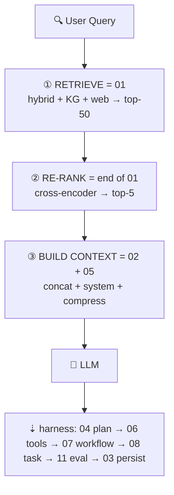

# ARCHITECTURE — Harness (01–15)

> Architecture overview of the `en/harness/` cluster. Vietnamese mirror: `vi/harness/ARCHITECTURE.md`.
>
> * `README.md` — the map: where each folder sits in a real harness.
> * `ARCHITECTURE.md` (this file) — overall design: layering, data flow, contracts, dependencies, how to build/debug.
> * `../HARNESS_ENGINEERING.md` — the full theory: 7 components, SOLID, 10 commandments, case studies.

## 1. What is a harness

The harness is **everything around the LLM** that turns a single
`prompt → completion` call into a trustworthy `request → verified outcome` system.

Two loops with clearly distinguished owners:

* **Inner loop** (owned by the harness runtime, e.g. Claude Code / opencode):
  `LLM → tool_call → observation → LLM → … → stop`.
* **Outer loop** (owned by you, the loop engineer):
  `plan → execute → validate → fix → persist → evaluate`.

```
┌──────────────────────── REAL HARNESS LIFECYCLE ──────────────────────────────┐
│  User request                                                                │
│      ▼                                                                       │
│  ┌────────┐  ┌────────┐  ┌────────┐  ┌────────┐  ┌────────┐  ┌────────┐        │
│  │01 Retri│─▶│02 Build│─▶│04 Plan │─▶│05 Promp│─▶│06 Tools│─▶│ LLM    │        │
│  │eve     │  │Context │  │Decompo │  │Builder │  │Decide  │  │ call   │        │
│  └────────┘  └────────┘  └────────┘  └────────┘  └────────┘  └────┬───┘        │
│       ▲                                                        │              │
│       │                                                   tool outputs        │
│       │                                                        │              │
│       │         ┌────────┐  ┌────────┐  ┌────────┐  ┌────────▼───┐            │
│       │         │03 Updat│◀─│11 Evalu│◀─│07 Workf│◀─│08 Task     │            │
│       │         │e Memory│  │ate     │  │low     │  │Execute    │            │
│       │         └────────┘  └────────┘  └────────┘  └────────────┘            │
│       │              ▲            ▲            │                              │
│       │              │            │            ▼                              │
│       │         ┌────┴────────────┴─────┐  ┌────────┐  ┌────────┐             │
│       └─────────│09 Multi-Agent (opt-  │  │10 Autom│  │Guardrai│             │
│                 │   ional, on demand)  │  │ation   │  │ls+Perms│             │
│                 └──────────────────────┘  └────────┘  │ (every │             │
│                                                       │ step)  │             │
│                                                       └────────┘             │
└──────────────────────────────────────────────────────────────────────────────┘
```

## 2. Layering: 7 components → 15 modules

The harness has 7 logical components, split into 11 stage modules + 4 cross-cutting
modules so each part can be learned and tested independently.

| # | Folder | Component | Input → Output | Read when |
|---|---|---|---|---|
| 01 | `01-retrieve-memory-knowledge/` | Memory (read) | query → ranked chunks (score) | Need to find information: vector + BM25 hybrid, RRF fusion, rerank, GraphRAG |
| 02 | `02-build-context/` | Context | chunks + goal + history + files → `BuiltContext` within token budget | Window, compression, routing, caching, 5-level hierarchy |
| 03 | `03-update-memory-store/` | Memory (write) | run result → versioned facts/patterns | Write-back, consolidation/dedupe, KB CRUD, event sourcing |
| 04 | `04-plan-decompose-task/` | Orchestration (plan) | goal → DAG of `TaskNode` | Decomposition, Plan-and-Solve, ToT, ReWOO, ReAct, replanning |
| 05 | `05-prompt-builder/` | Guardrails (input shaping) | `BuiltContext` + template → final prompt | Template registry, few-shot, CoT, schema, injection defense |
| 06 | `06-decide-tools-mcp/` | Tools + Permissions | intent → approved tool call → observation | Registry, intent classifier, MCP client, RBAC, executor (timeout/retry) |
| 07 | `07-workflow/` | Orchestration (run) | DAG → result with error compensation | Sequential/parallel/DAG/HSM, saga, circuit breaker, tracing |
| 08 | `08-task/` | Orchestration (unit of work) | defines one trackable unit | Lifecycle, DAG deps, priority, budget, timeout/cancel. Thinnest — if lost, start here |
| 09 | `09-multi-agent/` | Orchestration (scale-out) | 1 task → N collaborating agents | Roles, message protocol, shared memory. Only when 04+07 are overloaded. Sub-agent details: `09-multi-agent/SUBAGENT.md` |
| 10 | `10-automation/` | Feedback (periodic) | schedule/event → automated run | CI/CD, scheduler, code-gen, test automation, self-healing with cost guards |
| 11 | `11-evaluation/` | Feedback (measurement) | run → pass/fail + metrics | Rubric, quality metrics, benchmark, LLM-judge, regression |
| 12 | `12-sandbox-execution/` | Cross-cutting: execution | untrusted code → isolated result | Threat model, blast radius, tiers: language → container → syscall filter |
| 13 | `13-trajectory-observability/` | Cross-cutting: observability | every step → `TrajectoryEvent` stream | Event contract, session stream, fork/replay/resume, join keys |
| 14 | `14-compaction-context/` | Cross-cutting: context | long context → compact context that stays correct | Trigger at 70% (don't wait for 90%), pin set, summarization vs pruning, compaction-safe prompt |
| 15 | `15-approval-gates/` | Cross-cutting: control | risky op → human decision | Risk tier, gate payload, timeout-deny, pause/resume, audit |

Guardrails + Permissions are **not a stage** — they wrap every arrow
(check input, approve tool, validate output).

## 3. End-to-end flow of a request

Example *"Fix login bug"*:

1. **Retrieve (01).** Embed the query, hybrid-search vector DB + BM25, rerank top-k. Fallback when empty.
2. **Build context (02).** Merge system + goal + chunks + summary + current files into the budget (e.g. 100k). Trim lowest priority first. Mark untrusted content.
3. **Plan (04) → Task graph (08).** Generate the DAG `reproduce → locate → patch → test`; each node has an id, input, budget, timeout, approval flag.
4. **Build prompt (05).** Render each task from a versioned template, attach few-shot examples, include the output schema.
5. **Decide tools (06).** Intent classifier picks `read_file`, `run_tests`, … Check permissions (is writing outside `src/` allowed?). Risky op → pause and request approval (15).
6. **Execute workflow (07).** Run the DAG: sequential where dependent, parallel where independent. Retry with backoff, circuit-break on repeated failure, saga compensation on partial success.
7. **Inner tool loop (06 ↔ sandbox 12).** LLM calls tools, harness executes them in isolation, returns observations. Memoize duplicate calls, cap result size.
8. **Validate (11).** Syntax check, run tests, score with an LLM-judge rubric, measure trajectory metrics (steps, tool precision, recovery). Fail → replan or escalate.
9. **Persist (03).** Write what's worth keeping: success patterns, new facts, file summaries (versioned). Drop the noise.
10. **Automate (10) / Scale-out (09) — optional.** Schedule regression runs or fan out reviewer/tester agents via shared memory.

### 3.1. RAG sits at the start of the lifecycle



RAG **doesn't run once** — it reruns per task / per inner-loop iteration whenever the query changes
(replan at `04` → retrieve again at `01`). RAG alone gets you a one-shot chatbot;
an end-to-end agent needs the rest.

## 4. Three shared contracts

If the 11 modules share nothing else, share these 3 shapes:

> 📄 **Example code:** [`examples/01-4-three-shared-contracts.ts`](examples/01-4-three-shared-contracts.ts)

## 5. The control plane 12–15 (wrapping every stage)

| Module | Question | Key mechanisms |
|---|---|---|
| 12 Sandbox | Where does untrusted code run? | Isolation tiers + 5 mandatory controls + role-based matrix. Every `tool_call` in 06 goes through here |
| 13 Trajectory | How is a run recorded for replay/audit? | Event contract + session stream (durable append + live tail) + fork/replay/resume. Sample engine in `03-update-memory-store/trajectory-fork-replay.md` |
| 14 Compaction | How does a long run survive the token ceiling? | Trigger at 70% (don't wait for 90%), pin set (system/goal never trimmed), pruning + summarization, compaction-safe prompt |
| 15 Approval | Who approves irreversible actions? | Risk tier assigned at plan time (04), gate payload for the human, timeout-deny, pause/resume, audit trail |

## 6. Reading, building, debugging

* **New to this:** `08 → 07 → 02 → 06 → 01 → 03 → 04 → 05 → 11 → 10 → 09`, then `12 → 13 → 14 → 15`.
* **Minimal harness:** `02 + 05 + 06 + 07 + 11` is enough. Add `01/03` when you need memory, `04/08` for complex tasks, `09/10` last.
* **Debugging a bad run:** trajectory (`03/trajectory-fork-replay.md`) → `02` (wrong context?) → `06` (wrong tool?) → `11` (wrong rubric?).

## 7. Companion docs in this cluster

| File | What it adds beyond the module README |
|---|---|
| `03-update-memory-store/trajectory-fork-replay.md` | Session event stream engine, fork/replay/resume |
| `06-decide-tools-mcp/code-mode-sdk.md` | Code-mode vs JSON tool-call pattern + sandbox sketch |
| `07-workflow/cordis-kernel-plugin.md` | Micro-kernel + plugin lifecycle, 4 runtime modes |
| `09-multi-agent/SUBAGENT.md` | Sub-agent spec: lifecycle, spawn API, narrowed permissions, budget, result aggregation |
| `11-evaluation/minimal-benchmark-harness.md` | Minimal harness isolation so evals stay unbiased |

## 8. Known gaps

The old cross-cutting concerns now have a home (`12–15`). Still unowned by any module:
PII/secret scrubbing pipeline, tenant isolation, cost-per-task SLO.
Per-module gaps live in the supplementary section of each README.
