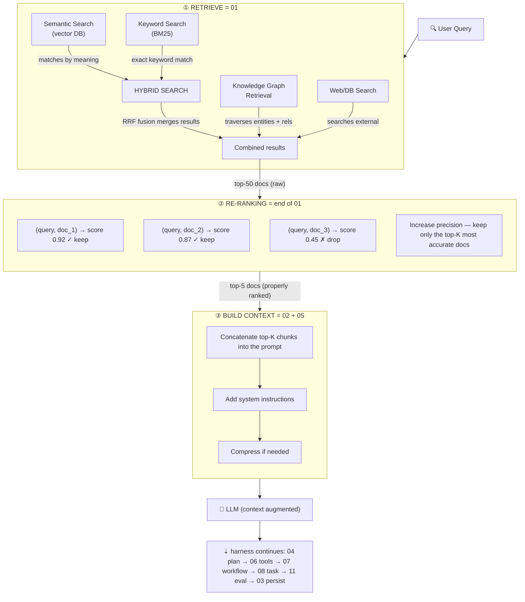

# Harness Architecture — Big Picture (01–15)

> Where does each folder fit in a real harness? This README is the map.
> Details live in `../HARNESS_ENGINEERING.md`; implementation lives in `01/`–`15/`.
> Modules `01–11` are pipeline stages; `12–15` are cross-cutting modules that wrap every stage.

This document is the entry point: what a harness is, what each of the 15 folders does, how one request flows through all of them, and where to start reading.

## 1. What Is a Harness, in One Diagram

Quick glosses before the diagram: LLM = the language model itself; tool_call = the model asking to run a tool (read a file, run a command); observation = the result fed back to the model; token window = the maximum text the model can hold at once.

A harness is **everything around the LLM** that turns a single
`prompt → reply` call into a reliable `request → checked result` system.

```
┌──────────────────────────── REAL HARNESS LIFECYCLE ────────────────────────────┐
│                                                                                │
│  User request                                                                  │
│      ▼                                                                         │
│  ┌────────┐  ┌────────┐  ┌────────┐  ┌────────┐  ┌────────┐  ┌────────┐          │
│  │01 Retri│─▶│02 Build│─▶│04 Plan │─▶│05 Promp│─▶│06 Tools│─▶│ LLM    │          │
│  │eve     │  │Context │  │Decompo │  │Builder │  │Decide  │  │ call   │          │
│  └────────┘  └────────┘  └────────┘  └────────┘  └────────┘  └────┬───┘          │
│       ▲                                                          │              │
│       │                                                     tool outputs        │
│       │                                                          │              │
│       │         ┌────────┐  ┌────────┐  ┌────────┐  ┌────────▼───┐              │
│       │         │03 Updat│◀─│11 Evalu│◀─│07 Workf│◀─│08 Task     │              │
│       │         │e Memory│  │ate     │  │low     │  │Execute    │              │
│       │         └────────┘  └────────┘  └────────┘  └────────────┘              │
│       │              ▲            ▲            │                                │
│       │              │            │            ▼                                │
│       │         ┌────┴────────────┴─────┐  ┌────────┐  ┌────────┐               │
│       └─────────│09 Multi-Agent (scale │  │10 Autom│  │Guardrai│               │
│                 │   -out option)       │  │ation   │  │ls+Perms│               │
│                 └──────────────────────┘  └────────┘  │ (every │               │
│                                                       │  step) │               │
│                                                       └────────┘               │
└────────────────────────────────────────────────────────────────────────────────┘
```

How to read the diagram: follow the arrows from "User request". Boxes `01`–`11` are pipeline stages; `09`/`10` are optional side branches; "Guardrails+Perms" touches every step; the long arrow back to `01` closes the loop (memory updated → the next request starts better informed).

Inner loop (owned by the harness runtime, e.g. Claude Code / opencode):
`LLM → tool_call → observation → LLM → … → stop`. That is "ask model, run tool, feed result back", repeated.
Outer loop (owned by you, the loop engineer):
`plan → execute → validate → fix → persist → evaluate`. That is the bigger cycle of managing the whole job, end to end.

> **One-line summary:** A harness is everything around the model that turns a raw prompt-reply into a checked result — an inner tool loop plus an outer management loop you own.

## 2. The 7 Components → 15 Modules Map

This section is the map from 7 big ideas to 15 concrete folders. Signpost: use it to find "which folder answers my question".

How to read it: `#` = module number; `Module folder` = the directory to open; `Harness component` = which of the 7 logical components it implements; `Answers the question` = the problem the module solves. Glosses used below: vector/BM25 hybrid = search by meaning combined with search by exact keyword; RAG = retrieval-augmented generation (find documents, paste them into the prompt); DAG = a task graph with arrows and no cycles; CoT = chain of thought, i.e. step-by-step reasoning; MCP = a standard protocol connecting agents to tools; RBAC = permissions decided by role; saga = multi-step operations where finished steps can be undone; cross-cutting = applies to every stage, not one step.

| # | Module folder | Harness component | Answers the question |
|---|---------------|-------------------|----------------------|
| 01 | `01-retrieve-memory-knowledge/` | Memory (read) | What does the agent remember that is relevant? Embeddings, chunking, vector + BM25 hybrid, rerank, RAG variants. |
| 02 | `02-build-context/` | Context management | What exactly goes into the token window, in what order, under what budget? 5-level hierarchy, compression, routing, caching. |
| 03 | `03-update-memory-store/` | Memory (write) | What is worth keeping after the task? Write-back, consolidation, versioning, audit. Companion: `trajectory-fork-replay.md`. |
| 04 | `04-plan-decompose-task/` | Orchestration (plan) | How is a big goal split into small verifiable steps? Decomposition patterns, ReAct/ReWOO/ToT, replanning. |
| 05 | `05-prompt-builder/` | Guardrails (input shaping) | How is the final prompt assembled safely? Templates, few-shot, CoT, schema enforcement, injection hardening. |
| 06 | `06-decide-tools-mcp/` | Tools + Permissions | What is the agent allowed to do, and via which tool? Registry, intent classification, MCP client, RBAC, sandbox. Companion: `code-mode-sdk.md`. |
| 07 | `07-workflow/` | Orchestration (run) | In what order do steps run, retry, compensate? Sequential/parallel/DAG/HSM, saga, circuit breaker, tracing. Companion: `cordis-kernel-plugin.md`. |
| 08 | `08-task/` | Orchestration (unit of work) | What is one trackable unit? Lifecycle, DAG deps, priority, budget, timeout/cancel. Thinnest module — start here if lost. |
| 09 | `09-multi-agent/` | Orchestration (scale-out) | When does one agent become a team? Roles, protocols, shared memory, conflict resolution. Only needed when 04+07 hit limits. |
| 10 | `10-automation/` | Feedback (scheduled) | What runs without a human asking? CI/CD, schedulers, self-healing loops with iteration/cost guards. |
| 11 | `11-evaluation/` | Feedback (measured) | Did it actually work? Rubrics, trajectory metrics, LLM-judge, regression, benchmarks. Companion: `minimal-benchmark-harness.md`. |
| 12 | `12-sandbox-execution/` | **Cross-cutting: execution** | Where does untrusted code run? Isolation tiers, five mandatory controls, per-role matrix. Canonical home of the sandbox concept. |
| 13 | `13-trajectory-observability/` | **Cross-cutting: observability** | How is every run recorded? Event contract, session stream, fork/replay/resume, join keys. Map to `03/.../trajectory-fork-replay.md` (engine). |
| 14 | `14-compaction-context/` | **Cross-cutting: context** | How do long runs survive the token ceiling? 70% policy, pruning, memory contract, compaction-safe prompts. |
| 15 | `15-approval-gates/` | **Cross-cutting: control** | Who authorizes irreversible actions? Risk tiers, gate payload, timeout-deny, pause/resume, audit. |

Guardrails + Permissions are **not a stage** — they wrap every arrow in the
diagram above (input check, tool approval, output validation).

> **One-line summary:** The 15 folders are 7 components split so each can be tested alone — 11 pipeline stages plus 4 cross-cutting wrappers, with guardrails and permissions touching every arrow.

## 3. Request Lifecycle, End to End

This section walks one concrete request — *"Fix login bug"* — through all 10 steps, so the module numbers become a story.

1. **Retrieve (01).** Embed the query (turn the text into a vector of numbers so similar texts can be found), hybrid-search vector DB + BM25,
   rerank top-k. Output: ranked chunks with scores. Fallback if empty.
2. **Build context (02).** Merge system instructions + task goal + retrieved
   chunks + conversation summary + immediate files into a token budget
   (e.g. 100k). Truncate low-priority first. Mark untrusted content.
3. **Plan (04) → Task graph (08).** Produce a DAG of tasks:
   `reproduce → locate → patch → test`. Each task has id, inputs, budget,
   timeout, approval flag.
4. **Build prompt (05).** Render per-task prompt from a versioned template,
   inject few-shot examples (worked examples shown to the model), attach output schema (the required shape of the answer).
5. **Decide tools (06).** Intent classifier picks tools
   (`read_file`, `run_tests`, …). Permission check: can this task write
   outside `src/`? Dangerous op → pause for approval.
6. **Execute workflow (07).** Run the DAG. Sequential where dependent,
   parallel where independent. Retry with backoff (wait longer between retries), circuit-break on
   repeated failure, saga compensation on partial success (undo finished steps when a later step fails).
7. **Inner tool loop.** LLM calls tools, harness executes them in a sandbox,
   returns observations. Memoize identical calls (remember a result instead of recomputing), cap result size.
8. **Validate (11).** Syntax check, run tests, LLM-judge rubric (a scoring checklist applied by a model), trajectory
   metrics (steps used, tool precision, recovery). Fail → replan or escalate.
9. **Persist (03).** Write back what matters: success pattern, new fact,
   updated file summary. Version it. Drop ephemeral noise.
10. **Automate (10) / Scale out (09) — optional.** Schedule regression, or
    fan out to reviewer/tester agents with shared memory.

Every step emits **trajectory events** (see §4), so a run can be replayed,
forked, or audited later (`03-update-memory-store/trajectory-fork-replay.md`).

### 3.1. Where the RAG Pipeline Lives

This short section locates RAG in the picture: it is the head of the lifecycle, not the whole body.

The classic RAG pipeline (retrieve → re-rank → build context → LLM) is the
**head of the lifecycle** — it ends at the first LLM call, the harness
carries on from there:



Glosses for the diagram: semantic search = find documents by meaning; keyword search = find by exact words; RRF fusion = a simple formula that merges two ranked lists; knowledge graph = a network of entities and their relations; cross-encoder scoring = a model that rates each (query, document) pair; top-50 → top-5 = narrowing 50 raw candidates to the 5 best.

| RAG stage | Harness module | Notes |
|-----------|----------------|-------|
| ① Retrieve (hybrid + KG + web, top-50) | `01-retrieve-memory-knowledge` | Embeddings, chunking, hybrid + RRF fusion, GraphRAG variant, external sources |
| ② Re-ranking (cross-encoder, top-5) | End of `01` (input to `02`) | Precision filter only — nothing enters the prompt yet |
| ③ Build context (concat + system + compress) | `02-build-context` (+ `05-prompt-builder` renders it) | Merges system/goal/chunks/history/immediate into a token budget, marks untrusted content |
| 🧠 LLM | Inner tool loop (`06` → `07` → `08`) | RAG ends here; the harness loop (plan → execute → validate → persist) takes over |

How to read the table: each row = one RAG stage; `Harness module` = which folder implements it; `Notes` = what happens there, in one line.

Key point: RAG does **not** run once. It re-runs on every task / every
inner-loop iteration whose query changes (replan in `04` → retrieve again
in `01`). RAG alone gives a good one-shot answer; the rest of the lifecycle
is what makes an end-to-end agent.

> **One-line summary:** RAG is only the head of the pipeline — it re-runs whenever the query changes, and everything after the first LLM call belongs to the harness.

## 4. The Three Shared Contracts

This section names the three data shapes every module must agree on — the minimum glue between parts.

If the 11 modules share nothing else, share these three shapes:

**A. Trajectory event** — the single source of truth for debugging (one event = one thing the agent did, with a timestamp):

> 📄 **Example code:** [`examples/01-4-the-three-shared-contracts.ts`](examples/01-4-the-three-shared-contracts.ts)

**B. Context object** — what 02 builds and 05 renders (exactly what the model was given):

> 📄 **Example code:** [`examples/02-4-the-three-shared-contracts.ts`](examples/02-4-the-three-shared-contracts.ts)

**C. Task node** — what 04 creates, 07 runs, 08 tracks (one trackable unit of work with a deadline and budget):

> 📄 **Example code:** [`examples/03-4-the-three-shared-contracts.ts`](examples/03-4-the-three-shared-contracts.ts)

> **One-line summary:** Even if modules share nothing else, they share three shapes — trajectory event, context object, task node — and that is what makes debugging possible.

## 5. How to Read This Folder

This section gives three ready-made paths through the repo, depending on your goal.

- **New to harness?** Read in this order: `08` → `07` → `02` → `06` →
  `01` → `03` → `04` → `05` → `11` → `10` → `09`, then cross-cutting:
  `12` → `13` → `14` → `15`.
- **Building a minimal harness?** `02 + 05 + 06 + 07 + 11` is enough.
  Add `01/03` when you need memory, `04/08` when tasks get complex,
  `09/10` last.
- **Debugging a bad run?** Start from the trajectory (`03/trajectory-fork-replay.md`),
  then check `02` (wrong context?), `06` (wrong tool?), `11` (wrong rubric?).

> **One-line summary:** Start at 08, not 01 — build the minimum five, and debug from the event log outward.

## 6. Companion Docs

This table lists the deep-dive documents that sit next to the module READMEs.

How to read it: `File` = where the doc lives; `What it adds` = what you get beyond the module's own README.

| File | What it adds beyond the module README |
|------|----------------------------------------|
| `03-update-memory-store/trajectory-fork-replay.md` | Session event stream, fork/replay/resume implementation |
| `06-decide-tools-mcp/code-mode-sdk.md` | Code-mode vs JSON tool-call pattern + sandbox sketch |
| `07-workflow/cordis-kernel-plugin.md` | Micro-kernel + plugin lifecycle, 4 runtime modes |
| `11-evaluation/minimal-benchmark-harness.md` | Minimal isolation harness for unbiased capability eval |
| `../HARNESS_ENGINEERING.md` | Full theory: 7 components, SOLID, 10 commandments, case studies (SWE-agent, Anthropic, Claude Code leak, Cursor, DeepSeek) |

## 7. Known Gaps (Contributions Welcome)

This closing section is honest about what no module owns yet, so you can track it yourself.

Former cross-cutting gaps now have homes: sandbox → `12`, trajectory → `13`,
compaction → `14`, approvals → `15`. Remaining items no single module owns yet:
PII/secret scrubbing pipeline (removing personal data and keys from logs), tenant isolation (keeping customers' data apart), cost-per-task SLOs (a spending target per task).
Per-module gaps are listed in each README's supplement section.

## 8. Modern AI Coding Workflow (2026)

This final section shows that the harness pattern is not theory — it is how real AI coding tools work today.

The harness in this repo is not just theory — it is how AI coding tools actually run inside IDEs today:

How to read it: each row = one well-known tool; `Harness inside it` = which harness pieces it already uses.

| Tool | Harness inside it |
|------|------------------|
| **Claude Code** | Agentic loop + Agent Skills (SKILL.md) + compaction + subagents. Has an official SDK (**Claude Agent SDK**, formerly Claude Code SDK — renamed 09/2025) to embed this loop into your own apps. |
| **GitHub Copilot (agent mode)** | 2025-2026: from autocomplete → agent mode editing many files, running terminals, self-verifying; Copilot coding agent takes an issue → opens a PR. |
| **Cursor** | Multi-tab agents, Composer running many files in parallel, background agents. |
| **opencode / OSS harnesses** | Same pattern: MCP tools + approval gates + session trajectories. |

Glosses: agentic loop = the model repeats "think → act → observe"; compaction = shrinking old context to keep long runs alive; subagents = helper agents spawned for one job; SDK = a library for building your own app on top; MCP tools = tools exposed via the standard agent-tool protocol; approval gates = human approval before risky actions; session trajectories = recorded run histories.

**What's common in 2026 (per Anthropic, OpenAI, IBM, Google):**
1. **Multi-agent orchestration** is the dominant pattern — lead agent + subagents (see `09-multi-agent/`), each subagent with its own context, returning short summaries.
2. **Agent control plane**: one place to orchestrate many agents running in parallel across environments (browser, editor, CI) — heading toward an "Agentic OS".
3. **Standardized protocols**: MCP (agent↔tool) + A2A (agent↔agent, Linux Foundation) — every serious coding agent runs both.
4. **Trust by Design**: security + approval gates wired into every layer from the start, not audited afterwards (see `15-approval-gates/`).

> **One-line summary:** Real 2026 coding tools all run the same harness pattern — loop + tools + memory + gates — with multi-agent orchestration and standard protocols (MCP, A2A) as the new baseline.

> To go deeper: `09-multi-agent/` for orchestration, `10-automation/` for self-running loops in CI, `06-decide-tools-mcp/` for MCP.
