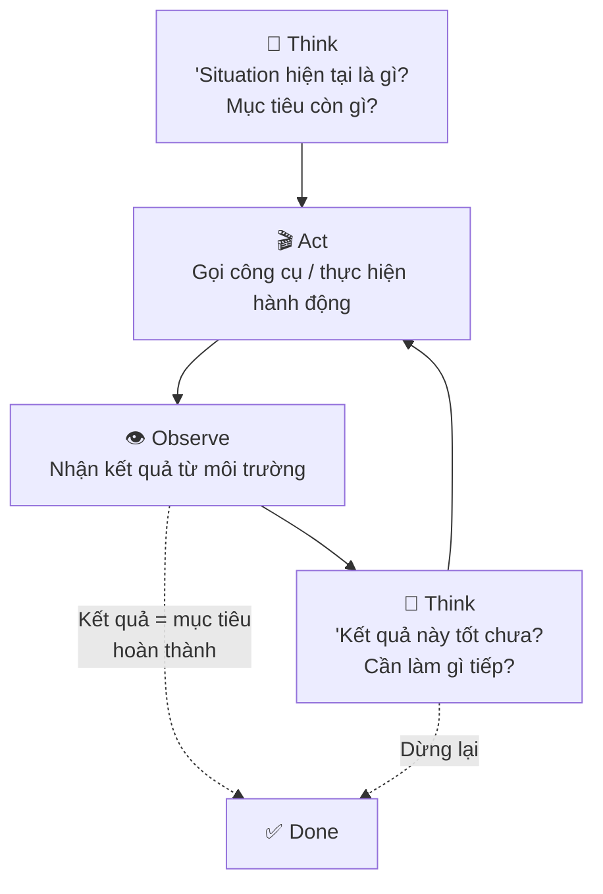
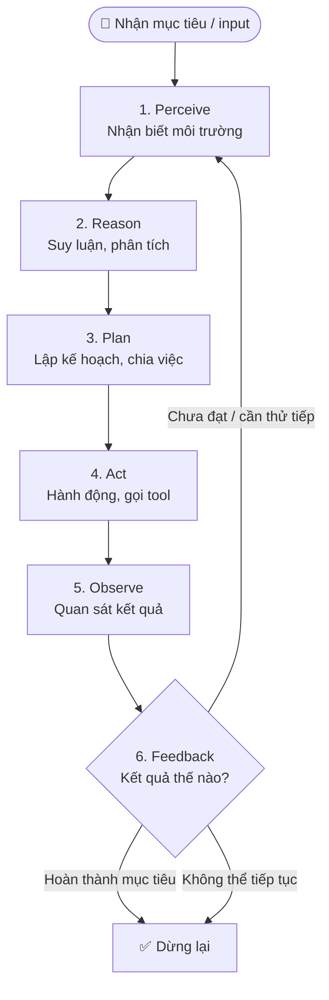

# 🔄 Module 3. Agent Lifecycle & Core Principles

> ## 📑 Mục Lục
>
> - [Câu Chuyện Mở Đầu](#câu-chuyện-mở-đầu)
> - [ReAct Loop — Vòng Lặp Think–Act–Observe](#react-loop--vòng-lặp-thinkactobserve)
> - [1. Perceive — Nhận Biết](#1-perceive--nhận-biết)
> - [2. Reason — Suy Luận](#2-reason--suy-luận)
> - [3. Plan — Lập Kế Hoạch](#3-plan--lập-kế-hoạch)
> - [4. Act — Hành Động](#4-act--hành-động)
> - [5. Observe — Quan Sát](#5-observe--quan-sát)
> - [6. Feedback Loop — Vòng Lặp Phản Hồi](#6-feedback-loop--vòng-lặp-phản-hồi)
> - [7. Iterative Execution — Thực Thi Lặp Lại](#7-iterative-execution--thực-thi-lặp-lại)
> - [8. Goal-oriented Behavior — Hành Vi Hướng Đích](#8-goal-oriented-behavior--hành-vi-hướng-đích)
> - [9. Decision Making — Quyết Định Dựa Trên Thông Tin](#9-decision-making--quyết-định-dựa-trên-thông-tin)
> - [10. Stop Condition & Task Completion — Khi Nào Dừng Lại](#10-stop-condition--task-completion--khi-nào-dừng-lại)
> - [Bảng So Sánh: Các Thành Phần Lifecycle](#bảng-so-sánh-các-thành-phần-lifecycle)
> - [Tóm Tắt & Checklist](#tóm-tắt--checklist)

---

## Câu Chuyện Mở Đầu

Bạn hãy tưởng tượng hai đầu bếp đứng trong cùng một bếp nhà hàng:

- **Đầu bếp A:** Nhận order "một tô phở bò". Anh ta không lao vào nấu ngay. Anh ta *nhìn* nguyên liệu còn gì (Perceive), *nghĩ*: "thịt bò khô quá, nước dùng nhạt" (Reason), *lên trình tự*: ninh nước → ướp thịt → chần bánh → bày bát (Plan), rồi *bắt tay làm* từng bước (Act). Mỗi bước xong, anh ta *nếm thử, nhìn lại* (Observe). Thấy mặn thì thêm nước; thấy thịt chưa mềm thì hầm thêm. Đây là vòng lặp có phản hồi.
- **Đầu bếp B:** Cũng order đó, nhưng bỏ tất cả vào nồi cùng lúc, khuấy đại, mang ra. Không nhìn, không nghĩ, không kiểm tra giữa chừng. Kết quả: nước dùng vừa, bánh phở nát, thịt bò cứng.

Đầu bếp A hoạt động theo **Agent Lifecycle** — chu trình sống: nhận biết → suy nghĩ → lên kế hoạch → hành động → quan sát → phản hồi → lặp lại. Đầu bếp B chỉ là một hàm `process()` cứng: nhận input, trả output, không có vòng lặp.

> **Tóm gọn 1 câu:** Agent sống theo vòng lặp có phản hồi — mỗi hành động đều được kiểm tra để quyết định bước tiếp theo, không phải chạy một kịch bản cứng nhắc từ đầu đến cuối.

---

## ReAct Loop — Vòng Lặp Think–Act–Observe

ReAct (Reason + Act) là mô hình vòng lặp phổ biến nhất trong Agent AI. Thay vì "suy nghĩ rồi làm xong", Agent liên tục **xoay vòng**: suy nghĩ một chút → hành động một chút → quan sát kết quả → suy nghĩ tiếp.

Vòng lặp này lặp cho đến khi Agent quyết định đã đạt mục tiêu hoặc không thể tiếp tục. Mỗi vòng gồm:

- **Think:** Phân tích tình huống hiện tại, xác định bước tiếp theo.
- **Act:** Gọi tool hoặc thực hiện hành động cụ thể.
- **Observe:** Đọc kết quả, cập nhật bối cảnh.

> **Tóm gọn 1 câu:** ReAct loop = "nghĩ một chút → làm một chút → nhìn kết quả → nghĩ tiếp" — lặp đến khi xong việc hoặc không thể tiếp.

---

## Sơ Đồ Lifecycle Tổng Quan

Gộp toàn bộ chu trình sống của một Agent thành một flowchart:

Đọc từ trên xuống: mọi vòng lặp đều **bắt đầu bằng nhận biết** và **kết thúc ở quyết định dừng lại**. Giữa hai đầu là vòng xoay Perceive → Reason → Plan → Act → Observe lặp đi lặp lại cho đến khi có đủ thông tin để *đạt mục tiêu* hoặc *bỏ cuộc*.

Mười mục dưới đây chính là từng ô trong sơ đồ, đi sâu từng cái một.

> **Tóm gọn 1 câu:** Lifecycle chung của Agent = một vòng lặp khép kín Perceive → Reason → Plan → Act → Observe, lặp tới khi hoàn thành mục tiêu hoặc bị chặn.

---

## 1. Perceive — Nhận Biết

Đây là **điểm vào duy nhất** của mọi vòng lặp: Agent nhận thông tin về môi trường để biết "mình đang ở đâu". Thông tin đến từ hai nguồn:

- **Input từ người dùng:** yêu cầu, câu hỏi, file đính kèm, ảnh chụp màn hình...
- **Cảm biến / bộ đọc môi trường:** nội dung file đã đọc, kết quả tìm kiếm, dữ liệu trả về từ API, thông báo hệ thống.

Quan trọng: Perceive **không phải là hành động** — nó chỉ *thu nhận* về. Một Agent biết "đọc" tốt sẽ ít bị mù quáng hành động sai.

> **Tóm gọn 1 câu:** Perceive = "nhận biết" — Agent thu thập thông tin về môi trường (input, file, kết quả công cụ) trước khi làm bất cứ điều gì.

---

## 2. Reason — Suy Luận

Từ dữ liệu vừa nhận, Agent **suy nghĩ**: dữ liệu có ý nghĩa gì? Yêu cầu thật sự là gì? Có ràng buộc nào? Phương án nào khả thi nhất?

Với LLM, Reason chính là **chuỗi suy luận (chain-of-thought)** — vừa là phân tích logic, vừa là phát hiện vấn đề ("yêu cầu mơ hồ, thiếu thông tin"). Đây cũng là lúc Agent nhận ra mình "không đủ thông tin" để quyết định và cần hỏi thêm hoặc thu thập thêm.

> **Tóm gọn 1 câu:** Reason = "suy nghĩ" — Agent phân tích, suy luận về ý nghĩa thông tin và rút ra kết luận trước khi bước tiếp.

---

## 3. Plan — Lập Kế Hoạch

Sau khi hiểu việc, Agent **chia việc lớn thành nhiều bước nhỏ và sắp xếp thứ tự**. Ví dụ mục tiêu "viết báo cáo doanh thu" được tách thành: lấy số liệu → dựng bảng → viết phân tích → định dạng → lưu file.

Lập kế hoạch tốt nhìn xa: bước nào hợp lý, bước nào độc lập (làm song song), bước nào phụ thuộc (phải làm sau), bước nào dễ sai cần kiểm tra kỹ. Kế hoạch không nhất thiết cứng nhắc — nó được điều chỉnh lại sau mỗi vòng lặp.

> **Tóm gọn 1 câu:** Plan = "chia việc" — Agent bè rải mục tiêu lớn thành danh sách hành động có thứ tự, ưu tiên và thứ tự phụ thuộc.

---

## 4. Act — Hành Động

Đây là nơi Agent "chạm vào thế giới": **gọi tool**, chạy code, ghi file, gửi HTTP request, tìm kiếm web. Hành động được chọn từ bộ công cụ (toolkit) được cấp — Agent không làm gì ngoài những tool đó cho phép.

Act đúng = chọn đúng công cụ cho đúng bài toán, truyền đúng tham số, và kiểm tra lỗi trả về ngay khi có.

> **Tóm gọn 1 câu:** Act = "làm" — Agent thực thi hành động cụ thể qua tool (chạy code, ghi file, gọi API...), biến suy nghĩ thành thay đổi thật sự ngoài đời.

---

## 5. Observe — Quan Sát

Sau mỗi hành động, Agent **nhận lại kết quả**: output của tool, lỗi, file mới, trang web vừa xem. Observe cập nhật "bức tranh thế giới" trong đầu Agent — giống đầu bếp A nếm thử sau mỗi lần nêm nếm.

Lưu ý: kết quả có thể **khác dự đoán** — lỗi tool, kết quả trống, output dài bị cắt, hay đơn giản là "không làm gì cả". Quan sát trung thực mới giúp vòng lặp đúng đắn.

> **Tóm gọn 1 câu:** Observe = "nhìn lại kết quả" — Agent đọc output/trạng thái sau mỗi hành động để biết việc diễn ra ổn hay lệch hướng.

---

## 6. Feedback Loop — Vòng Lặp Phản Hồi

Đây là **cầu nối** giữa Observe và bước tiếp theo: kết quả quan sát được so sánh với kỳ vọng để quyết định hành động tiếp theo. Feedback loop trả lời câu hỏi: "có gì sai với kế hoạch không?"

Ba loại phản hồi thường gặp:

- **Positive feedback:** kết quả đúng hướng, tiếp tục như kế hoạch.
- **Negative feedback:** kết quả lệch, cần điều chỉnh bước hoặc kế hoạch.
- **Null feedback:** không có kết quả rõ ràng (lỗi, timeout, trả về trống), cần thử cách khác.

Feedback loop là lý do Agent vượt trội so với chương trình cứng: nó **tự điều chỉnh** dựa trên những gì thực sự xảy ra, không chỉ những gì dự kiến.

> **Tóm gọn 1 câu:** Feedback loop = "phản hồi" — sau Observe, Agent so sánh kết quả với kỳ vọng để quyết định giữ nguyên hay thay đổi hướng đi.

---

## 7. Iterative Execution — Thực Thi Lặp Lại

Một nhiệm vụ phức tạp hiếm khi hoàn thành trong một bước. **Iterative execution** là nguyên tắc: mỗi vòng lặp (Perceive → Reason → Plan → Act → Observe → Feedback) tiến một bước gần hơn tới mục tiêu, cho đến khi đạt.

Mỗi vòng lặp gọi là một **step** hoặc **turn**. Thường gặp:

- **Multi-step tool calling:** dùng nhiều tool khác nhau qua nhiều lần gọi, mỗi lần dựa trên kết quả trước.
- **Loop guard:** giới hạn số vòng lặp để tránh Agent lặp vô hạn (ví dụ: max 20 vòng).
- **Self-correction:** mỗi vòng lặp là cơ hội để Agent tự phát hiện và sửa sai.

> **Tóm gọn 1 câu:** Iterative execution = "lặp đi lặp lại" — Agent tiến từng bước nhỏ qua nhiều vòng lặp, mỗi bước đều dựa trên kết quả bước trước.

---

## 8. Goal-oriented Behavior — Hành Vi Hướng Đích

Agent **luôn có mục tiêu rõ ràng** — đây là điểm khác biệt cốt lõi so với LLM đơn thuần. Mọi hành động đều được đánh giá qua lăng kính: "hành động này có đưa tôi gần mục tiêu hơn không?"

Hành vi hướng đích biểu hiện qua:

- **Task decomposition:** chia mục tiêu lớn thành subgoals (mục tiêu con) — hoàn thành từng mục nhỏ dẫn đến mục lớn.
- **Subgoal prioritization:** ưu tiên mục tiêu nào cần đạt trước.
- **Goal abandonment (rare):** khi mục tiêu bất khả thi, Agent có thể dừng lại và báo cáo — chứ không lặp vô nghĩa.

> **Tóm gọn 1 câu:** Goal-oriented = "hướng đích" — mọi quyết định của Agent đều được đặt trong bối cảnh "có đưa tôi gần mục tiêu không".

---

## 9. Decision Making — Quyết Định Dựa Trên Thông Tin

Tại mỗi điểm trong vòng lặp, Agent phải **chọn** một trong nhiều khả năng: gọi tool nào, thử cách nào, tiếp tục hay dừng. Decision making = quá trình đánh giá các lựa chọn dựa trên thông tin hiện có.

Ba yếu tố ảnh hưởng quyết định:

- **Thông tin từ perceive/observe:** kết quả bước trước, nội dung file, phản hồi API.
- **Bối cảnh (context/memory):** lịch sử cuộc trò chuyện, mục tiêu đã đặt, các ràng buộc.
- **Chiến lược suy luận (prompt/reasoning strategy):** cách LLM đánh giá xác suất thành công của từng lựa chọn.

LLM trong Agent dùng **reasoning** (suy luận) để đưa ra quyết định, thay vì chỉ phản hồi theo pattern đã học. Đây là lý do Agent không "hành động ngẫu nhiên" mà có tính nhất quán.

> **Tóm gọn 1 câu:** Decision making = "quyết định" — Agent cân nhắc các lựa chọn dựa trên thông tin đang có để chọn hành động tiếp theo, không phải hành động theo thói quen.

---

## 10. Stop Condition & Task Completion — Khi Nào Dừng Lại

Mọi vòng lặp cần **điều kiện dừng** — nếu không Agent sẽ lặp vô hạn. Stop condition gồm ba trường hợp chính:

1. **Thành công:** mục tiêu đạt → dừng và báo cáo kết quả. Ví dụ: đã viết xong file, đã gửi email, đã tổng hợp xong dữ liệu.
2. **Bất khả thi:** hết tool khả dụng, bị chặn bởi quyền truy cập, hoặc thông tin mâu thuẫn không giải được → dừng và báo lỗi rõ ràng.
3. **Hết giới hạn:** đạt max vòng lặp, hết token, hoặc thời gian timeout → dừng an toàn, trả về kết quả lúc dừng.

Thiết lập stop condition tốt là dấu hiệu của một Agent được thiết kế nghiêm túc — tránh cả hai thái cực: dừng quá sớm (chưa xong việc) và lặp vô hạn (đốt token, không ra kết quả).

> **Tóm gọn 1 câu:** Stop condition = "khi nào dừng" — Agent dừng khi đạt mục tiêu, khi bất khả thi, hoặc khi hết giới hạn; không dừng = lặp vô hạn.

---

## Bảng So Sánh: Các Thành Phần Lifecycle

| Thành phần | Tiếng Anh | Tiếng Việt | Vai trò | Ví dụ trong đời thực |
|---|---|---|---|---|
| **Perceive** | Nhận biết | Thu thập thông tin đầu vào | "Mắt và tai" của Agent | Đọc email, xem kết quả tool, nhận yêu cầu |
| **Reason** | Suy luận | Phân tích, suy nghĩ logic | "Bộ não" trong mỗi vòng | Phân tích yêu cầu, phát hiện mâu thuẫn |
| **Plan** | Lập kế hoạch | Chia việc, sắp thứ tự | "Người quản lý dự án" | Tách "viết báo cáo" thành 5 bước |
| **Act** | Hành động | Thực thi, gọi công cụ | "Tay chân" | Gọi API, ghi file, chạy Python |
| **Observe** | Quan sát | Đọc kết quả hành động | "Giám sát chất lượng" | Đọc stdout, kiểm tra file vừa tạo |
| **Feedback Loop** | Phản hồi | So sánh kết quả với kỳ vọng | "Điều chỉnh tay lái" | Thấy lỗi → thử cách khác |
| **Iterative Execution** | Thực thi lặp | Lặp nhiều vòng | "Bước chân tiến bộ" | 10 vòng tool gọi để hoàn thành tác vụ |
| **Goal-oriented** | Hướng đích | Mọi hành động phục vụ mục tiêu | "La bàn" | Từ chối hành động không liên quan mục tiêu |
| **Decision Making** | Quyết định | Chọn hành động dựa trên thông tin | "Người ra quyết định" | Chọn gọi tool A thay vì tool B |
| **Stop Condition** | Điều kiện dừng | Quyết định khi nào kết thúc | "Công tắc tắt" | Đạt mục tiêu / lỗi không sửa được / hết token |

*Cách đọc bảng: mỗi dòng là một thành phần, đọc từ trái sang phải để hiểu vai trò và ví dụ thực tế.*

---

## Tóm Tắt & Checklist

### Nội dung đã học trong module này

1. **Agent Lifecycle** = vòng lặp khép kín gồm 6–10 thành phần: Perceive → Reason → Plan → Act → Observe → Feedback → lặp lại → Goal-oriented → Decision Making → Stop Condition.
2. **ReAct Loop** (Think → Act → Observe → Think...) là dạng phổ biến nhất của vòng lặp trong Agent LLM.
3. **Perceive** = thu thập thông tin; **Reason** = suy luận; **Plan** = chia việc; **Act** = thực thi; **Observe** = đọc kết quả — năm bước cơ bản.
4. **Feedback Loop** = cầu nối Observe với quyết định tiếp theo, cho phép Agent tự điều chỉnh.
5. **Iterative Execution** = mỗi vòng lặp tiến một bước; **Goal-oriented** = mọi bước đều phục vụ mục tiêu lớn; **Stop Condition** = điểm dừng an toàn.
6. **Decision Making** là sợi chỉ đỏ xuyên suốt — tại mọi bước Agent phải quyết định hành động tiếp theo dựa trên thông tin đang có.

### Checklist tự kiểm tra

Bạn đã nắm được khi có thể trả lời lưu loát các câu hỏi sau:

- [ ] Vẽ được sơ đồ Agent Lifecycle bằng lời (Perceive → ... → Stop Condition) và giải thích mỗi bước?
- [ ] Giải thích được ReAct loop là gì và tại sao nó quan trọng với Agent LLM?
- [ ] Phân biệt được Perceive và Observe — cái nào là "thu thập" và cái nào là "kiểm tra"?
- [ ] Cho ví dụ một tình huống Feedback Loop giúp Agent tự điều chỉnh (ví dụ: gọi tool bị lỗi, thử tool khác)?
- [ ] Nêu được ba điều kiện dừng (stop condition) của một Agent?
- [ ] Giải thích tại sao một Agent cần "hành vi hướng đích" (goal-oriented) — nó giúp gì so với LLM không có mục tiêu rõ ràng?

---

## Tóm Gọn Toàn Module

> **Một câu để nhớ mãi:** Agent sống theo một vòng lặp có ý thức — nhận biết → suy nghĩ → lên kế hoạch → hành động → quan sát → phản hồi → lặp lại — và biết khi nào dừng lại vì đã hoàn thành, bất khả thi, hoặc hết giới hạn.

**Đi tiếp:** Module 4 sẽ giới thiệu **Agentic AI** — khi tính agent (tự chủ, có mục tiêu, chia chuỗi hành động) trở thành triết lý thiết kế của cả một hệ thống, cùng các khái niệm thường đi kèm (autonomy, agentic workflow, human-in-the-loop...).
