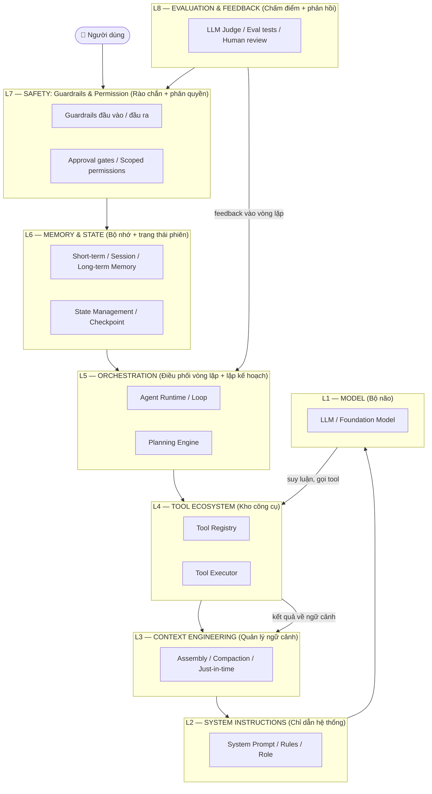

# 🏗️ Module 4. Agent Architecture & Components

> ## 📑 Mục Lục
>
> - [Câu Chuyện Mở Đầu](#câu-chuyện-mở-đầu)
> - [1. LLM / Foundation Model — Bộ Não Suy Luận](#1-llm--foundation-model--bộ-não-suy-luận)
> - [2. Agent Runtime / Orchestrator — Điều Phối Vòng Lặp](#2-agent-runtime--orchestrator--điều-phối-vòng-lặp)
> - [3. System Instructions / Prompt — Chỉ Dẫn Hệ Thống](#3-system-instructions--prompt--chỉ-dẫn-hệ-thống)
> - [4. Context Engineering — Quản Lý Ngữ Cảnh Đầu Vào](#4-context-engineering--quản-lý-ngữ-cảnh-đầu-vào)
> - [5. Planning Engine — Lập Kế Hoạch Hành Động](#5-planning-engine--lập-kế-hoạch-hành-động)
> - [6. Tool Registry — Danh Sách Công Cụ Sẵn Dùng](#6-tool-registry--danh-sách-công-cụ-sẵn-dùng)
> - [7. Tool Executor — Thực Thi Công Cụ, Xử Lý Lỗi](#7-tool-executor--thực-thi-công-cụ-xử-lý-lỗi)
> - [8. Memory System — Bộ Nhớ Ngắn Hạn / Dài Hạn](#8-memory-system--bộ-nhớ-ngắn-hạn--dài-hạn)
> - [9. State Management — Quản Lý Trạng Thái Phiên Làm Việc](#9-state-management--quản-lý-trạng-thái-phiên-làm-việc)
> - [10. Environment — Môi Trường Agent Hoạt Động](#10-environment--môi-trường-agent-hoạt-động)
> - [11. Feedback Mechanism — Cơ Chế Phản Hồi](#11-feedback-mechanism--cơ-chế-phản-hồi)
> - [12. Guardrails & Permission System — Rào Chắn An Toàn, Phân Quyền](#12-guardrails--permission-system--rào-chắn-an-toàn-phân-quyền)
> - [Sơ Đồ Kiến Trúc 8 Lớp](#sơ-đồ-kiến-trúc-8-lớp)
> - [Bảng Tổng Hợp: 12 Thành Phần vs Trách Nhiệm vs Code Module](#bảng-tổng-hợp-12-thành-phần-vs-trách-nhiệm-vs-code-module)
> - [Tóm Tắt & Checklist](#tóm-tắt--checklist)

---

## Câu Chuyện Mở Đầu

Bạn đã biết LLM là "bộ não" giỏi suy nghĩ — nhưng một bộ não ngồi im thì vô dụng. Người trợ lý A trong Module 1 hoàn thành công việc vì được *lắp ráp đầy đủ*. Hãy quan sát anh ta trong một ngày làm việc:

- **Sáng:** nhận yêu cầu từ bạn, nhưng không biết bắt đầu đâu — cần một "sếp" giữ vòng lặp *nghe → nghĩ → làm → xem kết quả* (Agent Runtime).
- Làm đúng phép tắc thì cần **bảng nội quy công ty** — vai trò, việc được phép, việc cấm (System Instructions).
- Não anh ta bị "reset" mỗi ngày — nếu không có **sổ ghi chép** thì quên việc dở dang (Memory + State).
- Anh ta không thể cầm hết dụng cụ cùng lúc — cần **kho dụng cụ** và biết cách **dùng đúng + xử lý khi hỏng** (Tool Registry + Executor).
- **Chiều:** khi cuống lên anh ta có thể làm bậy — cần **người gác cổng** ngăn việc nguy hiểm (Guardrails).

Một **AI Agent hoạt động cũng y hệt thế**: nó không phải "một con LLM", mà là một **hệ thống phần mềm** — một kiến trúc nhiều thành phần phối hợp. Module này mổ xẻ từng thành phần dưới góc nhìn **Software Architecture**: trách nhiệm gì, nằm ở tầng nào, và ánh xạ vào *module code* nào khi viết.

> **Tóm gọn 1 câu:** LLM chỉ là bộ não cô độc — một Agent thật sự là bộ não ấy được lắp ráp cùng 11 thành phần khác thành một hệ thống, và Module 4 mổ xẻ cả 12 mảnh ghép.

---

## 1. LLM / Foundation Model — Bộ Não Suy Luận

Đây là tầng nền của mọi agent: **LLM** nhận ngữ cảnh dạng văn bản và trả về văn bản tiếp theo — trả lời, suy luận, viết code, và quyết định gọi công cụ nào. Nó mạnh nhất trong 12 thành phần, nhưng có **3 điểm mù** mà toàn bộ kiến trúc phải bù:

- **Không nhớ** — mỗi lần gọi là mỗi lần quên → bù bằng Memory System.
- **Không tự hành động** — chỉ sinh chữ → bù bằng Tool Executor.
- **Không tự định hướng** — cần chỉ dẫn và điều phối → bù bằng Instructions + Orchestrator.

Khi thiết kế, chọn model theo độ khó việc: việc đơn giản dùng model rẻ-nhanh, việc suy luận phức tạp dùng model mạnh-đắt.

> **Tóm gọn 1 câu:** LLM là bộ não sinh suy luận và quyết định — mạnh nhất nhưng lại "mù" ba chuyện: không nhớ, không tay chân, không tự định hướng.

---

## 2. Agent Runtime / Orchestrator — Điều Phối Vòng Lặp

Nếu LLM là bộ não, **Agent Runtime (hay Orchestrator)** là "sếp trung tâm" chạy vòng lặp: *nhận mục tiêu → đưa ngữ cảnh cho LLM → nhận quyết định → thực thi → quan sát kết quả → lặp lại* cho tới khi đạt điều kiện dừng.

Đây là mảnh code bạn viết (hoặc framework cung cấp), chứ **không phải model**. Runtime quyết định *khi nào gọi LLM, khi nào gọi tool, khi nào hỏi lại người dùng*; kiểm soát *max iterations / timeout* để agent không chạy vô hạn; và gom kết quả các bước để quyết định *tiếp tục hay dừng*. Trong framework (Module 13), Runtime có sẵn: LangGraph gọi là "graph", OpenAI Agents SDK gọi là "runner".

> **Tóm gọn 1 câu:** Orchestrator là "sếp" không cần thông minh — chỉ giữ nhịp vòng lặp, quyết định lúc nào gọi LLM và lúc nào dừng.

---

## 3. System Instructions / Prompt — Chỉ Dẫn Hệ Thống

LLM sinh chữ dựa trên những gì nhét vào prompt. **System Instructions** là phần *khởi đầu cố định mỗi phiên* — nơi khai báo "bạn là ai, làm việc thế nào, được phép gì, cấm gì".

Thường đặt ở đây **vai trò & mục tiêu** ("Bạn là trợ lý chăm sóc khách hàng"), **luật lệ bắt buộc** ("không bịa dữ liệu", "hỏi lại khi mơ hồ"), và **phong cách** (ngắn gọn, tiếng Việt, markdown). System Instructions là *cấu hình* chứ không phải dữ liệu — đổi chúng là đổi "tính cách" agent. Nhưng chúng cũng là điểm yếu bảo mật: nếu dữ liệu bên ngoài giấu mệnh lệnh "bỏ qua chỉ dẫn hệ thống" thì gọi là **prompt injection** (học kỹ ở Module 6, 8).

> **Tóm gọn 1 câu:** System Instructions là "bảng nội quy" nạp sẵn mỗi phiên — định hình vai trò, luật và phong cách của agent trước khi nó nói một lời nào.

---

## 4. Context Engineering — Quản Lý Ngữ Cảnh Đầu Vào

LLM chỉ "nhìn" được một cửa sổ token hữu hạn (**context window**) — nhồi đầy quá thì vừa đắt vừa kém chính xác (hiện tượng **context rot**: ngữ cảnh càng dài, model càng dễ quên và nhầm). **Context Engineering** quyết định *đưa gì vào, bỏ gì ra, sắp xếp thế nào* qua 3 đòn bẩy: **assembly** (gom đúng phần — lịch sử, kết quả tool, tài liệu — vào prompt), **compaction** (khi ngữ cảnh gần đầy thì tóm tắt nén phần cũ, giữ quyết định quan trọng), và **just-in-time** (chỉ nạp dữ liệu khi cần, không nhồi hết từ đầu). Cách nhìn đơn giản: context là "giấy nháp hữu hạn" — kỹ sư giỏi là người giữ giấy nháp ít và đúng.

> **Tóm gọn 1 câu:** Context Engineering giữ vùng nhớ tạm của LLM "gọn và đúng" — thông tin tối thiểu, nhưng mỗi phần đều đáng giá cho việc đang làm.

---

## 5. Planning Engine — Lập Kế Hoạch Hành Động

Trước khi hành động, agent cần biết **làm theo thứ tự nào**. **Planning Engine** nhận mục tiêu lớn và chia nhỏ thành các bước thực thi được (*task decomposition*). Hai kiểu phổ biến:

- **Plan-then-execute:** vạch sẵn danh sách bước → lần lượt thực thi. Phù hợp việc có cấu trúc rõ.
- **Dynamic replanning:** chỉ vạch bước đầu, làm rồi quan sát rồi mới quyết bước sau. Phù hợp việc mở, khó đoán trước.

Planning không nhất thiết phải là code riêng — nhiều agent để LLM *tự lập kế hoạch trong prompt* rồi ghi ra bộ nhớ (Chẳng hạn lead agent trong mô hình Orchestrator-Worker lập kế hoạch rồi lưu vào memory).

> **Tóm gọn 1 câu:** Planning Engine biến "mục tiêu mơ hồ" thành "danh sách bước cụ thể" — và biết khi nào vạch hết trước, khi nào vừa làm vừa vạch tiếp.

---

## 6. Tool Registry — Danh Sách Công Cụ Sẵn Dùng

LLM không tự biết có những công cụ nào — phải có ai liệt kê cho nó. **Tool Registry** là "danh bạ" khai báo mọi công cụ agent được phép dùng, mỗi tool gồm:

- **Tên** — ngắn, đúng việc (như tên hàm).
- **Mô tả** — viết *rõ như tài liệu cho người mới*, để LLM biết khi nào dùng. Chất lượng mô tả quyết định chất lượng agent.
- **Schema tham số** — định nghĩa kiểu dữ liệu đầu vào (thường dạng JSON Schema).

Ví dụ trong code: `{"search": {"description": "...", "parameters": {...}}, "read_file": {...}}`. Đây chính là phần chuẩn **MCP** (Module 14) giúp chuẩn hóa — "USB-C cho AI".

> **Tóm gọn 1 câu:** Tool Registry là "menu công cụ" LLM nhìn thấy mỗi lượt — agent chỉ dùng được thứ nằm trong danh bạ này, nên danh bạ phải đủ, đúng và dễ hiểu.

---

## 7. Tool Executor — Thực Thi Công Cụ, Xử Lý Lỗi

Registry chỉ là danh bạ — ai thực sự *gọi* công cụ? Đó là **Tool Executor**. Khi LLM quyết định "dùng tool X với tham số Y", Executor sẽ:

1. **Xác nhận** tool nằm trong registry và được phép dùng.
2. **Gọi** tool thật (chạy lệnh, gọi API, đọc file...).
3. **Định dạng kết quả** (output/error) sạch để đưa vào prompt tiếp.
4. **Xử lý lỗi** — thử lại, bỏ qua, hay báo dừng.

| Kiểu lỗi | Xử lý |
|----------|-------|
| Tool không tồn tại | Báo "không tìm thấy công cụ" |
| Tham số sai định dạng | Trả thông báo rõ, LLM tự sửa |
| Tool chạy quá lâu | Timeout + thông báo |
| Lỗi có thể thử lại | Retry có backoff |
| Permission denied | Chặn, không thử, báo bị từ chối |

Executor cũng chịu trách nhiệm **sandboxing** — chạy tool trong môi trường biệt lập để lỗi không lan ra hệ thống thật.

> **Tóm gọn 1 câu:** Tool Executor là "người phục vụ" — nhận yêu cầu từ LLM, gọi đúng tool, trả kết quả sạch, và xử lý khéo khi sự cố để hệ thống không sụp.

---

## 8. Memory System — Bộ Nhớ Ngắn Hạn / Dài Hạn

LLM quên ngay khi context đầy. **Memory System** bù đắp khoảng trống đó với 3 tầng:

| Tầng | Thời gian sống | Ví dụ |
|------|---------------|-------|
| **Short-term** | Một lượt gọi | Message history, ngữ cảnh hiện tại |
| **Session** | Nhiều lượt / một phiên | Memory tool, file-based persistent |
| **Long-term** | Nhiều phiên / nhiều ngày | Vector DB, Agent Skills, NOTES.md |

Mẫu đã chứng minh (Claude Code): trong lúc làm, agent **ghi chú ra NOTES.md**; khi vùng nhớ gần đầy, hội thoại được *compaction*; phiên mới thì agent đọc lại NOTES.md + git log để "lấy bearings" (định vị xem mình đang ở đâu). **Note-taking** là kỹ thuật đơn giản nhất mà hiệu quả nhất — ghi ra file ngoài context, đọc lại khi cần.

> **Tóm gọn 1 câu:** Memory System là "sổ ghi chép" — tầng ngắn hạn trong context (quên ngay), tầng phiên sống qua lượt, tầng dài hạn sống qua ngày tháng và có tra cứu.

---

## 9. State Management — Quản Lý Trạng Thái Phiên Làm Việc

Memory lưu *thông tin*, còn **State Management** quản lý *trạng thái hiện tại* của phiên: agent đang ở bước nào, mục tiêu đến đâu, đã thử những gì. State thường gồm **task state** (mục tiêu, bước đã làm, bước kế tiếp), **progress state** (tiến độ — Vd: `feature_list.json` của Claude Code đánh dấu mỗi tính năng `passes: true/false`), và **context pointers** (đang ở file/thư mục nào).

Tầng này quyết định sống-còn với **long-running agents**: nếu không lưu state ra file/DB, mỗi phiên mới (context reset) agent phải bắt đầu từ số 0. Nguyên tắc thiết kế: **checkpoint trước việc lớn**, **state chạy được resume** (nạp checkpoint, không làm lại từ đầu), và gắn state với task thay vì context.

> **Tóm gọn 1 câu:** State Management là "bản đồ tiến độ" của phiên — biết agent đang ở đâu, đã làm gì, còn gì phải làm, để mỗi phiên bắt đầu không phải từ số 0.

---

## 10. Environment — Môi Trường Agent Hoạt Động

Agent hành động **bên trong một môi trường (environment)**: hệ thống file, terminal, web, API, cơ sở dữ liệu... Môi trường vừa là nguồn thông tin (đọc), vừa là nơi tác động (ghi, gọi, chạy).

| Loại môi trường | Đọc (perceive) | Tác động (act) |
|-----------------|----------------|----------------|
| **Hệ thống file** | read file, list dir | write, mv, rm |
| **Terminal** | xem output lệnh | chạy script |
| **Web** | fetch URL, search | submit form |
| **API / DB** | query, GET | POST, ghi DB |

Môi trường càng phong phú, agent đi càng xa — nhưng cũng càng nguy hiểm: là nơi rò rỉ dữ liệu và là nơi tool trả về nội dung nhiễm độc (prompt injection). Thiết kế môi trường tốt gọi là **ACI (Agent-Computer Interface)**: giao diện rõ, format dễ đọc (markdown thay vì JSON-escaped), và "poka-yoke" (chống sai). Nghiên cứu SWE-agent cho thấy chỉ cải thiện ACI đã tăng success rate tới **+64%** — nhanh hơn cả đổi model.

> **Tóm gọn 1 câu:** Environment là "sân chơi" — file, shell, web, API — nơi agent đọc tin và để lại dấu chân; sân thiết kế tốt làm agent làm việc tốt hơn hẳn, đôi khi hơn cả đổi model.

---

## 11. Feedback Mechanism — Cơ Chế Phản Hồi

Agent không có phản hồi thì cứ sai hoài mà không hay. **Feedback Mechanism** đưa kết quả của hành động trở về vòng lặp để agent tự điều chỉnh. Hai chiều quan trọng:

- **Tự phản hồi trong vòng lặp:** sau mỗi tool call, agent quan sát output — thấy logic hỏng, file lỗi, API báo lỗi → tự sửa trước khi đi tiếp.
- **Phản hồi ngoài (self-correction & evaluation):** LLM làm "giám khảo" chấm kết quả của chính nó theo rubric, hoặc chạy test (test thất bại → sửa code → test lại). Đây là gốc của pattern *Evaluator-Optimizer* (Module 9).

**Phản hồi từ con người** (user feedback, chấm tay, phê duyệt giữa chừng) là tín hiệu đáng tin nhất — nhiều hệ thống production dùng nó để tinh chỉnh agent liên tục.

> **Tóm gọn 1 câu:** Feedback là "tai mắt kiểm chứng" — agent nhìn lại kết quả của mình (tự kiểm tra, test, hoặc người chấm), phát hiện sai và điều chỉnh trước khi hậu quả to hơn.

---

## 12. Guardrails & Permission System — Rào Chắn An Toàn, Phân Quyền

Agent càng tự chủ càng cần rào chắn. **Guardrails & Permission** gồm ba mặt:

| Mặt | Chặn gì | Cơ chế |
|-----|---------|--------|
| **Input guardrails** | Prompt injection, nội dung độc hại | Kiểm tra trước khi vào LLM |
| **Output guardrails** | Rò rỉ data nhạy cảm, nội dung xấu | Kiểm tra sau khi LLM trả ra |
| **Behavioral guardrails** | Chạy vô hạn, hành động nguy hiểm | Max iterations, timeout, chặn domain |

**Permission System** (phân quyền) quyết định ai được làm gì: **scoped permissions** (agent chỉ chạy trong thư mục/API khai báo), **approval gates** (hành động nguy hiểm phải chờ người phê duyệt; im lặng quá lâu = tự từ chối), và **audit trail** (ghi lại ai quyết định gì). Rào chắn nên chạy **song song** với agent, và theo Mitchell Hashimoto: *"agent sai thì xây hệ thống chống sai, đừng cầu nguyện model đừng sai."*

> **Tóm gọn 1 câu:** Guardrails là "người gác cổng" — chặn đầu vào xấu, đầu ra nhạy cảm, khóa hành vi nguy hiểm và phân quyền rõ ràng, để agent tự chủ mà không gây thảm họa.

---

## Sơ Đồ Kiến Trúc 8 Lớp

Từ 12 thành phần trên, ta xếp chúng thành **8 lớp kiến trúc** (layer). Đọc từ dưới lên: L1 là nền tảng (bộ não), L8 là mái nhà (đo lường chất lượng). Mỗi lớp phục vụ lớp bên trên — dễ nhớ cho cả việc thiết kế lẫn trao đổi với đồng nghiệp.

**Cách đọc sơ đồ:** yêu cầu người dùng đi qua lớp an toàn (L7) rồi xuống các lớp bên dưới cho tới bộ não (L1). Bộ não quyết định rồi "nhờ" tầng tool (L4) hành động, kết quả được đưa về ngữ cảnh (L3) để suy nghĩ tiếp — tạo thành vòng lặp do L5 điều phối — trong khi L6 giữ bộ nhớ và tiến độ, L8 đo xem cả hệ thống làm ăn ra sao.

> **Tóm gọn 1 câu:** 12 thành phần gom vào 8 lớp — Model làm nền, Harness (L2–L6) điều khiển quanh nó, Safety (L7) bảo kê tất cả, Evaluation (L8) chấm điểm — như một tổ chức: sếp (model), điều hành (runtime), kho (tools), kế toán (state), bảo vệ (guardrails), phòng QC (evaluation).

---

## Bảng Tổng Hợp: 12 Thành Phần vs Trách Nhiệm vs Code Module

> **Cách đọc bảng:** mỗi dòng là một thành phần trong kiến trúc. Cột "Trách nhiệm" = việc nó *phải lo*; cột "Code module tương ứng" = khi bạn viết code thật thì nên đặt ở module/file nào trong dự án.

| # | Thành phần | Trách nhiệm chính | Code module tương ứng |
|---|-----------|-------------------|-----------------------|
| 1 | **LLM / Foundation Model** | Sinh suy luận, quyết định ngôn ngữ | `llm_client.py`, `model_catalog.py` |
| 2 | **Agent Runtime / Orchestrator** | Điều phối vòng lặp, quyết định dừng/tiếp tục | `agent.py`, `loop.py`, `orchestrator.py` |
| 3 | **System Instructions / Prompt** | Định hình vai trò, luật lệ, phong cách | `system_prompt.py`, `prompt_templates.py` |
| 4 | **Context Engineering** | Gom, nén, nạp ngữ cảnh đúng lúc | `context.py`, `compaction.py` |
| 5 | **Planning Engine** | Chia mục tiêu thành bước thực thi | `planner.py`, `task_planner.py` |
| 6 | **Tool Registry** | Khai báo + mô tả công cụ sẵn dùng | `tool_registry.py`, `tools/__init__.py` |
| 7 | **Tool Executor** | Gọi tool, xử lý lỗi, retry, timeout | `tool_executor.py`, `tool_runner.py` |
| 8 | **Memory System** | Lưu & tra cứu ngắn hạn / dài hạn | `memory.py`, `memory_store.py` |
| 9 | **State Management** | Theo dõi tiến độ, checkpoint, resume | `state.py`, `session_state.py` |
| 10 | **Environment** | Giao diện với file, shell, API, web | `environment.py`, `adapters/`, `mcp_client.py` |
| 11 | **Feedback Mechanism** | Phản hồi kết quả vào vòng lặp, tự sửa | `feedback.py`, `self_correction.py` |
| 12 | **Guardrails & Permission** | Chặn hành vi nguy hiểm, phân quyền | `guardrails.py`, `permissions.py`, `approval.py` |

*Ghi chú thực tế:* trong dự án nhỏ, nhiều module code có thể gộp chung một file. Ranh giới ở đây mang tính khái niệm — mục đích là giúp bạn *biết trách nhiệm nào nên tách riêng*, để hệ thống dễ đọc, dễ test và dễ thay đổi.

> **Tóm gọn 1 câu:** Bảng trên là "bản đồ code hóa" — cứ mỗi thành phần kiến trúc, bạn có một module code tương ứng; khi viết agent, chia trách nhiệm theo đúng 12 ô này để không biến agent thành một mớ code lộn xộn.

---

## Tóm Tắt & Checklist

### Nội dung đã học trong module này

1. **Kiến trúc Agent là một hệ thống phần mềm** — 12 thành phần phối hợp: LLM làm bộ não, 11 thành phần còn lại bù đắp các điểm mù của nó (không nhớ, không tay chân, không định hướng).
2. **LLM (L1)** là bộ não suy luận; **System Instructions (L2)** và **Context Engineering (L3)** quyết định nó "thấy" gì và hành xử ra sao.
3. **Tool Registry + Tool Executor (L4)** biến tay chân thành hiện thực — danh bạ công cụ chuẩn, thực thi an toàn, xử lý lỗi khéo léo.
4. **Agent Runtime + Planning (L5)** điều phối vòng lặp và chia nhỏ kế hoạch; **Memory + State (L6)** giúp agent nhớ và mỗi phiên bắt đầu không phải từ số 0.
5. **Guardrails & Permission (L7)** bảo vệ toàn hệ thống — chặn đầu vào xấu, đầu ra nhạy cảm và hành vi nguy hiểm bằng cổng duyệt + phân quyền.
6. **Environment, Feedback và Evaluation (L8)** — sân chơi phong phú giúp agent đi xa, phản hồi giúp nó tự sửa, và chấm điểm giúp ta biết hệ thống tốt hay tệ.

### Checklist tự kiểm tra

Bạn đã nắm được khi có thể trả lời lưu loát các câu hỏi sau:

- [ ] Kể tên được 12 thành phần của một agent và nói rõ LLM khác "một Agent hoàn chỉnh" ở chỗ nào?
- [ ] Giải thích được số phận của mỗi thành phần trong vòng lặp *perceive → act → observe* (thành phần nào chạy lúc nào)?
- [ ] Phân biệt được Tool Registry vs Tool Executor, Memory System vs State Management bằng một ví dụ?
- [ ] Nói được 3 đòn bẩy của Context Engineering (assembly / compaction / just-in-time) và khi nào nên dùng cái nào?
- [ ] Giải thích tại sao Guardrails & Permission lại là "lớp bắt buộc" chứ không phải tùy chọn, kể cả khi agent rất ít quyền?
- [ ] Vẽ lại được khung 8 lớp (L1 → L8) và chỉ ra mỗi lớp phục vụ lớp nào?

---

## Tóm Gọn Toàn Module

> **Một câu để nhớ mãi:** Một Agent không phải là "một LLM chạy lệnh" — mà là một **kiến trúc 8 lớp / 12 thành phần** trong đó LLM chỉ là bộ não, còn mọi thứ còn lại (chỉ dẫn, ngữ cảnh, công cụ, bộ nhớ, trạng thái, môi trường, rào chắn) đều là những mảnh ghép bạn *chủ động thiết kế* để bù đắp điểm mù của nó.

**Nếu chỉ nhớ 3 chữ:** **Não → Tay → Rào** (Model → Tools → Guardrails), còn lại là phần kết nối và nâng cao.

**Đi tiếp:** Module 5 sẽ đi sâu vào "mảnh ghép đầu tiên" và quan trọng nhất — **LLM & Reasoning**: token và context window, cách sinh văn bản, Chain-of-Thought, structured output, function calling, và giới hạn hallucination — để hiểu chính xác sức mạnh và giới hạn của bộ não mà bạn chuẩn bị lắp ráp.
