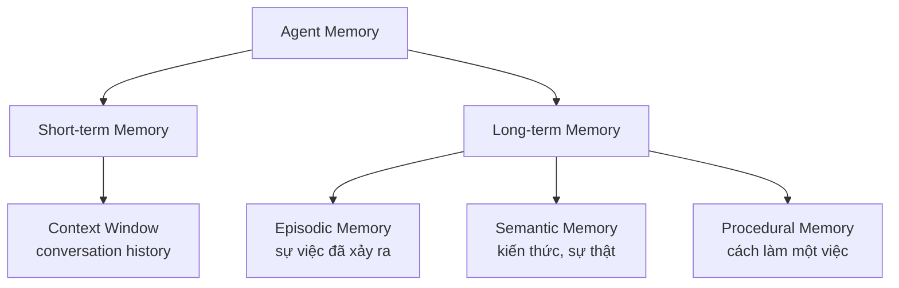
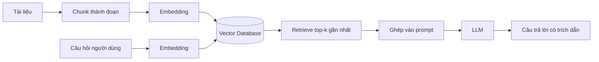

# 🗄️ Module 7. Memory Engineering

> ## 📑 Mục Lục
>
> - [Câu Chuyện Mở Đầu](#câu-chuyện-mở-đầu)
> - [1. Agent Memory là gì?](#1-agent-memory-là-gì)
> - [2. Short-term Memory](#2-short-term-memory)
> - [3. Long-term Memory](#3-long-term-memory)
> - [4. Episodic Memory](#4-episodic-memory)
> - [5. Semantic Memory](#5-semantic-memory)
> - [6. Procedural Memory](#6-procedural-memory)
> - [7. Sơ Đồ Tổng Quan & Bảng So Sánh 4 Loại Trí Nhớ](#7-sơ-đồ-tổng-quan--bảng-so-sánh-4-loại-trí-nhớ)
> - [8. Conversation History](#8-conversation-history)
> - [9. Embeddings](#9-embeddings)
> - [10. Vector Database](#10-vector-database)
> - [11. RAG — Retrieval-Augmented Generation](#11-rag--retrieval-augmented-generation)
> - [12. Memory Retrieval & Memory Update](#12-memory-retrieval--memory-update)
> - [13. Memory Management — Pin/Unpin & Consolidation](#13-memory-management--pinunpin--consolidation)
> - [Tóm Tắt & Checklist](#tóm-tắt--checklist)

---

## Câu Chuyện Mở Đầu

Hãy tưởng tượng bạn gặp lại một người bạn sau ba tháng. Bạn kể: *"Lần trước tôi nhờ anh kiểm tra cái hợp đồng với đối tác X, giờ họ huỷ deal rồi."* Nếu người bạn đó nhìn bạn ngơ ngác hỏi *"Cái gì cơ? Đối tác nào?"* — hẳn bạn sẽ thất vọng: *"Sao không nhớ gì thế!"*

Người trợ lý AI cũng vậy. Nếu mỗi lần mở cửa sổ chat mới là nó **quên sạch** — tên dự án, quyết định đã chốt, kiểu code bạn ưa thích, bài học rút ra lần trước — thì nó chỉ đáng dùng như một chiếc máy đánh chữ thông minh, chứ không phải một **Agent** đáng tin cậy.

Sự khác biệt nằm ở **trí nhớ (memory)**:

> **Trí nhớ là thứ biến một LLM "thông minh nhưng đãng trí" thành một trợ lý biết bạn, nhớ chuyện cũ, và làm việc tốt hơn theo thời gian.**

Nếu Module 1 đã nói *"LLM thiếu memory để trở thành Agent"*, thì Module này chính là câu trả lời: memory được *thiết kế và kỹ thuật hóa* như thế nào. Đây là một trong những khác biệt lớn nhất giữa một chatbot và một Agent thực thụ.

> **Tóm gọn 1 câu:** Memory là thứ giúp Agent "nhớ" giữa các lần hỏi — không có nó, Agent chỉ là một LLM đãng trí làm lại từ đầu mỗi phiên.

---

## 1. Agent Memory là gì?

Trong AI Agent, **memory** không phải một khái niệm mơ hồ mà là **một hệ thống lưu trữ + cơ chế truy xuất** nằm bên ngoài mô hình. Lý do đơn giản: LLM vốn **không có trạng thái** (stateless) — nó chỉ nhìn thấy đúng nội dung bạn đưa vào cửa sổ ngữ cảnh (context window), rồi trả lời một lần rồi thôi. Mọi thứ "nhớ" đều phải đến từ bên ngoài.

Vì vậy, ta có một định nghĩa thực dụng:

> **Agent Memory = khả năng Agent lưu lại, tổ chức, truy xuất và cập nhật thông tin qua các phiên làm việc, nhằm giữ sự liên tục và cá nhân hóa trong hành vi của nó.**

Ba vai trò chính của memory trong Agent:

- **Giữ liên tục (continuity):** nhớ cuộc trò chuyện trước, dự án đang dang dở, cân nhắc đã thống nhất.
- **Cá nhân hóa (personalization):** nhớ sở thích, quy ước, tone giọng của từng người dùng.
- **Học theo thời gian (accumulation):** dùng kết quả các lần làm trước để làm sau tốt hơn — tạo *feedback loop*.

Điều quan trọng cần tách bạch: **memory ≠ tham số mô hình**. Việc LLM "biết tiếng Việt" là do quá trình huấn luyện (training), còn memory nói ở đây là *trạng thái làm việc* của riêng agent — thứ được lưu và thay đổi theo thời gian sử dụng. Bạn sẽ thấy memory được phân thành các loại với thời gian sống (lifetime) rất khác nhau — ngắn hạn tính bằng tin nhắn, dài hạn tính bằng tháng/năm.

> **Tóm gọn 1 câu:** Agent Memory không nằm trong mô hình mà là một hệ thống lưu–truy xuất bên ngoài — giúp Agent duy trì sự liên tục, cá nhân hóa và tích lũy kinh nghiệm.

---

## 2. Short-term Memory

**Short-term Memory (bộ nhớ ngắn hạn)** là thông tin Agent đang giữ *ngay lúc này* để hoàn thành cuộc trò chuyện hoặc tác vụ hiện tại. Trong thực tế, nó gần như trùng với **context window** — lượng ngữ cảnh được đưa trực tiếp vào prompt của LLM ở mỗi lượt gọi.

Đặc điểm nổi bật:

- **Thời gian sống ngắn:** tính bằng lượt trò chuyện hoặc một phiên làm việc, không qua đêm.
- **Dung lượng có hạn:** bị khóa chặt bởi kích thước context window của mô hình (ví dụ 200k token). Đây chính là nỗi lo *context overflow* — bạn sẽ học cách quản lý nó ở Module 6.
- **Truy xuất nhanh:** vì nằm ngay trong prompt, LLM "thấy" ngay không cần tìm kiếm.

Cách short-term memory được xử lý trong một Agent:

- **Conversation History** (lịch sử hội thoại) được cắt thành các đoạn và đưa vào prompt theo thứ tự, thường là theo dạng role tròn: `user → assistant → user → assistant`.
- Loạt cơ chế **context management** (trimming, churning, summarization, compaction) giúp giữ short-term memory nhỏ gọn — chi tiết sẽ học ở Module 6.
- Không chỉ là "đoạn chat": short-term memory còn gồm **working context** — file đang mở, các bước agent đang thực hiện trong vòng lặp hiện tại (tool call, output hiện tại).

Hãy nhớ: short-term memory là nơi LLM hoạt động, còn *long-term memory* là nơi Agent "cất đồ" khi không dùng.

> **Tóm gọn 1 câu:** Short-term Memory = toàn bộ ngữ cảnh đang nằm trong context window của LLM — nhanh, tạm thời, và bị giới hạn bởi dung lượng mô hình.

---

## 3. Long-term Memory

**Long-term Memory (bộ nhớ dài hạn)** là kho lưu trữ thông tin **tồn tại vượt qua từng phiên** — ngày, tuần, tháng, thậm chí vĩnh viễn. Nó là thứ "ở bên ngoài" LLM và được nạp lại khi cần. Đây chính là thứ biến một Agent thành "một nhân viên lâu năm" thay vì "thực tập sinh mới mỗi sáng".

Long-term memory thường được phân thành **ba nhánh chính**, mô phỏng phân loại trí nhớ con người (mô hình tâm lý học cổ điển của Tulving):

- **Episodic Memory** — nhớ *sự việc đã xảy ra*.
- **Semantic Memory** — nhớ *kiến thức, sự kiện, khái niệm*.
- **Procedural Memory** — nhớ *cách làm một việc*.

Cùng với **short-term memory**, ta có **bốn loại trí nhớ** mà mọi thiết kế memory của Agent đều quay quanh — sẽ được sơ đồ hóa ở mục 7. Về mặt kỹ thuật, long-term memory không phải một "nơi" duy nhất: nó có thể là file, database, vector database, hay sự kết hợp cả ba — tùy loại trí nhớ và tốc độ truy xuất yêu cầu.

Nguyên tắc vàng khi thiết kế: **chỉ nạp vào context những gì cần cho việc hiện tại**. Ném cả kho ký ức vào prompt sẽ làm tràn context và làm loãng sự tập trung của LLM — vì thế long-term memory luôn đi kèm *retrieval* (truy xuất có chọn lọc), học ở mục 12.

> **Tóm gọn 1 câu:** Long-term Memory là kho lưu trữ tồn tại qua nhiều phiên, có ba nhánh chính — Episodic, Semantic, Procedural — và chỉ được "nạp vào đầu" khi cần.

---

## 4. Episodic Memory

**Episodic Memory (trí nhớ sự kiện)** lưu lại *toàn bộ một trải nghiệm* như một "thước phim": *chuyện gì đã xảy ra, khi nào, với bối cảnh nào.* Nó trả lời câu hỏi *"Lần trước con đã làm gì?"*

Ví dụ với một support agent:

- "Ngày 2/3, người dùng Alex khiếu nại hóa đơn, tôi giải thích xong và anh ấy hỏi lại về chính sách hoàn tiền."
- "Ở phiên trước, tôi đã đề xuất giải pháp X nhưng khách không đồng ý, nên lần này tôi nên thử Y."

Vai trò quan trọng của episodic memory trong Agent:

- **Giữ sự liên tục của cuộc trò chuyện:** nhớ chính xác ai đã nói gì, mình đã làm gì, kết quả ra sao.
- **Rút kinh nghiệm theo tình huống:** mỗi "tập phim" là một dữ liệu để Agent đối chiếu khi gặp tình huống tương tự.
- **Tạo sự cá nhân hóa sâu:** nhớ lịch sử tương tác riêng của từng người dùng cụ thể.

Cách lưu trữ điển hình: mỗi entry episodic thường là **một mô tả ngôn ngữ tự nhiên có tag thời gian** (timestamp, kèm metadata về người dùng/tác vụ), có thể nằm trong một database tuần tự. Khi cần, Agent truy xuất các sự kiện liên quan và nạp chúng vào context để "nhớ lại" bối cảnh.

> **Tóm gọn 1 câu:** Episodic Memory nhớ "chuyện đã xảy ra" như thước phim có mốc thời gian — giúp Agent giữ sự liên tục và cá nhân hóa với từng người dùng.

---

## 5. Semantic Memory

**Semantic Memory (trí nhớ ngữ nghĩa)** lưu *kiến thức tách rời khỏi bối cảnh cụ thể* — sự kiện, khái niệm, quy tắc, đặc điểm của thế giới và của người dùng. Nó trả lời câu hỏi *"Cái gì là đúng?"*, nhưng trang bị riêng cho Agent, chứ không phải kiến thức chung của LLM.

Ví dụ:

- "Khách hàng ưu tiên trả lời ngắn gọn và dùng tiếng Anh."
- "Tiêu chuẩn code của dự án này: dùng Python, tên biến camelCase."
- "Sản phẩm A bán chạy nhất vào quý 4, đối thủ chính là B."

Khác với episodic (một sự kiện cụ thể), semantic là **sự khái quát hóa** — thường được *rút ra/cô đọng* từ nhiều sự kiện lặp lại. Trong hệ thống memory, semantic memory thường được:

- Lưu dưới dạng **cặp key-value hoặc bản ghi có cấu trúc** (như JSON, SQL), dễ truy xuất chính xác.
- Lưu dưới dạng **văn bản ngắn không cần ngữ cảnh**, đóng vai trò như một "hồ sơ người dùng" (user profile) hoặc "hồ sơ dự án" được nạp bổ sung khi cần.

Semantic memory còn gắn chặt với **embedding và vector database** (mục 9, 10): vì nội dung semantic rất đa dạng, truy xuất "theo ý nghĩa" (semantic search) hiệu quả hơn truy xuất theo từ khóa. Và khi cần *bổ sung tri thức từ bên ngoài* cho semantic memory, ta dùng **RAG** (mục 11).

> **Tóm gọn 1 câu:** Semantic Memory lưu kiến thức và sự thật đã được khái quát hóa — giống "hồ sơ" về người dùng, dự án và thế giới — thường được truy xuất theo ý nghĩa nhờ embedding.

---

## 6. Procedural Memory

**Procedural Memory (trí nhớ thủ tục)** lưu *cách thực hiện một việc* — các bước, quy trình, "đường đi nước bước" đã được chứng minh là hiệu quả. Nó trả lời câu hỏi *"Làm việc này như thế nào?"*.

Ví dụ:

- "Khi nhận ticket lỗi login: xác minh tài khoản → kiểm tra ghi chép trước mắt → kiểm tra log 24h → nếu không rõ thì tạo ticket cho team backend."
- "Khi viết commit message: theo convention `type(scope): description`."
- "Khi tạo báo cáo: lấy số liệu → vẽ bảng → kèm phần tóm tắt 3 dòng ở đầu."

Vì LLM chưa từng học các bước riêng của *công ty bạn*, procedural memory chính là nơi "truyền nghề" — mã hóa quy trình làm việc tốt thành thứ Agent lặp lại được. Trong các framework, procedural memory thường được thể hiện qua:

- **Prompts / instructions** đóng vai trò hướng dẫn từng bước, gắn trực tiếp hoặc nạp khi gặp loại tác vụ tương ứng.
- **Skills / code / template tool** — những "kỹ năng đóng gói" mà Agent gọi ra khi cần (liên quan mật thiết đến cách tool được gắn vào Agent — sẽ học chi tiết ở Module 8).
- **Quy trình công việc (workflows / policies)** đã được đúc kết từ thực tế.

Khác biệt cốt lõi: episodic nhớ "cái gì đã xảy ra", semantic nhớ "cái gì đúng", còn procedural nhớ **"làm sao để thành công"** — nó là bí quyết hành động của Agent.

> **Tóm gọn 1 câu:** Procedural Memory chứa "cách làm" — bước, quy trình, kỹ năng — mã hóa kinh nghiệm thành việc Agent lặp lại nhất quán mỗi khi gặp tình huống quen thuộc.

---

## 7. Sơ Đồ Tổng Quan & Bảng So Sánh 4 Loại Trí Nhớ

Tổng kết bức tranh toàn cục: Agent quản lý bốn loại trí nhớ phục vụ các vai trò khác nhau — ngắn hạn để "đang làm", và ba nhánh dài hạn để "đã biết / đã trải / đã thuộc cách làm".



| Loại trí nhớ | Trả lời câu hỏi | Thời gian sống | Dung lượng | Lưu trữ điển hình |
|---|---|---|---|---|
| **Short-term** | "Đang làm gì?" | Trong phiên / lượt chat | Nhỏ, giới hạn bởi context window | Prompt / context window |
| **Episodic** | "Chuyện gì đã xảy ra?" | Dài (ngày → tháng) | Vừa | Database có timestamp, mô tả sự kiện |
| **Semantic** | "Điều gì là đúng?" | Rất dài (vĩnh viễn) | Lớn, đa dạng | Key-value / bản ghi cấu trúc, vector DB |
| **Procedural** | "Làm sao để làm?" | Rất dài (ổn định) | Nhỏ, súc tích | Prompt, skills, workflows, template tool |

*Cách đọc bảng: từ trên xuống, độ "tạm thời" giảm dần và độ "tồn tại lâu dài" tăng dần; mỗi loại đòi hỏi một cơ chế lưu trữ và truy xuất riêng.*

> **Tóm gọn 1 câu:** Bốn loại trí nhớ — Short-term, Episodic, Semantic, Procedural — khác nhau ở câu hỏi chúng trả lời và thời gian sống; thiết kế memory tốt là chọn đúng loại cho đúng mục đích và nạp đúng lúc.

---

## 8. Conversation History

**Conversation History (lịch sử hội thoại)** là bản ghi các lượt trao đổi giữa người dùng và Agent — đơn vị cơ bản nhất của memory. Mỗi lượt như một "mắt xích" với vai trò rõ ràng:

```
user:      "Tôi đang bị lỗi login"
assistant: "Bạn thử xóa cache và đăng nhập lại xem sao"
user:      "Vẫn không được..."
assistant: "Vậy để tôi kiểm tra log tài khoản của bạn"
```

Vai trò của conversation history trong memory engineering:

- **Trở thành short-term memory mặc định** của mọi Agent chat: nó giúp mô hình theo dõi ngữ cảnh đang diễn ra.
- **Là nguồn dữ liệu thô (crude source)** để trích xuất lên các loại trí nhớ dài hạn: từ nhiều lượt hội thoại, Agent có thể tổng kết thành *semantic memory* (ví dụ: "người dùng này thích trả lời ngắn") hoặc *episodic memory* ("lần trước vấn đề X đã được giải quyết bằng cách Y").

Nhưng conversation history không nên vô hạn: nó **chiếm context window** (gây context overflow — Module 6) và thể hiện **recency bias** (tin gần nhất được ưu tiên). Do đó các Agent thường phải lựa chọn giữa việc *giữ nguyên lịch sử* hay *nén/tóm tắt* (summarization, compaction) các đoạn cũ. Đây cũng là nơi người ta phân biệt **trí nhớ ngắn hạn mặc định** (tự có trong mọi chatbot) và **trí nhớ được thiết kế** (của Agent chuyên sâu).

> **Tóm gọn 1 câu:** Conversation History là "bản ghi cuộc nói chuyện" làm nền cho short-term memory và là nguồn nguyên liệu để đúc thành trí nhớ dài hạn — nhưng phải được cắt, nén và chọn lọc để không làm tràn context.

---

## 9. Embeddings

Để truy xuất trí nhớ "theo ý nghĩa" (chứ không phải theo từ khóa chính xác), ta cần biến văn bản thành **con số mà máy hiểu được ý nghĩa** — đó chính là **embeddings (vec-tơ nhúng)**.

**Embedding** là một mảng số (vector) đại diện cho *ý nghĩa* của một đoạn văn bản, được sinh ra bởi một mô hình embedding chuyên dụng (ví dụ `text-embedding-3`, `BGE`, `bge-m3`...). Đặc tính kỳ diệu:

- Hai đoạn văn bản **gần nghĩa** sẽ có vector **gần nhau** trong không gian nhiều chiều.
- Vì vậy, so sánh độ gần nghĩa = tính khoảng cách (thường là *cosine similarity*) giữa hai vector.

Ví dụ trực quan: vector của câu *"cách sửa lỗi đăng nhập"* sẽ gần với câu *"log in không vào được, xử lý sao?"* hơn là câu *"công thức nấu phở"* — dù không trùng từ khóa nào.

Điểm quan trọng: embedding **không phải là LLM sinh text** — nó là một mô hình riêng, đầu ra là số, không có "câu trả lời". Trong memory engineering, embedding là *chìa khóa* để biến một mớ văn bản rời rạc thành một kho tàng *truy xuất theo nghĩa*, làm nền cho vector database và RAG (mục 10, 11). Lưu ý: mỗi mô hình embedding sinh ra vector với *số chiều* khác nhau (ví dụ 768, 1024, 3072...) — số chiều ảnh hưởng trực tiếp đến chất lượng và chi phí lưu trữ.

> **Tóm gọn 1 câu:** Embedding biến văn bản thành con số (vector) mang ý nghĩa — văn bản gần nghĩa thì vector gần nhau — là nền tảng cho mọi truy xuất "theo nghĩa" trong memory.

---

## 10. Vector Database

Với embeddings là "con số mang nghĩa", **Vector Database (cơ sở dữ liệu vector)** là *kho chứa và máy tìm kiếm* cho các con số đó. Nó lưu hàng triệu vector cùng metadata (văn bản gốc, timestamp, nguồn...), rồi trả lời câu hỏi *"vector nào gần nhất với câu hỏi này?"* một cách nhanh chóng.

Các khả năng cốt lõi:

- **Similarity search:** tìm top-k vector gần nhất theo khoảng cách (cosine / euclidean).
- **Cập nhật linh hoạt:** thêm, sửa, xóa bản ghi — phù hợp với trí nhớ thay đổi theo thời gian.
- **Metadata filtering:** lọc trước khi tìm (chỉ tìm trong phạm vi một người dùng, một dự án, một khoảng thời gian).

Ví dụ công cụ phổ biến: **FAISS** (thư viện), **ChromaDB**, **Pinecone**, **Qdrant**, **Weaviate**, **pgvector** (cho PostgreSQL).

Một khoảnh khắc cần làm rõ với người mới: vector database **không "hiểu" gì cả** — nó chỉ giỏi một phép toán (tìm hàng xóm gần nhất). Toàn bộ "hiểu biết" đến từ embedding model (mục 9). Nó cũng không thay thế database quan hệ: với dữ liệu cần truy vấn chính xác theo trường (SQL), người ta vẫn dùng SQL — còn vector DB giải quyết bài toán *"tìm theo nghĩa, không biết trước từ khóa"*.

> **Tóm gọn 1 câu:** Vector Database là kho chứa + máy tìm "hàng xóm gần nhất" cho embedding — giúp Agent truy xuất trí nhớ theo nghĩa trong vài mili-giây.

---

## 11. RAG — Retrieval-Augmented Generation

**RAG (Retrieval-Augmented Generation, sinh văn bản có truy xuất)** là kỹ thuật *"tra sổ trước, rồi mới trả lời"*: thay vì để LLM tự bịa kiến thức, ta **truy xuất các đoạn liên quan** từ một kho kiến thức (thường là vector database) rồi đưa vào prompt cùng câu hỏi. LLM trả lời *dựa trên những gì tìm thấy*.

Đây chính là "cầu nối" giúp semantic memory không chỉ là thông tin của một Agent mà còn là **kiến thức cả công ty**: tài liệu, PDF, wiki, FAQ... Được "nhúng" vào kho tri thức có thể truy xuất. RAG giải quyết hai vấn đề lớn: LLM *không biết* dữ liệu riêng của bạn, và LLM *bịa* (hallucination) khi không chắc chắn.

Quy trình RAG điển hình gồm hai giai đoạn. **Giai đoạn xây kho (indexing)** diễn ra trước, không theo từng lượt hỏi:

1. **Chunk:** tài liệu được cắt thành các đoạn (chunk) vừa phải.
2. **Embedding:** mỗi chunk được nhúng thành vector.
3. **Lưu vào vector database.**

**Giai đoạn truy xuất (retrieval + generation)** diễn ra tại mỗi lượt hỏi:

1. **Câu hỏi người dùng** được nhúng thành vector.
2. **Truy xuất top-k** chunk gần nhất từ vector database.
3. Ghép các chunk vào **prompt** cùng câu hỏi.
4. **LLM sinh câu trả lời**, bám theo các chunk vừa lấy.



*Cách đọc sơ đồ: nhánh trên là "xây kho" một lần; nhánh duới là "truy xuất từng lượt hỏi" — kết quả truy xuất được nạp thẳng vào prompt cho LLM.*

> **Tóm gọn 1 câu:** RAG = "tra sổ trước khi trả lời" — truy xuất những đoạn gần nghĩa nhất từ kho vector rồi nạp vào prompt — giúp LLM trả lời đúng, đúng nguồn, và không bịa.

---

## 12. Memory Retrieval & Memory Update

Có kho trí nhớ thôi chưa đủ — Agent còn cần biết **khi nào lấy gì** (retrieval) và **khi nào ghi gì, sửa gì** (update). Đây là hai chiều vận hành của memory engineering.

**Memory Retrieval (truy xuất)** — quyết định *nạp gì* vào context:

- **Chủ động (proactive / explicit):** Agent xác định "tôi cần nhớ gì cho việc này" rồi đi tìm — hỏi vector DB, đọc file, tra hồ sơ người dùng.
- **Thụ động (background / implicit):** một số thông tin luôn được nạp sẵn (hồ sơ người dùng, quy tắc cố định) mà không cần tìm.
- Chiến lược phổ biến gồm **semantic retrieval** (theo nghĩa, nhờ embedding), **recency-based** (ưu tiên mới), **importance-based** (ưu tiên quan trọng), và *recency + importance + relevance weighted* — kinh điển trong mô hình trí nhớ như **MemGPT / Letta**.

**Memory Update (cập nhật)** — quyết định *ghi gì* sau mỗi lần làm việc:

- **Ghi mới (write/append):** lưu sự kiện, kết quả, thông tin mới về người dùng.
- **Sửa/ghi đè (update):** một thông tin cũ không còn đúng (khách đổi số điện thoại) — cần cập nhật thay vì tích thêm bản sai.
- **Đối chiếu nhất quán (consistency):** tránh hai bản ghi mâu thuẫn trong cùng một hệ thống memory.
- **Chọn lọc (filtering):** không phải mọi chi tiết đều đáng nhớ — nếu ghi mọi thứ, retrieval sẽ nhiễu và context sẽ tràn.

Nhịp cập nhật thường diễn ra ở **cuối vòng lặp hoặc cuối phiên** (khi Agent đã có kết quả), gắn chặt với vòng lặp *perceive → decide → act* bạn đã học ở Module 1. Cài đặt thực tế thường là: hội thoại sinh ra "sự kiện" → tổng hợp thành "memory entry" → lưu vào kho → sẵn sàng được truy xuất ở phiên sau.

> **Tóm gọn 1 câu:** Retrieval quyết định nạp gì vào context cho đúng việc, Update quyết định ghi gì để kho trí nhớ luôn đúng và không nhiễu — hai chiều này cùng nhau làm trí nhớ "sống" thay vì chỉ "có".

---

## 13. Memory Management — Pin/Unpin & Consolidation

Khi trí nhớ lớn dần, Agent cần một lớp **quản lý** để giữ cho nó gọn gàng, đúng trọng tâm và không tốn kém. Hai kỹ thuật quan trọng:

**Pin / Unpin (găm / gỡ găm):** cho phép *khóa một thông tin vào working context* để nó luôn được dùng, bất kể retrieval có tìm thấy hay không:

- **Pin:** đánh dấu một memory là *quan trọng, luôn giữ* — ví dụ: "khách A thích ngắn gọn", "dự án dùng Python" — không bao giờ bị đẩy ra khi context chật.
- **Unpin:** khi thông tin không còn quan trọng nữa, gỡ pin để nó trở lại trạng thái *được truy xuất khi cần* hoặc bị xóa.
- Pin thường kết hợp với *ngưỡng quan trọng (importance threshold)*: memory nào điểm quan trọng cao sẽ được ưu tiên giữ.

**Consolidation (củng cố / hợp nhất):** quá trình *gộp, cô đọng và dọn dẹp* trí nhớ định kỳ:

- **Trích xuất:** từ một phiên hội thoại dài, rút ra các *sự kiện đáng nhớ* và *kiến thức khái quát hóa* để chuyển lên long-term memory.
- **Tổng hợp / khái quát:** nhiều sự kiện lặp lặp lại → gộp thành một quy luật semantic (thay vì nhớ 20 lần "khách hỏi giá", chỉ cần nhớ "khách quan tâm giá").
- **Nén / tóm tắt:** các conversation history cũ được tóm tắt để tiết kiệm context.
- **Xóa / lãng quên (forgetting):** memory cũ, lỗi thời, trùng lặp sẽ được gỡ — trí nhớ tốt cũng là trí nhớ biết quên.

Consolidation gắn với khái niệm *memory hierarchy* — dữ liệu chảy từ short-term (tạm) → episodic/semantic (lâu) → ngày càng tinh giản. Đây là lý do các framework Agent (như MemGPT/Letta, LangMem, OpenAI Agents SDK) cung cấp sẵn vòng đời quản lý trí nhớ thay vì để ta tự xử lý thủ công — và các cơ chế quản lý vòng đời này sẽ được làm sâu hơn ở phần *frameworks* (Module 14 trở đi trong Part 4 của khóa).

> **Tóm gọn 1 câu:** Memory Management là lớp "giữ kho sạch" — pin giữ thứ quan trọng luôn ở gần, consolidation trích xuất, gộp và quên đi thứ thừa — để trí nhớ đúng trọng tâm và không phình to vô kiểm soát.

---

## Tóm Tắt & Checklist

### Nội dung đã học trong module này

1. **Agent Memory** là một hệ thống lưu + truy xuất nằm ngoài mô hình — LLM vốn *stateless*, mọi "trí nhớ" đều phải được thiết kế.
2. **Short-term Memory** = mọi thứ trong context window — nhanh, tạm thời, giới hạn dung lượng; **Long-term Memory** = kho tồn tại qua nhiều phiên.
3. **Episodic** nhớ *sự việc đã xảy ra*, **Semantic** nhớ *kiến thức/sự thật*, **Procedural** nhớ *cách làm* — ba nhánh của long-term memory.
4. **Conversation History** là nền của short-term memory và là nguồn nguyên liệu để đúc trí nhớ dài hạn.
5. **Embeddings** biến văn bản thành vector mang ý nghĩa; **Vector Database** là kho + máy tìm "gần nhất theo nghĩa"; **RAG** = "tra sổ rồi trả lời" để chống bịa và bổ sung tri thức riêng.
6. **Retrieval & Update** làm trí nhớ sống động; **Memory Management** (pin/unpin + consolidation) giữ kho trí nhớ gọn gàng, đúng trọng tâm.

### Checklist tự kiểm tra

Bạn đã nắm được khi có thể trả lời lưu loát các câu hỏi sau:

- [ ] Giải thích được tại sao LLM "không nhớ" và memory phải nằm ngoài mô hình?
- [ ] Phân biệt được short-term memory và long-term memory bằng dấu hiệu "thời gian sống" và "nằm trong hay ngoài context"?
- [ ] Kể được ví dụ riêng cho từng loại: Episodic, Semantic, Procedural?
- [ ] Giải thích được vì sao hai câu không trùng từ khóa vẫn có thể được tìm thấy nhờ embeddings?
- [ ] Vẽ/trình bày được quy trình RAG: chunk → embedding → vector DB → retrieve → prompt → LLM?
- [ ] Thử thiết kế cho một Agent của bạn: loại thông tin nào nên *pin* giữ nguyên, loại nào nên để *retrieval*, loại nào nên *consolidation* gộp lại?

---

## Tóm Gọn Toàn Module

> **Một câu để nhớ mãi:** Memory biến một LLM vô hồn, đãng trí thành một Agent "có nhân cách" — chỉ cần bạn phân biệt rõ *ngắn hạn* (context) và *dài hạn* (Episodic → sự việc, Semantic → kiến thức, Procedural → kỹ năng), dùng embeddings + vector database + RAG để truy xuất theo nghĩa, và thêm pin/unpin + consolidation để kho trí nhớ luôn gọn, luôn đúng, luôn sẵn sàng.

**Đi tiếp:** Module 8 sẽ chuyển sang chiều vận hành thứ hai của Agent — *Tool Calling & External Integration*: cách Agent "duỗi tay" ra thế giới qua function calling, file system, terminal, API, và MCP. Memory (Module 7) cho Agent *trí nhớ*, còn tools (Module 8) cho Agent *tay chân* — kết hợp cả hai mới thành một Agent hoàn chỉnh trong vòng lặp "nhớ → hành động → kiểm tra → rút kinh nghiệm".
