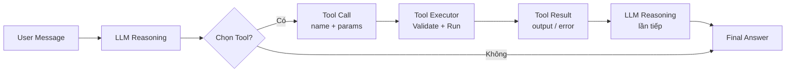

# 🛠️ Module 8. Tool Calling & External Integration

> ## 📑 Mục Lục
>
> - [Câu Chuyện Mở Đầu](#câu-chuyện-mở-đầu)
> - [1. Tool là gì?](#1-tool-là-gì)
> - [2. Function Calling vs Tool Calling](#2-function-calling-vs-tool-calling)
> - [3. Tool Definition / JSON Schema](#3-tool-definition--json-schema)
> - [4. Tool Selection](#4-tool-selection)
> - [5. Tool Execution](#5-tool-execution)
> - [6. Tool Result](#6-tool-result)
> - [7. Error Handling & Retry Mechanism](#7-error-handling--retry-mechanism)
> - [8. Tool Permission](#8-tool-permission)
> - [9. External API Integration](#9-external-api-integration)
> - [10. File System / Terminal / Browser / Database](#10-file-system--terminal--browser--database)
> - [11. MCP — Model Context Protocol (Tổng quan)](#11-mcp--model-context-protocol-tổng-quan)
> - [Tóm Tắt & Checklist](#tóm-tắt--checklist)

---

## Câu Chuyện Mở Đầu

Bạn đang ở một nhà hàng cao cấp. Người phục vụ đến bàn, bạn nói: *"Tôi muốn một phần beef Wellington, ít muối, kèm một chai rượu vang đỏ vùng Bordeaux năm 2015."*

Người phục vụ **hiểu** hoàn hảo yêu cầu — nhưng bản thân anh ta không nấu ăn, không rút rượu từ hầm, không tính tiền. Việc của anh ta là **dịch yêu cầu thành hành động cụ thể**: ghi order → chuyển bếp → bếp nấu → bar chuẩn bị rượu → mang ra bàn.

Trong thế giới AI Agent, **Tool (công cụ)** chính là "người phục vụ" đó — cây cầu giữa *lời nói* của LLM và *hành động* trong thế giới thực. Không có Tool, LLM chỉ miêu tả món ăn bằng lời, không ai nấu cả. Có Tool, LLM thực sự gọi API, đọc file, chạy lệnh, truy vấn database — hoàn thành việc đến nơi.

> **Tóm gọn 1 câu:** Tool là "tay chân" mà LLM dùng để hành động ngoài thế giới thực — đọc, gọi, ghi, chạy — thay vì chỉ trả lời bằng lời.

---

## 1. Tool là gì?

Một **Tool** là một hàm/chương trình mà Agent gọi để thực hiện một hành động cụ thể ngoài khả năng suy luận của LLM — ví dụ `read_file(path)`, `send_email(to, subject, body)`, `search_web(query)`, `run_sql(query)`. LLM **không tự có** những khả năng này — chúng được lập trình viên đăng ký vào hệ thống, rồi LLM quyết định khi nào dùng cái nào.

> **Tóm gọn 1 câu:** Tool là một hàm được đăng ký sẵn mà Agent gọi khi cần thực hiện hành động thực tế mà LLM thuần túy không làm được.

---

## 2. Function Calling vs Tool Calling

Hai thuật ngữ hay bị dùng lẫn nhau:

| | **Function Calling** | **Tool Calling** |
|---|---|---|
| **Nguồn gốc** | Thuật ngữ nhà cung cấp LLM (OpenAI, Anthropic...) | Thuật ngữ cộng đồng rộng hơn |
| **Phạm vi** | Gọi hàm qua API của model | Gọi hàm + API bên ngoài + tương tác hệ thống |
| **Quan hệ** | Function Calling ⊂ Tool Calling | Tool Calling ⊃ Function Calling |

Function Calling là *một cách* để triển khai Tool Calling — khi xài API LLM trực tiếp thì dùng Function Calling, khi xây Agent phức tạp thì dùng Tool Calling tổng thể.

> **Tóm gọn 1 câu:** Function Calling là cơ chế gọi hàm của riêng LLM; Tool Calling là khái niệm rộng hơn — tổng thể mọi cách Agent gọi công cụ bên ngoài.

---

## 3. Tool Definition / JSON Schema

Để LLM biết có tool nào và dùng thế nào, ta mô tả tool bằng **JSON Schema** — cùng chuẩn dùng trong API validation — rồi truyền vào prompt của LLM cùng với message. Mỗi tool definition gồm: `name` (tên hàm), `description` (mô tả bằng ngôn ngữ tự nhiên giúp LLM hiểu khi nào dùng), và `parameters` (JSON Schema mô tả tham số đầu vào).

### 3.2 Ví dụ đầy đủ

```json
{
  "name": "search_weather",
  "description": "Tra cứu thời tiết hiện tại của một thành phố theo tên. Trả về nhiệt độ, độ ẩm, tình trạng mưa/nắng.",
  "parameters": {
    "type": "object",
    "properties": {
      "city": {
        "type": "string",
        "description": "Tên thành phố cần tra cứu thời tiết (VD: 'Hanoi', 'Ho Chi Minh City')"
      },
      "unit": {
        "type": "string",
        "enum": ["celsius", "fahrenheit"],
        "description": "Đơn vị nhiệt độ trả về. Mặc định là celsius.",
        "default": "celsius"
      }
    },
    "required": ["city"]
  }
}
```

Đây chính là JSON Schema — LLM đọc `description` và tự quyết định: *"User hỏi thời tiết Tokyo — đây là lúc gọi `search_weather` với `city='Tokyo'`."*

> **Tóm gọn 1 câu:** Tool Definition là bản mô tả chuẩn JSON Schema gồm tên, mô tả, và tham số — giúp LLM hiểu tool nào dùng, khi nào, với tham số gì.

---

## 4. Tool Selection

Sau khi có danh sách tool đã đăng ký, LLM quyết định **gọi tool nào với tham số gì** — gọi là **Tool Selection**, gồm hai cấp độ:

### 4.1 Tool Selection (chọn tool nào)

LLM đọc toàn bộ mô tả các tool → suy nghĩ → quyết định gọi tool nào (hoặc không gọi, chỉ trả lời text):

```
Người dùng: "Thời tiết hôm nay ở Đà Nẵng thế nào?"
LLM: "Liên quan thời tiết → dùng search_weather(city='Da Nang', unit='celsius')"
```

Nếu thiếu tham số bắt buộc, LLM sẽ hỏi lại user hoặc đoán giá trị hợp lý.

> **Tóm gọn 1 câu:** Tool Selection là quá trình LLM phân tích yêu cầu → quyết định gọi tool nào với tham số gì.

---

## 5. Tool Execution

Sau khi LLM quyết định gọi tool, **hệ thống thực thi** theo trình tự: *parse* (tên + tham số) → *validate* (đủ required) → *execute* (hàm thực tế) → *collect* (kết quả/lỗi) → **trả kết quả về cho LLM** dưới dạng message mới.



Điểm quan trọng: **LLM không tự chạy tool** — LLM chỉ quyết định *gọi gì*. Phần thực thi do hệ thống (runtime/framework) đảm nhiệm. Đây là lý do tool execution cần có error handling chặt chẽ.

> **Tóm gọn 1 câu:** Tool Execution là hệ thống nhận yêu cầu từ LLM, thực thi hàm thực tế, rồi trả kết quả về cho LLM tiếp tục suy luận.

## 6. Tool Result

Kết quả trả về từ tool gọi là **Tool Result** — một message đặc biệt được chèn vào cuộc hội thoại giữa LLM và user.

### 6.1 Cấu trúc Tool Result

Thông thường một Tool Result gồm:

```
Tool: search_weather
Result: {"city": "Da Nang", "temperature": 28, "unit": "celsius", "condition": "sunny", "humidity": 75}
```

### 6.2 Cách LLM xử lý kết quả

Sau khi nhận Tool Result, LLM đọc kết quả rồi quyết định bước tiếp theo:

- **Đủ thông tin** → trả lời user
- **Chưa đủ** → gọi thêm tool khác
- **Có lỗi** → thử lại hoặc xử lý lỗi

### 6.3 Streaming vs Blocking

- **Streaming (async):** kết quả trả về dần — LLM có thể suy luận sớm khi tool chưa chạy xong (VD: tải file lớn).
- **Blocking (sync):** chờ tool xong hoàn toàn rồi mới trả kết quả — đơn giản và dễ debug.

> **Tóm gọn 1 câu:** Tool Result là output của tool, được định dạng chuẩn và chèn vào cuộc hội thoại để LLM xử lý tiếp hoặc trả lời user.

---

## 7. Error Handling & Retry Mechanism

Tool có thể thất bại vì nhiều nguyên nhân: lỗi mạng, tham số sai, hết quyền truy cập, timeout, hoặc LLM gọi tên tool không tồn tại. Mỗi nguyên nhân cần cách xử lý phù hợp.

### 7.1 Retry Mechanism

Cấu hình phổ biến: **max_retries** (số lần thử tối đa, thường 2–3), **backoff** (chờ tăng dần: 1s → 2s → 4s), và **retry_on** (danh sách lỗi được phép retry). Không phải lỗi nào cũng nên retry — lỗi quyền truy cập thì retry vô ích, lỗi mạng tạm thời thì nên retry.

### 7.2 Fallback

Khi tool chính thất bại sau max retries, dùng **Fallback** — tool thay thế:

```
Primary: search_google → FAIL
Fallback: search_bing → SUCCESS
```

> **Tóm gọn 1 câu:** Error Handling phát hiện lỗi từng lần gọi; Retry Mechanism tự động thử lại với backoff; Fallback dùng tool thay thế khi tool chính không phục hồi được.

---

## 8. Tool Permission

Không phải tool nào cũng được gọi mọi lúc. **Tool Permission** kiểm soát *ai được gọi tool gì, trong điều kiện nào*.

### 8.1 Các mức quyền tool phổ biến

| Mức | Tên | Mô tả | Ví dụ |
|-----|-----|-------|-------|
| **0** | Không cho phép | Tool bị vô hiệu hoá hoàn toàn | Không cho phép gọi `delete_database` |
| **1** | Chỉ đọc (Read-only) | Chỉ xem, không thay đổi | `read_file`, `search_web` |
| **2** | Đọc + Ghi (Read + Write) | Xem và tạo/sửa nội dung | `write_file`, `send_email` |
| **3** | Thực thi có giới hạn | Gọi được nhưng có ràng buộc | `run_sql` (chỉ SELECT), `terminal` (chỉ lệnh cho phép) |
| **4** | Toàn quyền (Full Access) | Gọi mọi thứ không giới hạn | Admin tool — cực kỳ nguy hiểm nếu bị lợi dụng |

### 8.2 Phân quyền theo ngữ cảnh

Mức quyền còn thay đổi theo: **người dùng** (Admin gọi mọi tool, user thường bị giới hạn), **môi trường** (Production khác Development), và **độ nhạy cảm của nội dung** (API tài chính/thanh toán luôn cần xác thực bổ sung).

> **Tóm gọn 1 câu:** Tool Permission kiểm soát ai được gọi tool nào — từ chỉ-đọc đến toàn-quyền — để đảm bảo Agent không làm điều không nên.

---

## 9. External API Integration

Agent thường cần gọi **External API** — dịch vụ bên thứ ba — để lấy dữ liệu hoặc thực hiện hành động thực tế. Các pattern phổ biến: REST API (đơn giản, trả JSON), GraphQL (linh hoạt trường dữ liệu), WebSocket (thời gian thực), và Webhook (server gọi ngược).

**Các bước tích hợp:** xác định endpoint + auth → viết wrapper function đóng gói HTTP call → xử lý response (parse, validate, map lỗi) → đăng ký vào Agent → test end-to-end.

> **Tóm gọn 1 câu:** External API Integration là đóng gói HTTP call thành tool function, với authentication, error handling, và đăng ký vào hệ thống tool của Agent.

---

## 10. File System / Terminal / Browser / Database

Bốn loại tích hợp phổ biến nhất:

### 10.1 File System

Cho phép Agent đọc/ghi file: `read_file(path)`, `write_file(path, data)`, `list_directory(path)`. ⚠️ Giới hạn quyền cẩn thận — Agent có thể ghi đè hoặc xoá file quan trọng.

### 10.2 Terminal / Shell

Cho phép Agent chạy lệnh command-line: `run_command(cmd)`, `run_python(code)`. ⚠️ Rủi ro bảo mật cao — luôn sandbox và chỉ cho phép lệnh được duyệt.

### 10.3 Browser & Database

- **Browser:** `navigate_to(url)`, `get_page_content(url)` — khi cần dữ liệu từ trang không có API công khai.
- **Database:** `run_sql(query)` (SELECT) hoặc `write_to_db` (INSERT/UPDATE/DELETE, cần quyền cao). ⚠️ Dùng parameterized queries để tránh SQL injection.

> **Tóm gọn 1 câu:** Agent tích hợp File System, Terminal, Browser, Database để tác động lên thế giới thực — mỗi loại cần cơ chế sandbox và permission riêng.

---

## 11. MCP — Model Context Protocol (Tổng quan)

> *⚠️ Phần này chỉ tổng quan. Chi tiết đầy đủ về MCP ở Module 14.*

**MCP** = Model Context Protocol là giao thức chuẩn do Anthropic đề xuất để **chuẩn hoá cách LLM giao tiếp với các công cụ và nguồn dữ liệu bên ngoài**.

### 11.1 Vấn đề MCP giải quyết

Trước MCP, mỗi Agent framework tự định nghĩa cách kết nối tool — LangChain, CrewAI, Claude Code đều khác nhau. **MCP ra đời tạo một "USB-C cho AI tools":** giao thức chuẩn, bất kể framework nào đều dùng được.

### 11.2 Kiến trúc MCP

MCP định nghĩa hai khái niệm cốt lõi:
- **Resources:** nguồn dữ liệu tĩnh (file, database, web content) mà Agent chỉ đọc
- **Tools:** hành động Agent có thể gọi (tìm kiếm, gửi email, deploy...)

> **Tóm gọn 1 câu:** MCP là giao thức chuẩn hoá cách LLM kết nối với công cụ và nguồn dữ liệu bên ngoài — tương tự USB-C cho AI, giúp các framework khác nhau dùng chung một cách tích hợp.

---

## Tóm Tắt & Checklist

### Nội dung đã học trong module này

1. **Tool** = hàm được đăng ký để Agent gọi thực hiện hành động thực tế ngoài khả năng LLM thuần túy.
2. **Function Calling** là cơ chế gọi hàm của từng LLM (OpenAI, Anthropic); **Tool Calling** là khái niệm rộng hơn bao trùm mọi cách gọi công cụ.
3. **Tool Definition** mô tả tool bằng JSON Schema: `name`, `description`, `parameters` — giúp LLM hiểu và chọn đúng.
4. **Tool Selection**: LLM phân tích yêu cầu → chọn tool → chọn tham số.
5. **Tool Execution**: hệ thống thực thi (parse → validate → run → collect) rồi trả kết quả về LLM.
6. **Tool Result** là output chèn vào hội thoại để LLM quyết định bước tiếp theo — có thể streaming hoặc blocking.
7. **Error Handling** phát hiện lỗi; **Retry Mechanism** thử lại với backoff; **Fallback** dùng tool thay thế.
8. **Tool Permission** kiểm soát quyền từ chỉ-đọc đến toàn-quyền theo ngữ cảnh.
9. **External API Integration** đóng gói HTTP call thành tool function có auth + error handling.
10. **File System / Terminal / Browser / Database** là 4 tích hợp phổ biến — mỗi loại cần sandbox và permission riêng.
11. **MCP** chuẩn hoá cách LLM kết nối tool và nguồn dữ liệu — *chi tiết ở Module 14*.

### Checklist tự kiểm tra

Bạn đã nắm được khi có thể trả lời lưu loát các câu hỏi sau:

- [ ] Giải thích được Tool là gì và vì sao LLM thuần túy không tự có tay chân?
- [ ] Phân biệt được Function Calling vs Tool Calling bằng một ví dụ thực tế?
- [ ] Viết được một JSON Schema tool definition đơn giản (tên, mô tả, tham số)?
- [ ] Mô tả được quy trình Tool Selection → Tool Execution → Tool Result?
- [ ] Kể được các nguyên nhân tool thất bại và cách xử lý / retry / fallback tương ứng?
- [ ] Giải thích được các mức permission của tool và rủi ro của mức toàn-quyền?
- [ ] Nêu được cách Agent tích hợp External API (auth, wrapper, error handling)?
- [ ] Kể được 4 loại tích hợp phổ biến (File System, Terminal, Browser, Database) và rủi ro mỗi loại?
- [ ] Giải thích được MCP giải quyết vấn đề gì (chuẩn hoá kết nối tool)?

---

## Tóm Gọn Toàn Module

> **Một câu để nhớ mãi:** LLM là bộ não chỉ biết *nói*; **Tool Calling biến bộ não đó thành người biết *làm*** — LLM tự chọn công cụ, hệ thống thực thi, kết quả quay lại để LLM tiếp tục suy luận, lặp cho đến khi hoàn thành mục tiêu — với Permission và Retry làm lớp bảo vệ cho cả vòng lặp.

**Đi tiếp:** Module 9 sẽ đi sâu vào *Agent Orchestration & Multi-Step Agent* — cách "người chỉ huy" (orchestrator) điều phối LLM chạy nhiều vòng lặp tool-calling liên tiếp, tổ chức chuỗi hành động nhiều bước, và phối hợp nhiều agent làm việc cùng nhau để hoàn thành mục tiêu phức tạp.
