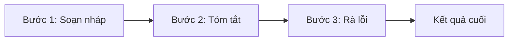
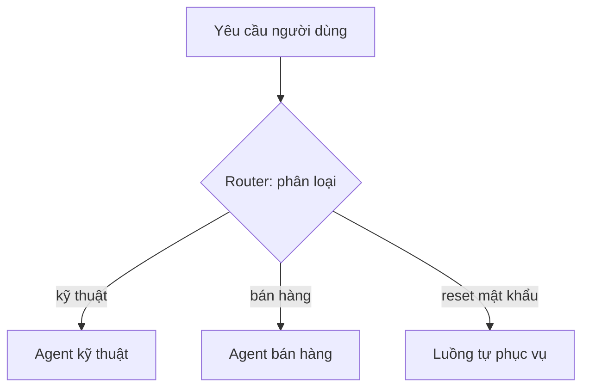
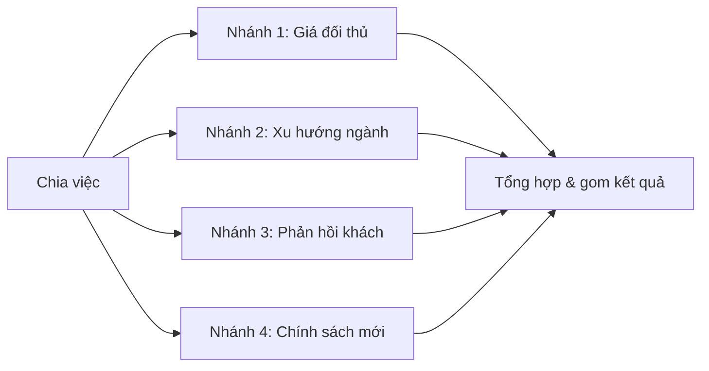
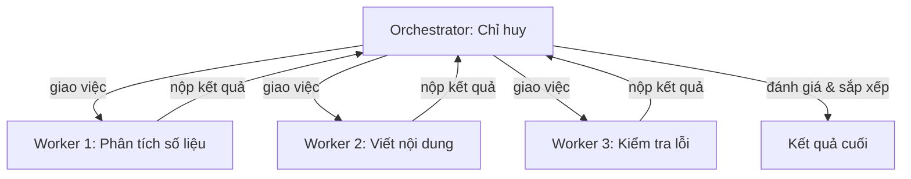
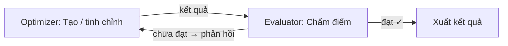
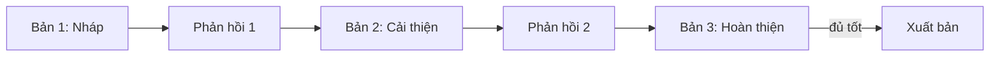
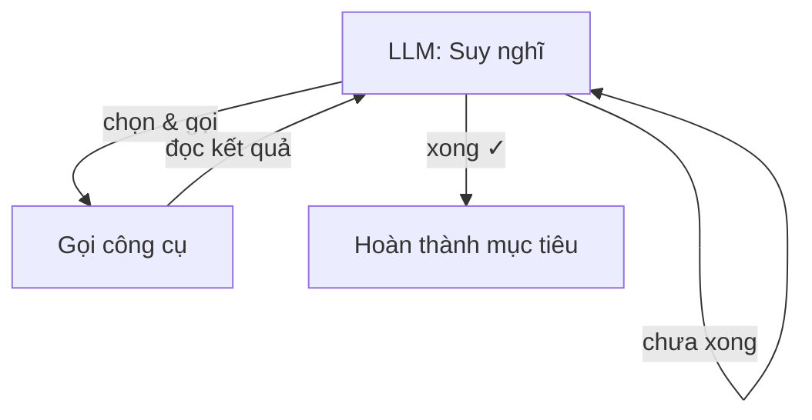

# 🔀 Module 9. Agent Workflow Patterns

> ## 📑 Mục Lục
>
> - [Câu Chuyện Mở Đầu](#câu-chuyện-mở-đầu)
> - [Bảng So Sánh 8 Workflow Patterns](#bảng-so-sánh-8-workflow-patterns)
> - [1. Prompt Chaining](#1-prompt-chaining)
> - [2. Routing](#2-routing)
> - [3. Parallelization](#3-parallelization)
> - [4. Orchestrator-Worker](#4-orchestrator-worker)
> - [5. Evaluator-Optimizer](#5-evaluator-optimizer)
> - [6. Iterative Refinement](#6-iterative-refinement)
> - [7. Tool-use Loop](#7-tool-use-loop)
> - [8. Reflection Pattern](#8-reflection-pattern)
> - [Tóm Tắt & Checklist](#tóm-tắt--checklist)

---

## Câu Chuyện Mở Đầu

Bạn đang điều hành một đội nhỏ phải làm báo cáo phân tích thị trường mỗi tháng. Việc thì rõ rành rành: thu thập số liệu → tìm điểm nổi bật → viết nhận xét → dựng slide trình bày. Vậy mà mỗi người làm một kiểu: Anh A cầu toàn thì mỗi phần phải viết đi viết lại 5 lần mới ưng; Chị B lại muốn chia việc cho 4 người cùng làm rồi gộp báo cáo lại; còn Anh C thì chỉ cần ngồi với phiếu việc, làm từng bước đúng thứ tự là xong.

Tuần đầu họ làm tùy hứng nên báo cáo chất lượng thất thường, hết trễ deadline lại phải làm lại. Tuần sau, họ vẽ hẳn một sơ đồ luồng việc lên bảng trắng: việc nào chạy trước, việc nào sau, ai kiểm tra ai, hỏng thì ai sửa. Kết quả bất ngờ — chỉ thay đổi *cách sắp xếp công việc* (workflow) mà chất lượng đồng đều hẳn, bớt làm lại, bớt cãi nhau.

Điều đó cũng đúng với AI Agent. Cùng một LLM thông minh như nhau, nhưng cách ta **sắp xếp các bước suy nghĩ–hành động thành một workflow** lại tạo ra khác biệt cực lớn về độ chính xác và độ tin cậy. Module này giới thiệu **8 mẫu workflow (design patterns)** kinh điển — từ cái đơn giản như *Prompt Chaining* đến cái phức tạp như *Orchestrator-Worker* — để bạn biết chọn mẫu nào cho bài toán nào.

> **Tóm gọn 1 câu:** LLM là "nguyên liệu thô"; **workflow pattern** là cách ta *bày bàn* các bước suy nghĩ–hành động để nguyên liệu ấy ra bản thành phẩm ổn định.

---

## Bảng So Sánh 8 Workflow Patterns

Dưới đây là "tấm bản đồ" toàn module — 8 mẫu workflow phổ biến, mỗi mẫu một vai trò riêng. Hãy đọc để có cái nhìn tổng, rồi các phần sau sẽ đào sâu từng mẫu.

| Pattern | Ý tưởng | Khi dùng | Ví dụ |
|---------|---------|----------|-------|
| **Prompt Chaining** | Chia việc lớn thành chuỗi bước nối tiếp; bước trước nạp kết quả cho bước sau | Output của bước này là input của bước kia, cần xử lý tuần tự, dễ kiểm soát từng khúc | Soạn bài → tóm tắt → rà lỗi chính tả |
| **Routing** | Có một "soát vé" chỉ mỗi yêu cầu về đúng "chuyên gia" phù hợp | Có nhiều loại câu hỏi; mỗi loại cần prompt/kỹ thuật riêng | Câu hỏi kỹ thuật → Agent kỹ thuật; câu hỏi bán hàng → Agent bán hàng |
| **Parallelization** | Chia công việc thành nhiều mảnh **chạy song song** rồi gom lại | Các phần độc lập nhau, cần chạy nhanh hoặc cần nhiều góc nhìn | Rà 10 nguồn tin cùng lúc rồi tổng hợp báo cáo |
| **Orchestrator-Worker** | Một "chỉ huy" lập kế hoạch, giao việc cho nhiều "nhân viên", gom về và kiểm soát | Bài toán phức tạp, nhiều phần cần chuyên môn khác nhau, luồng việc không cố định | Research agent: phân tích → viết code → chạy thử → soạn kết luận |
| **Evaluator-Optimizer** | Vòng lặp "sản xuất → chấm điểm → sửa" quay tới khi đạt chuẩn | Có tiêu chí chấm rõ ràng và cần chất lượng cao hơn mức một lần viết | Viết bài → tự chấm 8/10 → sửa → chấm lại → 9/10 → xuất bản |
| **Iterative Refinement** | Làm bản thô trước, rồi mài dần qua nhiều vòng theo phản hồi | Kết quả cần chỉnh nhiều lần, phản hồi đến dần dần | Nhận bản nháp → nghe góp ý → sửa → gửi tiếp |
| **Tool-use Loop** | LLM tự gọi công cụ, đọc kết quả, rồi lặp: nghĩ → gọi → đọc → nghĩ tiếp | Cần truy cập dữ liệu ngoài, chạy code, gọi API để làm việc thật | Mở file → sửa → chạy test → thấy lỗi → sửa tiếp |
| **Reflection Pattern** | LLM tự nhìn lại sản phẩm của mình, phê bình và đề xuất cải thiện | Muốn tự bắt lỗi, nâng chất lượng mà không cần nguồn ngoài | Code tự review lại theo checklist trước khi gửi |

*Cách đọc bảng: từ trên xuống, độ phức tạp tăng dần — nhưng "phức tạp" không đồng nghĩa "tốt hơn": đúng mẫu cho đúng bài mới là chìa khóa.*

> **Tóm gọn 1 câu:** 8 mẫu workflow = 8 cách bố trí công việc cho LLM — chọn mẫu theo *bản chất bài toán* (tuần tự, chỉ định, song song, có chỉ huy, hay có kiểm định), không theo độ "sang".

---

## 1. Prompt Chaining

Prompt Chaining (chuỗi prompt) là mẫu đơn giản nhất: tách một nhiệm vụ lớn thành **một dãy các bước nhỏ chạy nối tiếp nhau**. Kết quả của bước trước là "nguyên liệu" đưa vào bước sau. Không có nhánh, không có vòng lặp — một đường thẳng.

Vì sao lại đi vòng như vậy thay vì hỏi một lần? Vì mỗi bước có một vai trò riêng, ta dễ theo dõi, dễ sửa lỗi đúng chỗ, và mỗi bước có thể dùng prompt (hoặc thậm chí model) riêng phù hợp với chức năng của nó.

Ví dụ chuỗi 3 bước soạn tin tuyển dụng:
1. **Soạn thảo:** viết bản nháp mô tả công việc từ các ghi chú thô.
2. **Tóm tắt:** rút gọn thành 5 bullet dùng cho email giới thiệu.
3. **Rà soát:** quét lỗi chính tả và ngữ pháp, trả lại bản sạch.

*Cách đọc sơ đồ: một mũi tên duy nhất — mỗi bước ăn khớp với bước trước, không rẽ nhánh.*

> **Tóm gọn 1 câu:** Prompt Chaining = cắt việc lớn thành chuỗi bước nhỏ chạy tuần tự, mỗi bước một vai, dễ kiểm soát và dễ sửa lỗi đúng chỗ.

---

## 2. Routing

Routing (định tuyến) giải bài toán khác: **có nhiều loại yêu cầu trộn lẫn**, mỗi loại lại cần một cách xử lý riêng. Thay vì ép một prompt xử lý hết (cách thường cho chất lượng trung bình), ta đặt một "soát vé" phân loại trước, rồi chuyển mỗi yêu cầu về đúng "chuyên gia".

Bộ soát vé có thể là một LLM nhỏ, hoặc cả hệ thống phân loại truyền thống (keyword, score) — miễn là chia đúng "lối đi". Mỗi nhánh sau đó có prompt, tool và thậm chí model riêng.

Ví dụ công ty phần mềm nhận tin nhắn qua nhiều kênh:
- "Bản cập nhật vừa làm máy tôi treo" → nhánh **hỗ trợ kỹ thuật** (hướng dẫn gỡ lỗi).
- "Tôi muốn nâng cấp gói 3 năm" → nhánh **bán hàng** (tư vấn gói, báo giá).
- "Mật khẩu của tôi bị quên" → nhánh **tự phục vụ** (đường dẫn reset).

*Cách đọc sơ đồ: một đầu vào, nhiều nhánh ra — router quyết định nhánh nào, mỗi nhánh một chuyên gia.*

> **Tóm gọn 1 câu:** Routing = đặt một bộ soát vé phân loại yêu cầu rồi chuyển về đúng nhánh "chuyên gia" — thay vì một prompt bao cấp mọi loại câu hỏi.

---

## 3. Parallelization

Parallelization (song song hóa) là mẫu "một mảnh việc lớn → nhiều mảnh nhỏ độc lập chạy cùng lúc → gom về một mối". Khác với Prompt Chaining (chạy nối tiếp), ở đây các nhánh **không đợi nhau** — chúng chạy song song rồi một bước gộp (aggregator) hợp nhất kết quả.

Có hai kiểu song song phổ biến:
- **Chia việc theo phần (sectioning):** cùng một loại việc nhưng tách thành nhiều phần — ví dụ phân tích từng chương của một tài liệu dài.
- **Chạy đa góc nhìn (voting):** nhiều nhánh làm *cùng một việc* nhưng khác cách/hướng — ví dụ 3 nhánh độc lập đánh giá code, rồi tổng hợp ý kiến.

Lợi ích rõ nhất: **giảm thời gian** (chạy song song thay vì nối tiếp) và **tăng độ tin cậy** (nhiều góc nhìn bắt chéo, phát hiện sự khác biệt).

Ví dụ nghiên cứu thị trường: 4 nhánh cùng lúc rà (giá đối thủ / xu hướng ngành / phản hồi khách / chính sách mới), rồi một "tổng hợp viên" gom thành báo cáo 4 mục.

*Cách đọc sơ đồ: một nguồn tỏa ra nhiều nhánh chạy đồng thời, tất cả đổ vào một điểm gom.*

> **Tóm gọn 1 câu:** Parallelization = chia việc thành các mảnh độc lập chạy đua song song rồi gom lại — nhanh hơn khi việc dời được, thông minh hơn khi cần nhiều góc nhìn.

---

## 4. Orchestrator-Worker

Orchestrator-Worker là mẫu quản lý bài toán phức tạp: một **Orchestrator (điều phối viên — "sếp")** nhận mục tiêu, lập kế hoạch, giao việc cho nhiều **Worker (nhân viên)**, nhận kết quả về, đánh giá và **quyết định làm tiếp hay dừng**. Khác với Parallelization (các nhánh cố định), Orchestrator **tự quyết động lực** — chia việc thế nào, khởi tạo worker nào, gom ra sao — tùy theo diễn biến.

Ai đảm nhận vai trò gì?
- **Orchestrator:** một LLM phụ trách lập kế hoạch, chia nhỏ mục tiêu, phân công, tổng hợp và kiểm soát.
- **Worker:** mỗi worker là một LLM/tool chuyên biệt cho một mảng (viết code, tìm kiếm, kiểm thử, soạn văn bản...).

Khác biệt mấu chốt với Parallelization để nhớ: trong Parallelization, *cấu trúc nhánh được thiết kế sẵn*; trong Orchestrator-Worker, *cấu trúc do Orchestrator tự quyết trong lúc chạy* — linh hoạt hơn, phù hợp bài toán không lường trước hết.

Ví dụ một research agent lập báo cáo về một công ty: Orchestrator phát hiện "cần số liệu tài chính" → giao worker "phân tích số liệu"; thấy "thiếu so sánh đối thủ" → giao worker "nghiên cứu" chạy tiếp; khi đủ, Orchestrator gom lại và soạn báo cáo cuối.

*Cách đọc sơ đồ: mọi liên lạc đều đi qua Orchestrator — chu trình "giao → nhận → đánh giá lại" lặp cho đến khi đủ tốt.*

> **Tóm gọn 1 câu:** Orchestrator-Worker = một "sếp" tự lập kế hoạch, tự giao việc cho các "nhân viên" chuyên môn và tự quyết còn làm tiếp hay dừng — cho bài toán phức tạp, luồng việc động.

---

## 5. Evaluator-Optimizer

Evaluator-Optimizer là mẫu cho những bài toán **cần chất lượng cao hơn mức một lần xử lý** — dùng vòng lặp "tạo → chấm → sửa" quay đi quay lại cho tới khi một bộ tiêu chí đạt. Một agent "tạo" (Optimizer) sản sinh kết quả, agent kia "chấm" (Evaluator) soát kết quả, rồi phản hồi cho bước tạo tiếp theo.

Điểm mạnh của mẫu này: **tiêu chí chấm điểm có thể rõ ràng và tự động** — không cần người chấm. Ví dụ: "bài viết phải có đủ 5 thẻ H2, từ khóa xuất hiện ít nhất 3 lần, độ dài trên 800 từ, không có lỗi chính tả". Khi Evaluator thấy thiếu, nó trả lời "chưa đạt — cần thêm 2 thẻ H2 và 1 lần từ khóa" — đủ cụ thể để Optimizer sửa đúng.

*Cách đọc sơ đồ: vòng quay "tạo ↔ chấm" — dừng khi Evaluator xác nhận đạt tiêu chí.*

> **Tóm gọn 1 câu:** Evaluator-Optimizer = vòng lặp "tạo → chấm → sửa" giữa hai agent cho tới khi đạt tiêu chí — dùng khi kết quả cần đạt chuẩn rõ ràng, tự động được kiểm định.

---

## 6. Iterative Refinement

Iterative Refinement (mài dần) là dạng "bản nháp → phản hồi → bản mới → phản hồi → …" — mỗi vòng người thực hiện đều nhận kết quả bản trước và một phản hồi (feedback) để sản sinh phiên bản tốt hơn. Khác với Evaluator-Optimizer (cần tiêu chí chấm tự động), Iterative Refinement thường dùng **feedback ngữ nghĩa** — gợi ý, nhận xét, điều chỉnh hướng.

Mẫu này đặc biệt phù hợp khi tiêu chí **khó định lượng bằng số**: đẹp, tự nhiên, thuyết phục, phù hợp giọng văn. Agent tạo bản thô, rồi người/agent khác nhận xét "phần này chưa thuyết phục, thử đổi hướng tiếp cận", agent lại viết bản mới — cứ thế mài cho đến khi "nghe ổn".

Ví dụ viết bài blog chuyên sâu: bản 1 = dàn ý; phản hồi = "thiếu ví dụ ở phần 3"; bản 2 = viết đầy đủ; phản hồi = "phần kết quả hơi mơ hồ, cần con số cụ thể"; bản 3 = bổ sung số liệu; phản hồi = "được rồi, xuất bản".

*Cách đọc sơ đồ: mỗi vòng cho ra một bản mới cùng phản hồi; vòng lặp dừng khi bản đủ tốt, không theo tiêu chí số cứng.*

> **Tóm gọn 1 câu:** Iterative Refinement = mài dần từng bản nháp với phản hồi ngữ nghĩa — cho những thứ mà "tốt" không đo bằng số mà bằng cảm nhận, mỗi vòng lại gần hơn với đích mong muốn.

---

## 7. Tool-use Loop

Tool-use Loop (vòng lặp dùng công cụ) là trái tim của agent hiện đại — **LLM tự chọn công cụ, gọi nó, đọc kết quả về rồi quyết định bước tiếp theo**, cứ lặp đến khi hoàn thành mục tiêu. Đây là mẫu mà định nghĩa ngắn gọn "an agent is an LLM autonomously using tools in a loop" (Module 1) nhắc tới.

Chuỗi hành động điển hình: LLM nhận việc → *nghĩ* cần công cụ gì → *gọi* (mở file, chạy code, tìm kiếm, gọi API, ghi file) → *đọc kết quả* → *đánh giá* → *nghĩ tiếp* → gọi công cụ khác... cho tới khi xong hoặc phải dừng.

Ví dụ sửa lỗi một đoạn code: mở file `app.js` → thấy lỗi `undefined function` → sửa hàm → chạy test → test báo 2 lỗi mới → sửa tiếp → chạy lại → xanh → viết ghi chú cho người dùng.

*Cách đọc sơ đồ: vòng lặp "nghĩ → gọi → đọc → nghĩ" — LLM luôn là người quyết định bước kế tiếp.*

> **Tóm gọn 1 câu:** Tool-use Loop = LLM tự nghĩ, tự gọi công cụ, tự đọc kết quả và lặp lại tới khi xong việc — đây chính là bản chất của một agent tự chủ.

---

## 8. Reflection Pattern

Reflection Pattern (mẫu tự soi gương) dạy LLM **nhìn lại sản phẩm của chính nó, phê bình nghiêm túc và đề xuất cải thiện** trước khi bàn giao. Không cần người kiểm tra, không cần công cụ ngoài — chỉ cần một lượt "tự duyệt" thêm.

Cách làm: sau khi tạo output, agent dùng thêm một lượt prompt yêu cầu nhập vai "người đánh giá khó tính" — kiểm tra theo checklist (đúng yêu cầu chưa, lỗi logic, thiếu chứng cứ, mơ hồ...), rồi tự sinh bản sửa đã vượt qua danh sách đó. Đó chính là lý do mẫu này thường đi kèm các "guardrail" chất lượng.

Ví dụ viết email quan trọng: viết xong → tự soi lại "giọng có quá gay gắt không? thiếu lời chào/cảm ơn không? ngày giờ họp có ghi đúng không?" → tự sửa → gửi bản đã "soi" lần hai.

*Cách đọc sơ đồ: một vòng tự đánh giá ngắn trước khi giao — như người viết đọc lại bài trước khi nộp.*

> **Tóm gọn 1 câu:** Reflection Pattern = LLM tự đóng vai "người đánh giá khó tính" để phê bình và sửa sản phẩm của mình trước khi giao — nâng tầng chất lượng không tốn thêm nguồn lực ngoài.

---

## Tóm Tắt & Checklist

### Nội dung đã học trong module này

1. **Workflow Pattern** = cách ta bày bàn (sắp xếp, kết nối, điều khiển) các bước suy nghĩ–hành động để LLM cho ra kết quả ổn định và đáng tin cậy.
2. **Prompt Chaining** = chuỗi bước tuần tự, mỗi bước một vai, dễ theo dõi và dễ sửa đúng chỗ.
3. **Routing** = bộ soát vé phân loại yêu cầu để chuyển về đúng nhánh chuyên gia phù hợp — tránh một prompt cố giải quyết mọi thứ.
4. **Parallelization** = chia việc thành mảnh độc lập chạy song song rồi gom lại — nhanh hơn và đa dạng hơn.
5. **Orchestrator-Worker** = một "sếp" tự lập kế hoạch, giao việc cho các "nhân viên" chuyên môn và quyết còn làm tiếp hay dừng — cho bài toán phức tạp, động.
6. **Evaluator-Optimizer** = vòng lặp "tạo → chấm điểm tự động → sửa" cho tới khi đạt tiêu chí rõ ràng.
7. **Iterative Refinement** = mài dần từng bản nháp với phản hồi ngữ nghĩa — cho những thứ mà "tốt" đo bằng cảm nhận chứ không phải số.
8. **Tool-use Loop** = vòng lặp "nghĩ → gọi công cụ → đọc kết quả → nghĩ tiếp" — bản chất của agent tự chủ.
9. **Reflection Pattern** = LLM tự phê bình sản phẩm của mình trước khi giao — nâng chất lượng không tốn nguồn ngoài.

### Checklist tự kiểm tra

Bạn đã nắm được khi có thể trả lời lưu loát các câu hỏi sau:

- [ ] Giải thích được "workflow pattern" là gì bằng một câu ngắn?
- [ ] Phân biệt được Prompt Chaining vs Routing vs Parallelization (ý tưởng cốt lõi + khi nào dùng)?
- [ ] Vẽ được sơ đồ Orchestrator-Worker và giải thích vai trò của từng thành phần?
- [ ] Vẽ được sơ đồ Evaluator-Optimizer và cho ví dụ thực tế của riêng bạn?
- [ ] Biết khi nào dùng Tool-use Loop thay vì Prompt Chaining đơn thuần?
- [ ] Nêu được 2–3 workflow pattern và cho biết tại sao chọn pattern đó cho tình huống cụ thể?

---

## Tóm Gọn Toàn Module

> **Một câu để nhớ mãi:** 8 workflow pattern = 8 cách bày bàn cho LLM — từ chuỗi tuần tự đơn giản đến vòng lặp động của Orchestrator; mẫu đúng cho bài toán đúng mới là chìa khóa.

**Đi tiếp:** Module 10 tiếp theo sẽ đi sâu vào *Planning & Task Execution* — cách agent phân rã mục tiêu thành các bước hành động, lập kế hoạch đa bước, xử lý phụ thuộc, và quản lý quá trình thực thi.
