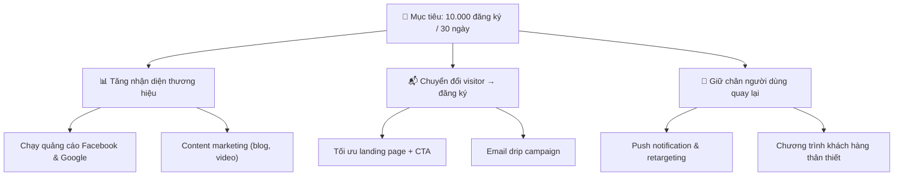
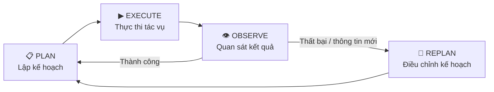
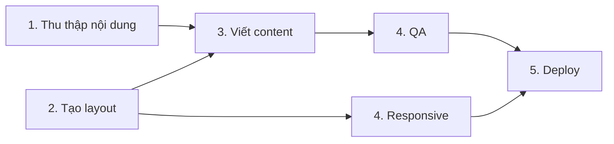

# 🗺️ Module 10. Planning & Task Execution

> ## 📑 Mục Lục
>
> - [Câu Chuyện Mở Đầu](#câu-chuyện-mở-đầu)
> - [1. Planning là gì?](#1-planning-là-gì)
> - [2. Task Decomposition — Phân rã tác vụ](#2-task-decomposition--phân-rã-tác-vụ)
> - [3. Goal Decomposition — Phân rã mục tiêu](#3-goal-decomposition--phân-rã-mục-tiêu)
> - [4. Vòng lặp Plan → Execute → Observe → Replan](#4-vòng-lặp-plan--execute--observe--replan)
> - [5. Planning Strategies — Chiến lược lập kế hoạch](#5-planning-strategies--chiến-lược-lập-kế-hoạch)
>   - [5.1 Sequential Execution — Thực thi tuần tự](#51-sequential-execution--thực-thi-tuần-tự)
>   - [5.2 Parallel Execution — Thực thi song song](#52-parallel-execution--thực-thi-song-song)
>   - [5.3 Dynamic Planning — Lập kế hoạch động](#53-dynamic-planning--lập-kế-hoạch-động)
> - [6. Replanning — Lập kế hoạch lại](#6-replanning--lập-kế-hoạch-lại)
> - [7. Dependency Management — Quản lý phụ thuộc](#7-dependency-management--quản-lý-phụ-thuộc)
> - [8. Task Prioritization — Ưu tiên tác vụ](#8-task-prioritization--ưu-tiên-tác-vụ)
> - [9. Execution Budget & Stop Conditions](#9-execution-budget--stop-conditions)
> - [Tóm Tắt & Checklist](#tóm-tắt--checklist)

---

## Câu Chuyện Mở Đầu

Bạn giao cho hai người trợ lý cùng một việc: *"Cuối tuần này tổ chức tiệc tân gia cho 20 khách."*

- **Trợ lý A:** ôm cuốn sách *"Đại Tiệc Dễ Như Ăn Kẹo"* về, háo hức hỏi bạn nên đọc từ trang nào. Hết tuần, nhà vẫn trống trơn, duy nhất cuốn sách nằm trên bàn.
- **Trợ lý B:** trả lời ngay *"Đây là kế hoạch của tôi — xác định ngân sách → chọn địa điểm → in thiệp → chốt danh sách khách → thực đơn → nấu nướng → bày trí. Danh sách khách cần chốt trước thực đơn, nên tôi sẽ làm hai việc đầu trước, khách xác nhận tới đâu tôi chốt món tới đó."* Cuối tuần, bữa tiệc diễn ra đúng giờ, ai cũng khen.

Cả hai đều "hiểu yêu cầu", nhưng **chỉ trợ lý B làm được việc** — vì anh ta biết *lập kế hoạch và thực thi có chủ đích*. Đây chính là trọng tâm của Module 10: **biết ý định thôi chưa đủ, phải biết biến ý định thành chuỗi hành động có thứ tự, có thể thích nghi.**

> **Tóm gọn 1 câu:** Một Agent làm việc giỏi khác một Agent thông minh ở chỗ biết *chia việc lớn thành việc nhỏ, sắp thứ tự, thực thi rồi quan sát và điều chỉnh* — đó chính là planning & task execution.


---

## 1. Planning là gì?

**Planning (lập kế hoạch)** là quá trình Agent biến một mục tiêu mơ hồ thành một **chuỗi hành động có thứ tự, xác định rõ làm gì → làm trước gì → làm xong gì → biết khi nào xong.** Không có planning, Agent chỉ là một LLM trả lời theo cảm hứng từng bước.

Trong thực tế xây dựng tác nhân, planning thường tạo ra hai thứ:

- **Một kế hoạch (plan):** danh sách các bước/pha cần thực hiện để đạt mục tiêu.
- **Một cấu trúc tác vụ (task structure):** cách các bước đó chia nhỏ, nối với nhau và sắp ưu tiên.

Một kế hoạch tốt không cần "hoàn hảo ngay từ đầu" — trong môi trường thay đổi liên tục như codebase hay dữ liệu sống, **kế hoạch là bản nháp chiến lược, không phải bản hợp đồng.** Điều quan trọng là nó *đủ rõ để bắt đầu thực thi*, và *đủ linh hoạt để sửa khi gặp thông tin mới*.

> **Tóm gọn 1 câu:** Planning = biến mục tiêu thành chuỗi hành động có thứ tự, đủ rõ để chạy và đủ linh hoạt để sửa.

---

## 2. Task Decomposition — Phân rã tác vụ

**Task Decomposition** bẻ một tác vụ to, mơ hồ thành nhiều tác vụ nhỏ, cụ thể, mỗi cái có thể hoàn thành riêng — đúng tinh thần "chia để trị" (divide and conquer).

Vì phải phân rã? Vì LLM trả lời trực tiếp tác vụ lớn thường: quên tiến độ, nhảy lung tung, không biết "xong chưa". Phân rã giúp mỗi bước có tiêu chí "xong" rõ ràng, dễ kiểm tra, và dễ chạy song song.

Ví dụ — tác vụ *"dựng một landing page giới thiệu sản phẩm"* phân rã thành:

```
🎯 MỤC TIÊU: Dựng landing page giới thiệu sản phẩm
│
├── 1. Chuẩn bị
│   ├── 1.1 Thu thập nội dung sản phẩm (tên, đặc điểm, giá)
│   ├── 1.2 Thu thập hình ảnh / asset (logo, ảnh minh họa)
│   └── 1.3 Xác định thông điệp chính & CTA
│
├── 2. Khung trang (Layout)
│   ├── 2.1 Tạo cấu trúc HTML: header, hero, feature, footer
│   └── 2.2 Định kiểu CSS: màu nền, typography
│
├── 3. Nội dung (Content)
│   ├── 3.1 Viết tiêu đề hero & phụ đề
│   ├── 3.2 Viết khối tính năng (3–5 features)
│   └── 3.3 Viết phần CTA, nút đăng ký
│
├── 4. Tương tác (Interaction)
│   ├── 4.1 Gắn form đăng ký / theo dõi sự kiện
│   └── 4.2 Hiệu ứng cuộn & responsive mobile
│
└── 5. Kiểm tra & Hoàn thiện (QA)
    ├── 5.1 Chạy thử desktop & mobile
    ├── 5.2 Kiểm tra link, form, hình ảnh
    └── 5.3 Rà soát tốc độ & làm gọn code
```

Cây này cũng gợi ý phụ thuộc: muốn viết content (3) phải có nội dung sản phẩm trước (1.1 → 3.1); QA (5) cần có trang đã dựng — cầu nối sang Dependency Management.

> **Tóm gọn 1 câu:** Task Decomposition bẻ tác vụ khổng lồ thành cây bước nhỏ có tiêu chí "xong" rõ ràng — giúp Agent không bị choáng, dễ kiểm soát và dễ chạy song song.


---

## 3. Goal Decomposition — Phân rã mục tiêu

**Goal Decomposition** đi ngược Task Decomposition: từ "muốn gì" để tìm ra "cần làm gì", bổ sung tầng *mục đích* phía trên mỗi tác vụ.

- **Goal** (mục tiêu) = kết quả mong muốn ở mức nghiệp vụ, ví dụ *"Đạt 10.000 đăng ký / 30 ngày"*.
- **Task** (tác vụ) = hành động cụ thể để đạt mục tiêu, ví dụ *"dựng landing page, chạy quảng cáo"*.

Vẽ cây Goal: mục tiêu tổng → mục tiêu con → kết quả kỳ vọng.



Khi Agent phân rã Goal, nó hỏi *"Để đạt G1, tôi cần làm gì?"* rồi lặp cho đến khi mỗi Task là **hành động có thể thực thi**. Quan trọng khi mục tiêu mơ hồ — Agent cần dịch thành mục tiêu cụ thể trước khi nhảy vào hành động.

> **Tóm gọn 1 câu:** Goal Decomposition đi từ "muốn gì" ngược về "cần làm gì" — bổ sung tầng mục đích cho Task Decomposition.

---

## 4. Vòng lặp Plan → Execute → Observe → Replan

Planning & execution không phải đường một chiều mà là một **vòng lặp có phản hồi (feedback loop)**:



Đọc sơ đồ:

1. **Plan:** phân rã mục tiêu → danh sách bước.
2. **Execute:** thực thi bước đầu tiên hoặc nhóm bước song song.
3. **Observe:** kiểm tra — tác vụ xong chưa? Có lỗi? Môi trường đổi không?
4. **Replan:** dựa trên quan sát, tiếp tục hoặc sửa bước tiếp theo.

Lặp đến khi đạt mục tiêu hoặc gặp stop condition (mục 9). **Observe chủ động** chứ không thụ động — Agent phải tự đặt câu hỏi kiểm tra sau mỗi bước.

> **Tóm gọn 1 câu:** Planning & execution là vòng lặp Plan → Execute → Observe → Replan, lặp đến khi đạt mục tiêu hoặc dừng có kiểm soát.


---

## 5. Planning Strategies — Chiến lược lập kế hoạch

Ba chiến lược planning chính, khác nhau ở **thời điểm lập kế hoạch** và **mức linh hoạt**:

| | **Sequential (Tuần tự)** | **Parallel (Song song)** | **Dynamic (Động)** |
|---|---|---|---|
| **Lập kế hoạch** | Toàn bộ plan trước khi thực thi | Plan trước, thực thi linh hoạt | Lập lại sau mỗi bước |
| **Thứ tự thực thi** | Bước này xong mới bước kia | Nhiều bước cùng lúc nếu độc lập | Tùy trạng thái môi trường |
| **Phù hợp khi** | Biết rõ mọi bước từ đầu | Nhiều tác vụ độc lập, cần tốc độ | Môi trường thay đổi, phụ thuộc phức tạp |
| **Rủi ro** | Không thích ứng nếu bước đầu sai | Cần quản lý phụ thuộc chặt | Có thể lặp vĩnh viễn |
| **Độ phức tạp** | Thấp | Trung bình | Cao |

Ba chiến lược **không loại trừ nhau** — một Agent thực tế thường dùng cả ba, tùy từng pha.

---

### 5.1 Sequential Execution — Thực thi tuần tự

Mỗi bước thực thi **sau khi bước trước hoàn tất** — đơn giản, dễ suy luận, dễ debug.

```
[1.1 Thu thập nội dung] → [2.1 Tạo HTML] → [3.1 Viết content] → [4.1 Gắn form] → [5.1 QA]
```

Tốt khi mỗi bước phụ thuộc kết quả bước trước — ví dụ: không thể viết nội dung khi chưa có thông tin sản phẩm.

> **Tóm gọn 1 câu:** Sequential Execution chạy bước này xong bước kia — đơn giản, dễ kiểm soát, phù hợp chuỗi phụ thuộc rõ ràng.

---

### 5.2 Parallel Execution — Thực thi song song

Nhiều bước **không phụ thuộc nhau** chạy cùng lúc — giảm tổng thời gian đáng kể.

```
[1.1 Thu thập nội dung] ─┬─→ [2.1 Tạo HTML]
                         ├─→ [2.2 Định kiểu CSS]
                         ├─→ [3.1 Viết tiêu đề hero]
                         └─→ [3.2 Viết khối tính năng]
```

2.1, 2.2, 3.1, 3.2 **độc lập** (sau khi có 1.1) nên chạy song song trên nhiều worker — đúng mẫu Orchestrator-Worker (Module 9).

> **Tóm gọn 1 câu:** Parallel Execution chạy nhiều bước độc lập cùng lúc — tăng tốc, nhưng đòi hỏi biết bước nào phụ thuộc bước nào.

---

### 5.3 Dynamic Planning — Lập kế hoạch động

Thay vì lập toàn bộ plan, **Dynamic Planning chỉ lập bước tiếp theo, quan sát kết quả rồi mới quyết định bước sau**. Phù hợp khi:

- **Môi trường thay đổi liên tục** — code generation agent thấy file khác expectation.
- **Phụ thuộc phức tạp, chưa biết hết** — research agent tìm thấy thông tin mới.
- **Yêu cầu đến từng phần** — hệ thống tư vấn chỉ biết ngân sách sau khi hỏi.

Cần stop condition rõ ràng, nếu không sẽ lặp mãi hoặc *planning drift* (mỗi bước hợp lý nhưng hướng tổng thể lệch).

> **Tóm gọn 1 câu:** Dynamic Planning lập kế hoạch sau mỗi bước — linh hoạt với môi trường thay đổi, nhưng cần stop condition để tránh lặp vĩnh viễn.


---

## 6. Replanning — Lập kế hoạch lại

**Replanning** là sửa kế hoạch giữa chừng dựa trên quan sát. Đây là "trái tim" của vòng lặp Plan → Execute → Observe → Replan — thứ biến planning từ ra lệnh một lần thành **vòng lặp thích nghi**.

Khi nào cần replan?

- **Tác vụ thất bại** — bước "tạo HTML" không ra đúng → thử cách khác.
- **Thông tin mới** — research agent tìm thấy nguồn tốt hơn → đổi hướng.
- **Môi trường đổi** — file bị đổi tên → cập nhật bước refer.
- **Người dùng bổ sung yêu cầu** → chèn tác vụ mới vào plan.
- **Ước lượng sai** → phân rã thêm bước nhỏ hơn.

Hai mức replan:

- **Local (sửa nhỏ):** chỉ sửa bước quanh điểm thất bại, giữ nguyên phần còn lại. Nhẹ, nhanh.
- **Global (lập lại):** bỏ toàn bộ plan, lập lại từ mục tiêu. Cần khi mục tiêu hoặc môi trường đổi căn bản.

Agent giỏi **phân biệt được hai mức này** — tránh vá vu vơ khi thực ra cần lập lại, và tránh vứt cả kế hoạch khi chỉ cần vá nhỏ.

> **Tóm gọn 1 câu:** Replanning sửa kế hoạch giữa chừng — vá nhỏ (local) khi lệch một chút, lập lại (global) khi đổi căn bản.

---

## 7. Dependency Management — Quản lý phụ thuộc

**Dependency Management** xác định **bước nào phải xong trước bước nào**, và **bước nào chạy độc lập được**. Đây là nền tảng quyết định tuần tự hay song song, và khi replan sẽ ảnh hưởng bước nào.

Mô hình chuẩn là **DAG (Directed Acyclic Graph — đồ thị có hướng, không chu trình)**: mỗi bước là một đỉnh, mũi tên A → B nghĩa là "A phải xong trước B".

Ví dụ DAG cho landing page:



Đọc DAG:
- Các task **không có cạnh nối** (A, B) và (D, E) có thể **chạy song song**.
- Mọi đường nối (A→C, B→C, D→F…) là chuỗi **tuần tự bắt buộc**.
- F (deploy) phải chờ **toàn bộ** phụ thuộc (D, E) xong.

Vì là DAG, không có vòng tròn "A cần B, B cần A" — nếu vô tình tạo vòng, hệ thống **deadlock**. Trong thực tế, dependency thường do Agent tự suy diễn: thấy "viết content" cần "nội dung sản phẩm" trước → tự chèn A → C vào plan.

> **Tóm gọn 1 câu:** Dependency Management dùng DAG ghi "ai xong trước ai" — từ đó biết bước nào song song, bước nào tuần tự, và tránh deadlock.

---

## 8. Task Prioritization — Ưu tiên tác vụ

Khi **nguồn lực hạn chế**, Agent phải quyết định **làm gì trước**. Task Prioritization sắp thứ tự bằng giá trị × khẩn cấp (ma trận Eisenhower):

| | **Khẩn cấp** | **Không khẩn cấp** |
|---|---|---|
| **Quan trọng** | Làm ngay (do first) | Lên lịch (schedule) |
| **Không quan trọng** | Ủy quyền / bỏ qua | Xóa bỏ (eliminate) |

Với landing page: sửa form đăng ký lỗi → làm ngay (quan trọng + khẩn); tối ưu SEO → lên lịch; hiệu ứng động thừa → xóa.

Thêm quy tắc: **ưu tiên gỡ rủi ro lớn sớm** — kiểm tra phần dễ hỏng nhất (API thanh toán) trước, vì nếu nó không chạy thì mọi thứ khác vô nghĩa.

> **Tóm gọn 1 câu:** Task Prioritization sắp thứ tự bằng giá trị × khẩn cấp, ưu tiên gỡ rủi ro lớn sớm — để nguồn lực đi vào việc quyết định kết quả.

---

## 9. Execution Budget & Stop Conditions

Không có giới hạn, Agent sẽ chạy mãi — lặp vô hạn, tốn token, hoặc không biết mình đã hoàn thành chưa.

### 9.1 Execution Budget — Ngân sách thực thi

Giới hạn nguồn lực Agent được dùng:

- **Giới hạn bước (max steps):** tối đa 15 bước — tránh lặp trong dynamic planning.
- **Giới hạn token / chi phí:** tối đa 500K token — kiểm soát ngân sách API.
- **Giới hạn thời gian:** hoàn thành trong 10 phút.
- **Giới hạn công cụ:** gọi tối đa 50 lần tool search — tránh lan man.

Khi vượt budget, Agent **báo cáo và yêu cầu mở rộng** hoặc tự thu hẹp mục tiêu — cơ hội cho human-in-the-loop.

### 9.2 Stop Conditions — Điều kiện dừng

Bốn loại dừng phổ biến:

1. **Thành công:** đạt tiêu chí "xong" — tất cả test pass, landing page load thành công.
2. **Budget exhausted:** hết bước/token/thời gian → **dừng, báo cáo trạng thái hiện tại**.
3. **Không thể tiến triển (stuck):** cùng lỗi lặp lại, không có tiến triển → **dừng sớm**.
4. **Human approval:** đạt điểm cần xác nhận con người → dừng đợi phản hồi.

Một cặp budget + stop condition tốt trả lời: *"Khi nào coi là xong?"*, *"Khi nào dừng vì cạn nguồn?"*, *"Khi nào nên bỏ cuộc sớm?"*.

> **Tóm gọn 1 câu:** Execution Budget giới hạn tài nguyên (bước, token, thời gian); Stop Conditions quyết định khi nào dừng — thành công, cạn ngân sách, hay bế tắc — để Agent không lặp vô hạn.


---

## Tóm Tắt & Checklist

### Nội dung đã học trong module này

1. **Planning** = biến mục tiêu thành chuỗi hành động có thứ tự, đủ rõ để chạy và đủ linh hoạt để sửa.
2. **Task Decomposition** bẻ tác vụ to thành cây bước nhỏ (ví dụ: dựng landing page).
3. **Goal Decomposition** đi từ "muốn gì" ngược về "cần làm gì" — bổ sung tầng mục đích.
4. Vòng lặp **Plan → Execute → Observe → Replan** là trái tim mọi agentic workflow.
5. Ba **Planning Strategies:** Sequential, Parallel, Dynamic — thường dùng kết hợp.
6. **Replanning** có hai mức: local (vá nhỏ) và global (lập lại cả plan).
7. **Dependency Management** dùng **DAG** ghi "ai xong trước ai" → tuần tự/song song, tránh deadlock.
8. **Task Prioritization** sắp thứ tự bằng giá trị × khẩn cấp, ưu tiên gỡ rủi ro lớn sớm.
9. **Execution Budget + Stop Conditions** giới hạn tài nguyên và quyết định khi nào dừng.

### Checklist tự kiểm tra

Bạn đã nắm được khi có thể trả lời lưu loát các câu hỏi sau:

- [ ] Phân biệt được Task Decomposition và Goal Decomposition bằng ví dụ?
- [ ] Vẽ được cây phân rã tác vụ cho một việc cụ thể?
- [ ] Giải thích vòng lặp Plan → Execute → Observe → Replan?
- [ ] Kể được ưu/nhược Sequential vs Parallel vs Dynamic planning?
- [ ] Nhận biết được lúc nào replan local, lúc nào global?
- [ ] Dựng được một DAG nhỏ (3–5 task), chỉ ra task nào chạy song song?
- [ ] Đặt được Execution Budget và Stop Conditions cho agent cụ thể?

---

## Tóm Gọn Toàn Module

> **Một câu để nhớ mãi:** Một Agent đáng tin cậy không chỉ *thông minh* mà còn *biết tổ chức* — chia nhỏ tác vụ (decompose), sắp thứ tự (prioritize & schedule), quan sát để điều chỉnh (replan), và dừng tay đúng lúc (budget & stop conditions).

**Đi tiếp:** Module 11 sẽ chuyển từ *cách chia việc và tổ chức thực thi* sang **Agent Decision Making** — cách Agent chọn hành động nào để thực hiện, đánh giá quan sát sau khi hành động, xử lý độ chắc chắn và sự không chắc chắn, cũng như phục hồi và tự sửa lỗi khi kế hoạch không diễn ra như ý.
