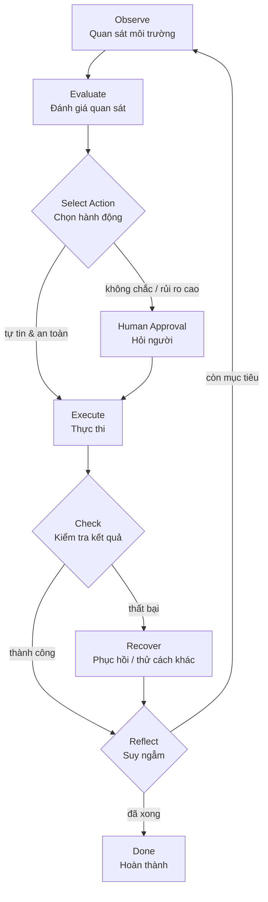

# 🎯 Module 11. Agent Decision Making

> ## 📑 Mục Lục
>
> - [Câu Chuyện Mở Đầu](#câu-chuyện-mở-đầu)
> - [1. Ba Trường Phái Ra Quyết Định](#1-ba-trường-phái-ra-quyết-định)
>   - [1.1 Rule-based Decision Making](#11-rule-based-decision-making)
>   - [1.2 LLM-based Decision Making](#12-llm-based-decision-making)
>   - [1.3 State-based Decision Making](#13-state-based-decision-making)
>   - [So sánh ba trường phái](#so-sánh-ba-trường-phái)
> - [2. Action Selection — Chọn Hành Động Nào?](#2-action-selection--chọn-hành-động-nào)
> - [3. Observation Evaluation — Đánh Giá Những Gì Quan Sát Được](#3-observation-evaluation--đánh-giá-những-gì-quan-sát-được)
> - [4. Confidence & Uncertainty — Khi Nào Tin Tưởng, Khi Nào Ngờ Vực](#4-confidence--uncertainty--khi-nào-tin-tưởng-khi-nào-ngờ-vực)
> - [5. Failure Recovery — Phục Hồi Khi Thất Bại](#5-failure-recovery--phục-hồi-khi-thất-bại)
> - [6. Self-correction & Reflection — Tự Sửa Chính Mình](#6-self-correction--reflection--tự-sửa-chính-mình)
> - [7. Human Approval — Khi Nào Nên Hỏi Người?](#7-human-approval--khi-nào-nên-hỏi-người)
> - [Tóm Tắt & Checklist](#tóm-tắt--checklist)
>
> ---

## Câu Chuyện Mở Đầu

Giữa một buổi sáng, chị Lan — trưởng nhóm vận hành — giao cho trợ lý AI của mình một nhiệm vụ: *"Hôm nay có 150 đơn hàng, hãy rà soát giúp tôi những đơn nào nghi ngờ lừa đảo."* Trợ lý AI gật đầu và bắt đầu làm việc.

Với mỗi đơn hàng, nó phải lần lượt quyết định:

- **Quan sát:** đọc thông tin đơn hàng — địa chỉ, email, hình thức thanh toán, lịch sử mua.
- **Đánh giá:** đơn này "dấu hiệu lạ" ở mức nào — địa chỉ giao tới khu đất trống, email vừa tạo 1 ngày, thanh toán bằng thẻ quẹt nhiều lần trong 10 phút.
- **Chọn hành động:** giữ nguyên / đánh dấu cần xem / chặn và thông báo cho chị Lan.
- **Thực thi:** ghi chú vào hệ thống.
- **Kiểm tra:** xem kết quả ghi vào đúng chỗ chưa, đúng trạng thái chưa.
- **Suy ngẫm:** rút ra bài học — "liệu quyết định vừa rồi có quá vội không?" — để lần sau xử lý khôn ngoan hơn.

150 đơn hàng có thể là 150 "con đường" khác nhau, mỗi con đường cần những quyết định khác nhau. Nếu trợ lý AI chỉ chạy một danh sách luật cố định, nó sẽ bỏ sót những đơn lừa đảo "kiểu mới". Nếu nó tự do quyết định mọi thứ bằng trực giác, nó sẽ chặn nhầm đơn hàng của khách hàng tốt.

Câu hỏi đặt ra cho cả module này không phải là *"agent có nên quyết định không?"* mà là: **agent quyết định *như thế nào*, *dựa trên gì*, và khi nào nên dừng lại để hỏi người.**

> **Tóm gọn 1 câu:** Quyết định là trái tim của một agent — và vấn đề mấu chốt là *chọn đúng cách để quyết định* trong từng tình huống, chứ không phải "càng tự động càng tốt".

---

## 1. Ba Trường Phái Ra Quyết Định

Trong thực tế, một agent ra quyết định theo **ba trường phái chính**. Mỗi trường phái trả lời một câu hỏi khác nhau:

- **Rule-based (Dựa trên luật):** "Nếu gặp tình huống này thì làm thế nào?"
- **LLM-based (Dựa trên mô hình ngôn ngữ):** "Tình huống này giống với điều mà mô hình đã học, nên tôi nên làm gì?"
- **State-based (Dựa trên trạng thái):** "Mình đang ở đâu trong quy trình, và bước tiếp theo theo quy trình là gì?"

### 1.1 Rule-based Decision Making

Đây là cách ra quyết định **lâu đời nhất và dễ hiểu nhất**: viết một chuỗi luật `if → then` cố định. Người phát triển định nghĩa trước mọi tình huống có thể xảy ra và quyết định cho từng tình huống.

```python
def quyet_dinh_don_hang(order):
    if order.amount > 50_000_000 and order.is_express:
        return "CAN_XEM_NGUOI"
    if order.payment_count_last_10m > 5:
        return "CHAN"
    return "GIU_NGUYEN"
```

Một agent thuần rule-based **không suy nghĩ**, nó chỉ **đối chiếu**. Chính xác, nhất quán, có thể giải thích — đó là điểm mạnh kinh điển của nó.

> **Tóm gọn 1 câu:** Rule-based = "nếu... thì..." được viết tay — hay dùng khi quy trình rõ ràng, ít thay đổi và cần độ nhất quán tuyệt đối.

### 1.2 LLM-based Decision Making

Đây là bước tiến vượt bậc của agent hiện đại: thay vì viết luật tay, agent đưa **ngữ cảnh** (prompt + thông tin quan sát được) vào một LLM, và LLM **suy luận** ra quyết định — kể cả những tình huống chưa từng được lập trình trước.

```python
prompt = f"""
Bạn là trợ lý chống gian lận. Hãy phân tích đơn hàng sau và chọn hành động:
{order.dump()}
Chọn một trong: GIU_NGUYEN | CAN_XEM_NGUOI | CHAN
"""
decision = llm.complete(prompt)
```

Điểm mạnh: **linh hoạt, hiểu ngữ cảnh, xử lý tình huống mới**. Điểm yếu: **không chắc chắn 100%** — LLM có thể "bịa" lý do hợp lý nghe rất thuyết phục nhưng sai (gọi là *hallucination*). Vì vậy, agent LLM-based thường cần thêm các lớp kiểm tra (sẽ học ở phần Confidence & Uncertainty).

> **Tóm gọn 1 câu:** LLM-based = để mô hình *suy luận* ra quyết định từ ngữ cảnh — linh hoạt với tình huống mới, nhưng kém chắc chắn hơn luật cứng và dễ ảo giác.

### 1.3 State-based Decision Making

Cách thứ ba dựa trên **trạng thái** (state): agent luôn biết mình "đang ở bước nào" của một quy trình. Mỗi trạng thái có một tập hành động cho phép — giống như một cỗ máy trạng thái (state machine).

```
DON_MOI --(hợp lệ)--> DANG_XU_LY --(nghi ngờ)--> CHO_NGUOI_XEM
   |                        |
   +--(lừa đảo rõ)---> CHAN  +--(hợp lệ)---> HOAN_TAT
```

State-based **không linh hoạt quyết định "nên làm gì" như** LLM, nhưng nó **kiểm soát luồng chạy** cực tốt: không cho phép agent "nhảy cóc" qua các bước bắt buộc, dễ ghi log, dễ quay lại, và ai cũng dễ hiểu.

> **Tóm gọn 1 câu:** State-based = biết mình đang ở bước nào, chỉ được làm những hành động cho phép ở bước đó — tuyệt vời để kiểm soát quy trình, kém linh hoạt với tình huống bất ngờ.

### So sánh ba trường phái

| Đặc điểm | Rule-based | LLM-based | State-based |
|---|---|---|---|
| **Tư duy** | Đối chiếu luật | Suy luận ngữ cảnh | Đi theo trạng thái |
| **Ưu** | Chính xác, nhất quán, giải thích được | Linh hoạt, hiểu ngữ cảnh, xử lý tình huống mới | Kiểm soát quy trình, an toàn, dễ debug |
| **Nhược** | Cứng nhắc, tốn công viết luật, bỏ sót trường hợp mới | Không chắc chắn, dễ ảo giác, khó kiểm soát | Kém linh hoạt với tình huống bất ngờ |
| **Khi dùng** | Quy tắc rõ ràng, ổn định, cần nhất quán cao | Tình huống phong phú, thay đổi liên tục, cần hiểu ngữ cảnh | Có quy trình nhiều bước bắt buộc, cần đảm bảo đúng luồng |

*Cách đọc bảng: không trường phái nào "tốt hơn" tuyệt đối — agent thực tế thường **kết hợp cả ba**: dùng state machine để giữ luồng, luật để chặn nhanh trường hợp rõ ràng, và LLM để xử lý những vùng mờ ở giữa.*

> **Tóm gọn 1 câu:** Ba trường phái không loại trừ nhau — agent chuyên nghiệp dùng state để giữ luồng, luật để chốt nhanh, LLM để đánh giá vùng mờ.

---

## 2. Action Selection — Chọn Hành Động Nào?

Sau khi biết "mình quyết định dựa trên gì", agent phải trả lời: **trong hàng chục hành động khả dụng, chọn cái nào?** Đây là *action selection* (chọn hành động).

Mỗi agent có một **bàn công cụ (toolkit)** — những thứ nó có thể làm: đọc file, tìm kiếm, gọi API, ghi file, gửi email... Action selection là việc **chọn đúng lệnh, đúng thứ tự, đúng lúc**.

Các yếu tố ảnh hưởng đến lựa chọn:

- **Mức độ phù hợp:** hành động nào đưa agent lại gần mục tiêu nhất ở bước này?
- **Chi phí & rủi ro:** hành động đắt (nhiều token, nhiều thời gian, thay đổi dữ liệu thật) cần cân nhắc kỹ hơn.
- **Ràng buộc trạng thái:** ở bước này có được phép làm việc đó không?
- **Ưu tiên ít gây hại nhất:** khi không chắc, chọn hành động "nhẹ nhất" — đọc thay vì ghi, nháp thay vì gửi.

Thực tế phổ biến: agent **liệt kê vài ứng viên hành động, gán điểm, rồi chọn ứng viên tốt nhất** — thay vì chọn bừa. Với các hành động không thể đảo ngược (xóa dữ liệu, gửi tiền, publish), nguyên tắc vàng là **hạ cấp thành bản xem trước hoặc hỏi người** (xem mục 7).

> **Tóm gọn 1 câu:** Action selection = chọn hành động khả thi và phù hợp nhất — và càng "không thể đảo ngược" thì càng cần thận trọng.

---

## 3. Observation Evaluation — Đánh Giá Những Gì Quan Sát Được

Trước khi chọn hành động, agent phải **đánh giá những gì nó quan sát được** từ môi trường — file đọc được, kết quả API, output của lệnh, phản hồi của người dùng. Đây là *observation evaluation* (đánh giá quan sát), và nó quyết định chất lượng quyết định.

Ba kỹ thuật đánh giá thường dùng:

- **So khớp kỳ vọng (expectation matching):** so sánh kết quả quan sát với kết quả mong đợi — lệnh `git status` có báo đúng file vừa sửa không? API có trả đúng status 200 không?
- **Đối chiếu nguồn (source validation):** đánh giá độ tin cậy của thông tin — dữ liệu từ hệ thống nội bộ đáng tin hơn dữ liệu một trang web lạ. Hỏi: *"thông tin này đến từ đâu, có đáng tin không?"*
- **Phát hiện dị thường (anomaly detection):** nhận ra điều bất thường — con số quá lớn, thời gian quá nhanh, định dạng sai — để không tin mù quáng vào quan sát.

Một quan sát "tốt" cần được **đóng dấu độ chắc chắn** trước khi đưa vào quyết định: thông tin này chắc chắn 100% hay chỉ là phỏng đoán 60%? Điều này kết nối trực tiếp với phần Confidence & Uncertainty ở dưới.

> **Tóm gọn 1 câu:** Observation evaluation = không tin mù những gì agent "thấy" — phải so với kỳ vọng, kiểm tra nguồn, tìm điểm bất thường rồi mới dùng làm căn cứ.

---

## 4. Confidence & Uncertainty — Khi Nào Tin, Khi Nào Ngờ

LLM không có "đồng hồ đo sự tự tin" tuyệt đối — nó sinh ra câu trả lời, còn mức độ chắc chắn là thứ **agent phải tự ước lượng**. Hai khái niệm cần phân biệt:

- **Confidence (độ tin cậy):** mức độ agent tin rằng quyết định/đánh giá của mình là đúng.
- **Uncertainty (độ bất định):** mức độ thiếu thông tin hoặc thiếu chắc chắn xung quanh quyết định — có hai loại:
  - *Epistemic uncertainty:* bất định do **thiếu thông tin** — có thể giảm bằng cách đọc thêm, tìm thêm, hỏi thêm.
  - *Aleatoric uncertainty:* bất định **vốn có** — không bao giờ loại bỏ được (ví dụ: thị trường ngày mai lên hay xuống).

> **Tóm gọn 1 câu:** Confidence là "tôi tự tin bao nhiêu", Uncertainty là "tôi thiếu/không chắc bao nhiêu" — agent giỏi là agent biết tự định lượng cả hai thay vì trả lời ừ đại.

### Khi nào agent nên hỏi người hoặc dừng lại?

Đây là nguyên tắc thực hành quan trọng nhất của phần này — một *quy tắc quyết định theo ngưỡng*:

| Tình huống | Confidence | Điều agent nên làm |
|---|---|---|
| Rõ ràng, quen thuộc, ít rủi ro | Cao | Tự hành động |
| Khá rõ nhưng rủi ro vừa phải | Trung bình | Hành động nhưng báo cáo lại |
| Mơ hồ, thiếu thông tin (epistemic) | Thấp | Thu thập thêm thông tin trước |
| Rủi ro cao / không thể đảo ngược | Dù cao hay thấp | **Hỏi người phê duyệt** |
| Cần thông tin không bao giờ có được (aleatoric) | Thấp mãi mãi | **Dừng lại, không tự bịa** |

Nói gọn: **tự làm khi tự tin và an toàn; hỏi người khi rủi ro cao hoặc không chắc; dừng hẳn khi đang "đoán mò" mà không có cách nào chắc hơn.**

> **Tóm gọn 1 câu:** Hỏi người khi rủi ro cao hoặc thiếu chắc chắn, dừng hẳn khi biết mình đang đoán mò — tự tin cộng an toàn mới được tự hành động.

### Vòng lặp quyết định hoàn chỉnh

Gộp toàn bộ các phần trên lại, ta có một **vòng lặp quyết định** chuẩn — từ quan sát đến suy ngẫm:



Đọc sơ đồ: agent **quan sát → đánh giá → chọn hành động → thực thi → kiểm tra → suy ngẫm**, lặp cho đến khi xong việc. Ở bước "chọn hành động", nếu không chắc hoặc rủi ro cao, agent rẽ nhánh sang **hỏi người** trước khi thực thi; nếu kiểm tra thất bại, agent **phục hồi** rồi vòng lại.

> **Tóm gọn 1 câu:** Vòng lặp quyết định = Observe → Evaluate → Select → Execute → Check → Reflect, lặp tới khi xong — với hai nhánh an toàn: hỏi người khi không chắc, tự phục hồi khi sai.

---

## 5. Failure Recovery — Phục Hồi Khi Thất Bại

Không agent nào hoàn hảo. Mỗi bước thực thi đều có thể thất bại: lệnh chạy sai, API trả lỗi 500, file không tồn tại, kết quả đánh giá sai lệch. **Failure recovery** là khả năng agent nhận ra thất bại và tự đứng dậy — thay vì dừng hẳn.

Ba chiến lược phục hồi phổ biến:

- **Fallback (dự phòng):** khi công cụ chính thất bại, dùng công cụ thay thế. Ví dụ: search API lỗi → thử web search khác → thử lại sau 30 giây → báo lỗi có chọn lọc.
- **Retry có exponential backoff:** thử lại với số lần giới hạn, mỗi lần chờ lâu hơn. Ví dụ: chờ 1s → 2s → 4s → dừng và báo lỗi.
- **Replan (lập kế hoạch lại):** khi kết quả cho thấy kế hoạch ban đầu không đúng, agent tự tạo kế hoạch mới — thay vì cứng nhắc theo kế hoạch cũ định làm.

Nguyên tắc thiết kế: **mỗi hành động phải có "cửa thoát"** — nếu không chạy được thì agent biết phải làm gì tiếp theo. Không có "chết cứng" trong một bước.

> **Tóm gọn 1 câu:** Failure recovery = khi thất bại, có kế hoạch đứng dậy ngay — dùng dự phòng, thử lại có chờ, hoặc lập kế hoạch mới — không bao giờ dừng im ở lỗi.

---

## 6. Self-correction & Reflection — Tự Sửa Chính Mình

Không chỉ phục hồi khi thất bại rõ ràng, agent thông minh còn **tự nhìn lại những quyết định đã làm** để tìm chỗ chưa đúng — dù kết quả bước đó trông ổn.

**Self-correction (tự sửa)** là việc agent **tự phát hiện và điều chỉnh** quyết định đang làm — giữa chừng, khi nhận ra dấu hiệu sai:

- LLM suy luận ra hành động A → thực thi → thấy kết quả không khớp kỳ vọng → LLM được gọi lại để "suy nghĩ lại" → chọn hành động B.
- Agent đang đọc file nhưng file đó không chứa thông tin cần → agent tự hỏi "mình có đang đi đúng hướng không?" → quay lại đọc file khác.

**Reflection (phản tư)** là bước cuối cùng trong vòng lặp — sau khi hoàn thành một nhiệm vụ (hoặc một phần nhiệm vụ), agent **ngồi lại đánh giá**:

- Quyết định vừa rồi có đúng không? Nếu sai, sai ở đâu?
- Có bỏ sót thông tin quan trọng nào không?
- Có cách nào tốt hơn cho lần sau không?
- Kinh nghiệm rút ra có đáng ghi lại vào memory không?

Reflection thường dùng LLM để tự viết nhận xét về phiên làm việc — gọi là *self-critique* (tự phê bình). Nhiều agent hiện đại (Claude Code, ReAct agent) thiết kế bước này bắt buộc, không phải tuỳ chọn.

> **Tóm gọn 1 câu:** Self-correction = tự phát hiện sai giữa chừng rồi đổi hướng; Reflection = ngồi lại cuối mỗi bước để hỏi "mình làm tốt chưa, cần cải thiện gì?" — và cả hai cùng biến agent từ "máy làm theo lệnh" thành "người máy biết học hỏi".

---

## 7. Human Approval — Khi Nào Nên Hỏi Người?

Đây là khía cạnh cuối cùng nhưng cực kỳ quan trọng trong thiết kế agent thực tế: **agent không nên tự quyết mọi thứ**.

Ba nguyên tắc quyết định khi nào cần human-in-the-loop:

- **Nguyên tắc rủi ro cao:** hành động có thể gây hậu quả nghiêm trọng (xóa dữ liệu, chuyển tiền, gửi email ra bên ngoài) → **bắt buộc hỏi người** trước.
- **Nguyên tắc pháp lý / tuân thủ:** hành động cần tuân theo quy định (GDPR, tài chính, y tế) → **bắt buộc người xác nhận** trước khi thực thi.
- **Nguyên tắc vượt phạm vi:** nếu hành động nằm ngoài phạm vi mà người dùng đã cho phép ban đầu → **hỏi lại** trước khi làm.

Trong thực tế, người ta thường dùng **bảng quyết định (decision matrix)** như sau:

| Hành động | Rủi ro | Cần human approval? |
|---|---|---|
| Đọc file nội bộ | Thấp | Không |
| Tìm kiếm web | Thấp | Không |
| Viết nháp email | Trung bình | Có, báo cáo kết quả |
| Gửi email cho khách hàng | Cao | Có, chờ phê duyệt |
| Xoá dữ liệu sản xuất | Rất cao | Có, xác nhận bằng văn bản |

> **Tóm gọn 1 câu:** Human approval = những hành động rủi ro cao, khó đảo ngược hoặc vượt phạm vi đều phải có "người duyệt" — agent tự tin không có nghĩa là agent quyết mọi thứ.

---

## Tóm Tắt & Checklist

### Nội dung đã học trong module này

1. **Ba trường phái quyết định:** Rule-based (viết luật `if→then`), LLM-based (mô hình suy luận), State-based (đi theo trạng thái) — và agent thực tế thường kết hợp cả ba.
2. **Action selection:** chọn hành động phù hợp nhất trên bàn công cụ — càng khó đảo ngược càng cần thận trọng.
3. **Observation evaluation:** so với kỳ vọng, kiểm tra nguồn, phát hiện dị thường — trước khi tin vào quan sát.
4. **Confidence & Uncertainty:** độ tin cậy vs độ bất định (thiếu thông tin / bất định vốn có) — là nền tảng của việc "hỏi hay dừng".
5. **Ngưỡng quyết định:** tự hành động khi tự tin & an toàn; hỏi người khi rủi ro cao; dừng khi đoán mò.
6. **Vòng lặp quyết định:** Observe → Evaluate → Select → Execute → Check → Reflect (có mermaid ở trên).
7. **Failure recovery:** fallback, retry có backoff, replan — mỗi hành động cần cửa thoát.
8. **Self-correction & Reflection:** tự phát hiện sai giữa chừng, ngồi lại suy ngẫm cuối bước, rút kinh nghiệm.
9. **Human approval:** rủi ro cao / tuân thủ / vượt phạm vi → bắt buộc có người duyệt.

### Checklist tự kiểm tra

Bạn đã nắm được khi có thể trả lời lưu loát các câu hỏi sau:

- [ ] Phân biệt được Rule-based, LLM-based và State-based decision making bằng một ví dụ cụ thể?
- [ ] Giải thích được khi nào nên dùng từng trường phái (và tại sao nên kết hợp)?
- [ ] Kể được 3 yếu tố ảnh hưởng đến action selection?
- [ ] Trình bày được 3 kỹ thuật đánh giá quan sát (expectation matching, source validation, anomaly detection)?
- [ ] Thể hiện được sự khác nhau giữa Confidence và Uncertainty? Giải thích được 2 loại uncertainty?
- [ ] Nêu đúng khi nào agent nên tự hành động / hỏi người / dừng lại?
- [ ] Giải thích được vòng lặp quyết định 6 bước (Observe → Evaluate → Select → Execute → Check → Reflect)?
- [ ] Kể được 3 chiến lược phục hồi khi thất bại?
- [ ] Phân biệt được self-correction và reflection?
- [ ] Liệt kê được 3 nguyên tắc xác định khi nào cần human approval?

---

> **Một câu để nhớ mãi:** Quyết định là nơi agent chuyển từ "người máy làm theo lệnh" thành "trí tuệ tự hành" — và sự khác biệt nằm ở chỗ agent biết **dùng cách nào để quyết định, đánh giá đến đâu, tự sửa ở đâu, và dừng lại khi nào cần hỏi người**.

**Đi tiếp:** Module 12 — *Single Agent vs Multi-Agent* — sẽ mở rộng bức tranh: khi nào một agent là đủ, khi nào cần nhiều agent phối hợp, và những thách thức của hệ thống đa agent — cùng các pattern như hierarchical agents, swarm agents, và debate/negotiation giữa các agent.
