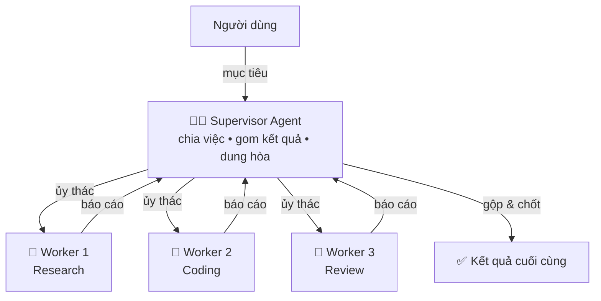

# 👥 Module 12. Single-Agent vs Multi-Agent

> ## 📑 Mục Lục
>
> - [Câu Chuyện Mở Đầu](#câu-chuyện-mở-đầu)
> - [1. Single-Agent Architecture](#1-single-agent-architecture)
> - [2. Multi-Agent Architecture](#2-multi-agent-architecture)
> - [3. Single vs Multi — Bảng So Sánh Lớn](#3-single-vs-multi--bảng-so-sánh-lớn)
> - [4. Agent Collaboration](#4-agent-collaboration)
> - [5. Agent Delegation](#5-agent-delegation)
> - [6. Agent Communication](#6-agent-communication)
> - [7. Shared Memory vs Independent Memory](#7-shared-memory-vs-independent-memory)
> - [8. Agent Roles — Supervisor & Worker](#8-agent-roles--supervisor--worker)
> - [9. Hierarchical Agents (Supervisor → Worker)](#9-hierarchical-agents-supervisor--worker)
> - [10. Multi-Agent Coordination](#10-multi-agent-coordination)
> - [11. Consensus & Conflict Resolution](#11-consensus--conflict-resolution)
> - [12. Cảnh Báo Chi Phí: "15x Token"](#12-cảnh-báo-chi-phí-15x-token)
> - [Tóm Tắt & Checklist](#tóm-tắt--checklist)

---

## Câu Chuyện Mở Đầu

Bạn là trưởng nhóm nhận việc **viết tài liệu kỹ thuật cho sản phẩm mới**. Có hai cách:

- **Một người lo tất cả:** thuê một kỹ sư tài năng — tự phân tích, tự viết, tự rà soát rồi giao bản cuối. Một bộ não xuyên suốt, không bàn giao giữa chừng.
- **Cả đội có người chỉ huy:** bạn làm **supervisor** — chia phần (A viết tổng quan, B viết API, C rà soát chéo). Ai xong báo cáo lên; bạn gom lại, bắt mâu thuẫn thống nhất rồi mới chốt.

Cách 1 là **Single-Agent**, cách 2 là **Multi-Agent**. Câu hỏi: *khi nào đủ một mình, khi nào phải kéo cả đội?*

> **Tóm gọn 1 câu:** Single-Agent là nhân viên đa năng cô độc; Multi-Agent là công ty nhỏ có người chỉ huy và các chuyên gia — đều xong việc, chỉ khác giá tiền và độ phức tạp.
---

## 1. Single-Agent Architecture

**Single-Agent Architecture** là khi *một* agent duy nhất nhận mục tiêu, tự lập kế hoạch, tự chọn công cụ và tự chạy vòng lặp đến khi xong — không có agent thứ hai tham gia.

| Đặc điểm | Giải thích |
|---|---|
| **Một bộ não duy nhất** | Một LLM điều khiển toàn bộ vòng lặp suy nghĩ → hành động → quan sát |
| **Prompt & memory thống nhất** | Một system prompt, một luồng ngữ cảnh xuyên suốt |
| **Điểm kiểm soát duy nhất** | Dễ theo dõi, dễ bảo mật, dễ gỡ lỗi |

Nó chỉ là *agent + công cụ + vòng lặp* — đóng gói từ Module 1 đến 11.

> **Tóm gọn 1 câu:** Single-Agent = một agent ôm trọn task từ đầu đến cuối — đơn giản, rẻ, dễ kiểm soát; hợp với bài toán tuyến tính, một ngữ cảnh, một chủ sở hữu.

---

## 2. Multi-Agent Architecture

**Multi-Agent Architecture** là khi *nhiều* agent (mỗi con có prompt, công cụ, memory riêng) phối hợp hoàn thành một mục tiêu chung — bằng cách chia nhỏ task, chạy song song, hoặc chuyên môn hóa vai trò.

| Đặc điểm | Giải thích |
|---|---|
| **Nhiều bộ não** | Mỗi agent là một vòng lặp LLM độc lập, có tính cách và chuyên môn riêng |
| **Chia để trị** | Task lớn bẻ thành mảnh, mỗi con xử lý một mảnh |
| **Giao tiếp & bàn giao** | Kết quả chuyền giữa các agent: message, file, kết quả tool |

Multi-agent chỉ đáng giá khi hiệu quả "cả đội" vượt chi phí phải trả: thắng ở bài toán lớn, nhiều chuyên môn, cần song song — nhưng thua ở chi phí token và độ khó vận hành.

> **Tóm gọn 1 câu:** Multi-Agent = đưa nhiều chuyên gia LLM vào một "văn phòng", họ nhận việc, làm song song rồi gom kết quả — mạnh cho task lớn nhưng tốn kém và khó chỉ huy.
---

## 3. Single vs Multi — Bảng So Sánh Lớn

Bảng này nên đọc lại mỗi khi phân vân chọn kiến trúc:

| Tiêu chí | **Single-Agent** | **Multi-Agent** |
|---|---|---|
| **Khi nào dùng** | Task vừa, một ngữ cảnh, một chuyên môn | Task lớn, nhiều mảng chuyên môn, chia song song được |
| **Chi phí token** | Thấp — một luồng context duy nhất | **Cao 3–15 lần** — trùng prompt, trùng context, giao tiếp qua lại |
| **Độ phức tạp xây dựng** | Thấp — một prompt, một loop, một bộ tool | Cao — thiết kế vai trò, luồng giao tiếp, cơ chế gom & dung hòa |
| **Bài toán phù hợp** | Hỏi-đáp, tóm tắt, code 1 file, pipeline tuần tự | Nghiên cứu nhiều nguồn song song, codebase lớn, nội dung đa phần |
| **Độ trễ & lỗi** | Nhanh, một luồng; sai là sai cả cục | Chậm hơn; sai dễ phát hiện chéo nhưng cũng dễ "loạn tiếng" |
| **Kiểm soát & bảo mật** | Một điểm kiểm soát, dễ giám sát | Phân tán nhiều luồng, khó giám sát hơn |

*Cách đọc: đừng chọn theo cái nào "sang" — chọn theo giá tiền so với lợi ích của bài toán.*

> **Tóm gọn 1 câu:** Single-Agent rẻ, nhanh, dễ xây; Multi-Agent đắt, chậm, phức tạp nhưng cần cho bài toán lớn nhiều chuyên môn — chọn theo bài toán, không theo trend.

---

## 4. Agent Collaboration

**Agent Collaboration** (hợp tác) là khi nhiều agent cùng hướng về *một* mục tiêu chung, mỗi con đóng góp phần của mình — khác với nhóm agent chạy độc lập không biết nhau. Ba kiểu phổ biến:

- **Song song:** cùng làm, không phụ thuộc — 3 research agent tìm 3 nguồn, gom ở cuối.
- **Dây chuyền:** A xong bàn giao B — phân tích → soạn → kiểm tra.
- **Phản biện:** các agent tranh luận, ép ra quyết định ít sai sót hơn.

> **Tóm gọn 1 câu:** Collaboration là "cùng một đội" — song song, dây chuyền hay phản biện đều được, miễn là tất cả hướng về một đích chung.
---

## 5. Agent Delegation

**Agent Delegation** (ủy thác) là khi một agent **chuyển một phần việc** cho agent khác thay vì tự làm — xương sống của hệ chỉ huy/con thợ. Một sự ủy thác tốt cần:

| Yếu tố | Nội dung |
|---|---|
| **Nhiệm vụ rõ** | Nói rõ *làm gì, xong là thế nào* — mơ hồ là agent con đoán mò |
| **Ngữ cảnh đủ** | Truyền vừa đủ dữ liệu; ít thì sai, thừa thì tốn token |
| **Giới hạn phạm vi** | Công cụ và quyền hạn của agent con phải được chặn lại |

> **Tóm gọn 1 câu:** Delegation là nghệ thuật "giao đúng tầm, đúng người, đúng ngữ cảnh" — làm tốt thì mọi việc trôi, làm ẩu thì lỗi bắt đầu ngay từ khâu giao việc.

---

## 6. Agent Communication

**Agent Communication** là cách các agent trao đổi thông tin với nhau (khác "LLM gọi API" — giao tiếp *giữa các agent* trong cùng hệ):

| Cách giao tiếp | Mô tả | Ưu / nhược |
|---|---|---|
| **Message (ngôn ngữ tự nhiên)** | A gửi văn bản, B đọc và xử lý | Mềm dẻo, con người đọc được — nhưng tốn token, dễ hiểu lầm |
| **Cấu trúc (structured / tool call)** | Gọi "tool" của agent khác bằng JSON tham số rõ ràng | Chặt chẽ, rẻ, dễ validate — khó với yêu cầu mở |

Quy tắc thực dụng: **nội bộ dùng cấu trúc, biên giới với con người dùng ngôn ngữ tự nhiên.** Đừng bắt hai agent chém gió văn xuôi cho việc mà một lược đồ JSON giải quyết trong một dòng.

> **Tóm gọn 1 câu:** Communication là "ngôn ngữ chung" giữa các agent — message thì mềm nhưng tốn, cấu trúc thì chặt nhưng rẻ; nguyên tắc: càng đơn giản càng tốt.

---

## 7. Shared Memory vs Independent Memory

**Memory** (học kỹ ở Module 7) quyết định agent nhớ gì giữa các bước. Trong hệ nhiều agent, câu hỏi lớn: **các con dùng chung bộ nhớ hay mỗi con một bộ riêng?**

| | **Shared Memory (chung)** | **Independent Memory (riêng)** |
|---|---|---|
| **Cấu trúc** | Một kho lưu trữ dùng chung (DB, vector store, file state) | Mỗi agent giữ context/history của riêng nó |
| **Ưu điểm** | Mọi con thấy cùng một sự thật — đồng bộ | Cô lập, rẻ, không lo đồng bộ |
| **Nhược điểm** | Phải quản lý ghi/xung đột, tốn đồng thuận | Dễ "người không biết việc người", mâu thuẫn vì thiếu bối cảnh chung |

Thực tế hay gặp nhất là **trung gian**: một *shared store* nhỏ cho phần phải đồng bộ (kế hoạch, hợp đồng dữ liệu), chi tiết nằm trong memory riêng từng agent.

> **Tóm gọn 1 câu:** Shared Memory đảm bảo "mọi người thấy một sự thật" nhưng tốn đồng bộ; Independent Memory rẻ, cô lập nhưng dễ xung đột — cách hay: chỉ chia sẻ phần thật cần chia.
---

## 8. Agent Roles — Supervisor & Worker

Mỗi agent thường được trao một **vai trò** (role) — bộ prompt, công cụ và quyền hạn riêng. Hai vai cơ bản nhất trong hệ phân cấp:

| Vai trò | Nhận gì | Làm gì | Quyền hạn |
|---|---|---|---|
| **Supervisor (chỉ huy)** | Mục tiêu từ con người | Chia việc, gom kết quả, xử lý mâu thuẫn, chốt | Cao — điều phối và quyết định |
| **Worker (thợ)** | Một task cụ thể + ngữ cảnh | Thực thi bằng công cụ của mình, báo cáo lại | Hạn chế — đúng phạm vi task được giao |

Hệ thực tế còn hay dùng thêm: **Reviewer** (kiểm tra), **Critic** (chỉ trích để cải thiện), **Researcher** (tìm thông tin), **Executor** (chạy code), **Summarizer** (gộp tài liệu dài cho agent khác đỡ tốn context).

> **Tóm gọn 1 câu:** Roles là "hợp đồng" của từng agent — Supervisor lo chia và chốt, Worker lo làm trong phạm vi, còn các vai phụ thêm khi bài toán cần.

---

## 9. Hierarchical Agents (Supervisor → Worker)

**Hierarchical Agents** — mô hình "cây chỉ huy" — là kiến trúc multi-agent phổ biến nhất: một *Supervisor* ở đỉnh điều phối nhiều *Worker* chuyên môn ở dưới.

*Cách đọc: mũi tên xuống = ủy thác việc, mũi tên lên = báo cáo; Supervisor là điểm hội tụ duy nhất.*

Ưu điểm: **một điểm ra quyết định** — dễ phê duyệt, dễ thêm/bớt worker. Nhược điểm: Supervisor thành *nút thắt cổ chai* (single point of failure) và ngốn token vì phải đọc context của mọi con thợ.

> **Tóm gọn 1 câu:** Hierarchical (Supervisor → Worker) là "trưởng phòng + nhân viên" — chỉ huy tập trung rất dễ quản lý, nhưng coi chừng Supervisor nghẽn cổ chai và ngốn token.
---

## 10. Multi-Agent Coordination

**Multi-Agent Coordination** là phần "vận hành" của cả đội: làm sao để các agent làm đúng thứ tự, đúng lúc, đúng ai, không đụng nhau và tạo ra một kết quả gắn kết. Ba câu hỏi cốt lõi:

- **Ai làm việc gì?** Chốt trước theo mô hình tĩnh, hoặc để Supervisor xoay theo tình huống.
- **Khi nào bàn giao?** Xong mới bàn, hay đủ dữ liệu tối thiểu đã bàn?
- **Lệch hướng phát hiện từ khi nào?** Cần check-in định kỳ để worker không làm sai mà chẳng ai hay.

Hai cực phổ biến: **orchestration** (bộ điều phối trung tâm quyết mọi bước — kiểu Supervisor), và **decentralized** (các agent tự thỏa thuận, không ai đứng trên). Trung tâm dễ kiểm soát; phân tán linh hoạt nhưng khó gỡ lỗi.

> **Tóm gọn 1 câu:** Coordination là "đúng việc, đúng thứ tự, đúng thời điểm" — điều phối trung tâm dễ kiểm soát, phân tán mềm dẻo nhưng khó bảo trì.

---

## 11. Consensus & Conflict Resolution

Khi nhiều agent cùng tham gia, chắc chắn sẽ có lúc **bất đồng** — hai worker cho kết quả trái nhau, hoặc agent này phát hiện agent kia sai. Ta cần *consensus* (đi đến đồng thuận) và *conflict resolution* (giải quyết mâu thuẫn):

| Kỹ thuật | Cách làm | Khi nào |
|---|---|---|
| **Voting / bỏ phiếu** | Chọn đáp án đông nhất, hoặc theo trọng số độ tin cậy | Quyết định rời rạc, nhiều ý kiến |
| **Debate / tranh biện** | Hai+ agent phản biện nhiều vòng để lỗi lộ ra | Cần phơi bày thiên kiến, sai sót |
| **Review loop** | Worker làm → Reviewer chấm → gửi về sửa → lặp | Cần kiểm chứng chéo chất lượng |
| **Arbiter (trọng tài)** | Agent trung lập / Supervisor / con người chốt | Tranh cãi gay gắt, rủi ro cao |

Quy tắc vàng: **có lỗi thì dừng bàn, định nghĩa rõ "đúng" trước đã** — nếu không, mọi tranh biện chỉ là đoán mò.

> **Tóm gọn 1 câu:** Consensus & Conflict Resolution là "luật chơi" khi đội bất đồng — bỏ phiếu, tranh biện, review hay trọng tài, miễn là có tiêu chí rõ để phân định đúng sai.
---

## 12. Cảnh Báo Chi Phí: "15x Token"

Con số đau đớn nhất của multi-agent: **một hệ multi-agent có thể tiêu tốn gấp ~15 lần token so với một single-agent làm cùng một việc.** Vì sao chi phí phình to vậy?

- **Trùng prompt:** mỗi agent đều nạp system prompt và danh sách công cụ riêng vào context.
- **Trùng bối cảnh:** dữ liệu "ai cũng cần biết" (mục tiêu, tài liệu gốc) phải xuất hiện trong context của *từng* agent, không dùng chung được.
- **Giao tiếp qua lại:** mỗi tin nhắn, báo cáo, bản tóm tắt là một lượt token riêng — Supervisor lại đọc khá nhiều trước khi điều phối.
- **Vòng review/debate:** càng nhiều vòng, token càng nhân theo số vòng.

Hệ quả trớ trêu: đúng lúc kỳ vọng "nhiều agent = chia việc = rẻ hơn", chi phí lại **tăng gần như tuyến tính theo số agent và số vòng giao tiếp.** Con số 15x là mức đo trong thực tế (từ hệ multi-agent research của Anthropic), không phải định luật — nhưng cho thấy *giá của sự đánh đổi*. Multi-agent vẫn thắng khi cần **độ phủ song song** (tìm kiếm nhiều hướng cùng lúc) và **chuyên môn hóa**; chỉ trả giá đó khi lợi ích thật sự xứng đáng — chứ một câu hỏi nhỏ thì đừng dựng cả một văn phòng.

> **Tóm gọn 1 câu:** Multi-agent có thể ngốn gấp ~15 lần token (trùng prompt, trùng bối cảnh, giao tiếp qua lại) — chỉ trả giá đó khi độ phủ song song và chuyên môn hóa thật cần thiết.

---

## Tóm Tắt & Checklist

### Nội dung đã học trong module này

1. **Single-Agent** = một agent lo trọn task — rẻ, nhanh, dễ kiểm soát, hợp bài toán vừa.
2. **Multi-Agent** = nhiều chuyên gia LLM phối hợp — mạnh cho bài toán lớn, nhiều chuyên môn, song song.
3. **Bảng so sánh lớn** — chọn theo bài toán: lưu ý chi phí (cao 3–15x), độ phức tạp, độ trễ, kiểm soát.
4. **Collaboration** — cùng đội một đích: song song, dây chuyền, hay phản biện.
5. **Delegation** — rõ nhiệm vụ, đủ ngữ cảnh, giới hạn phạm vi.
6. **Communication** — message mềm nhưng tốn; cấu trúc chặt nhưng rẻ.
7. **Memory** — chung thì đồng bộ nhưng tốn; riêng thì cô lập dễ xung đột; hay dùng trung gian.
8. **Roles** — Supervisor chỉ huy, Worker làm việc, thêm Reviewer/Researcher khi cần.
9. **Hierarchical** (Supervisor → Worker) — dễ quản lý nhưng Supervisor dễ thành nút thắt cổ chai.
10. **Coordination** — đúng việc, đúng thứ tự, đúng lúc; trung tâm hay phân tán tùy bài toán.
11. **Consensus & Conflict Resolution** — bỏ phiếu, tranh biện, review, trọng tài... miễn có tiêu chí rõ.
12. **Cảnh báo 15x token** — giá của multi-agent là chi phí; chỉ dùng khi lợi ích xứng đáng.

### Checklist tự kiểm tra

- [ ] Giải thích Single-Agent và Multi-Agent bằng một ví dụ đời thường?
- [ ] Nêu ít nhất 3 tiêu chí trong bảng so sánh để chọn giữa hai kiến trúc?
- [ ] Vẽ lại sơ đồ Hierarchical (Supervisor → Worker) và giải thích từng mũi tên?
- [ ] Giải thích vì sao multi-agent tốn nhiều token, con số ~15x đến từ đâu?
- [ ] Phân biệt Collaboration vs Delegation vs Coordination bằng ba ví dụ?
- [ ] Kể 2–3 kỹ thuật giải quyết bất đồng giữa các agent?
- [ ] Quyết định được cho task của mình: dùng single hay multi, vì sao?

---

## Tóm Gọn Toàn Module

> **Một câu để nhớ mãi:** Single-Agent là *một nhân viên đa năng cô độc* — rẻ, đơn giản, làm việc vừa phải; Multi-Agent là *cả một đội có người chỉ huy* — đắt gấp nhiều lần token nhưng chinh phục được bài toán lớn; chọn theo bài toán, không theo sự hào nhoáng.

**Đi tiếp:** Module 13 sẽ đưa bạn vào *Agent Frameworks* — hai kiến trúc vừa học sẽ được hiện thực bằng code: LangChain, LangGraph, CrewAI, AutoGen, OpenAI Agents SDK... và câu hỏi thực dụng nhất: khi nào dùng framework có sẵn, khi nào tự xây từ đầu.
