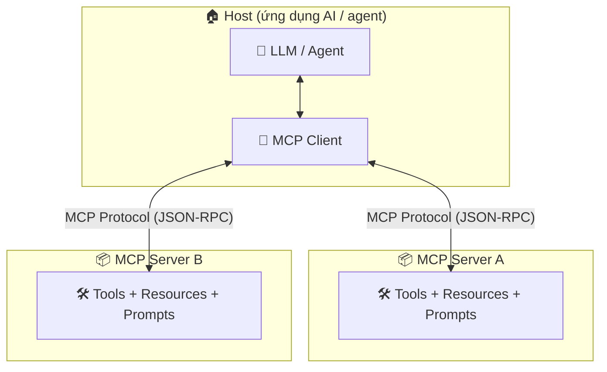

# 🔌 Module 14. MCP – Model Context Protocol

> ## 📑 Mục Lục
>
> - [Câu Chuyện Mở Đầu](#câu-chuyện-mở-đầu)
> - [1. MCP là gì?](#1-mcp-là-gì)
> - [2. Tại sao cần MCP?](#2-tại-sao-cần-mcp)
> - [3. MCP Architecture: Host / Client / Server](#3-mcp-architecture-host--client--server)
> - [4. Ba Nguyên Liệu của MCP: Tools, Resources, Prompts](#4-ba-nguyên-liệu-của-mcp-tools-resources-prompts)
> - [5. Transport Mechanisms: Giao Thức Vận Chuyển](#5-transport-mechanisms-giao-thức-vận-chuyển)
> - [6. MCP Lifecycle: Vòng Đời Kết Nối](#6-mcp-lifecycle-vòng-đời-kết-nối)
> - [7. Security & Permission: Bảo Mật Và Phân Quyền](#7-security--permission-bảo-mật-và-phân-quyền)
> - [8. Tự Xây Dựng MCP Server (Tổng Quan Các Bước)](#8-tự-xây-dựng-mcp-server-tổng-quan-các-bước)
> - [Tóm Tắt & Checklist](#tóm-tắt--checklist)

---

## Câu Chuyện Mở Đầu

Công ty bạn dùng 10 phần mềm khác nhau: CRM, kho hàng, kế toán, Slack, email, bảng doanh thu...

- **Người trợ lý A:** Để giúp bạn, anh ta phải tự lắp **10 bộ cáp riêng** cho từng phần mềm. Kết nối CRM một kiểu, kết nối kế toán một kiểu, mỗi thứ một chuẩn riêng, mỗi thứ một quyển hướng dẫn dày. Anh ta giỏi, nhưng quen được 1–2 phần mềm là cùng; thêm phần mềm mới lại bắt đầu từ con số không.
- **Người trợ lý B:** Cũng phải "nói chuyện" với 10 phần mềm đó, nhưng chỉ cần **một ổ cắm chuẩn duy nhất**. Cắm cáp vào là phần mềm nào cũng giao tiếp được ngay bằng đúng một ngôn ngữ chung; thêm phần mềm mới chỉ việc cắm thêm, không cần học lại gì.

Bạn thấy đấy — **vấn đề không phải trợ lý thông minh hay không, mà là "phích cắm".** Người trợ lý A là agent kết nối kiểu *point-to-point* (từng cặp một, ai cũng tự dựng chuẩn riêng). Người trợ lý B là một **agent dùng MCP** — một chuẩn chung, kết nối được với tất cả.

> **Tóm gọn 1 câu:** MCP là "ổ cắm chuẩn" cho AI — thay vì nối agent–ứng dụng theo từng cặp riêng lẻ, ta có một giao thức chung để bất kỳ agent nào cũng cắm vào bất kỳ công cụ nào.

---

## 1. MCP là gì?

MCP = **Model Context Protocol** — một **giao thức mở (open protocol)**, được Anthropic giới thiệu và nay là một chuẩn mở rộng rãi. Nó định nghĩa cách một ứng dụng AI (thường là agent) giao tiếp với các công cụ, dữ liệu bên ngoài theo một cách **chuẩn hóa và an toàn**.

Một cách gần gũi để nhớ: MCP giống một **"USB-C cho AI"**. Ngày xưa mỗi thiết bị một loại cáp riêng; USB-C ra đời thành chuẩn chung — một đầu cáp cắm được vào gần như mọi thứ. MCP cũng vậy: **một giao thức duy nhất** để agent cắm vào mọi "thiết bị" (tool, database, file, API...).

Ba khái niệm nền tảng bạn sẽ gặp suốt module:

- **Host:** chương trình AI "ở giữa" — nơi agent sống (ví dụ: Claude Desktop, một IDE, ứng dụng của bạn).
- **Client:** bộ phận bên trong Host, chịu trách nhiệm kết nối và trò chuyện với server.
- **Server:** "người cung cấp tài nguyên" — gói một nhóm công cụ/dữ liệu lại và phơi ra theo chuẩn MCP.

> **Tóm gọn 1 câu:** MCP là "USB-C cho AI" — một giao thức mở, chuẩn hóa cách agent kết nối với công cụ, dữ liệu và ứng dụng bên ngoài.

*Chú thích nhanh: hãy nhớ "Context" trong tên gọi — mục tiêu của MCP là đưa **context** (dữ liệu + công cụ) vào tầm tay của LLM, để mô hình không chỉ "biết" mà còn "làm được".*

---

## 2. Tại sao cần MCP?

Trước MCP, mỗi khi muốn agent gọi một công cụ mới, bạn phải viết một **bộ tích hợp riêng** (integration) cho từng cặp: agent ↔ Slack, agent ↔ database, agent ↔ CRM... Đây là vấn đề kinh điển **M × N**:

- **M** ứng dụng AI × **N** hệ thống bên ngoài = cần duy trì **M × N** bộ tích hợp riêng.
- Mỗi bộ tích hợp lại có cách gọi riêng, định dạng riêng, tài liệu riêng — tốn công, dễ hỏng, khó bảo trì.

MCP đổi mô hình từ **ai nối được với ai** sang **ai cũng cắm được vào chuẩn chung**:

| | Trước MCP (point-to-point) | Với MCP |
|---|---|---|
| **Cách kết nối** | Viết tích hợp riêng cho từng cặp agent–hệ thống | Một chuẩn chung, server tự khai báo |
| **Số lượng tích hợp** | M × N | M + N |
| **Thêm công cụ mới** | Viết code tích hợp mới từ đầu | Server khai báo thêm là xong |
| **Bảo trì** | Mỗi bộ tích hợp một sửa | Sửa 1 chỗ, mọi nơi được lợi |

*Cách đọc bảng: MCP không làm AI thông minh hơn, mà làm phần "nối dây" rẻ hơn và chuẩn hơn.*

> **Tóm gọn 1 câu:** Không có MCP, bạn phải viết N bộ tích hợp cho M ứng dụng (M×N) — có MCP, mọi thứ cắm vào một chuẩn chung (M+N), thêm công cụ chỉ là khai báo.

---

## 3. MCP Architecture: Host / Client / Server

Bức tranh tổng thể của MCP có ba vai trò, chạy theo một hướng dữ liệu rõ ràng:

Đọc sơ đồ từ trái sang: **Host** (nơi agent sống) chứa **MCP Client**. Client là "sứ giả" duy nhất nói chuyện với **MCP Server** qua giao thức MCP (nền tảng là JSON-RPC). Server thì "phơi ra" các tài nguyên của nó thành ba primitive (sẽ học ngay sau). Một Host có thể kết nối cùng lúc với nhiều Server.

Từng vai trò cụ thể:

- **Host (ứng dụng AI):** là "người dùng cuối" của MCP. Host chịu trách nhiệm xác thực người dùng, quyết định công cụ nào được gọi, và hiển thị kết quả. Ví dụ: Claude Desktop, Cursor, một framework agent bạn tự build.
- **MCP Client:** bộ phận bên trong Host, chịu trách nhiệm *kết nối* với một server: khởi tạo phiên, gửi yêu cầu, nhận kết quả, xử lý lỗi. Một Host có thể chứa nhiều client, mỗi client nối một server.
- **MCP Server:** gói một khả năng cụ thể (truy cập GitHub, query database, điều khiển browser...) thành các **tool / resource / prompt** chuẩn hóa. Nó không cần biết agent là ai — chỉ cần tuân theo giao thức.

> **Tóm gọn 1 câu:** Host là ngôi nhà của agent, Client là "sứ giả" kết nối, Server là "nhà cung cấp khả năng" — ba vai trò giao tiếp bằng một giao thức chung.

---

## 4. Ba Nguyên Liệu của MCP: Tools, Resources, Prompts

MCP định nghĩa **ba primitive (nguyên liệu cơ bản)** — đây là cách mọi server khai báo khả năng của mình. Nhớ ba thứ này là nhớ được 80% MCP:

| Primitive | Là gì? | Ví dụ |
|-----------|--------|-------|
| **Tools** | Hành động mà agent có thể *gọi ra* — thực thi việc gì đó, thường có tác động bên ngoài | Gửi email, tạo GitHub issue, chạy SQL, đặt lịch họp |
| **Resources** | Dữ liệu mà agent có thể *đọc* — để đưa vào context, gần như "file/thư mục" | Nội dung file README, schema database, tài liệu wiki, log |
| **Prompts** | Mẫu lời nhắc (template) dùng lại được — giúp định hướng agent xử lý một tác vụ chuẩn | "Tóm tắt PR này", "Viết test cho module X", "Soạn báo cáo lỗi" |

Phân biệt nhanh bằng 3 động từ: **Tools = làm**, **Resources = đọc**, **Prompts = mẫu hướng dẫn**.

- **Tools:** agent chủ động *quyết định gọi* (tương tự function calling — cơ chế chi tiết sẽ học ở Module 8). Tool thường cần quyền và có *side effect* (thay đổi trạng thái thế giới).
- **Resources:** giống như một "ổ đĩa" chuẩn hóa — agent hay ứng dụng chủ động *đọc* chúng để nạp context. Mỗi resource có một **URI** riêng (ví dụ `file:///docs/api.md`, `db://users`).
- **Prompts:** là *template có thể tái sử dụng* do server cung cấp — giúp chuẩn hóa cách agent tiếp cận một tác vụ quen thuộc, giảm việc viết lại prompt thủ công.

> **Tóm gọn 1 câu:** Tools để agent *làm*, Resources để agent *đọc*, Prompts để tái dùng *mẫu hướng dẫn* — ba nguyên liệu này là toàn bộ "khả năng" mà một MCP server phơi ra.

---

## 5. Transport Mechanisms: Giao Thức Vận Chuyển

"Transport" là **đường ống vật lý/logic** để Client và Server truyền tin. MCP hiện hỗ trợ hai cơ chế chính:

| Transport | Chạy ở đâu? | Khi nào dùng? | Đặc điểm |
|-----------|-------------|---------------|----------|
| **stdio** | Cùng một máy — server là một **tiến trình con** do client khởi động | Server cục bộ, gắn với một máy/ứng dụng | Bảo mật cao (không lộ ra mạng), khởi tạo đơn giản, khó gọi từ xa |
| **HTTP** (Streamable HTTP / SSE) | Qua mạng — server là một **endpoint HTTP** | Server chia sẻ, nhiều client, gọi từ xa | Linh hoạt, dễ scale, nhưng phải lo xác thực & bảo mật mạng |

*Cách đọc bảng: chọn transport theo vị trí — server độc lập gắn với ứng dụng thì dùng stdio; server "public" cho nhiều agent gọi thì dùng HTTP.*

> **Tóm gọn 1 câu:** stdio = nói chuyện qua ống cáp nội bộ một máy; HTTP = nói chuyển qua mạng — chọn theo chỗ server sống.

---

## 6. MCP Lifecycle: Vòng Đời Kết Nối

Kết nối MCP không phải "cắm là xong" — nó trải qua một **vòng đời (lifecycle)** với các bước kiểm tra lẫn nhau:

1. **Khởi tạo (Initialization):** Client gửi lời chào (`initialize`) kèm thông tin phiên bản, giao thức; Server trả lời khả năng của mình. Hai bên **bắt tay** trước khi làm gì thêm.
2. **Trao đổi khả năng & mô tả (Notifications + List):** sau khi bắt tay, client gọi `tools/list`, `resources/list`, `prompts/list` để biết server có gì — từ đó agent "nhìn thấy" bàn công cụ.
3. **Gọi tác vụ (Invocation):** agent gọi `tools/call`, `resources/read`, `prompts/get` — đây là lúc công việc thật sự diễn ra.
4. **Kết thúc (Shutdown):** khi xong (ứng dụng đóng, hoặc client chủ động cancel), kết nối được đóng lại sạch sẽ.

Một số cơ chế bổ sung trong vòng đời giúp MCP "chủ động" hơn:

- **Notifications:** server có thể *chủ động báo* client khi tài nguyên thay đổi (resource/event), hoặc tool hết hạn.
- **Sampling (đề cử ngược):** server có thể *nhờ* client hỏi ý kiến LLM — hữu ích khi cho phép agent gọi agent, dù mặc định bị giới hạn vì bảo mật.

> **Tóm gọn 1 câu:** Lifecycle là một "quy trình hẹn hò" có bắt tay (initialize), làm quen (list khả năng), hẹn hò (call), và chia tay lịch sự (shutdown) — không phải cắm phát là chạy ngay.

---

## 7. Security & Permission: Bảo Mật Và Phân Quyền

MCP trao cho agent "tay chân" — mà có tay chân thì có thể **làm hỏng việc**. Không bao giờ để agent *tự do* gọi mọi tool. Nguyên tắc an toàn:

- **Human-in-the-loop (HITL):** các tool *nguy hiểm* (xóa dữ liệu, gửi tiền, publish, chạy lệnh) phải **yêu cầu con người xác nhận** trước khi thực thi — user confirmation không nên bỏ qua.
- **Phân quyền tối thiểu (principle of least privilege):** chỉ cấp cho server đúng quyền nó cần. Server đọc GitHub không cần quyền ghi repo.
- **Allowlist / Denylist:** trắng đen danh sách tool được phép gọi; tool lạ mặc định **chặn**.
- **Cẩn thận với prompt injection:** không gian dữ liệu của tool (file, web, email) có thể chứa *chỉ thị độc* — server nên *không nhúng mù* nội dung người dùng vào prompt thực thi.
- **Transport quyết định rủi ro:** stdio kín mạng hơn HTTP; với HTTP phải lo xác thực (auth), token, và kiểm soát ai được gọi endpoint.

Thiết kế tốt: **context ít quyền → tool ít quyền → luôn ghi log** những gì agent thực sự làm.

> **Tóm gọn 1 câu:** MCP = trao quyền cho agent — bảo mật nghĩa là "nghi ngờ mặc định": yêu cầu xác nhận với tool nhạy cảm, chỉ cấp quyền tối thiểu, và chặn tool lạ.

---

## 8. Tự Xây Dựng MCP Server (Tổng Quan Các Bước)

Bạn không cần viết từ con số không — các SDK chính thức (Python, TypeScript, Kotlin...) đã lo phần giao thức. Quy trình tổng quan để dựng một server của riêng mình:

1. **Xác định phạm vi:** bạn muốn agent làm được gì? Liệt kê các **tool** cụ thể (đọc file, gửi top issue, query database...) — đây mới là "sản phẩm" thật sự.
2. **Khởi tạo dự án:** dùng `npx @modelcontextprotocol/create-server` (TypeScript) hay `uv` + SDK (Python) để có khung server trống.
3. **Khai báo tools bằng JSON Schema:** mỗi tool có *tên, mô tả, tham số* — phần mô tả rất quan trọng vì LLM đọc nó để quyết định gọi tool.
4. **Viết handler (bộ xử lý):** đúng chuỗi code xử lý khi tool được gọi — đây là nơi bạn "nối" vào hệ thống thật (gọi API, dùng thư viện...).
5. **Chọn transport:** `stdio` cho server cục bộ, hoặc HTTP server cho trường hợp chia sẻ.
6. **Test bằng MCP Inspector:** công cụ chính thức để chạy thử từng tool, xem log, gỡ lỗi trước khi gắn vào ứng dụng.
7. **Kiểm tra bảo mật & phát hành:** rà soát quyền nhỏ nhất, xóa thông tin nhạy cảm (API key) khỏi code, rồi publish theo kênh của bạn (npm/PyPI hoặc chạy nội bộ).

> **Tóm gọn 1 câu:** Dựng MCP server = khai báo tool bằng schema đẹp + viết handler đúng + chọn transport hợp lý + test bằng Inspector — SDK đã lo hết phần "dây nối".

---

## Tóm Tắt & Checklist

### Nội dung đã học trong module này

1. **MCP** = Model Context Protocol — "USB-C cho AI": một giao thức mở chuẩn hóa kết nối agent với công cụ/dữ liệu.
2. **Vì sao cần:** thay mô hình tích hợp M×N bằng chuẩn chung M+N, thêm công cụ chỉ là khai báo.
3. **Architecture:** Host (nhà của agent) → Client (sứ giả) ↔ Server (nhà cung cấp) — giao tiếp qua JSON-RPC.
4. **Ba primitive:** **Tools** = làm, **Resources** = đọc, **Prompts** = mẫu hướng dẫn.
5. **Transport:** **stdio** cho server cục bộ, **HTTP** cho server gọi qua mạng.
6. **Lifecycle:** bắt tay (initialize) → liệt kê khả năng → gọi tác vụ → đóng kết nối.
7. **Security:** xác nhận của người dùng với tool nhạy cảm, quyền tối thiểu, chặn tool lạ.
8. **Xây server:** khai báo tool (JSON Schema) → viết handler → chọn transport → test bằng MCP Inspector.

### Checklist tự kiểm tra

Bạn đã nắm được khi có thể trả lời lưu loát các câu hỏi sau:

- [ ] Giải thích cho người khác: MCP là gì bằng câu chuyện "USB-C cho AI"?
- [ ] Nói rõ tại sao MCP giúp tránh vấn đề tích hợp M×N?
- [ ] Phân biệt được Host, MCP Client và MCP Server, ai là "sứ giả" kết nối?
- [ ] Phân biệt được Tools vs Resources vs Prompts bằng ví dụ cụ thể?
- [ ] Chọn được transport (stdio hay HTTP) cho một tình huống cụ thể?
- [ ] Kể được các bước chính trong vòng đời kết nối MCP?
- [ ] Kể được ít nhất 3 quy tắc bảo mật khi dùng MCP?
- [ ] Nêu được các bước tổng quan để dựng một MCP server của riêng mình?

---

## Tóm Gọn Toàn Module

> **Một câu để nhớ mãi:** MCP là "USB-C cho AI" — một ổ cắm chuẩn để agent cắm vào mọi công cụ, dữ liệu và ứng dụng: Tools để *làm*, Resources để *đọc*, Prompts để *định hướng*, chạy trên stdio hay HTTP, và luôn phải *phân quyền cẩn thận*.

**Đi tiếp:** Module 15 sẽ mở rộng từ *một* kết nối chuẩn hóa (MCP) sang bức tranh *toàn hệ thống*: REST API, WebSocket, Event-driven, Message Queue, giao tiếp Agent-to-Agent với giao thức A2A, kết nối dịch vụ bên ngoài và các vấn đề xác thực, phân quyền, giới hạn tốc độ (rate limiting).
