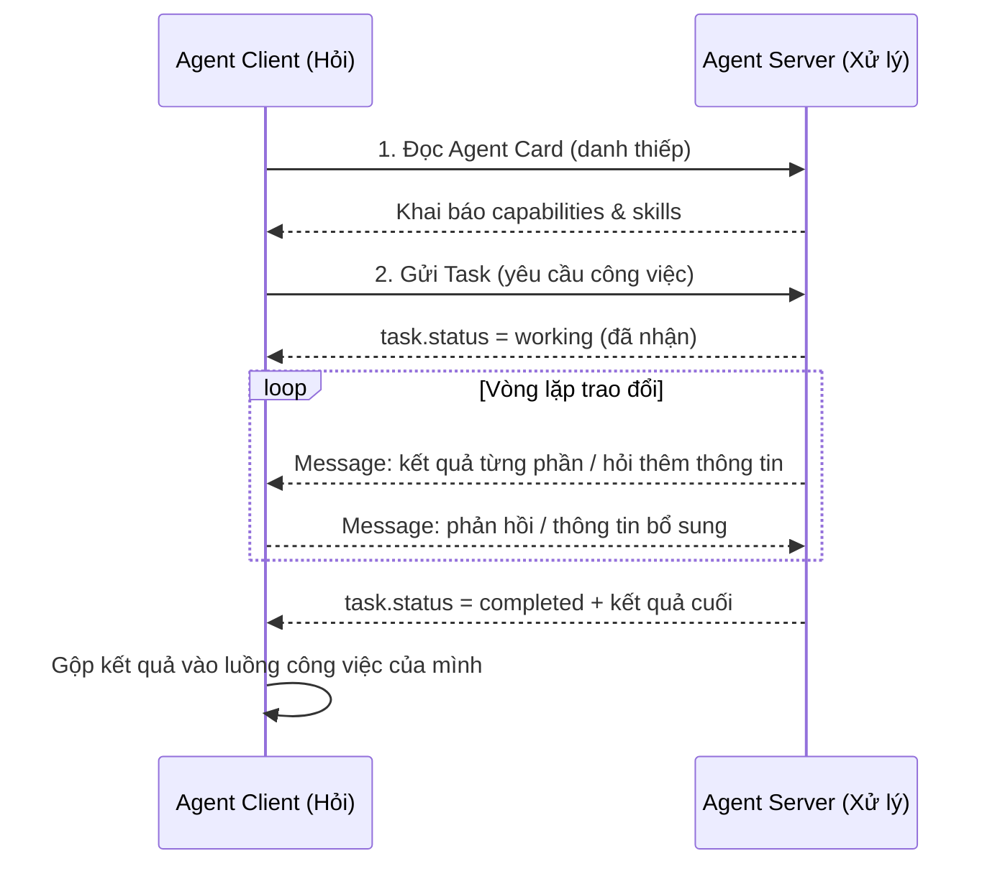

# 📡 Module 15. Agent Communication & Integration

> ## 📑 Mục Lục
>
> - [Câu Chuyện Mở Đầu](#câu-chuyện-mở-đầu)
> - [1. REST API](#1-rest-api)
> - [2. WebSocket](#2-websocket)
> - [3. Event-driven Architecture](#3-event-driven-architecture)
> - [4. Message Queue](#4-message-queue)
> - [5. REST vs WebSocket vs Message Queue — Bảng So Sánh](#5-rest-vs-websocket-vs-message-queue--bảng-so-sánh)
> - [6. Agent-to-Agent Communication](#6-agent-to-agent-communication)
> - [7. A2A Protocol](#7-a2a-protocol)
> - [8. A2A vs MCP — Giao Thức Bổ Trợ](#8-a2a-vs-mcp--giao-thức-bổ-trợ)
> - [9. External Services Integration](#9-external-services-integration)
> - [10. Bảo mật: Authentication, Authorization, API Rate Limiting](#10-bảo-mật-authentication-authorization-api-rate-limiting)
> - [Tóm Tắt & Checklist](#tóm-tắt--checklist)

---

## Câu Chuyện Mở Đầu

Hình dung một đội ba agent trong cùng một công ty dịch vụ:

- **Agent Phân Tích:** nhận email khách, đọc kỹ, đưa ra kết luận *"Khách muốn hoàn tiền, gấp, ưu tiên cao."*
- **Agent Tài Chính:** giữ dữ liệu đơn hàng và hóa đơn, chỉ được phép chạm vào hệ thống thanh toán.
- **Agent CSKH:** soạn email trả lời khách, cần câu trả lời từ hai agent kia.

Ba agent này *phải nói chuyện được với nhau*: Phân Tích chuyển ticket, Tài Chính trả kết quả đối soát, CSKH gộp tất cả lại thành email gửi khách. Mỗi agent mã hóa theo kiểu riêng — cái chờ xong mới trả lời, cái cần kết quả ngay lập tức, cái chạy nền vẫn làm việc khác — thì hệ thống rối loạn, chậm và dễ hỏng.

Câu hỏi xuyên suốt module này: **agent giao tiếp với nhau và với thế giới bên ngoài bằng cách nào, và chọn công cụ nào cho hoàn cảnh nào?** Câu trả lời đi từ REST API — thứ đơn giản nhất — tới WebSocket, event-driven, message queue, rồi đến "ngôn ngữ chung" giữa hai tác tử: giao thức A2A. Cuối cùng, mọi đường truyền đều phải qua cổng an ninh: authentication, authorization và giới hạn tần suất gọi API.

> **Tóm gọn 1 câu:** Một agent cô lập thì chỉ mạnh một mình; agent biết giao tiếp — qua REST, WebSocket, message queue hay A2A — mới thành một đội ngũ giải quyết việc lớn.

---

## 1. REST API

REST (Representational State Transfer) là kiểu giao tiếp qua lại phổ biến nhất trên web: một agent **gửi yêu cầu HTTP** (GET, POST, PUT, DELETE) tới một địa chỉ cụ thể, và nhận **câu trả lời** kèm trạng thái. Người gọi — ví dụ agent của bạn — không cần "bận lòng" về việc server xử lý ra sao bên trong.

Đặc điểm giúp REST phù hợp với agent:

- **Request – Response:** gọi xong là có ngay kết quả, dễ hiểu, dễ gỡ lỗi.
- **Stateless (không trạng thái):** mỗi lần gọi là độc lập, server không cần nhớ bạn là ai ở lần trước — độ tin cậy cao, dễ mở rộng.
- **JSON phổ biến:** LLM đọc và sinh JSON cực tốt, nên agent thao tác dữ liệu REST rất tự nhiên.

REST là lựa chọn hàng đầu cho *tool calling* (Module 8) và gần như mọi *external service* — từ trả tiền, gửi email, đến truy vấn kho dữ liệu. Hạn chế chính: client phải **chủ động hỏi** — server không tự "gõ cửa" để báo tin mới.

> **Tóm gọn 1 câu:** REST là "cuộc gọi điện thoại" giữa các dịch vụ — hỏi đáp nhanh, không trạng thái, tiêu chuẩn toàn web; thích hợp cho agent gọi công cụ và tích hợp dịch vụ ngoài.

---

## 2. WebSocket

REST xử lý tốt chuyện "hỏi – đáp", nhưng bế tắc khi cần **hai chiều, theo thời gian thực**. WebSocket sinh ra để giải bài đó: mở ra một **kênh kết nối liên tục** giữa hai phía, và cả hai đều có thể *đẩy* dữ liệu bất cứ lúc nào mà không cần hỏi lại.

Với agent, WebSocket hữu ích khi:

- Nhận **stream** kết quả từ LLM (token chảy về từng phần thay vì chờ cả câu).
- Theo dõi **sự kiện trực tiếp**: giá chứng khoán, trạng thái máy, tin nhắn khách hàng — agent hành động ngay khi có biến động.
- Một agent **gửi tin cho agent khác** ngay trong phiên làm việc chung (mô hình cộng tác kiểu hội thoại).

Giá phải trả: phải quản lý trạng thái kết nối, xử lý mất kết nối/reconnect, và khó mở rộng quy mô như HTTP thông thường.

> **Tóm gọn 1 câu:** WebSocket là "đường dây nóng mở sẵn" — hai phía đẩy dữ liệu qua lại theo thời gian thực; hợp cho stream LLM, sự kiện trực tiếp và giao tiếp agent-to-agent trực tuyến.

---
## 3. Event-driven Architecture

Nếu REST là "bạn hỏi thì tôi trả lời", thì **event-driven** đảo ngược quan điểm: các phần trong hệ thống **phát ra sự kiện** (event) — "đơn hàng mới", "trả tiền xong", "log cảnh báo" — và **không biết cũng chẳng quan tâm ai sẽ đón nhận** sự kiện đó. Bên nhận quan tâm sẽ đăng ký lắng nghe và phản hồi khi sự kiện xảy ra. Người gửi không gọi thẳng người nhận; cả hai bị "nới lỏng kết nối" (loosely coupled).

Với agent, mô hình này mang lại sức mạnh đáng kể:

- Một hệ thống agent mới có thể **thêm vào mà không cần sửa** agent phát sự kiện — chỉ cần lắng nghe các sự kiện sẵn có.
- **Chạy song song tự nhiên:** nhiều agent cùng phản hồi một sự kiện, mỗi agent lo một việc.
- **Chịu lỗi tốt:** nếu một agent đang bận hay chết, sự kiện không mất — nó chờ trong hàng đợi cho đến khi có người xử lý.

Ranh giới event-driven và message queue thường bị nhầm; thực tế chúng đi cùng nhau — sự kiện thường *được chở* qua một message queue (phần tiếp theo).

> **Tóm gọn 1 câu:** Event-driven là thế giới "phát–thu" — agent phát sự kiện mà không cần biết ai nghe; hệ thống trở nên lỏng lẻo, dễ mở rộng và chịu lỗi tốt.

---

## 4. Message Queue

Message Queue (MQ) là **hàng đợi trung gian** chứa các message giữa người sản xuất (producer) và người tiêu thụ (consumer). Producer đẩy tin vào queue và quên đi; consumer rút tin ra khi sẵn sàng. Tin không bị gửi trực tiếp "tận tay" — nó nằm chờ trong hàng, an toàn, và được lấy theo thứ tự.

Điều này giải quyết hai vấn đề kinh điển của hệ agent:

- **Giảm tải đột biến (buffering):** nếu 10.000 sự kiện dồn về cùng lúc mà agent chỉ xử lý được 10, phần dư nằm chờ trong queue, không gây sập.
- **Tin cậy (reliability):** nếu agent xử lý thất bại, message có thể *retry* hoặc đưa vào dead-letter queue để xem xét — không mất việc.

Trong hệ sinh thái agent, MQ thường xuất hiện ở nghiệp vụ **hàng đợi công việc**: agent sinh ra task (rút ticket, gửi email, đối soát dữ liệu...), bỏ vào queue, một nhóm worker agent rút và làm. Nhờ đó hệ thống phẳng vượt trội về lưu lượng, không cần biết nhau, và dễ bổ sung thêm worker.

Ví dụ điển hình cho hạ tầng này: Kafka, RabbitMQ, Amazon SQS — nền móng hầu hết hệ thống agent production hiện nay.

> **Tóm gọn 1 câu:** Message Queue là "bưu cục trung chuyển" — producer gửi xong là xong, consumer tự đến lấy khi rảnh; giúp hệ agent sống sót qua bão lưu lượng và không mất task.

---
## 5. REST vs WebSocket vs Message Queue — Bảng So Sánh

Bảng dưới đây tóm lại cốt lõi ba phương thức, để dễ nhớ khi nào dùng cái nào:

| Tiêu chí | REST API | WebSocket | Message Queue |
|---|---|---|---|
| **Cơ chế** | Request – Response (hỏi – đáp), mỗi lần gọi độc lập | Kênh hai chiều mở liên tục, đẩy dữ liệu tự do | Hàng đợi trung gian: producer gửi, consumer rút, không gắn trực tiếp |
| **Khác biệt chính** | Client phải *chủ động gọi*; server không tự báo tin | Cả hai phía *chủ động* đẩy tin; kết nối bền bỉ theo thời gian thực | Người gửi *không biết ai nhận*; tin được lưu đệm, retry, xử lý lại |
| **Tính trạng thái** | Stateless | Stateful (có kết nối dài) | Stateless về logic — trạng thái nằm trong queue |
| **Độ trễ / thời gian thực** | Thời gian thực kém (phải hỏi) | Thời gian thực tốt | Trễ trung bình (chờ rút) nhưng chịu tải cao |
| **Khả năng mở rộng** | Tốt, dễ scale | Khó scale khi quá nhiều kết nối | Rất tốt — phẳng hóa lưu lượng, thêm worker dễ dàng |
| **Tin cậy khi lỗi** | Gọi lại có thể thất bại, phải retry tay | Mất kết nối phải reconnect | Tin nằm trong queue, retry/redeliver — mạnh nhất |
| **Ví dụ** | Gọi tool, tích hợp dịch vụ thanh toán, CRUD | Stream token LLM, chat thời gian thực, giá chứng khoán | Hàng đợi task: xử lý ticket, gửi email hàng loạt, pipeline dữ liệu (Kafka, RabbitMQ, SQS) |

*Cách đọc bảng: tăng dần về độ phức tạp và độ tin cậy — REST đơn giản nhất, MQ mạnh nhất về lưu lượng và khả năng chịu lỗi.*

> **Tóm gọn 1 câu:** Cần hỏi đáp nhanh thì dùng REST; cần hai chiều thời gian thực thì dùng WebSocket; cần chịu tải, không mất việc, tách rời người gửi–người nhận thì dùng Message Queue.

---

## 6. Agent-to-Agent Communication

Từ Module 12, ta đã biết multi-agent cần *cộng tác, ủy quyền và trao đổi*. Nhưng hai agent cụ thể "nói chuyện" ra sao? Có hai cực:

- **Direct call (gọi trực tiếp):** agent A gọi agent B qua API (thường dựng trên REST hoặc WebSocket), gửi yêu cầu và nhận kết quả. Nhanh, rõ ràng, nhưng tạo **ràng buộc cứng**: A phải biết B, biết định dạng của B.
- **Message passing (chuyển tin qua trung gian):** hai agent trao đổi qua message queue hoặc event bus; A gửi tin, B lắng nghe. Không cần biết nhau, dễ thêm/thay agent, nhưng phải thống nhất "khuôn dạng tin" và quản lý độ trễ.

Cả hai đều đối mặt một vấn đề nền tảng: **hai agent do các tổ chức, framework khác nhau xây dựng (Module 12, 13) — làm sao chúng hiểu yêu cầu của nhau?** Mỗi framework có định dạng prompt, cấu trúc message và cách gọi tool riêng. Nếu mỗi cặp agent tự thống nhất một giao thức riêng, hệ thống thành "mớ dây rối". Giải pháp: một **giao thức mở chuẩn hóa** — đó chính là lý do A2A ra đời.

> **Tóm gọn 1 câu:** Agent-to-agent có hai cách — gọi trực tiếp (chặt, nhanh) hoặc chuyển tin qua trung gian (lỏng, linh hoạt); cả hai đều cần một "ngôn ngữ chung" để các agent khác tổ chức hiểu nhau.

---
## 7. A2A Protocol

**A2A (Agent2Agent)** là giao thức mở do **Linux Foundation** bảo trợ (Google dẫn dắt cùng nhiều công ty lớn), công bố năm 2025, với mục tiêu: *cho phép hai agent thuộc bất kỳ framework nào giao tiếp và ủy quyền công việc cho nhau một cách chuẩn hóa.*

Các khái niệm chính trong A2A:

- **Agent Card:** "danh thiếp" JSON công khai của mỗi agent — mô tả nó làm được gì, nói ngôn ngữ nào, yêu cầu xác thực gì. Client đọc Agent Card để biết *nói chuyện với ai*.
- **Capabilities:** năng lực mà agent khai báo — giải quyết việc dài nhiều bước (long-running tasks), stream kết quả từng phần, gọi người dùng xác nhận giữa chừng (human-in-the-loop).
- **Task & Message:** đơn vị công việc — agent yêu cầu agent khác thực hiện một *task* và nhận kết quả; quá trình diễn ra thông qua các *message* được trao đổi theo vòng lặp.
- **Transports & Security:** giao thức chạy trên nền HTTP, JSON-RPC, hiện tại chủ yếu trên HTTP + SSE, kèm xác thực chuẩn (OAuth, JWT).

Sơ đồ dưới đây minh họa một lượt trao đổi A2A điển hình giữa hai agent:

Chú ý chiều trao đổi: Agent Client **ủy quyền một task**; Agent Server có thể chủ động hỏi lại (hỏi làm rõ, yêu cầu xác nhận) — như hai chuyên gia trao đổi, không phải lệnh một chiều.

> **Tóm gọn 1 câu:** A2A (Linux Foundation) là "ngôn ngữ chung" cho agent-to-agent — mỗi agent công bố Agent Card, nhận task, trao đổi message và trả kết quả theo chuẩn mở, bất kể framework bên dưới là gì.

---
## 8. A2A vs MCP — Giao Thức Bổ Trợ

Điểm dễ nhầm nhất của cả module này: A2A và MCP (hiểu kỹ ở **Module 14**) nghe na ná, thực chất giải **hai bài toán khác nhau**. MCP trả lời câu hỏi *"agent kết nối với công cụ và dữ liệu thế nào?"*; A2A trả lời *"agent kết nối với agent thế nào?"*.

| Tiêu chí | MCP (Module 14) | A2A (Module 15) |
|---|---|---|
| **Bài toán** | Agent dùng **tools / external data** | Agent giao tiếp và **ủy quyền cho agent khác** |
| **"Cổng" giao tiếp** | Agent ↔ Host/Client ↔ MCP Server (công cụ, dữ liệu) | Agent ↔ Agent (task, message, kết quả) |
| **Hướng** | *Dọc* — LLM vươn tay ra thế giới | *Ngang* — hai tác tử trao đổi với nhau |
| **Đơn vị chính** | Tools, Resources, Prompts | Agent Card, Task, Capabilities, Messages |
| **Được phát triển bởi** | Anthropic (sau đó mở rộng, chuẩn hóa cộng đồng) | Linux Foundation (Google dẫn dắt cùng consortium) |
| **Ví dụ** | Agent gọi MCP server tìm kiếm, đọc CSDL, điều khiển trình duyệt | Agent hỏi agent CSKH về tình trạng đơn rồi gộp thành email |
| **Quan hệ** | Bổ trợ, không loại trừ — hai tầng độc lập | Bổ trợ, không loại trừ — hai tầng độc lập |

Trong thực tế hai giao thức **sống cùng nhau**: một agent nội bộ dùng MCP để truy cập dữ liệu (chiều dọc); khi cần nhờ agent ở tổ chức khác, nó dùng A2A để gửi task (chiều ngang). Như "châm cứu" với "kết nối" — cần cả hai cho một hệ multi-agent thực thụ.

> **Tóm gọn 1 câu:** MCP cho agent *dùng công cụ/dữ liệu* (chiều dọc, Module 14), A2A cho agent *nói chuyện với agent* (chiều ngang, Module 15) — hai lớp bổ trợ, cần cả hai cho một hệ multi-agent thực thụ.

---

## 9. External Services Integration

Agent gần như không bao giờ sống cô lập — nó phải **chạm vào thế giới thật**: gửi email, trả tiền, đọc CRM, truy vấn kho, cập nhật tài liệu. Bốn nguyên tắc vàng khi tích hợp dịch vụ ngoài:

- **Bọc (wrap) qua lớp API sạch:** agent không gọi thẳng SDK lộn xộn; đóng gói thành tool đúng tinh thần Module 8.
- **Retry với backoff + timeout:** dịch vụ ngoài hay chậm hay lỗi tạm; đặt giới hạn thời gian, trả ngay "đang xử lý" cho tác vụ lâu.
- **Secret an toàn:** API key và URL không hardcode — dùng biến môi trường hoặc vault.
- **Quy tắc tối thiểu:** tích hợp càng xa tầm kiểm soát, càng phải thận trọng — điều này dẫn thẳng tới ba lớp an ninh bắt buộc phần tiếp theo.

> **Tóm gọn 1 câu:** Tích hợp dịch vụ ngoài là "bắt tay thế giới thật" — cần lớp API sạch, retry/timeout, secret an toàn, và càng xa tầm kiểm soát thì càng thận trọng.

---
## 10. Bảo mật: Authentication, Authorization, API Rate Limiting

Không có cổng an ninh, agent lạ có thể giả danh, lấy dữ liệu nhạy cảm, hoặc làm quá tải hệ thống. Ba lớp bảo vệ bổ sung cho nhau:

- **Authentication (Xác thực) — "Anh là ai?":** API Key đơn giản cho máy–máy; OAuth 2.0 / Bearer Token chuẩn dịch vụ công khai; JWT tự ký chứa danh tính mà không cần tra server mỗi lần; mTLS cho kênh cực nhạy cảm.
- **Authorization (Phân quyền) — "Anh được làm gì?":** RBAC gán quyền theo vai trò; ABAC quyết định theo thuộc tính người dùng/nguồn/thời gian; luôn áp dụng *least privilege* — agent chỉ có đúng quyền cần cho task của nó; hành động tác động thế giới thật (gửi tiền, xóa dữ liệu) nên kèm human-in-the-loop (Module 11).
- **API Rate Limiting — "Bao nhiêu là đủ?":** chặn bên gọi quá nhiều lần qua giới hạn requests/phút, token bucket; khi bị 429 — agent phải đọc header `Retry-After`, chờ và giảm tốc, không gọi lại liên tục.

Ba lớp đi cùng nhau: *Authentication xác nhận danh tính → Authorization kiểm tra quyền → Rate Limiting giới hạn tần suất.* Thiếu bất kỳ lớp nào, hệ thống đều hở.

> **Tóm gọn 1 câu:** Ba cổng an ninh: Authentication hỏi "bạn là ai", Authorization hỏi "được làm gì", Rate Limiting hỏi "gọi bao nhiêu là đủ" — thiếu một trong ba, hệ thống hở.

---
## Tóm Tắt & Checklist

### Nội dung đã học trong module này

1. **REST API** — hỏi–đáp qua HTTP, stateless, là nền cho tool calling và tích hợp dịch vụ ngoài.
2. **WebSocket** — kênh hai chiều thời gian thực cho stream LLM, sự kiện trực tiếp, hội thoại agent.
3. **Event-driven Architecture** — phát sự kiện, người nhận đăng ký lắng nghe; hệ thống lỏng lẻo, dễ mở rộng.
4. **Message Queue** — hàng đợi trung gian: chịu tải đột biến, không mất task, tách rời producer–consumer (Kafka, RabbitMQ, SQS).
5. **Bảng so sánh phương thức** — REST đơn giản; WebSocket thời gian thực; Message Queue mạnh về lưu lượng và độ tin cậy.
6. **Agent-to-Agent** — gọi trực tiếp (chặt) hoặc message passing (lỏng); đều cần ngôn ngữ chung.
7. **A2A Protocol** — chuẩn mở của Linux Foundation: Agent Card, Task, Capabilities, Messages, chạy trên HTTP.
8. **A2A vs MCP** — A2A nối agent↔agent (ngang); MCP (Module 14) nối agent↔tool/dữ liệu (dọc); bổ trợ nhau.
9. **External Services Integration** — lớp API sạch, retry/timeout, secret an toàn, thận trọng với dịch vụ ngoài tầm kiểm soát.
10. **Bảo mật** — Authentication (bạn là ai), Authorization (được làm gì), API Rate Limiting (gọi bao nhiêu là đủ).

### Checklist tự kiểm tra

Bạn đã nắm được khi có thể trả lời lưu loát các câu hỏi sau:

- [ ] Giải thích được sự khác nhau giữa REST, WebSocket và Message Queue qua một ví dụ cụ thể?
- [ ] Nêu được khi nào chọn event-driven thay vì gọi REST trực tiếp?
- [ ] Vẽ/phân tích được một luồng A2A: đọc Agent Card → gửi Task → trao đổi message → nhận kết quả?
- [ ] Phân biệt được vai trò của MCP (Module 14) và A2A trong cùng một hệ thống?
- [ ] Liệt kê được 3 lớp bảo mật và nội dung chính của từng lớp?
- [ ] Giải thích được ý nghĩa của mã lỗi 429 và cách agent nên phản ứng?

---

## Tóm Gọn Toàn Module

> **Một câu để nhớ mãi:** Agent mạnh nhất là một đội biết nói chuyện — người gửi thì hỏi–đáp qua REST, kênh nóng thời gian thực qua WebSocket, hàng hóa thì chở qua Message Queue, và khi cần nhờ đồng nghiệp agent thì dùng A2A — tất cả dưới ba cổng an ninh: authentication, authorization, rate limiting.

**Đóng khóa Part I–IV:** sau 15 module, bạn đã đi trọn hành trình — từ *Part I* hiểu agent là gì và kiến trúc của nó, đến *Part II* nắm công nghệ nền (LLM & reasoning, context, memory, tool calling), qua *Part III* thiết kế luồng làm việc agentic (workflow patterns, planning, decision-making, multi-agent), và *Part IV* gắn agent vào hệ sinh thái thực (framework, MCP, giao tiếp & tích hợp). Bạn đã có toàn bộ khung lý thuyết để xây dựng và vận hành một hệ thống agent thực tế.

**Đi tiếp:** Đây là module cuối của **phần lý thuyết (Part I–IV)** — lúc này là thời điểm *tổng kết toàn khóa và bắt tay vào thực hành*. Hãy dành thời gian rà lại sơ đồ học tập 15 module, tự chọn một bài toán thật (research agent, support triage, coding agent...), và chuyển sang **phần thực hành Part V**: xây dựng từng module-dự án bằng Python/Node.js — áp dụng tool calling, memory, MCP, A2A, bảo mật đã học để hoàn thiện một agent production hoàn chỉnh. Lý thuyết nền đã đủ vững; từ đây, *đoạn code đầu tiên của bạn quan trọng hơn mọi ghi chú.*
