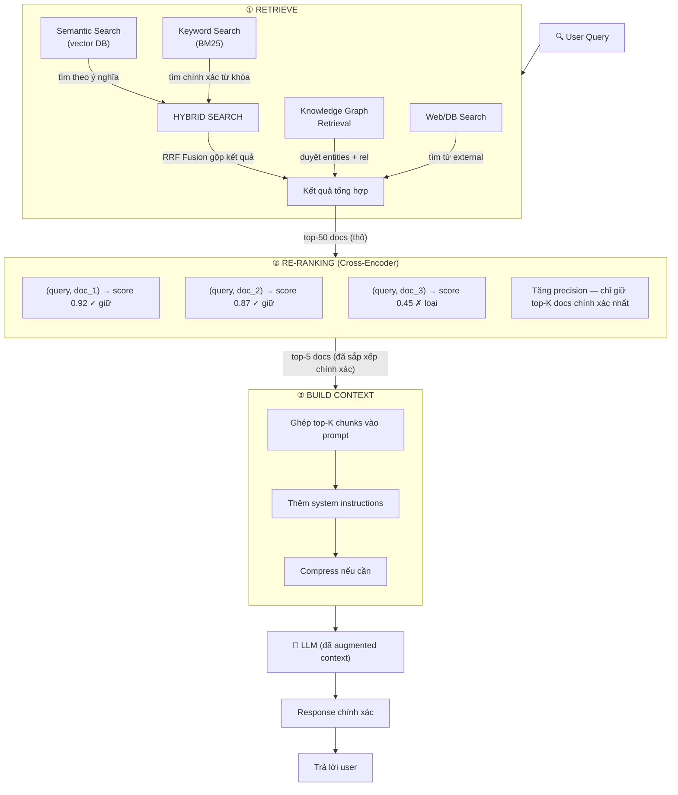
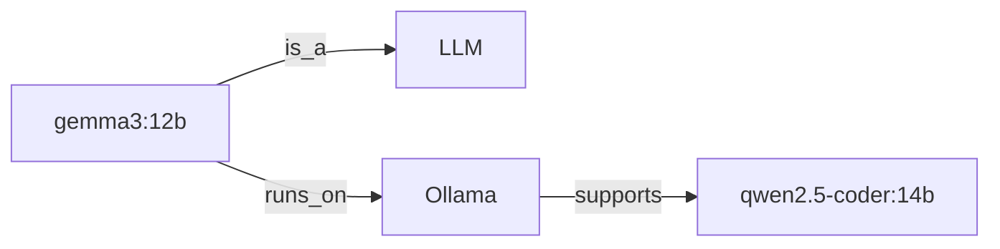
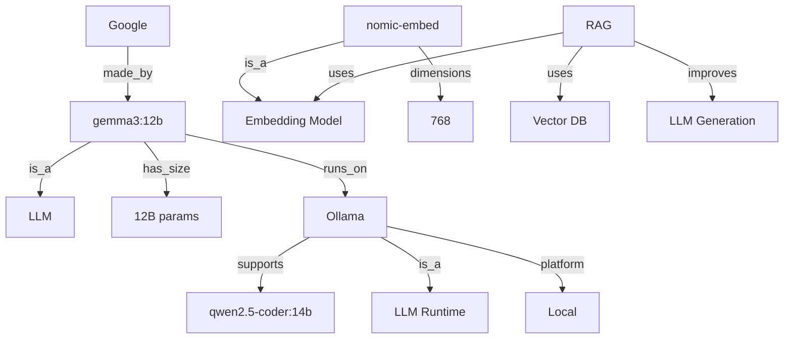
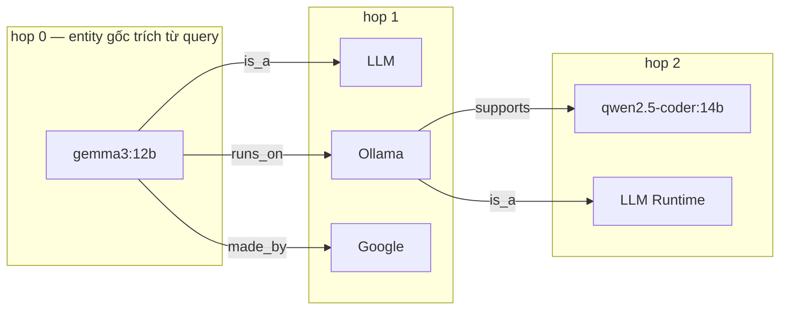
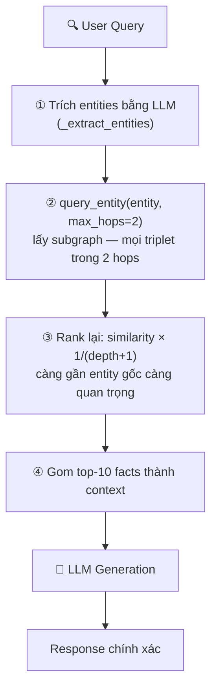

# 🧠 I. Retrieve Memory & Knowledge

> ## 📑 Mục Lục
>
> - [Tổng Quan](#tổng-quan)
> - [Tại Sao Retrieve Memory & Knowledge Quan Trọng?](#tại-sao-retrieve-memory-knowledge-quan-trọng)
> - [Nội Dung](#nội-dung)
> - [1. Semantic Search / Vector Search](#1-semantic-search-vector-search)
>   - [1.1 Khái Niệm Cơ Bản](#11-khái-niệm-cơ-bản)
>   - [1.2 Vector Embedding — Cách Thức Hoạt Động](#12-vector-embedding-cách-thức-hoạt-động)
>   - [1.3 Embedding Models So Sánh](#13-embedding-models-so-sánh)
>   - [1.4 Chunking Strategies — Chi Tiết](#14-chunking-strategies-chi-tiết)
>   - [1.5 Similarity Metrics — Chi Tiết](#15-similarity-metrics-chi-tiết)
>   - [1.6 Vector Databases — Chi Tiết](#16-vector-databases-chi-tiết)
> - [2. RAG (Retrieval-Augmented Generation)](#2-rag-retrieval-augmented-generation)
>   - [2.1 Khái Niệm](#21-khái-niệm)
>   - [2.2 RAG Pipeline Chi Tiết — 6 Bước](#22-rag-pipeline-chi-tiết-6-bước)
>   - [2.3 Các Loại RAG](#23-các-loại-rag)
>   - [2.4 RAG Evaluation Metrics](#24-rag-evaluation-metrics)
> - [3. Knowledge Graph Retrieval](#3-knowledge-graph-retrieval)
>   - [3.1 Khái Niệm](#31-khái-niệm)
>   - [3.2 Entity-Relationship Triplets](#32-entity-relationship-triplets)
>   - [3.3 Knowledge Graph Operations](#33-knowledge-graph-operations)
>   - [3.4 Graph RAG Implementation](#34-graph-rag-implementation)
> - [4. Hybrid Search](#4-hybrid-search)
>   - [4.1 Tại Sao Cần Hybrid Search?](#41-tại-sao-cần-hybrid-search)
>   - [4.2 BM25 Algorithm](#42-bm25-algorithm)
>   - [4.3 Reciprocal Rank Fusion (RRF)](#43-reciprocal-rank-fusion-rrf)
>   - [4.4 Hybrid Search Implementation](#44-hybrid-search-implementation)
> - [5. Re-ranking](#5-re-ranking)
>   - [5.1 Tại Sao Cần Re-ranking?](#51-tại-sao-cần-re-ranking)
>   - [5.2 Cross-Encoder Implementation](#52-cross-encoder-implementation)
>   - [5.3 Re-ranking Models Comparison](#53-re-ranking-models-comparison)
> - [6. Memory Systems](#6-memory-systems)
>   - [6.1 Memory Types Chi Tiết](#61-memory-types-chi-tiết)
>   - [6.2 Memory Patterns Chi Tiết](#62-memory-patterns-chi-tiết)
>   - [6.3 MemGPT-Style Memory Architecture](#63-memgpt-style-memory-architecture)
>   - [6.4 Complete Memory Manager](#64-complete-memory-manager)
> - [7. Labs Thực Hành](#7-labs-thực-hành)
>   - [Lab 1: Semantic Search với nomic-embed-text](#lab-1-semantic-search-với-nomic-embed-text)
>   - [Lab 2: BM25 + Vector Hybrid Search](#lab-2-bm25-vector-hybrid-search)
>   - [Lab 3: Full RAG Pipeline](#lab-3-full-rag-pipeline)
>
---

### Câu Chuyện Mở Đầu

Hãy hình dung bạn đi khám ở một phòng mạch quen. Tuần này bạn tới lần thứ ba, vậy mà bác sĩ vẫn hỏi lại từ đầu: "Anh bị sao nhỉ? Kể lại giúp tôi nhé". Nghe là thấy nản đúng không? Khám ba lần mà lần nào cũng như lần đầu gặp mặt.

**LLM mà thiếu Memory & Retrieval thì cũng y chang vị bác sĩ đãng trí đó.**

Mỗi cuộc trò chuyện mà không "nhớ" được ngữ cảnh trước đó thì coi như bắt đầu lại từ số 0. Hậu quả rất quen thuộc: hỏi đi hỏi lại một câu, lạc mất mạch chuyện, và tệ nhất là — **bịa chuyện (hallucinate)** vì không có dữ liệu thực tế trong tay.

### Tại Sao Retrieve Memory & Knowledge Quan Trọng?

> *"Vấn đề không phải là não to hơn — mà là biết cần tìm ở đâu."*

#### 3 Bằng Chứng Khoa Học

| # | Nghiên Cứu | Phát Hiện Quan Trọng |
|---|-----------|----------------------|
| 1 | **Princeton SWE-agent (2024)** | Retrieval-augmented agent giải quyết **56% SWE-bench** issues — gấp 4× so với baseline |
| 2 | **Anthropic (2025)** | Memory retrieval đúng lúc giảm **68% duplicate questions** trong multi-session |
| 3 | **Microsoft (2024)** | Structured retrieval giảm **40% token usage** — vì chỉ lấy thông tin cần thiết |

## Tổng Quan

Nói ngắn gọn thế này: **truy xuất bộ nhớ và kiến thức** là cách mình đi "mượn" thông tin từ bên ngoài — tài liệu, cơ sở dữ liệu, đồ thị tri thức — rồi đưa cho LLM đọc trước khi trả lời. Nhờ có "phao cứu trợ" này mà câu trả lời bám sát thực tế hơn hẳn, bớt bịa đặt hẳn đi.



---

## Tại Sao Retrieve Memory & Knowledge Quan Trọng?

> **"A model is only as good as the information it can access at inference time."**
> — Andrej Karpathy

### Bối Cảnh

Bạn chat với ChatGPT hay Claude bao giờ gặp cảnh này chưa: hỏi chuyện mới xảy ra gần đây thì AI trả lời trật lất? Công ty bạn vừa đổi chính sách tuần trước mà AI vẫn nói theo luật cũ? Thậm chí có lúc nó còn tự tin đưa ra mấy con số… không hề tồn tại?

Thủ phạm chính là **bộ nhớ**. Không có memory retrieval, AI giống như một bộ óc rất thông minh nhưng bị nhốt trong phòng kín — giỏi suy luận mà lại **mù tịt về thế giới bên ngoài**.

### Triết Lý Cốt Lõi

Cách làm Memory Retrieval gói gọn trong 3 câu "thần chú":

1. **Knowledge at Inference Time**: Kiến thức phải được nạp vào đúng lúc AI đang suy luận, chứ đừng mong nhồi hết vào model từ lúc train
2. **Fresh over Familiar**: Tin mới ra lò lúc nào cũng đáng giá hơn tin cũ quen thuộc
3. **Relevance over Quantity**: Một ít thông tin đúng còn hơn cả đống thông tin lạc đề

### Tại Sao Không Thể Bỏ Qua?

```
┌──────────────────────────────────────────────────────────────────┐
│          TẠI SAO MEMORY RETRIEVAL QUAN TRỌNG?                    │
│                                                                  │
│  VẤN ĐỀ CỦA LLM THUẦN:                                          │
│  ┌──────────────────────────────────────────────────────────┐   │
│  │ ❌ Knowledge cutoff: GPT-4 không biết gì sau Apr 2024  │   │
│  │ ❌ Hallucination: Bịa ra thông tin khi không biết       │   │
│  │ ❌ No personalization: Không nhớ preferences user       │   │
│  │ ❌ No real-time: Không biết giá BTC lúc này             │   │
│  └──────────────────────────────────────────────────────────┘   │
│                                                                  │
│  GIẢI PHÁP: MEMORY RETRIEVAL                                     │
│  ┌──────────────────────────────────────────────────────────┐   │
│  │ ✅ RAG: Đưa kiến thức mới vào context                    │   │
│  │ ✅ Semantic search: Tìm đúng thông tin dù query khác    │   │
│  │ ✅ Knowledge graph: Hiểu mối quan hệ giữa entities      │   │
│  │ ✅ Hybrid search: Kết hợp strengths của nhiều methods    │   │
│  └──────────────────────────────────────────────────────────┘   │
│                                                                  │
└──────────────────────────────────────────────────────────────────┘
```

### Bằng Chứng Nghiên Cứu

Nghe lý thuyết hay là một chuyện, còn đây là những con số từ các nhóm nghiên cứu lớn — đọc để thấy người ta đã đo đếm hẳn hoi, không phải nói suông:

**1. Google Research (2020) — "Retrieval-Augmented Generation for Knowledge-Intensive NLP Tasks"**
- RAG giảm hallucination **từ 27% xuống còn 3%** trên knowledge-intensive tasks
- Retrieval precision@10 > 85% là ngưỡng để RAG hiệu quả

**2. Stanford (2024) — "Retrieval is All You Need"**
- Hệ thống retrieval tốt hơn có thể **thay thế việc upgrade model** (GPT-3.5 + RAG > GPT-4 alone trên nhiều benchmarks)
- Cost: GPT-3.5 + RAG = $0.002/query vs GPT-4 = $0.03/query → **giảm 93% chi phí**

**3. LangChain State of AI Agents (2025)**
- 78% production AI agents sử dụng RAG
- Organizations deploy RAG báo cáo **giảm 65% factual errors**

### Cost-Benefit Analysis

Nói chuyện tiền nong cho dễ hình dung — thử đặt lên bàn cân xem có retrieval với không có retrieval khác nhau ra sao:

```
┌──────────────────────────────────────────────────────────────────┐
│                COST-BENEFIT: MEMORY RETRIEVAL                     │
│                                                                  │
│  KHÔNG CÓ RETRIEVAL (LLM thuần):                                │
│  ├── Model upgrade GPT-3.5 → GPT-4: +$0.027/query              │
│  ├── 10,000 queries/ngày = $270/ngày = $8,100/tháng            │
│  ├── Hallucination rate: 15-27%                                 │
│  └── User trust: Thấp (sai thông tin thường xuyên)            │
│                                                                  │
│  CÓ RETRIEVAL (RAG + Vector DB):                                │
│  ├── Vector DB hosting: ~$50/tháng (Pinecone/Qdrant)           │
│  ├── Embedding cost: ~$0.0001/query (text-embedding-3-small)   │
│  ├── Giữ model GPT-3.5: $0.0015/query                         │
│  ├── Total: $65/tháng (fixed) + $15/tháng (variable)          │
│  ├── Hallucination rate: 2-5%                                   │
│  └── User trust: Cao (trả lời đúng từ nguồn verifiable)      │
│                                                                  │
│  ROI: Giảm 90%+ chi phí VÀ tăng accuracy 5-10x               │
└──────────────────────────────────────────────────────────────────┘
```

### Analogies — Hiểu Dễ Hơn

**Kể vài câu chuyện đời thường để hình dung cho dễ:**

| Analogies | Giải thích |
|-----------|------------|
| **Bộ não + Thư viện** | LLM giống như một bộ não rất thông minh, còn Retrieval là đôi chân chịu khó chạy vào thư viện lấy sách. Não mà lười đi thư viện thì chỉ quanh quẩn với mấy kiến thức học từ hồi nhỏ |
| **Bác sĩ + Hồ sơ bệnh án** | Bác sĩ có giỏi mấy (LLM) thì trước khi kê đơn vẫn phải lật hồ sơ bệnh án (retrieval) ra đọc. Cứ kê bừa không đọc hồ sơ là toa thuốc trật ngay |
| **Điều hướng viên + Bản đồ** | LLM giống bác tài lái cứng, còn Retrieval là tấm bản đồ giao thông cập nhật liên tục. Không có bản đồ thì tay lái lụa mấy cũng dễ rẽ nhầm đường |

### Nếu Bạn Bỏ Qua?

Thử tưởng tượng team bạn quyết định "khỏi làm retrieval cho đỡ mệt" — kịch bản thường sẽ diễn ra như thế này:

```
┌──────────────────────────────────────────────────────────────────┐
│              NẾU BỎ QUA MEMORY RETRIEVAL?                        │
│                                                                  │
│  ❌ Hậu quả:                                                     │
│  ├── AI hallucinate thông tin quan trọng                       │
│  ├── Khách hàng nhận thông tin sai về sản phẩm                 │
│  ├── Bot trả lời "Tôi không biết" liên tục                    │
│  ├── Legal compliance failures (AI trích luật sai)             │
│  └── Users loses trust → adoption rate drops                   │
│                                                                  │
│  💰 Chi phí:                                                    │
│  ├── 1 hallucination = potential lawsuit $100K+                │
│  ├── Poor UX = lost customers = lost revenue                   │
│  ├── Manual fact-checking = higher operational cost            │
│  └── Model upgrade treadmill: always paying for bigger models │
│                                                                  │
└──────────────────────────────────────────────────────────────────┘
```

### Evolutionary Context

Nhìn lại chặng đường vài năm qua mới thấy cách làm retrieval "lớn" nhanh thế nào — từ kiểu cầu may ban đầu tới kiểu truy xuất thông minh bây giờ:

```
┌──────────────────────────────────────────────────────────────────┐
│              TIẾN HÓA CỦA MEMORY RETRIEVAL                       │
│                                                                  │
│  2020-2022: FEW-SHOT LEARNING                                    │
│  ┌─────────────────────────────────┐                            │
│  │ "Gõ gì thì model tự hiểu"      │                            │
│  │ Hope model knows the answer     │                            │
│  │ Problem: Knowledge cutoff       │                            │
│  └─────────────────────────────────┘                            │
│                    │                                              │
│                    ▼                                              │
│  2023: BASIC RAG                                                │
│  ┌─────────────────────────────────┐                            │
│  │ "Retrieve docs → stuff in prompt"│                           │
│  │ Keyword search (BM25)            │                           │
│  │ Problem: Misses semantic meaning │                           │
│  └─────────────────────────────────┘                            │
│                    │                                              │
│                    ▼                                              │
│  2024-2025: SEMANTIC RAG + HYBRID                                │
│  ┌─────────────────────────────────┐                            │
│  │ Vector search + Keyword search   │                           │
│  │ Re-ranking with cross-encoders   │                           │
│  │ Multi-modal retrieval            │                           │
│  └─────────────────────────────────┘                            │
│                    │                                              │
│                    ▼                                              │
│  2026+: INTELLIGENT RETRIEVAL                                    │
│  ┌─────────────────────────────────┐                            │
│  │ Self-correcting retrieval        │                           │
│  │ Memory-augmented agents          │                           │
│  │ Graph-based reasoning            │                           │
│  └─────────────────────────────────┘                            │
│                                                                  │
└──────────────────────────────────────────────────────────────────┘
```

---

## Nội Dung

Dưới đây là bản đồ toàn bộ chương này — mình sẽ đi từ tìm kiếm ngữ nghĩa cơ bản, qua RAG, tới đồ thị tri thức và hệ thống bộ nhớ. Cứ đi theo thứ tự là vừa đẹp:

| # | Chủ đề | Mô tả |
|---|--------|-------|
| 1 | [Semantic Search](#1-semantic-search--vector-search) | Tìm kiếm ngữ nghĩa dựa trên vector embedding |
| 2 | [RAG](#2-rag-retrieval-augmented-generation) | Kết hợp retrieve và generate |
| 3 | [Knowledge Graph](#3-knowledge-graph-retrieval) | Truy xuất từ đồ thị tri thức |
| 4 | [Hybrid Search](#4-hybrid-search) | Kết hợp semantic + keyword search |
| 5 | [Re-ranking](#5-re-ranking) | Sắp xếp lại kết quả retrieve |
| 6 | [Memory Systems](#6-memory-systems) | Các hệ thống bộ nhớ cho AI |

---

## 1. Semantic Search / Vector Search

### 1.1 Khái Niệm Cơ Bản

**Semantic Search** là kiểu tìm kiếm theo **ý nghĩa** của câu chữ, chứ không khư khư đếm xem trùng được mấy từ khóa. Cách làm rất đời: mỗi đoạn văn bản được "dịch" thành một **vector embedding** — nôm na là một dãy số dài ngoằng — rồi đem so khoảng cách giữa các dãy số đó. Gần nhau nghĩa là hợp ý nhau.

```
┌──────────────────────────────────────────────────────────────────┐
│              SEMANTIC SEARCH vs KEYWORD SEARCH                   │
│                                                                  │
│  Keyword Search (BM25):                                         │
│  ┌──────────────────────────────────────────────────────────┐   │
│  │ Query: "cách bảo vệ sức khỏe tim mạch"                   │   │
│  │ Match: "bảo vệ sức khỏe" ✓  "tim mạch" ✓                │   │
│  │ No Match: "phòng ngừa bệnh tim" ✗ (không có keyword)    │   │
│  └──────────────────────────────────────────────────────────┘   │
│                                                                  │
│  Semantic Search (Vector):                                      │
│  ┌──────────────────────────────────────────────────────────┐   │
│  │ Query: "cách bảo vệ sức khỏe tim mạch"                   │   │
│  │ Match: "bảo vệ sức khỏe" ✓  "tim mạch" ✓                │   │
│  │ Match: "phòng ngừa bệnh tim" ✓ (cùng ý nghĩa!)          │   │
│  │ Match: "giảm cholesterol để giữ trái tim khỏe" ✓        │   │
│  └──────────────────────────────────────────────────────────┘   │
│                                                                  │
│  → Semantic Search hiểu NGHĨA, không chỉ khớp từ               │
│                                                                  │
└──────────────────────────────────────────────────────────────────┘
```

#### Pipeline Xử Lý Documents

Quy trình chuẩn nó chạy như dây chuyền thế này — tài liệu thô đi vào một đầu, vector gọn gàng đi ra đầu kia:

```
📄 Documents (PDF, HTML, Markdown...)
        │
        ▼
① CLEANING — Làm sạch text (bỏ HTML tags, lỗi encoding...)
        │
        ▼
② CHUNKING — Chia nhỏ documents thành các đoạn
        │
        ▼
③ EMBEDDING — Dùng Embedding Model (nomic-embed-text) chuyển mỗi chunk thành vector
        │
        ▼
④ SAVE TO VECTOR DB — Lưu vector + text + metadata vào database
```

**Giải thích từng bước cho dễ nhớ:**

| # | Bước | Input | Output | Ví dụ |
|---|------|-------|--------|-------|
| 1 | Chunking | Document lớn (10 trang) | Nhiều chunks nhỏ | 1 PDF → 50 chunks |
| 2 | Embedding | Chunk text | Vector (dãy số) | "BHYT là gì?" → [0.25, -0.42, 0.65, ...] |
| 3 | Save to DB | Vector + Text + Metadata | Entry trong Vector DB | Lưu vào ChromaDB/Qdrant |

<br>

#### Khi User Search

Còn lúc người dùng gõ câu hỏi thì mình chạy quy trình ngược lại — từ câu hỏi ra tới tài liệu liên quan:

```
🔍 User Query: "phòng ngừa bệnh tim"
        │
        ▼
① EMBEDDING Query — Chuyển query thành vector
        │
        ▼
② SEARCH Vector DB — Tìm vector gần nhất
        │
        ▼
③ RETURN Results — Trả về text chunks liên quan nhất
```

<br>

### 1.2 Vector Embedding — Cách Thức Hoạt Động

Hình dung mỗi từ, mỗi câu được "nén" thành một dãy số trong không gian nhiều chiều. Hai câu càng giống ý nhau thì hai dãy số càng đứng sát nhau — như hai người bạn thân lúc nào cũng kè kè một chỗ:

```
"Bảo hiểm y tế"     → [0.23, -0.45, 0.67, 0.12, ...]  (768 dimensions)
"BHYT"               → [0.25, -0.42, 0.65, 0.14, ...]  (gần nhau!)
"Sở thích âm nhạc"  → [0.89, 0.12, -0.34, 0.56, ...]  (xa nhau!)

Không gian 2D minh họa:

    ▲ dimension 2
    │
    │   ● "BHYT"
    │   ● "Bảo hiểm y tế"
    │   ● "Health Insurance"
    │
    │                           ● "Sở thích âm nhạc"
    │                           ● "Music hobby"
    │
    └─────────────────────────────────────────► dimension 1
    
    Khoảng cách gần = Cùng ý nghĩa
    Khoảng cách xa = Khác ý nghĩa
```

### 1.3 Embedding Models So Sánh

```
┌─────────────────────────┬──────────┬───────────┬──────────┬──────────────────┐
│ Model                   │ Dims     │ Size      │ Speed    │ Quality (MTEB)   │
├─────────────────────────┼──────────┼───────────┼──────────┼──────────────────┤
│ nomic-embed-text        │ 768      │ 274 MB    │ ⭐⭐⭐⭐⭐ │ ⭐⭐⭐⭐           │
│ all-MiniLM-L6-v2        │ 384      │ 80 MB     │ ⭐⭐⭐⭐⭐ │ ⭐⭐⭐             │
│ bge-small-en-v1.5       │ 384      │ 134 MB    │ ⭐⭐⭐⭐⭐ │ ⭐⭐⭐⭐           │
│ bge-large-en-v1.5       │ 1024     │ 1.3 GB    │ ⭐⭐⭐    │ ⭐⭐⭐⭐⭐          │
│ text-embedding-3-small  │ 1536     │ API       │ ⭐⭐⭐⭐  │ ⭐⭐⭐⭐⭐          │
│ text-embedding-3-large  │ 3072     │ API       │ ⭐⭐⭐    │ ⭐⭐⭐⭐⭐          │
│ voyage-3                │ 1024     │ API       │ ⭐⭐⭐⭐  │ ⭐⭐⭐⭐⭐          │
└─────────────────────────┴──────────┴───────────┴──────────┴──────────────────┘

Bạn đang dùng: nomic-embed-text (768 dims, 274MB) — gọn nhẹ, chạy local khỏe re
```

### 1.4 Chunking Strategies — Chi Tiết

Chunking nôm na là **cắt nhỏ tài liệu** ra từng miếng vừa miệng trước khi đem đi embedding. Cắt khéo hay cắt ẩu quyết định hẳn chất lượng tìm kiếm — cắt ngang câu thì AI đọc cũng như mình đọc sách bị xé đôi trang vậy.

#### Strategy 1: Fixed-Size Chunking

<details>
<summary>Python Code (Click to expand/collapse)</summary>

> 📄 **Code ví dụ:** [`examples/01-strategy-1-fixed-size-chunking.py`](examples/01-strategy-1-fixed-size-chunking.py)

</details>

```
Ưu điểm:                    Nhược điểm:
✅ Đơn giản                 ❌ Cắt ngang câu
✅ Nhanh                     ❌ Mất context giữa chunks
✅ Predictable size          ❌ Không tôn trọng cấu trúc
```

#### Strategy 2: Recursive Character Splitting

<details>
<summary>Python Code (Click to expand/collapse)</summary>

> 📄 **Code ví dụ:** [`examples/02-strategy-2-recursive-character-splitting.py`](examples/02-strategy-2-recursive-character-splitting.py)

</details>

```
Ưu điểm:                    Nhược điểm:
✅ Tôn trọng cấu trúc       ❌ Chunk size không đều
✅ Giữ nguyên câu/đoạn     ❌ Phức tạp hơn fixed-size
✅ Ít mất context hơn      ❌ Cần chọn separators phù hợp
```

#### Strategy 3: Semantic Chunking

<details>
<summary>Python Code (Click to expand/collapse)</summary>

> 📄 **Code ví dụ:** [`examples/03-strategy-3-semantic-chunking.py`](examples/03-strategy-3-semantic-chunking.py)

</details>

```
Ưu điểm:                    Nhược điểm:
✅ Chunks ngữ nghĩa nhất    ❌ Chậm (cần embed mỗi câu)
✅ Giữ thông tin liên quan  ❌ Chi phí tính toán cao
✅ Tự động tìm breakpoint  ❌ Threshold cần tune
```

#### Strategy 4: Document-Aware Chunking

<details>
<summary>Python Code (Click to expand/collapse)</summary>

> 📄 **Code ví dụ:** [`examples/04-strategy-4-document-aware-chunking.py`](examples/04-strategy-4-document-aware-chunking.py)

</details>

#### So Sánh Chi Tiết

```
┌──────────────────┬─────────┬──────────┬───────────┬────────────┬──────────────┐
│ Strategy         │ Quality │ Speed    │ Token     │ Complexity │ Best For     │
│                  │         │          │ Efficiency│            │              │
├──────────────────┼─────────┼──────────┼───────────┼────────────┼──────────────┤
│ Fixed-size       │ ⭐⭐     │ ⭐⭐⭐⭐⭐  │ ⭐⭐⭐      │ ⭐          │ Quick prot.  │
│ Recursive        │ ⭐⭐⭐   │ ⭐⭐⭐⭐   │ ⭐⭐⭐⭐     │ ⭐⭐        │ General text │
│ Semantic         │ ⭐⭐⭐⭐⭐│ ⭐⭐      │ ⭐⭐⭐⭐⭐   │ ⭐⭐⭐⭐     │ Complex docs │
│ Document-aware   │ ⭐⭐⭐⭐⭐│ ⭐⭐⭐    │ ⭐⭐⭐⭐⭐   │ ⭐⭐⭐⭐     │ Structured   │
│ Parent-child     │ ⭐⭐⭐⭐⭐│ ⭐⭐      │ ⭐⭐⭐⭐     │ ⭐⭐⭐⭐⭐   │ RAG systems  │
└──────────────────┴─────────┴──────────┴───────────┴────────────┴──────────────┘
```

### 1.5 Similarity Metrics — Chi Tiết

<details>
<summary>Python Code (Click to expand/collapse)</summary>

> 📄 **Code ví dụ:** [`examples/05-1-5-similarity-metrics-chi-tiet.py`](examples/05-1-5-similarity-metrics-chi-tiet.py)

</details>

```
So sánh:
┌──────────────────┬───────────────────┬───────────────────────┐
│ Metric           │ Khi nào dùng     │ Lưu ý                │
├──────────────────┼───────────────────┼───────────────────────┤
│ Cosine Sim       │ Dense vectors     │ Phổ biến nhất, robust │
│ Dot Product      │ Normalized vecs   │ Nhanh hơn cosine     │
│ Euclidean (L2)   │ Clustered data    │ Nhạy với magnitude   │
│ Manhattan (L1)   │ Sparse data       │ Robust với outliers  │
│ Inner Product    │ Recommendation    │ Dùng trong ANN       │
└──────────────────┴───────────────────┴───────────────────────┘
```

### 1.6 Vector Databases — Chi Tiết

```
┌──────────────────────────────────────────────────────────────────────┐
│                    VECTOR DATABASE COMPARISON                        │
├──────────────────────────────────────────────────────────────────────┤
│                                                                      │
│  FAISS (Facebook AI Similarity Search)                               │
│  ├── Type: Library (không phải DB server)                           │
│  ├── Storage: In-memory hoặc disk                                    │
│  ├── Index types: IVF, HNSW, PQ, LSH                                │
│  ├── Scale: Hàng tỷ vectors                                         │
│  ├── Pricing: Free (open-source)                                    │
│  └── Best for: Research, high-performance local                     │
│                                                                      │
│  ChromaDB                                                            │
│  ├── Type: Embedded database                                         │
│  ├── Storage: Persistent (SQLite) hoặc ephemeral                   │
│  ├── Features: Metadata filtering, collections                      │
│  ├── Scale: Hàng triệu vectors                                      │
│  ├── Pricing: Free (open-source)                                    │
│  └── Best for: Prototyping, small-medium projects                   │
│                                                                      │
│  Qdrant                                                              │
│  ├── Type: Self-hosted / Cloud                                      │
│  ├── Storage: Persistent (Raft consensus)                           │
│  ├── Features: Filtering, payload, multi-tenancy                    │
│  ├── Scale: Hàng tỷ vectors                                         │
│  ├── Pricing: Free (open-source) / Cloud pricing                    │
│  └── Best for: Production, self-hosted                              │
│                                                                      │
│  Pinecone                                                           │
│  ├── Type: Managed cloud                                            │
│  ├── Storage: Fully managed                                         │
│  ├── Features: Namespaces, metadata filtering                       │
│  ├── Scale: Hàng tỷ vectors                                         │
│  ├── Pricing: Pay per usage                                         │
│  └── Best for: Production (no ops overhead)                         │
│                                                                      │
│  Weaviate                                                           │
│  ├── Type: Self-hosted / Cloud                                      │
│  ├── Storage: Persistent (LSM-tree)                                 │
│  ├── Features: GraphQL, modules, hybrid search                      │
│  ├── Scale: Hàng tỷ vectors                                         │
│  ├── Pricing: Free (open-source) / Cloud pricing                    │
│  └── Best for: Complex queries, multi-modal                         │
│                                                                      │
│  Milvus                                                             │
│  ├── Type: Self-hosted / Cloud (Zilliz)                             │
│  ├── Storage: Distributed (etcd, MinIO, Pulsar)                    │
│  ├── Features: Partition keys, dynamic schema                       │
│  ├── Scale: Hàng trăm tỷ vectors                                    │
│  ├── Pricing: Free (open-source) / Cloud pricing                    │
│  └── Best for: Large-scale production                               │
│                                                                      │
│  pgvector                                                           │
│  ├── Type: PostgreSQL extension                                     │
│  ├── Storage: PostgreSQL tables                                     │
│  ├── Features: SQL queries + vector search                          │
│  ├── Scale: Hàng triệu vectors                                      │
│  ├── Pricing: Free (extension)                                      │
│  └── Best for: Existing PostgreSQL, simple use cases                │
│                                                                      │
└──────────────────────────────────────────────────────────────────────┘
```

#### ANN (Approximate Nearest Neighbor) Algorithms

```
┌──────────────────────────────────────────────────────────────────┐
│                 ANN ALGORITHM COMPARISON                          │
│                                                                  │
│  Flat (Brute Force)                                             │
│  ├── So sánh query với TẤT CẢ vectors                          │
│  ├── Accuracy: 100%                                              │
│  ├── Speed: O(n) — chậm với dataset lớn                         │
│  └── Best for: Dataset nhỏ (<100K vectors)                      │
│                                                                  │
│  IVF (Inverted File Index)                                       │
│  ├── Chia vectors thành clusters (Voronoi cells)                │
│  ├── Chỉ search trong cluster gần nhất + neighbors              │
│  ├── Accuracy: 95-99% (tùy nprobe)                             │
│  ├── Speed: O(n/k) — nhanh hơn nhiều                            │
│  └── Best for: Dataset lớn, cần balance speed/accuracy          │
│                                                                  │
│  HNSW (Hierarchical Navigable Small World)                       │
│  ├── Tạo graph links giữa các vectors gần nhau                 │
│  ├── Search: BFS trên graph từ coarse → fine                    │
│  ├── Accuracy: 97-99%                                            │
│  ├── Speed: O(log n) — rất nhanh                                │
│  └── Best for: Production, real-time search                     │
│                                                                  │
│  Product Quantization (PQ)                                       │
│  ├── Nén vectors thành codes nhỏ hơn                            │
│  ├── Giảm memory footprint                                      │
│  ├── Accuracy: 90-95% (lossy compression)                      │
│  ├── Memory: Giảm 4-32x                                         │
│  └── Best for: Dataset cực lớn, memory limited                  │
│                                                                  │
└──────────────────────────────────────────────────────────────────┘
```

---

## 2. RAG (Retrieval-Augmented Generation)

### 2.1 Khái Niệm

**RAG** = Retrieve (đi tìm) + Generate (viết trả lời). Thay vì bắt model tự "nhớ" hết mọi thứ trong đầu, RAG cho phép nó **chạy đi tra cứu nguồn bên ngoài trước**, đọc xong rồi mới viết câu trả lời. Giống như học sinh được mang tài liệu vào phòng thi — điểm cao hơn hẳn mà lại ít "chém gió".

> **📌 RAG Pipeline chi tiết (xem diagram ở [đầu tài liệu](#-i-retrieve-memory--knowledge)):**
> 1. **① RETRIEVE** — Hybrid Search (Semantic + BM25) + KG Retrieval + Web/DB Search → top-50 docs
> 2. **② RE-RANKING** — Cross-Encoder chấm điểm từng (query, doc) → giữ top-5 docs chính xác nhất
> 3. **③ BUILD CONTEXT** — Ghép top-K chunks vào prompt + system instructions

### 2.2 RAG Pipeline Chi Tiết — 6 Bước

#### Bước 1: Document Processing (Offline)

<details>
<summary>Python Code (Click to expand/collapse)</summary>

> 📄 **Code ví dụ:** [`examples/06-buoc-1-document-processing-offline.py`](examples/06-buoc-1-document-processing-offline.py)

</details>

#### Bước 2: Embedding (Offline)

<details>
<summary>Python Code (Click to expand/collapse)</summary>

> 📄 **Code ví dụ:** [`examples/07-buoc-2-embedding-offline.py`](examples/07-buoc-2-embedding-offline.py)

</details>

#### Bước 3: Storage (Offline)

<details>
<summary>Python Code (Click to expand/collapse)</summary>

> 📄 **Code ví dụ:** [`examples/08-buoc-3-storage-offline.py`](examples/08-buoc-3-storage-offline.py)

</details>

#### Bước 4: Query Processing (Online)

<details>
<summary>Python Code (Click to expand/collapse)</summary>

> 📄 **Code ví dụ:** [`examples/09-buoc-4-query-processing-online.py`](examples/09-buoc-4-query-processing-online.py)

</details>

#### Bước 5: Retrieval (Online)

<details>
<summary>Python Code (Click to expand/collapse)</summary>

> 📄 **Code ví dụ:** [`examples/10-buoc-5-retrieval-online.py`](examples/10-buoc-5-retrieval-online.py)

</details>

#### Bước 6: Generation (Online)

<details>
<summary>Python Code (Click to expand/collapse)</summary>

> 📄 **Code ví dụ:** [`examples/11-buoc-6-generation-online.py`](examples/11-buoc-6-generation-online.py)

</details>

### 2.3 Các Loại RAG

#### Naive RAG

```
┌──────────────────────────────────────────────────────────────┐
│                     NAIVE RAG                                 │
│                                                              │
│  Query ──► Embed ──► Search ──► Top-K ──► Prompt ──► LLM    │
│                                                              │
│  Implementation:                                             │
│  1. Index documents (chunk + embed)                         │
│  2. User query → embed → cosine search                      │
│  3. Get top-K chunks                                        │
│  4. Inject into prompt                                      │
│  5. LLM generates answer                                    │
│                                                              │
│  ✅ DỄ implement (1-2 giờ)                                  │
│  ❌ Search quality thấp                                     │
│  ❌ Không xử lý query phức tạp                              │
│  ❌ Context có thể không relevant                           │
│                                                              │
│  Phù hợp cho: Proof of concept, prototype                  │
│                                                              │
└──────────────────────────────────────────────────────────────┘
```

#### Advanced RAG

```
┌──────────────────────────────────────────────────────────────┐
│                     ADVANCED RAG                              │
│                                                              │
│  ┌──────────── PRE-RETRIEVAL ────────────┐                  │
│  │                                        │                  │
│  │  Query ──► Expansion ──► Rewriting     │                  │
│  │           ──► HyDE       ──► Routing   │                  │
│  │                                        │                  │
│  └────────────────┬───────────────────────┘                  │
│                   ▼                                          │
│  ┌──────────── RETRIEVAL ────────────────┐                  │
│  │                                        │                  │
│  │  Hybrid Search (Vector + BM25)        │                  │
│  │  ──► Re-ranking (Cross-Encoder)       │                  │
│  │  ──► MMR (Diversity)                  │                  │
│  │                                        │                  │
│  └────────────────┬───────────────────────┘                  │
│                   ▼                                          │
│  ┌──────────── POST-RETRIEVAL ───────────┐                  │
│  │                                        │                  │
│  │  Compression ──► Deduplication         │                  │
│  │  ──► Citation extraction              │                  │
│  │  ──► Context construction             │                  │
│  │                                        │                  │
│  └────────────────┬───────────────────────┘                  │
│                   ▼                                          │
│              LLM Generation                                  │
│                                                              │
│  ✅ Chất lượng CAO hơn nhiều                                │
│  ❌ Phức tạp hơn                                            │
│  ❌ Nhiều components cần tune                                │
│                                                              │
│  Phù hợp cho: Production RAG systems                       │
│                                                              │
└──────────────────────────────────────────────────────────────┘
```

#### Self-RAG

```
┌──────────────────────────────────────────────────────────────┐
│                      SELF-RAG                                 │
│                                                              │
│  Ý tưởng: LLM tự quyết định KHI NÀO và CÁCH retrieve      │
│                                                              │
│  Query ──► LLM decides:                                     │
│            ├── "Tôi cần retrieve" ──► Search ──► Generate    │
│            ├── "Tôi biết rồi" ──► Direct answer              │
│            └── "Cần nhiều hơn" ──► Multi-step retrieval      │
│                                                              │
│  Self-reflection tokens:                                    │
│  [Retrieve] - Model quyết định có cần search không         │
│  [Reliable] - Đánh giá retrieved documents                  │
│  [Support]  - Kiểm tra answer có supported không            │
│  [Useful]   - Đánh giá câu trả lời có useful không         │
│                                                              │
│  ✅ Thông minh, tự điều chỉnh                               │
│  ❌ Cần fine-tune model                                     │
│  ❌ Tốn hơn (nhiều LLM calls)                               │
│                                                              │
└──────────────────────────────────────────────────────────────┘
```

#### Graph RAG

```
┌──────────────────────────────────────────────────────────────┐
│                       GRAPH RAG                               │
│                                                              │
│  Ý tưởng: Sử dụng Knowledge Graph để improve retrieval      │
│                                                              │
│  Documents ──► NER ──► Entity Extraction                     │
│                  ──► Relationship Extraction                 │
│                  ──► Knowledge Graph Construction            │
│                                                              │
│  Query ──► Entity Recognition                                │
│         ──► Graph Traversal                                  │
│         ──► Community Detection                              │
│         ──► Context Assembly                                 │
│         ──► LLM Generation                                  │
│                                                              │
│  Ví dụ:                                                     │
│  "BHYT của người lao động tại TP.HCM?"                     │
│  → Entities: [BHYT, người lao động, TP.HCM]                │
│  → Graph: BHYT →(applies_to)→ người lao động               │
│           TP.HCM →(has_policy)→ BHYT                         │
│  → Retrieve: all nodes within 2 hops                        │
│                                                              │
│  ✅ Hiểu mối quan hệ phức tạp                              │
│  ✅ Good for multi-hop reasoning                             │
│  ❌ Cần xây dựng Knowledge Graph                            │
│  ❌ Expensive graph operations                               │
│                                                              │
└──────────────────────────────────────────────────────────────┘
```

#### Agentic RAG

```
┌──────────────────────────────────────────────────────────────┐
│                      AGENTIC RAG                             │
│                                                              │
│  Ý tưởng: AI Agent tự quyết định retrieval strategy          │
│                                                              │
│  Agent ──► Analyze query                                     │
│         ──► Choose source (DB, API, Vector, Web)            │
│         ──► Execute search                                  │
│         ──► Evaluate results                                │
│         ──► Decide: enough? or search more?                 │
│         ──► Synthesize answer                               │
│                                                              │
│  Agent Tools:                                               │
│  ├── vector_search(query) → [doc1, doc2, ...]              │
│  ├── sql_query(sql) → [row1, row2, ...]                     │
│  ├── web_search(query) → [url1, url2, ...]                 │
│  ├── api_call(endpoint, params) → response                 │
│  └── calculate(expression) → result                         │
│                                                              │
│  ✅ Linh hoạt nhất                                          │
│  ✅ Có thể kết hợp nhiều nguồn                             │
│  ❌ Complex orchestration                                    │
│  ❌ Nhiều LLM calls = tốn hơn                              │
│  ❌ Latency cao hơn                                        │
│                                                              │
└──────────────────────────────────────────────────────────────┘
```

### 2.4 RAG Evaluation Metrics

```
┌──────────────────────────────────────────────────────────────┐
│                  RAG EVALUATION METRICS                       │
│                                                              │
│  RETRIEVAL METRICS (Đánh giá retrieve):                     │
│  ├── Precision@K: Trong K results, bao nhiêu là relevant?  │
│  ├── Recall@K: Trong tất cả relevant, bao nhiêu được find? │
│  ├── MRR (Mean Reciprocal Rank): Rank của kết quả đúng     │
│  └── NDCG: Normalized Discounted Cumulative Gain            │
│                                                              │
│  GENERATION METRICS (Đánh giá generation):                  │
│  ├── Faithfulness: Answer có faithful với context không?    │
│  ├── Relevancy: Answer có trả lời đúng câu hỏi không?     │
│  ├── Context Relevancy: Context có relevant không?          │
│  └── Hallucination Rate: Bao nhiêu % answer là hallucinate?│
│                                                              │
│  END-TO-END METRICS:                                         │
│  ├── Answer Correctness: So sánh với ground truth          │
│  ├── Answer Similarity: Semantic similarity với truth       │
│  └── Cost per Query: Chi phí mỗi query                     │
│                                                              │
│  Tools: RAGAS, DeepEval, TruLens                            │
│                                                              │
└──────────────────────────────────────────────────────────────┘
```

---

## 3. Knowledge Graph Retrieval

### 3.1 Khái Niệm

**Knowledge Graph (KG)** là kiểu lưu tri thức dưới dạng **đồ thị**: các **entities** (nhân vật, sự vật) là những chấm tròn, còn **relationships** (mối quan hệ) là những sợi dây nối chúng lại với nhau.

#### Tại Sao Cần Knowledge Graph? — Graph Khác Vector Search Ở Đâu?

Nhớ lại [Phần 1 — Semantic Search](#1-semantic-search--vector-search) nhé — vector search cất mỗi chunk như một **"hòn đảo" riêng lẻ** trôi lềnh bềnh trong không gian embedding:

```
Vector DB:
  chunk_1 → vector_1
  chunk_2 → vector_2
  chunk_3 → vector_3
  (không có "sợi dây" nối giữa chúng)
```

Mỗi chunk **chẳng biết** chunk bên cạnh là ai. Thế nên gặp câu hỏi kiểu "xâu chuỗi" — phải ráp 2–3 mẩu thông tin mới ra đáp án (multi-hop reasoning) — là vector search hay bó tay.

Knowledge Graph chơi kiểu ngược lại — cất các **mẩu kiến thức be bé** rồi **lấy dây (relationships) buộc chúng lại với nhau**:



Mỗi "mẩu kiến thức" như vậy gọi là một **triplet** — cứ khi nào cùng một entity ló mặt trong nhiều triplet, nó **tự động thành cái cầu** nối các mẩu lại với nhau. Nhiều cầu nối chằng chịt thì thành *đồ thị*, tên gọi từ đó mà ra.

| | Vector Search | Knowledge Graph Retrieval |
|---|---|---|
| Đơn vị lưu trữ | Chunk văn bản | Triplet `(subject, predicate, object)` |
| Cách tìm | Embed query → tìm vector gần nhất | Trích entity → đi dọc các cạnh (traversal) |
| Câu hỏi multi-hop | ❌ yếu | ✅ mạnh |
| Chi phí xây dựng | Thấp (chunk + embed) | Cao (phải gọi LLM trích triplet) |
| Khi nào dùng | Hầu hết mọi case | Câu hỏi về **mối quan hệ**, **thống kê**, cần **suy luận nhiều bước** |

### 3.2 Entity-Relationship Triplets

```
Knowledge Graph được biểu diễn dưới dạng triplets:
(Subject, Predicate, Object)

Ví dụ:
┌─────────────────────────────────────────────────────────────┐
│                    KNOWLEDGE GRAPH EXAMPLE                   │
│                                                             │
│  (gemma3:12b,  is_a,         LLM)                          │
│  (gemma3:12b,  has_size,     12B_params)                    │
│  (gemma3:12b,  runs_on,      Ollama)                        │
│  (gemma3:12b,  made_by,      Google)                        │
│  (Ollama,      is_a,         LLM_Runtime)                   │
│  (Ollama,      supports,     gemma3:12b)                    │
│  (Ollama,      supports,     qwen2.5-coder:14b)            │
│  (Ollama,      platform,     Local)                         │
│  (nomic-embed, is_a,         Embedding_Model)               │
│  (nomic-embed, dimensions,   768)                           │
│  (RAG,         uses,         Embedding_Model)               │
│  (RAG,         uses,         Vector_DB)                     │
│  (RAG,         improves,     LLM_Generation)                │
│                                                             │
│  Visualized:                                                │
│                                                             │
│       [Google] ──made_by──► [gemma3:12b] ──runs_on──► [Ollama]│
│                                  │                         │    │
│                              has_size                   supports│
│                                  │                         │    │
│                                  ▼                         ▼    │
│                             [12B]            [qwen2.5-coder:14b]│
│                                                             │
│       [nomic-embed] ──is_a──► [Embedding_Model]             │
│             │                                                  │
│          uses                                                  │
│             │                                                  │
│             ▼                                                  │
│          [RAG] ──improves──► [LLM_Generation]               │
│             │                                                  │
│          uses                                                  │
│             │                                                  │
│             ▼                                                  │
│        [Vector_DB]                                            │
│                                                             │
└─────────────────────────────────────────────────────────────┘
```

**Cách đọc triplet — đọc như một câu tiếng Anh:**

| Triplet | Đọc là |
|---------|--------|
| `(gemma3:12b, is_a, LLM)` | "gemma3:12b **là** một LLM" |
| `(gemma3:12b, runs_on, Ollama)` | "gemma3:12b **chạy trên** Ollama" |
| `(Ollama, supports, gemma3:12b)` | "Ollama **hỗ trợ** gemma3:12b" |

Cùng graph trên, vẽ bằng Mermaid:



> **📌 Ghi nhớ:** cùng một entity xuất hiện trong nhiều triplet → **tự động nối** các mảnh kiến thức lại. `gemma3:12b` nối với `LLM`, `Ollama`, `Google`, `12B`... — đây chính là lý do gọi là *đồ thị*.

### 3.3 Knowledge Graph Operations

<details>
<summary>Python Code (Click to expand/collapse)</summary>

> 📄 **Code ví dụ:** [`examples/12-3-3-knowledge-graph-operations.py`](examples/12-3-3-knowledge-graph-operations.py)

</details>

**Giải thích từng hàm:**

| Hàm | Làm gì | Ví dụ |
|-----|--------|-------|
| `add_triplet()` | Thêm 1 sự kiện vào graph | `kg.add_triplet("Ollama", "supports", "qwen2.5")` |
| `add_from_text()` | Đưa văn bản thô cho LLM → LLM **trích ra triplet** rồi tự thêm vào | `"gemma3 chạy trên Ollama"` → 3 triplets |
| `query_entity()` | **BFS** (duyệt theo chiều rộng) từ 1 entity, lấy mọi triplet trong `max_hops` | Đây là hàm retrieval chính |
| `find_path()` | Tìm đường đi ngắn nhất giữa 2 entity | `find_path("RAG", "Ollama")` |
| `community_detection()` | Gom các entity liên quan thành nhóm (connected components) | Nhóm `{gemma3, Ollama, Google, qwen2.5...}` |
| `summarize_community()` | Gom hết sự kiện trong 1 nhóm → LLM tóm tắt thành 1 đoạn | Đưa "1 ý lớn" vào context thay vì nhiều triplet rời rạc |

**`query_entity(entity, max_hops=2)` chạy thế nào?** — Đi dọc các "sợi dây" (graph traversal / BFS):



`max_hops=2` nghĩa là lấy những kiến thức cách entity gốc **tối đa 2 sợi dây**. Đây chính là lý do graph trả lời được câu hỏi **multi-hop** ("A liên quan B, B liên quan C, vậy A có liên quan C không?") mà vector search không làm được.

### 3.4 Graph RAG Implementation

<details>
<summary>Python Code (Click to expand/collapse)</summary>

> 📄 **Code ví dụ:** [`examples/13-3-4-graph-rag-implementation.py`](examples/13-3-4-graph-rag-implementation.py)

</details>

---

**Pipeline đầy đủ của Graph RAG — 4 bước:**



Điểm hay của bước ③: kết hợp cả **graph** (depth — càng gần entity gốc càng quan trọng) **và vector** (similarity — đo độ tương đồng ngữ nghĩa giữa từng fact và query) để xếp hạng. Đây là cách điển hình kết hợp hai thế mạnh.

> **📌 Tóm tắt mục 3:** Graph RAG = **trích entity từ query** → **đi dọc các sợi dây lấy subgraph** → **xếp hạng bằng similarity + depth** → **gom thành context** → đưa cho LLM. Khác với vector search (tìm "gần nhất"), graph retrieval **duyệt theo mối quan hệ** — mạnh với câu hỏi multi-hop, thống kê, và quan hệ giữa các entities.

---

## 4. Hybrid Search

### 4.1 Tại Sao Cần Hybrid Search?

```
┌──────────────────────────────────────────────────────────────────┐
│                 SEMANTIC vs KEYWORD SEARCH                        │
│                                                                  │
│  Semantic Search (Vector):                                      │
│  ✅ Hiểu ngữ nghĩa ("bệnh tim" ≈ "cardiovascular disease")    │
│  ✅ Robust với synonyms                                         │
│  ✅ Good for natural language queries                           │
│  ❌ Yếu với exact match (mã, số, tên riêng)                    │
│  ❌ Có thể miss chính xác keyword                              │
│                                                                  │
│  Keyword Search (BM25/TF-IDF):                                 │
│  ✅ Perfect exact match                                         │
│  ✅ Hiệu quả với technical terms                               │
│  ✅ Nhanh, không cần embedding                                  │
│  ❌ Không hiểu synonym/paraphrase                              │
│  ❌ Không handle spelling errors                                │
│                                                                  │
│  HYBRAND = Kết hợp cả hai → Best of both worlds!               │
│                                                                  │
└──────────────────────────────────────────────────────────────────┘
```

### 4.2 BM25 Algorithm

<details>
<summary>Python Code (Click to expand/collapse)</summary>

> 📄 **Code ví dụ:** [`examples/14-4-2-bm25-algorithm.py`](examples/14-4-2-bm25-algorithm.py)

</details>

### 4.3 Reciprocal Rank Fusion (RRF)

<details>
<summary>Python Code (Click to expand/collapse)</summary>

> 📄 **Code ví dụ:** [`examples/15-4-3-reciprocal-rank-fusion-rrf.py`](examples/15-4-3-reciprocal-rank-fusion-rrf.py)

</details>

### 4.4 Hybrid Search Implementation

<details>
<summary>Python Code (Click to expand/collapse)</summary>

> 📄 **Code ví dụ:** [`examples/16-4-4-hybrid-search-implementation.py`](examples/16-4-4-hybrid-search-implementation.py)

</details>

---

## 5. Re-ranking

### 5.1 Tại Sao Cần Re-ranking?

```
┌──────────────────────────────────────────────────────────────────┐
│                    WHY RE-RANK?                                  │
│                                                                  │
│  Bi-encoder (Initial Retrieval):                                │
│  ├── Query và documents được embed RIÊNG BIỆT                  │
│  ├── Tính dot-product/cosine → approximate similarity           │
│  ├── ✅ Nhanh (pre-computed embeddings)                        │
│  └── ❌ Không chính xác (không thấy interaction q↔d)           │
│                                                                  │
│  Cross-encoder (Re-ranking):                                    │
│  ├── Query và document được input ĐỒNG THỜI vào model         │
│  ├── Cross-attention giữa query và document                    │
│  ├── ✅ Rất chính xác (thấy interaction q↔d)                  │
│  └── ❌ Chậm (phải compute cho từng pair)                      │
│                                                                  │
│  Strategy: Retrieve top-50 với bi-encoder → Re-rank top-5      │
│                                                                  │
└──────────────────────────────────────────────────────────────────┘
```

### 5.2 Cross-Encoder Implementation

<details>
<summary>Python Code (Click to expand/collapse)</summary>

> 📄 **Code ví dụ:** [`examples/17-5-2-cross-encoder-implementation.py`](examples/17-5-2-cross-encoder-implementation.py)

</details>

### 5.3 Re-ranking Models Comparison

```
┌────────────────────────────────┬──────────┬──────────┬──────────┬──────────────┐
│ Model                          │ Quality  │ Speed    │ Size     │ Best For     │
│                                │ (MTEB)   │ (ms/doc) │          │              │
├────────────────────────────────┼──────────┼──────────┼──────────┼──────────────┤
│ cross-encoder/ms-marco-        │ 33.8     │ ~5       │ 80MB     │ English,     │
│   MiniLM-L-6-v2               │          │          │          │ fast         │
├────────────────────────────────┼──────────┼──────────┼──────────┼──────────────┤
│ cross-encoder/ms-marco-        │ 34.5     │ ~10      │ 130MB    │ English,     │
│   MiniLM-L-12-v2              │          │          │          │ balanced     │
├────────────────────────────────┼──────────┼──────────┼──────────┼──────────────┤
│ cross-encoder/ms-marco-        │ 36.1     │ ~20      │ 440MB    │ English,     │
│   electron-base               │          │          │          │ accurate     │
├────────────────────────────────┼──────────┼──────────┼──────────┼──────────────┤
│ BAAI/bge-reranker-base        │ 34.2     │ ~8       │ 1.1GB    │ Multilingual │
├────────────────────────────────┼──────────┼──────────┼──────────┼──────────────┤
│ BAAI/bge-reranker-large       │ 35.9     │ ~25      │ 2.2GB    │ Multilingual │
├────────────────────────────────┼──────────┼──────────┼──────────┼──────────────┤
│ Cohere Rerank v3              │ ~37      │ ~50      │ API      │ Production   │
├────────────────────────────────┼──────────┼──────────┼──────────┼──────────────┤
│ Jina Reranker v2              │ ~36      │ ~30      │ API      │ Multilingual │
├────────────────────────────────┼──────────┼──────────┼──────────┼──────────────┤
│ YOUR custom fine-tuned        │ Varies   │ Varies   │ Varies   │ Domain-      │
│                                │          │          │          │ specific     │
└────────────────────────────────┴──────────┴──────────┴──────────┴──────────────┘

Lưu ý: Quality scores chỉ là con số tham khảo, tùy benchmark đo mà xê dịch ít nhiều
```

---

## 6. Memory Systems

Tới đây mình chuyển từ chuyện "đi tìm kiến thức bên ngoài" sang chuyện "giữ trí nhớ cho AI" — cũng giống như con người có trí nhớ ngắn hạn, dài hạn, AI cũng cần nhiều loại bộ nhớ phối hợp với nhau:

### 6.1 Memory Types Chi Tiết

```
┌──────────────────────────────────────────────────────────────────┐
│                    MEMORY TYPES IN DETAIL                         │
├──────────────────────────────────────────────────────────────────┤
│                                                                  │
│  SENSORY MEMORY (Bộ nhớ giác quan)                               │
│  ├── Duration: ~1 giây                                          │
│  ├── Capacity: Bounded by sensory organs                        │
│  ├── AI Equivalent: Current input tokens                        │
│  ├── Ví dụ: Text user đang nhập, hình ảnh hiện tại            │
│  └── Management: Không cần (tự mất)                             │
│                                                                  │
│  WORKING MEMORY (Bộ nhớ làm việc)                               │
│  ├── Duration: Trong khi xử lý                                  │
│  ├── Capacity: Context window size                              │
│  ├── AI Equivalent: Token context, scratchpad                   │
│  ├── Ví dụ: 128K token window, tool outputs                     │
│  └── Management: Token budget allocation                        │
│                                                                  │
│  SHORT-TERM MEMORY (Bộ nhớ ngắn hạn)                            │
│  ├── Duration: 1 session (~phút-giờ)                            │
│  ├── Capacity: Conversation length                              │
│  ├── AI Equivalent: Chat history trong session                  │
│  ├── Ví dụ: Messages trong cuộc trò chuyện hiện tại           │
│  └── Management: Buffer/Window/Summary strategies               │
│                                                                  │
│  LONG-TERM MEMORY (Bộ nhớ dài hạn)                              │
│  ├── Duration: Vĩnh viễn (nếu được store)                      │
│  ├── Capacity: Unlimited (external storage)                     │
│  ├── AI Equivalent: Vector DB, files, databases                 │
│  ├── Sub-types:                                                  │
│  │   ├── Episodic: Các sự kiện đã trải qua                     │
│  │   ├── Semantic: Facts, knowledge                            │
│  │   └── Procedural: Skills, how-to knowledge                  │
│  └── Management: Retrieval, update, consolidation               │
│                                                                  │
└──────────────────────────────────────────────────────────────────┘
```

### 6.2 Memory Patterns Chi Tiết

Biết có mấy loại bộ nhớ rồi, giờ tới cách dùng chúng trong thực tế — mỗi pattern là một "chiêu" giữ context, chiêu nào cũng có cái được cái mất:

#### Buffer Memory

<details>
<summary>Python Code (Click to expand/collapse)</summary>

> 📄 **Code ví dụ:** [`examples/18-buffer-memory.py`](examples/18-buffer-memory.py)

</details>

#### Window Memory

<details>
<summary>Python Code (Click to expand/collapse)</summary>

> 📄 **Code ví dụ:** [`examples/19-window-memory.py`](examples/19-window-memory.py)

</details>

#### Summary Memory

<details>
<summary>Python Code (Click to expand/collapse)</summary>

> 📄 **Code ví dụ:** [`examples/20-summary-memory.py`](examples/20-summary-memory.py)

</details>

#### Entity Memory

<details>
<summary>Python Code (Click to expand/collapse)</summary>

> 📄 **Code ví dụ:** [`examples/21-entity-memory.py`](examples/21-entity-memory.py)

</details>

#### Semantic Memory (Vector-based)

<details>
<summary>Python Code (Click to expand/collapse)</summary>

> 📄 **Code ví dụ:** [`examples/22-semantic-memory-vector-based.py`](examples/22-semantic-memory-vector-based.py)

</details>

### 6.3 MemGPT-Style Memory Architecture

```
┌──────────────────────────────────────────────────────────────────┐
│                MEMGPT MEMORY ARCHITECTURE                        │
│                                                                  │
│  Inspired by OS virtual memory concept                           │
│                                                                  │
│  ┌────────────────────────────────────────────┐                 │
│  │             CORE MEMORY (RAM)               │                 │
│  │  Always in context                          │                 │
│  │  ├── User persona (name, preferences)      │                 │
│  │  ├── Bot persona (personality, rules)      │                 │
│  │  └── Active tasks/projects                 │                 │
│  │  Size: ~1000 tokens                        │                 │
│  └────────────────────────────────────────────┘                 │
│                                                                  │
│  ┌────────────────────────────────────────────┐                 │
│  │           RECALL MEMORY (Disk)              │                 │
│  │  Full conversation history                  │                 │
│  │  Searchable via keywords/timestamps         │                 │
│  │  Can be paged into core memory              │                 │
│  │  Size: Unlimited                            │                 │
│  └────────────────────────────────────────────┘                 │
│                                                                  │
│  ┌────────────────────────────────────────────┐                 │
│  │           ARCHIVAL MEMORY (Archive)         │                 │
│  │  Long-term knowledge & facts                │                 │
│  │  Vector-searchable                          │                 │
│  │  Can be paged into core memory              │                 │
│  │  Size: Unlimited                            │                 │
│  └────────────────────────────────────────────┘                 │
│                                                                  │
│  Operations:                                                     │
│  ├── core_memory_append(name, content)                          │
│  ├── core_memory_replace(name, old, new)                        │
│  ├── recall_memory_search(query)                                │
│  ├── recall_memory_search_by_date(start, end)                   │
│  ├── archival_memory_insert(content)                            │
│  └── archival_memory_search(query)                              │
│                                                                  │
└──────────────────────────────────────────────────────────────────┘
```

### 6.4 Complete Memory Manager

<details>
<summary>Python Code (Click to expand/collapse)</summary>

> 📄 **Code ví dụ:** [`examples/23-6-4-complete-memory-manager.py`](examples/23-6-4-complete-memory-manager.py)

</details>

---

## 7. Labs Thực Hành

Tới phần vui nhất — xắn tay áo lên chạy thử. Ba lab đi từ dễ tới khó: search thử, search lai, rồi ráp cả pipeline RAG hoàn chỉnh:

### Lab 1: Semantic Search với nomic-embed-text

<details>
<summary><b>Lab 1: Semantic Search với nomic-embed-text (Click to expand/collapse)</b></summary>

> 📄 **Code ví dụ:** [`examples/24-lab-1-semantic-search-voi-nomic-embed-text.sh`](examples/24-lab-1-semantic-search-voi-nomic-embed-text.sh)

</details>

### Lab 2: BM25 + Vector Hybrid Search

<details>
<summary>Python Code (Click to expand/collapse)</summary>

> 📄 **Code ví dụ:** [`examples/25-lab-2-bm25-vector-hybrid-search.py`](examples/25-lab-2-bm25-vector-hybrid-search.py)

</details>

### Lab 3: Full RAG Pipeline

<details>
<summary>Python Code (Click to expand/collapse)</summary>

> 📄 **Code ví dụ:** [`examples/26-lab-3-full-rag-pipeline.py`](examples/26-lab-3-full-rag-pipeline.py)

</details>

## 8. Bổ Sung Production: Vận Hành Index, Bảo Mật, Sự Cố & Khả Năng Quan Sát

> Từ §1 tới §7 mình lo chuyện "chạy được". Sang mục này, mình lo chuyện "chạy bền ở production" — những thứ demo thường bỏ qua nhưng lên thật thì thiếu không được.

### 8.1 Định nghĩa

| Thuật ngữ | Định nghĩa | Vì sao quan trọng |
|------|------------|----------------|
| Re-index tăng dần (incremental re-index) | Chỉ re-embed các doc thay đổi/xóa (theo content hash + version), không re-index toàn bộ corpus | Re-index toàn bộ 1M doc = hàng giờ + tốn tiền; incremental = vài giây |
| Version / drift của embedding | `embed_model:v` được đóng dấu trên mỗi vector; drift = phân bố điểm số lệch sau khi nâng cấp model | Trộn vector `bge-v1` và `bge-v2` sẽ âm thầm phá hỏng xếp hạng cosine |
| Vô hiệu hóa dữ liệu cũ (stale invalidation) | TTL + tombstone theo sự kiện cho các chunk đã bị thay thế | Ngăn phục vụ policy đã bị thu hồi / chữ ký API cũ |
| Khử trùng lặp lúc ghi (write-time dedup) | Kiểm tra Sim-hash / cosine ≥0.97 lúc ingest; loại bỏ hoặc liên kết bản trùng | Ngăn index phình to và RRF bị chia phiếu bầu |
| Cô lập tenant (tenant isolation) | Phân vùng vật lý (collection riêng) hoặc logic (bộ lọc `tenant_id` + kiểm tra ACL) | Ngăn rò rỉ dữ liệu liên tenant, đáp ứng phạm vi GDPR |

### 8.2 Vận Hành Index Trong Production

1. **Re-index tăng dần:** lưu `doc_id, content_sha256, embed_version, chunk_ids`. Khi ghi: nếu `sha` không đổi → bỏ qua; nếu đổi → xóa `chunk_ids` cũ, embed + upsert mới. Job quét đêm chỉ re-embed các dòng có `embed_version != CURRENT`.
2. **Version/drift của embedding:** ghim `EMBED_MODEL="nomic-embed-text:v2"`. Không bao giờ trộn nhiều version trong một namespace. Khi nâng cấp: ghi kép (dual-write) sang `idx_v2`, so sánh ngầm hit-rate@5 trong 7 ngày, rồi mới chuyển đổi + backfill. Cảnh báo nếu điểm top-1 trung bình giảm >0.08.
3. **Vô hiệu hóa dữ liệu cũ:** mỗi chunk có `valid_until + supersedes` trỏ tới bản thay thế. Bản cập nhật ghi tombstone `{deleted_chunk_ids, reason}`. Retrieval lọc `valid_until > now AND NOT tombstoned`.
4. **Khử trùng lặp lúc ghi:** chuẩn hóa → hash khớp chính xác → kiểm tra gần trùng bằng vector (cosine top-1 ≥0.97 → gộp metadata, bỏ qua insert).

### 8.3 Bảo Mật

- **Tẩy PII trước khi embed:** regex + NER (email, điện thoại, SSN, API key) → `[REDACTED:<type>]` *trước* khi embedding và trước khi log. Không bao giờ embed secret thô; chỉ lưu văn bản đã redact.
- **Cô lập tenant:** `tenant_id` bắt buộc trên mọi upsert/query. Thực thi ở tầng query: `filter={tenant_id: X}` VÀ kiểm tra sau `hit.tenant_id == X`. Ưu tiên namespace riêng cho mỗi tenant để xóa cứng.
- **Xóa theo GDPR:** `delete_by_tenant + doc_id` phải xóa vector, doc BM25 và log trong SLO (ví dụ 24h). Giữ lại biên nhận xóa.

### 8.4 Sự Cố & Khả Năng Quan Sát

- **Fallback khi rỗng / điểm thấp:** nếu `hits==0` hoặc `top_score < 0.25` → (1) thử lại với mở rộng query / chỉ BM25, (2) nếu vẫn rỗng trả về "no grounding found" tường minh + từ chối trả lời (abstain), không bao giờ hallucinate. Log `fallback_triggered`.
- **Ngân sách latency / chi phí:** `p99_retrieve < 400ms`, trần `embed_tokens/day`. Circuit-breaker: nếu vector DB p99 > 800ms trong 2 phút → hạ cấp sang chỉ BM25.
- **Log hit-rate:** log mỗi query: `top_scores, hit_count, fallback, latency_ms, embed_version, tenant_hash`. Dashboard: `hit_rate@k, zero-hit %, low-score %, p50/p99 latency`.

<details>
<summary>Python Code — Retrieve với Fallback + Logging (Click to expand/collapse)</summary>

> 📄 **Code ví dụ:** [`examples/27-8-4-su-co-kha-nang-quan-sat.py`](examples/27-8-4-su-co-kha-nang-quan-sat.py)

</details>

### 8.5 Checklist Thực Hành Tốt

| # | Quy tắc | Triệu chứng hỏng nếu bỏ qua |
|---|------|-------------------------|
| 1 | Content-hash + embed-version trên mọi vector | Trộn version gây hỏng xếp hạng âm thầm |
| 2 | Upsert/delete tăng dần, không bao giờ append mù | Index phình 3x, trả lời cũ |
| 3 | Kiểm tra trùng chính xác + gần trùng (≥0.97) lúc ghi | RRF bị bản trùng lấn át |
| 4 | Tẩy PII trước khi embed + log | Secret bị lưu trong vector DB |
| 5 | Thực thi bộ lọc `tenant_id` + kiểm tra sau | Rò rỉ dữ liệu liên tenant |
| 6 | Ngưỡng điểm thấp + luồng abstain tường minh | Hallucinate khi không có grounding |
| 7 | Log điểm/latency/version/fallback mỗi query | Suy giảm chất lượng không chẩn đoán được |
| 8 | Ngân sách p99 + chi phí với công tắc hạ cấp BM25 | Sập dây chuyền do latency |

### 8.6 Ví Dụ Thực Tế

1. **RAG doanh nghiệp (cô lập tenant + vô hiệu hóa):** namespace theo từng org; khi đổi quyền repo, các chunk ID ảnh hưởng bị tombstone trong vài phút. Query luôn mang bộ lọc `org_id`; job audit chạy probe query liên tenant mỗi đêm.
2. **Hỏi đáp Notion / Confluence (tăng dần + chặn drift):** sửa doc → chỉ re-embed block đổi qua hash diff; nâng cấp embedding chạy index ngầm với so sánh A/B hit-rate@5 trước khi chuyển đổi, rollback nếu giảm >5%.

---

*Tài liệu: I. Retrieve Memory & Knowledge*
*Ngày tạo: 2026-07-11*
*Môi trường: Ollama (gemma3:12b, nomic-embed-text)*

---

## Cập nhật 10/2026 — Retrieval cho Agentic Systems

### 1. Pipeline hybrid search hoàn chỉnh (Python ~45 dòng, chạy được)

BM25 (rank-bm25) + vector (Ollama nomic-embed-text) → RRF fusion → cross-encoder rerank → top-k.

> 📄 **Code ví dụ:** [`examples/28-1-pipeline-hybrid-search-hoan-chinh-python-45.py`](examples/28-1-pipeline-hybrid-search-hoan-chinh-python-45.py)

### 2. Just-in-time vs pre-computed retrieval (Anthropic 09/2025)

| Khía cạnh | Pre-computed (Static) | Just-in-time (Agentic) |
|-----------|----------------------|------------------------|
| **Định nghĩa** | CLAUDE.md, context files được ghi sẵn | Agent tự generate queries, explore, progressive disclosure |
| **Ưu điểm** | Nhanh, deterministic, không tốn token search | Linh hoạt, context-aware, multi-hop capable |
| **Nhược điểm** | Cần manual update, có thể outdated | Tốn thời gian, có thể noisy |
| **Khi nào dùng** | Project conventions, architecture docs, coding standards | Feature exploration, debugging, novel scenarios |
| **Ví dụ** | CLAUDE.md, SPEC.md, system prompt | glob/grep dynamic queries, web search, documentation exploration |

**Khuyến nghị hybrid:** Kết hợp cả hai — pre-computed cho static facts + agentic search cho dynamic exploration.

- **Agentic search pattern:** Agent tự generate queries → explore file tree → progressive disclosure (lấy từng lớp thông tin khi cần).
- **Nguồn:** Anthropic, "Agentic Retrieval Patterns," 09/2025.

### 3. GraphRAG comparison (Microsoft 2024)

| Chỉ số | Vector RAG | GraphRAG |
|--------|-----------|----------|
| **Comprehensiveness** | Baseline | +30-40% cao hơn |
| **Diversity of answers** | Baseline | +30-40% cao hơn |
| **Local entity queries** | Đủ tốt | Tương đương |
| **Global sensemaking** | Yếu | Mạnh |
| **Multi-hop reasoning** | Khó | Hỗ trợ tốt |
| **Citation path clarity** | Có thể hallucinate | Giảm 25-30% hallucination |
| **Implementation complexity** | Thấp | Cao |
| **Storage overhead** | Baseline | +50-100% |

**Khi nào cần GraphRAG:**

- Multi-hop queries: "Ai là trưởng phòng của người mà developer X báo cáo?"
- Global sensemaking: Tóm tắt toàn bộ codebase, phân tích patterns
- Entity relationship queries: "Tìm tất cả dependencies của service A"

**Khi nào Vector RAG đủ:**

- Simple lookup queries
- Local entity questions
- Low-latency requirements

### 4. Cross-link

- `[AGENT_SYSTEM_ARCHITECTURE.md](../../AGENT_SYSTEM_ARCHITECTURE.md)` — Layer 1 (Data Sources) và Layer 3 (Retrieval & Context)
- `[GraphRAG](../../graph/05-graph-rag/README.md)` — chi tiết GraphRAG implementation
