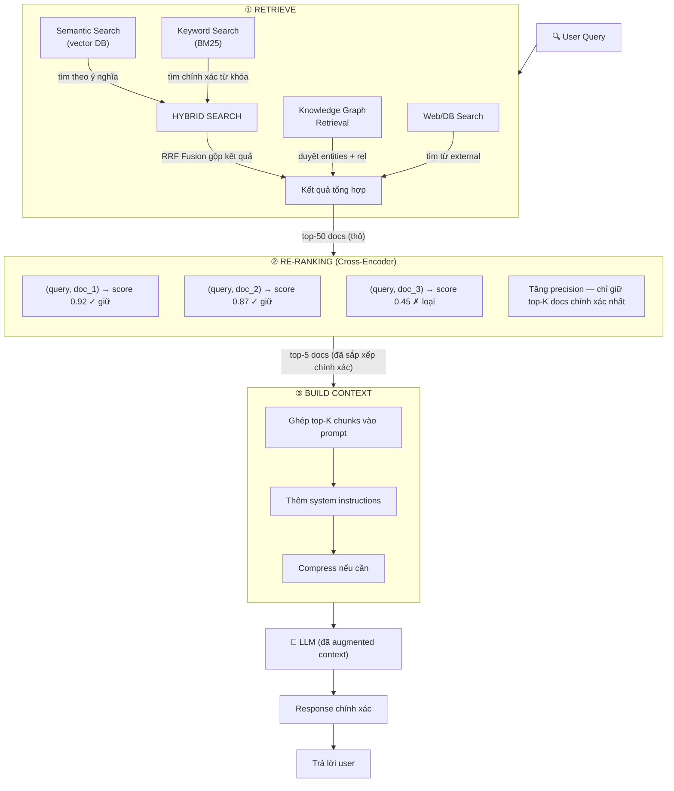
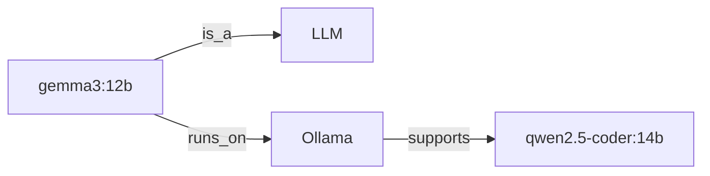
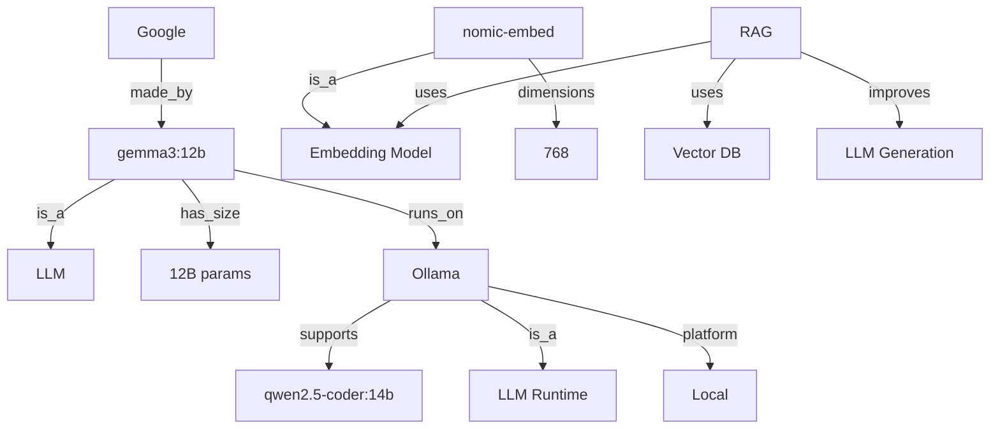
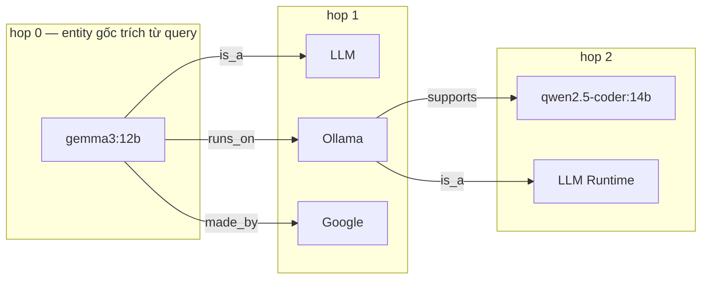
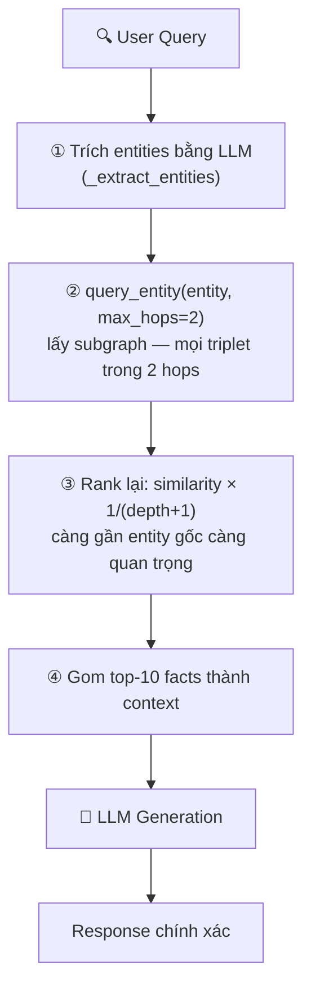

# 🧠 I. Retrieve Memory & Knowledge

> ## 📑 Mục Lục
>
> - [Tổng Quan](#tổng-quan)
> - [Tại Sao Retrieve Memory & Knowledge Quan Trọng?](#tại-sao-retrieve-memory-knowledge-quan-trọng)
> - [Nội Dung](#nội-dung)
> - [1. Semantic Search / Vector Search](#1-semantic-search-vector-search)
>   - [1.1 Khái Niệm Cơ Bản](#11-khái-niệm-cơ-bản)
>   - [1.2 Vector Embedding — Cách Thức Hoạt Động](#12-vector-embedding-cách-thức-hoạt-động)
>   - [1.3 Embedding Models So Sánh](#13-embedding-models-so-sánh)
>   - [1.4 Chunking Strategies — Chi Tiết](#14-chunking-strategies-chi-tiết)
>   - [1.5 Similarity Metrics — Chi Tiết](#15-similarity-metrics-chi-tiết)
>   - [1.6 Vector Databases — Chi Tiết](#16-vector-databases-chi-tiết)
> - [2. RAG (Retrieval-Augmented Generation)](#2-rag-retrieval-augmented-generation)
>   - [2.1 Khái Niệm](#21-khái-niệm)
>   - [2.2 RAG Pipeline Chi Tiết — 6 Bước](#22-rag-pipeline-chi-tiết-6-bước)
>   - [2.3 Các Loại RAG](#23-các-loại-rag)
>   - [2.4 RAG Evaluation Metrics](#24-rag-evaluation-metrics)
> - [3. Knowledge Graph Retrieval](#3-knowledge-graph-retrieval)
>   - [3.1 Khái Niệm](#31-khái-niệm)
>   - [3.2 Entity-Relationship Triplets](#32-entity-relationship-triplets)
>   - [3.3 Knowledge Graph Operations](#33-knowledge-graph-operations)
>   - [3.4 Graph RAG Implementation](#34-graph-rag-implementation)
> - [4. Hybrid Search](#4-hybrid-search)
>   - [4.1 Tại Sao Cần Hybrid Search?](#41-tại-sao-cần-hybrid-search)
>   - [4.2 BM25 Algorithm](#42-bm25-algorithm)
>   - [4.3 Reciprocal Rank Fusion (RRF)](#43-reciprocal-rank-fusion-rrf)
>   - [4.4 Hybrid Search Implementation](#44-hybrid-search-implementation)
> - [5. Re-ranking](#5-re-ranking)
>   - [5.1 Tại Sao Cần Re-ranking?](#51-tại-sao-cần-re-ranking)
>   - [5.2 Cross-Encoder Implementation](#52-cross-encoder-implementation)
>   - [5.3 Re-ranking Models Comparison](#53-re-ranking-models-comparison)
> - [6. Memory Systems](#6-memory-systems)
>   - [6.1 Memory Types Chi Tiết](#61-memory-types-chi-tiết)
>   - [6.2 Memory Patterns Chi Tiết](#62-memory-patterns-chi-tiết)
>   - [6.3 MemGPT-Style Memory Architecture](#63-memgpt-style-memory-architecture)
>   - [6.4 Complete Memory Manager](#64-complete-memory-manager)
> - [7. Labs Thực Hành](#7-labs-thực-hành)
>   - [Lab 1: Semantic Search với nomic-embed-text](#lab-1-semantic-search-với-nomic-embed-text)
>   - [Lab 2: BM25 + Vector Hybrid Search](#lab-2-bm25-vector-hybrid-search)
>   - [Lab 3: Full RAG Pipeline](#lab-3-full-rag-pipeline)
>
---

### Câu Chuyện Mở Đầu

Hãy hình dung bạn đi khám ở một phòng mạch quen. Tuần này bạn tới lần thứ ba, vậy mà bác sĩ vẫn hỏi lại từ đầu: "Anh bị sao nhỉ? Kể lại giúp tôi nhé". Nghe là thấy nản đúng không? Khám ba lần mà lần nào cũng như lần đầu gặp mặt.

**LLM mà thiếu Memory & Retrieval thì cũng y chang vị bác sĩ đãng trí đó.**

Mỗi cuộc trò chuyện mà không "nhớ" được ngữ cảnh trước đó thì coi như bắt đầu lại từ số 0. Hậu quả rất quen thuộc: hỏi đi hỏi lại một câu, lạc mất mạch chuyện, và tệ nhất là — **bịa chuyện (hallucinate)** vì không có dữ liệu thực tế trong tay. *Hallucinate = "ảo giác" — model tự bịa ra câu trả lời nghe có vẻ hợp lý nhưng thực ra không có nguồn thật, ví dụ trích một điều khoản luật không hề tồn tại.*

> **Tóm gọn 1 câu:** AI không có bộ nhớ ngoài (memory & retrieval) thì cứ mỗi lần nói chuyện là "quên sạch", và khi không biết sẽ bịa đáp án thay vì nói "tôi không biết".

### Tại Sao Retrieve Memory & Knowledge Quan Trọng?

> *"Vấn đề không phải là não to hơn — mà là biết cần tìm ở đâu."*

Phần này nêu 3 nghiên cứu thực tế, để thấy retrieval (chức năng "đi tìm thông tin") không phải lý thuyết suông mà đã được đo đếm bằng số liệu.

#### 3 Bằng Chứng Khoa Học

*Cách đọc bảng này: mỗi dòng là một nghiên cứu — cột giữa là tên nhóm nghiên cứu, cột phải là phát hiện chính. Ví dụ dòng 1: agent có gắn công cụ tra cứu (retrieval-augmented = "được bổ sung bằng truy xuất") giải được 56% đề thi SWE-bench — bộ benchmark các issue GitHub thật — gấp 4 lần agent thường.*

| # | Nghiên Cứu | Phát Hiện Quan Trọng |
|---|-----------|----------------------|
| 1 | **Princeton SWE-agent (2024)** | Retrieval-augmented agent giải quyết **56% SWE-bench** issues — gấp 4× so với baseline |
| 2 | **Anthropic (2025)** | Memory retrieval đúng lúc giảm **68% duplicate questions** trong multi-session |
| 3 | **Microsoft (2024)** | Structured retrieval giảm **40% token usage** — vì chỉ lấy thông tin cần thiết |

*(Giải thích nhanh: baseline = mức nền để so sánh; duplicate questions = người dùng hỏi lại câu đã hỏi; multi-session = nhiều phiên chat khác nhau; token usage = lượng "chữ" đưa vào model, càng nhiều càng tốn tiền.)*

> **Tóm gọn 1 câu:** Số liệu từ Princeton, Anthropic và Microsoft cùng chỉ về một điểm: gắn "bộ nhớ + tra cứu" cho AI giúp trả lời đúng hơn, bớt hỏi lại, và tốn ít token hơn.

## Tổng Quan

Phần này vẽ bức tranh tổng thể: câu hỏi của bạn đi qua mấy trạm nào trước khi AI trả lời. Đọc xong sẽ hiểu vì sao chương này có các mục nhỏ như semantic search, RAG, re-ranking... — mỗi mục là một trạm trên dây chuyền.

Nói ngắn gọn thế này: **truy xuất bộ nhớ và kiến thức** là cách mình đi "mượn" thông tin từ bên ngoài — tài liệu, cơ sở dữ liệu, đồ thị tri thức — rồi đưa cho LLM đọc trước khi trả lời. Nhờ có "phao cứu trợ" này mà câu trả lời bám sát thực tế hơn hẳn, bớt bịa đặt hẳn đi.



*(Cách đọc sơ đồ: đi từ trên xuống. Câu hỏi của user (① RETRIEVE) được tìm bằng nhiều cách song song — tìm theo ý nghĩa (semantic), tìm theo từ khóa (BM25), tra đồ thị tri thức, tra web/database — rồi gộp lại (RRF Fusion). Sang ② RE-RANKING, một model chấm điểm lại từng cặp (câu hỏi, tài liệu) để loại kết quả lỏng, chỉ giữ 5 tài liệu tốt nhất. Cuối cùng ③ BUILD CONTEXT ghép các tài liệu đó vào prompt — lá thư lệnh gửi cho model — để model trả lời dựa trên bằng chứng thật.)*

> **Tóm gọn 1 câu:** Retrieval là dây chuyền 3 trạm — tìm nhiều nguồn → chấm điểm lọc lại → ghép vào context — để model trả lời dựa trên thông tin thật thay vì trí nhớ vốn có.

---

## Tại Sao Retrieve Memory & Knowledge Quan Trọng?

> **"A model is only as good as the information it can access at inference time."**
> — Andrej Karpathy

### Bối Cảnh

Phần này nói về nguyên nhân gốc: vì sao AI cần được "nạp" thông tin từ ngoài vào lúc trả lời.

Bạn chat với ChatGPT hay Claude bao giờ gặp cảnh này chưa: hỏi chuyện mới xảy ra gần đây thì AI trả lời trật lất? Công ty bạn vừa đổi chính sách tuần trước mà AI vẫn nói theo luật cũ? Thậm chí có lúc nó còn tự tin đưa ra mấy con số… không hề tồn tại?

Thủ phạm chính là **bộ nhớ**. Không có memory retrieval, AI giống như một bộ óc rất thông minh nhưng bị nhốt trong phòng kín — giỏi suy luận mà lại **mù tịt về thế giới bên ngoài**.

> **Tóm gọn 1 câu:** Model chỉ biết thứ có trong dữ liệu huấn luyện — mọi thứ sinh ra sau đó, hoặc thuộc về riêng bạn, đều phải lấy từ ngoài vào lúc trả lời.

### Triết Lý Cốt Lõi

Phần này rút gọn toàn bộ tư duy retrieval thành 3 nguyên tắc. Nhớ 3 câu này là nắm được "tâm lý" của cả chương.

Cách làm Memory Retrieval gói gọn trong 3 câu "thần chú":

1. **Knowledge at Inference Time**: Kiến thức phải được nạp vào đúng lúc AI đang suy luận, chứ đừng mong nhồi hết vào model từ lúc train *(inference = lúc model "làm việc" trả lời câu hỏi, ngược lại với training = lúc "đi học")*
2. **Fresh over Familiar**: Tin mới ra lò lúc nào cũng đáng giá hơn tin cũ quen thuộc
3. **Relevance over Quantity**: Một ít thông tin đúng còn hơn cả đống thông tin lạc đề

> **Tóm gọn 1 câu:** Nạp kiến thức lúc trả lời, ưu tiên tin mới, ưu tiên tin đúng — ba nguyên tắc này chi phối mọi thiết kế retrieval.

### Tại Sao Không Thể Bỏ Qua?

Sơ đồ dưới đây xếp cặp: các điểm yếu của LLM thuần (không gắn công cụ) ở trên, và các giải pháp tương ứng ở dưới — mỗi ❌ được bù bằng một ✅.

```
┌──────────────────────────────────────────────────────────────────┐
│          TẠI SAO MEMORY RETRIEVAL QUAN TRỌNG?                    │
│                                                                  │
│  VẤN ĐỀ CỦA LLM THUẦN:                                          │
│  ┌──────────────────────────────────────────────────────────┐   │
│  │ ❌ Knowledge cutoff: GPT-4 không biết gì sau Apr 2024  │   │
│  │ ❌ Hallucination: Bịa ra thông tin khi không biết       │   │
│  │ ❌ No personalization: Không nhớ preferences user       │   │
│  │ ❌ No real-time: Không biết giá BTC lúc này             │   │
│  └──────────────────────────────────────────────────────────┘   │
│                                                                  │
│  GIẢI PHÁP: MEMORY RETRIEVAL                                     │
│  ┌──────────────────────────────────────────────────────────┐   │
│  │ ✅ RAG: Đưa kiến thức mới vào context                    │   │
│  │ ✅ Semantic search: Tìm đúng thông tin dù query khác    │   │
│  │ ✅ Knowledge graph: Hiểu mối quan hệ giữa entities      │   │
│  │ ✅ Hybrid search: Kết hợp strengths của nhiều methods    │   │
│  └──────────────────────────────────────────────────────────┘   │
│                                                                  │
└──────────────────────────────────────────────────────────────────┘
```

*(Giải thích thuật ngữ trong khung: knowledge cutoff = "mốc kiến thức" — ngày model ngừng học dữ liệu mới; personalization = ghi nhớ sở thích từng người dùng; real-time = dữ liệu cập nhật từng phút như giá cổ phiếu.)*

> **Tóm gọn 1 câu:** Bốn điểm yếu của LLM thuần (kiến thức cũ, bịa chuyện, không cá nhân hóa, không biết tin tức thời) đều được giải quyết bằng một loại truy xuất tương ứng.

### Bằng Chứng Nghiên Cứu

Nghe lý thuyết hay là một chuyện, còn đây là những con số từ các nhóm nghiên cứu lớn — đọc để thấy người ta đã đo đếm hẳn hoi, không phải nói suông:

**1. Google Research (2020) — "Retrieval-Augmented Generation for Knowledge-Intensive NLP Tasks"**
- RAG giảm hallucination **từ 27% xuống còn 3%** trên knowledge-intensive tasks
- Retrieval precision@10 > 85% là ngưỡng để RAG hiệu quả

**2. Stanford (2024) — "Retrieval is All You Need"**
- Hệ thống retrieval tốt hơn có thể **thay thế việc upgrade model** (GPT-3.5 + RAG > GPT-4 alone trên nhiều benchmarks) *(benchmark = bộ bài thi chuẩn để so điểm các model)*
- Cost: GPT-3.5 + RAG = $0.002/query vs GPT-4 = $0.03/query → **giảm 93% chi phí**

**3. LangChain State of AI Agents (2025)**
- 78% production AI agents sử dụng RAG *(production = hệ thống đang chạy thật phục vụ người dùng)*
- Organizations deploy RAG báo cáo **giảm 65% factual errors**

> **Tóm gọn 1 câu:** Ba nghiên cứu độc lập đều cho cùng kết quả: retrieval tốt giúp trả lời đúng hơn (bớt bịa từ 27% xuống 3%) và rẻ hơn (tiết kiệm tới 93% chi phí) so với chỉ dùng model mạnh.

### Cost-Benefit Analysis

Nói chuyện tiền nong cho dễ hình dung — thử đặt lên bàn cân xem có retrieval với không có retrieval khác nhau ra sao:

```
┌──────────────────────────────────────────────────────────────────┐
│                COST-BENEFIT: MEMORY RETRIEVAL                     │
│                                                                  │
│  KHÔNG CÓ RETRIEVAL (LLM thuần):                                │
│  ├── Model upgrade GPT-3.5 → GPT-4: +$0.027/query              │
│  ├── 10,000 queries/ngày = $270/ngày = $8,100/tháng            │
│  ├── Hallucination rate: 15-27%                                 │
│  └── User trust: Thấp (sai thông tin thường xuyên)            │
│                                                                  │
│  CÓ RETRIEVAL (RAG + Vector DB):                                │
│  ├── Vector DB hosting: ~$50/tháng (Pinecone/Qdrant)           │
│  ├── Embedding cost: ~$0.0001/query (text-embedding-3-small)   │
│  ├── Giữ model GPT-3.5: $0.0015/query                         │
│  ├── Total: $65/tháng (fixed) + $15/tháng (variable)          │
│  ├── Hallucination rate: 2-5%                                   │
│  └── User trust: Cao (trả lời đúng từ nguồn verifiable)      │
│                                                                  │
│  ROI: Giảm 90%+ chi phí VÀ tăng accuracy 5-10x               │
└──────────────────────────────────────────────────────────────────┘
```

*(Cách đọc khung: phần trên là chi phí nếu dùng model xịn hơn thay vì làm retrieval; phần dưới là chi phí nếu làm retrieval. Verifiable = có thể kiểm chứng lại nguồn. ROI = tỷ lệ "được" trên "bỏ ra".)*

> **Tóm gọn 1 câu:** Với 10.000 câu hỏi mỗi ngày, gắn retrieval cho model rẻ còn tiết kiệm hơn 90% so với nâng cấp model xịn — và trả lời đúng hơn nhiều lần.

### Analogies — Hiểu Dễ Hơn

Phần này dùng ba hình ảnh đời thường để bạn "nhìn thấy" quan hệ giữa LLM và retrieval: model là bộ não, retrieval là công cụ mang thông tin tới cho não.

**Kể vài câu chuyện đời thường để hình dung cho dễ:**

*Cách đọc bảng này: cột trái là phép so sánh (vế trước = LLM, vế sau = retrieval), cột phải là ý nghĩa của phép so sánh đó.*

| Analogies | Giải thích |
|-----------|------------|
| **Bộ não + Thư viện** | LLM giống như một bộ não rất thông minh, còn Retrieval là đôi chân chịu khó chạy vào thư viện lấy sách. Não mà lười đi thư viện thì chỉ quanh quẩn với mấy kiến thức học từ hồi nhỏ |
| **Bác sĩ + Hồ sơ bệnh án** | Bác sĩ có giỏi mấy (LLM) thì trước khi kê đơn vẫn phải lật hồ sơ bệnh án (retrieval) ra đọc. Cứ kê bừa không đọc hồ sơ là toa thuốc trật ngay |
| **Điều hướng viên + Bản đồ** | LLM giống bác tài lái cứng, còn Retrieval là tấm bản đồ giao thông cập nhật liên tục. Không có bản đồ thì tay lái lụa mấy cũng dễ rẽ nhầm đường |

> **Tóm gọn 1 câu:** Ba phép so sánh đều chỉ về một điểm: LLM giỏi đến đâu cũng vô dụng nếu không có retrieval mang thông tin đúng tới đúng lúc.

### Nếu Bạn Bỏ Qua?

Phần này liệt kê hệ quả thật nếu team không làm retrieval — đọc để có lý lẽ thuyết phục khi cần xin ngân sách làm retrieval.

Thử tưởng tượng team bạn quyết định "khỏi làm retrieval cho đỡ mệt" — kịch bản thường sẽ diễn ra như thế này:

```
┌──────────────────────────────────────────────────────────────────┐
│              NẾU BỎ QUA MEMORY RETRIEVAL?                        │
│                                                                  │
│  ❌ Hậu quả:                                                     │
│  ├── AI hallucinate thông tin quan trọng                       │
│  ├── Khách hàng nhận thông tin sai về sản phẩm                 │
│  ├── Bot trả lời "Tôi không biết" liên tục                    │
│  ├── Legal compliance failures (AI trích luật sai)             │
│  └── Users loses trust → adoption rate drops                   │
│                                                                  │
│  💰 Chi phí:                                                    │
│  ├── 1 hallucination = potential lawsuit $100K+                │
│  ├── Poor UX = lost customers = lost revenue                   │
│  ├── Manual fact-checking = higher operational cost            │
│  └── Model upgrade treadmill: always paying for bigger models │
│                                                                  │
└──────────────────────────────────────────────────────────────────┘
```

*(Giải thích vài mục trong khung: compliance failure = vi phạm quy định pháp lý; UX = trải nghiệm người dùng; fact-checking = kiểm chứng thông tin thủ công; model upgrade treadmill = "vòng xoáy nâng cấp model" — cứ sai là lại mua model to hơn, tiền đội lên không dứt.)*

> **Tóm gọn 1 câu:** Bỏ retrieval thì bạn trả giá bằng thông tin sai, khách rời đi, rủi ro pháp lý, và tiền duy trì model ngày càng to — tổng tốn hơn nhiều so với làm retrieval ngay từ đầu.

### Evolutionary Context

Phần này kể lại lịch sử 6 năm của retrieval — hiểu tiến hóa này sẽ giúp bạn tránh lặp lại các cách làm lỗi thời.

Nhìn lại chặng đường vài năm qua mới thấy cách làm retrieval "lớn" nhanh thế nào — từ kiểu cầu may ban đầu tới kiểu truy xuất thông minh bây giờ:

```
┌──────────────────────────────────────────────────────────────────┐
│              TIẾN HÓA CỦA MEMORY RETRIEVAL                       │
│                                                                  │
│  2020-2022: FEW-SHOT LEARNING                                    │
│  ┌─────────────────────────────────┐                            │
│  │ "Gõ gì thì model tự hiểu"      │                            │
│  │ Hope model knows the answer     │                            │
│  │ Problem: Knowledge cutoff       │                            │
│  └─────────────────────────────────┘                            │
│                    │                                              │
│                    ▼                                              │
│  2023: BASIC RAG                                                │
│  ┌─────────────────────────────────┐                            │
│  │ "Retrieve docs → stuff in prompt"│                           │
│  │ Keyword search (BM25)            │                           │
│  │ Problem: Misses semantic meaning │                           │
│  └─────────────────────────────────┘                            │
│                    │                                              │
│                    ▼                                              │
│  2024-2025: SEMANTIC RAG + HYBRID                                │
│  ┌─────────────────────────────────┐                            │
│  │ Vector search + Keyword search   │                           │
│  │ Re-ranking with cross-encoders   │                           │
│  │ Multi-modal retrieval            │                           │
│  └─────────────────────────────────┘                            │
│                    │                                              │
│                    ▼                                              │
│  2026+: INTELLIGENT RETRIEVAL                                    │
│  ┌─────────────────────────────────┐                            │
│  │ Self-correcting retrieval        │                           │
│  │ Memory-augmented agents          │                           │
│  │ Graph-based reasoning            │                           │
│  └─────────────────────────────────┘                            │
│                                                                  │
└──────────────────────────────────────────────────────────────────┘
```

*(Cách đọc khung: mỗi khung nhỏ là một giai đoạn, mũi tên ▼ chỉ giai đoạn sau. Few-shot learning = nhét vài ví dụ vào prompt rồi hy vọng model biết; BM25 = thuật toán tìm theo tần suất từ khóa; multi-modal = tìm được cả ảnh, âm thanh, không chỉ chữ; self-correcting = hệ tự phát hiện tìm sai và tìm lại.)*

> **Tóm gọn 1 câu:** Retrieval đi từ "hy vọng model biết" (2020) → "nhét tài liệu vào prompt" (2023) → "tìm lai vector + từ khóa, chấm điểm lại" (2024-25) → "hệ tự sửa lỗi, tự suy luận theo đồ thị" (2026+).

---

## Nội Dung

Dưới đây là bản đồ toàn bộ chương này — mình sẽ đi từ tìm kiếm ngữ nghĩa cơ bản, qua RAG, tới đồ thị tri thức và hệ thống bộ nhớ. Cứ đi theo thứ tự là vừa đẹp:

*Cách đọc bảng này: mỗi dòng là một mục trong chương, cột giữa là tên mục (bấm vào để nhảy tới), cột phải là mô tả một câu. Ví dụ dòng 1: Semantic Search = tìm theo ý nghĩa, hoạt động nhờ biến chữ thành vector.*

| # | Chủ đề | Mô tả |
|---|--------|-------|
| 1 | [Semantic Search](#1-semantic-search--vector-search) | Tìm kiếm ngữ nghĩa dựa trên vector embedding |
| 2 | [RAG](#2-rag-retrieval-augmented-generation) | Kết hợp retrieve và generate |
| 3 | [Knowledge Graph](#3-knowledge-graph-retrieval) | Truy xuất từ đồ thị tri thức |
| 4 | [Hybrid Search](#4-hybrid-search) | Kết hợp semantic + keyword search |
| 5 | [Re-ranking](#5-re-ranking) | Sắp xếp lại kết quả retrieve |
| 6 | [Memory Systems](#6-memory-systems) | Các hệ thống bộ nhớ cho AI |

> **Tóm gọn 1 câu:** Chương đi theo 6 bước từ cơ bản tới nâng cao: tìm theo ý nghĩa → tìm + trả lời (RAG) → tra theo quan hệ (graph) → tìm lai nhiều cách → xếp lại hạng kết quả → cuối cùng là lưu trí nhớ dài hạn.

---

## 1. Semantic Search / Vector Search

Mục này giải thích kỹ thuật tìm kiếm theo ý nghĩa — nền móng cho hầu hết các hệ thống retrieval sau này. Hiểu được mục này thì các mục 2, 4, 5 đọc sẽ nhẹ nhàng hơn hẳn.

### 1.1 Khái Niệm Cơ Bản

**Semantic Search** là kiểu tìm kiếm theo **ý nghĩa** của câu chữ, chứ không khư khư đếm xem trùng được mấy từ khóa. Cách làm rất đời: mỗi đoạn văn bản được "dịch" thành một **vector embedding** — nôm na là một dãy số dài ngoằng — rồi đem so khoảng cách giữa các dãy số đó. Gần nhau nghĩa là hợp ý nhau. *(Vector = dãy số có thứ tự, ví dụ [0.25, -0.42, 0.65, ...]; "embedding" = quá trình "cắm" một câu chữ vào không gian số đó.)*

```
┌──────────────────────────────────────────────────────────────────┐
│              SEMANTIC SEARCH vs KEYWORD SEARCH                   │
│                                                                  │
│  Keyword Search (BM25):                                         │
│  ┌──────────────────────────────────────────────────────────┐   │
│  │ Query: "cách bảo vệ sức khỏe tim mạch"                   │   │
│  │ Match: "bảo vệ sức khỏe" ✓  "tim mạch" ✓                │   │
│  │ No Match: "phòng ngừa bệnh tim" ✗ (không có keyword)    │   │
│  └──────────────────────────────────────────────────────────┘   │
│                                                                  │
│  Semantic Search (Vector):                                      │
│  ┌──────────────────────────────────────────────────────────┐   │
│  │ Query: "cách bảo vệ sức khỏe tim mạch"                   │   │
│  │ Match: "bảo vệ sức khỏe" ✓  "tim mạch" ✓                │   │
│  │ Match: "phòng ngừa bệnh tim" ✓ (cùng ý nghĩa!)          │   │
│  │ Match: "giảm cholesterol để giữ trái tim khỏe" ✓        │   │
│  └──────────────────────────────────────────────────────────┘   │
│                                                                  │
│  → Semantic Search hiểu NGHĨA, không chỉ khớp từ               │
│                                                                  │
└──────────────────────────────────────────────────────────────────┘
```

*(Cách đọc khung: hai hộp nhỏ so sánh cùng một câu hỏi. Keyword Search = tìm theo từ khóa trích xuất; BM25 là thuật toán tìm từ khóa phổ biến nhất. Semantic Search tìm theo nghĩa nên bắt được cả câu không chứa từ khóa gốc.)*

> **Tóm gọn 1 câu:** Tìm theo từ khóa chỉ bắt được chữ trùng; tìm theo ngữ nghĩa biến câu thành vector số rồi so khoảng cách, nên bắt được cả câu nói khác chữ nhưng cùng ý.

#### Pipeline Xử Lý Documents

Phần này mô tả dây chuyền "nạp tài liệu vào kho" — chạy một lần lúc chuẩn bị (offline = không cần người dùng đợi), gồm 4 trạm: làm sạch, cắt nhỏ, đổi thành vector, lưu vào database.

```
📄 Documents (PDF, HTML, Markdown...)
        │
        ▼
① CLEANING — Làm sạch text (bỏ HTML tags, lỗi encoding...)
        │
        ▼
② CHUNKING — Chia nhỏ documents thành các đoạn
        │
        ▼
③ EMBEDDING — Dùng Embedding Model (nomic-embed-text) chuyển mỗi chunk thành vector
        │
        ▼
④ SAVE TO VECTOR DB — Lưu vector + text + metadata vào database
```

**Giải thích từng bước cho dễ nhớ:**

*Cách đọc bảng này: cột Input là thứ đưa vào, cột Output là thứ thu được, cột Ví dụ cho thấy một tình huống cụ thể. Metadata = "dữ liệu mô tả dữ liệu", ví dụ tên file, ngày tạo, số trang.*

| # | Bước | Input | Output | Ví dụ |
|---|------|-------|--------|-------|
| 1 | Chunking | Document lớn (10 trang) | Nhiều chunks nhỏ | 1 PDF → 50 chunks |
| 2 | Embedding | Chunk text | Vector (dãy số) | "BHYT là gì?" → [0.25, -0.42, 0.65, ...] |
| 3 | Save to DB | Vector + Text + Metadata | Entry trong Vector DB | Lưu vào ChromaDB/Qdrant |

*(Chunk = một mẩu văn bản nhỏ cắt từ tài liệu gốc. BHYT = bảo hiểm y tế.)*

> **Tóm gọn 1 câu:** Nạp tài liệu = làm sạch → cắt thành từng mẩu nhỏ → mỗi mẩu đổi thành dãy số → lưu cả số, chữ gốc và thông tin mô tả vào vector database.

<br>

#### Khi User Search

Còn lúc người dùng gõ câu hỏi thì mình chạy quy trình ngược lại — từ câu hỏi ra tới tài liệu liên quan:

```
🔍 User Query: "phòng ngừa bệnh tim"
        │
        ▼
① EMBEDDING Query — Chuyển query thành vector
        │
        ▼
② SEARCH Vector DB — Tìm vector gần nhất
        │
        ▼
③ RETURN Results — Trả về text chunks liên quan nhất
```

> **Tóm gọn 1 câu:** Lúc người dùng hỏi, câu hỏi cũng được đổi thành vector rồi đi so khoảng cách với các vector đã lưu — vector nào gần nhất thì mẩu văn bản đó được trả về.

<br>

### 1.2 Vector Embedding — Cách Thức Hoạt Động

Phần này "mổ xẻ" khái niệm vector embedding — yếu tố cốt lõi khiến semantic search hoạt động, bằng một ví dụ đo khoảng cách trực quan.

Hình dung mỗi từ, mỗi câu được "nén" thành một dãy số trong không gian nhiều chiều. Hai câu càng giống ý nhau thì hai dãy số càng đứng sát nhau — như hai người bạn thân lúc nào cũng kè kè một chỗ:

```
"Bảo hiểm y tế"     → [0.23, -0.45, 0.67, 0.12, ...]  (768 dimensions)
"BHYT"               → [0.25, -0.42, 0.65, 0.14, ...]  (gần nhau!)
"Sở thích âm nhạc"  → [0.89, 0.12, -0.34, 0.56, ...]  (xa nhau!)

Không gian 2D minh họa:

    ▲ dimension 2
    │
    │   ● "BHYT"
    │   ● "Bảo hiểm y tế"
    │   ● "Health Insurance"
    │
    │                           ● "Sở thích âm nhạc"
    │                           ● "Music hobby"
    │
    └─────────────────────────────────────────► dimension 1
    
    Khoảng cách gần = Cùng ý nghĩa
    Khoảng cách xa = Khác ý nghĩa
```

*(Cách đọc khung: mỗi dòng trên là một cụm từ cùng vector của nó — 768 dimensions nghĩa là dãy 768 số. Không gian 2D bên dưới chỉ là vẽ minh họa: "BHYT" và "Bảo hiểm y tế" và "Health Insurance" đứng gần nhau vì cùng một ý, còn "Sở thích âm nhạc" đứng xa hẳn.)*

> **Tóm gọn 1 câu:** Embedding biến mỗi câu thành một điểm trong không gian số — ý nghĩa giống nhau thì điểm gần nhau, nên "tìm nghĩa" thành bài toán "tìm điểm gần".

### 1.3 Embedding Models So Sánh

Phần này so sánh các model embedding đang phổ biến, giúp bạn chọn model nào cho nhu cầu của mình: chạy trong máy (local) hay gọi qua API, ưu tiên gọn nhẹ hay ưu tiên chất lượng.

*(Giải thích cột: Dims = số lượng số trong mỗi vector — càng nhiều càng chi tiết nhưng càng tốn bộ nhớ; Size = dung lượng file model; MTEB = bộ benchmark chuẩn dùng để chấm điểm model embedding; API = chạy trên máy chủ của nhà cung cấp, trả tiền theo lần dùng.)*

```
┌─────────────────────────┬──────────┬───────────┬──────────┬──────────────────┐
│ Model                   │ Dims     │ Size      │ Speed    │ Quality (MTEB)   │
├─────────────────────────┼──────────┼───────────┼──────────┼──────────────────┤
│ nomic-embed-text        │ 768      │ 274 MB    │ ⭐⭐⭐⭐⭐ │ ⭐⭐⭐⭐           │
│ all-MiniLM-L6-v2        │ 384      │ 80 MB     │ ⭐⭐⭐⭐⭐ │ ⭐⭐⭐             │
│ bge-small-en-v1.5       │ 384      │ 134 MB    │ ⭐⭐⭐⭐⭐ │ ⭐⭐⭐⭐           │
│ bge-large-en-v1.5       │ 1024     │ 1.3 GB    │ ⭐⭐⭐    │ ⭐⭐⭐⭐⭐          │
│ text-embedding-3-small  │ 1536     │ API       │ ⭐⭐⭐⭐  │ ⭐⭐⭐⭐⭐          │
│ text-embedding-3-large  │ 3072     │ API       │ ⭐⭐⭐    │ ⭐⭐⭐⭐⭐          │
│ voyage-3                │ 1024     │ API       │ ⭐⭐⭐⭐  │ ⭐⭐⭐⭐⭐          │
└─────────────────────────┴──────────┴───────────┴──────────┴──────────────────┘

Bạn đang dùng: nomic-embed-text (768 dims, 274MB) — gọn nhẹ, chạy local khỏe re
```

> **Tóm gọn 1 câu:** Model embedding càng to càng chính xác nhưng càng chậm và tốn bộ nhớ — model nhỏ chạy local (như nomic-embed-text) đủ dùng cho đa số dự án, model lớn qua API chỉ cần khi chất lượng là ưu tiên tuyệt đối.

### 1.4 Chunking Strategies — Chi Tiết

Chunking nôm na là **cắt nhỏ tài liệu** ra từng miếng vừa miệng trước khi đem đi embedding. Cắt khéo hay cắt ẩu quyết định hẳn chất lượng tìm kiếm — cắt ngang câu thì AI đọc cũng như mình đọc sách bị xé đôi trang vậy.

Phần dưới đây so sánh 4 cách cắt phổ biến, từ đơn giản tới tinh vi.

#### Strategy 1: Fixed-Size Chunking

Cách cắt đơn giản nhất: cứ sau mỗi N ký tự thì cắt một nhát, bất kể đang giữa câu hay giữa đoạn. *(Fixed-size = cố định kích thước.)*

<details>
<summary>Python Code (Click to expand/collapse)</summary>

> 📄 **Code ví dụ:** [`examples/01-strategy-1-fixed-size-chunking.py`](examples/01-strategy-1-fixed-size-chunking.py)

</details>

```
Ưu điểm:                    Nhược điểm:
✅ Đơn giản                 ❌ Cắt ngang câu
✅ Nhanh                     ❌ Mất context giữa chunks
✅ Predictable size          ❌ Không tôn trọng cấu trúc
```

*(Khung trên: ưu điểm bên trái, nhược điểm bên phải. Predictable size = mỗi chunk có độ dài đều như nhau, dễ tính toán.)*

> **Tóm gọn 1 câu:** Fixed-size cắt theo mét chữ đều tăm tắp — nhanh, dễ làm, nhưng hay cắt đứt câu và làm mất ngữ cảnh giữa các mảnh.

#### Strategy 2: Recursive Character Splitting

Cách cắt "thông minh hơn một nhát": thử cắt theo dấu xuống dòng trước, hết chỗ thì xuống dấu chấm câu, rồi tới dấu cách — tách dần từ "ranh giới tự nhiên" lớn nhất xuống nhỏ nhất. *(Recursive = đệ quy — lặp lại cùng một quy tắc ở mức nhỏ dần.)*

<details>
<summary>Python Code (Click to expand/collapse)</summary>

> 📄 **Code ví dụ:** [`examples/02-strategy-2-recursive-character-splitting.py`](examples/02-strategy-2-recursive-character-splitting.py)

</details>

```
Ưu điểm:                    Nhược điểm:
✅ Tôn trọng cấu trúc       ❌ Chunk size không đều
✅ Giữ nguyên câu/đoạn     ❌ Phức tạp hơn fixed-size
✅ Ít mất context hơn      ❌ Cần chọn separators phù hợp
```

*(Separators = các ký tự dùng làm "lằn ranh" để cắt: xuống dòng, dấu chấm, dấu phẩy, dấu cách.)*

> **Tóm gọn 1 câu:** Recursive splitting cắt theo ranh giới tự nhiên của văn bản (đoạn → câu → từ) nên giữ được ngữ cảnh tốt hơn fixed-size, tuy từng mảnh có thể dài ngắn không đều.

#### Strategy 3: Semantic Chunking

Cách cắt "đo theo ý": dùng chính model embedding để đo câu nào ý nào liền mạch, và cắt đúng chỗ ý chuyển hướng. *(Breakpoint = điểm cắt; threshold = ngưỡng — giá trị mà khi vượt qua thì quyết định cắt.)*

<details>
<summary>Python Code (Click to expand/collapse)</summary>

> 📄 **Code ví dụ:** [`examples/03-strategy-3-semantic-chunking.py`](examples/03-strategy-3-semantic-chunking.py)

</details>

```
Ưu điểm:                    Nhược điểm:
✅ Chunks ngữ nghĩa nhất    ❌ Chậm (cần embed mỗi câu)
✅ Giữ thông tin liên quan  ❌ Chi phí tính toán cao
✅ Tự động tìm breakpoint  ❌ Threshold cần tune
```

*(Tune = vặn chỉnh tham số đến khi chạy tốt.)*

> **Tóm gọn 1 câu:** Semantic chunking cắt đúng chỗ ý nghĩa thay đổi nên mỗi mảnh "thuần" một chủ đề — chất lượng tìm kiếm tốt nhất nhưng chậm và tốn công tính toán hơn hẳn.

#### Strategy 4: Document-Aware Chunking

Cách cắt "hiểu cấu trúc": dựa vào đặc thù từng loại tài liệu — code cắt theo hàm, PDF cắt theo mục lục, Markdown cắt theo tiêu đề. *(Document-aware = "có ý thức" về loại tài liệu đang xử lý.)*

<details>
<summary>Python Code (Click to expand/collapse)</summary>

> 📄 **Code ví dụ:** [`examples/04-strategy-4-document-aware-chunking.py`](examples/04-strategy-4-document-aware-chunking.py)

</details>

#### So Sánh Chi Tiết

Bảng dưới đây tổng hợp 4 cách cắt vừa nói (cộng thêm 1 cách thứ 5 — parent-child) theo 5 tiêu chí. *(Parent-child = cắt thành mảnh lớn "cha" và mảnh nhỏ "con": tìm bằng mảnh nhỏ cho khớp, nhưng đưa cho model đọc mảnh cha cho đủ ngữ cảnh; prot. = prototype — bản thử nghiệm.)*

Cách đọc: mỗi dòng là một chiến lược; cột Quality/Speed/Token Efficiency/Complexity chấm sao 1-5 (nhiều sao = tốt hơn, riêng Complexity nhiều sao = phức tạp hơn); cột Best For chỉ tình huống hợp nhất.

```
┌──────────────────┬─────────┬──────────┬───────────┬────────────┬──────────────┐
│ Strategy         │ Quality │ Speed    │ Token     │ Complexity │ Best For     │
│                  │         │          │ Efficiency│            │              │
├──────────────────┼─────────┼──────────┼───────────┼────────────┼──────────────┤
│ Fixed-size       │ ⭐⭐     │ ⭐⭐⭐⭐⭐  │ ⭐⭐⭐      │ ⭐          │ Quick prot.  │
│ Recursive        │ ⭐⭐⭐   │ ⭐⭐⭐⭐   │ ⭐⭐⭐⭐     │ ⭐⭐        │ General text │
│ Semantic         │ ⭐⭐⭐⭐⭐│ ⭐⭐      │ ⭐⭐⭐⭐⭐   │ ⭐⭐⭐⭐     │ Complex docs │
│ Document-aware   │ ⭐⭐⭐⭐⭐│ ⭐⭐⭐    │ ⭐⭐⭐⭐⭐   │ ⭐⭐⭐⭐     │ Structured   │
│ Parent-child     │ ⭐⭐⭐⭐⭐│ ⭐⭐      │ ⭐⭐⭐⭐     │ ⭐⭐⭐⭐⭐   │ RAG systems  │
└──────────────────┴─────────┴──────────┴───────────┴────────────┴──────────────┘
```

> **Tóm gọn 1 câu:** Không có cách cắt nào thắng tuyệt đối — dự án thử nghiệm thì fixed-size, văn bản chung thì recursive, tài liệu phức tạp hay hệ RAG nghiêm túc thì semantic/parent-child đáng bỏ công hơn.

### 1.5 Similarity Metrics — Chi Tiết

Phần này trả lời câu hỏi "đo khoảng cách giữa 2 vector bằng cách nào?" — mỗi cách có thế mạnh riêng, chọn sai cách là kết quả tìm kiếm lệch dù embedding tốt. *(Metric = thước đo.)*

<details>
<summary>Python Code (Click to expand/collapse)</summary>

> 📄 **Code ví dụ:** [`examples/05-1-5-similarity-metrics-chi-tiet.py`](examples/05-1-5-similarity-metrics-chi-tiet.py)

</details>

```
So sánh:
┌──────────────────┬───────────────────┬───────────────────────┐
│ Metric           │ Khi nào dùng     │ Lưu ý                │
├──────────────────┼───────────────────┼───────────────────────┤
│ Cosine Sim       │ Dense vectors     │ Phổ biến nhất, robust │
│ Dot Product      │ Normalized vecs   │ Nhanh hơn cosine     │
│ Euclidean (L2)   │ Clustered data    │ Nhạy với magnitude   │
│ Manhattan (L1)   │ Sparse data       │ Robust với outliers  │
│ Inner Product    │ Recommendation    │ Dùng trong ANN       │
└──────────────────┴───────────────────┴───────────────────────┘
```

*(Cách đọc bảng: cột Metric = tên thước đo; cột giữa = tình huống hợp nhất; cột phải = đặc điểm cần nhớ. Dense vectors = vector dày đặc (hầu hết các số đều có giá trị); normalized = đã chuẩn hóa độ dài về 1; clustered = dữ liệu tụ thành từng cụm; sparse = thưa (nhiều số bằng 0); outliers = giá trị dị biệt xa đám đông; ANN = approximate nearest neighbor — tìm "gần đúng" với tốc độ nhanh (xem mục 1.6); Recommendation = hệ gợi ý sản phẩm.)*

> **Tóm gọn 1 câu:** Đa số trường hợp dùng cosine similarity (so góc giữa 2 vector, không quan tâm độ dài) là an toàn nhất — các thước đo còn lại chỉ thắng trong tình huống đặc thù.

### 1.6 Vector Databases — Chi Tiết

Phần này so sánh các loại "kho lưu trữ vector" — chọn database nào quyết định chi phí vận hành và khả năng mở rộng của hệ retrieval.

*(Cách đọc khung: mỗi hộp là một sản phẩm; Type = kiểu triển khai (thư viện gắn vào code, database nhúng, server tự dựng, hay dịch vụ cloud trả tiền); Index types = thuật toán đánh chỉ mục (mục lục) giúp tìm nhanh; Scale = quy mô tối đa.)*

```
┌──────────────────────────────────────────────────────────────────────┐
│                    VECTOR DATABASE COMPARISON                        │
├──────────────────────────────────────────────────────────────────────┤
│                                                                      │
│  FAISS (Facebook AI Similarity Search)                               │
│  ├── Type: Library (không phải DB server)                           │
│  ├── Storage: In-memory hoặc disk                                    │
│  ├── Index types: IVF, HNSW, PQ, LSH                                │
│  ├── Scale: Hàng tỷ vectors                                         │
│  ├── Pricing: Free (open-source)                                    │
│  └── Best for: Research, high-performance local                     │
│                                                                      │
│  ChromaDB                                                            │
│  ├── Type: Embedded database                                         │
│  ├── Storage: Persistent (SQLite) hoặc ephemeral                   │
│  ├── Features: Metadata filtering, collections                      │
│  ├── Scale: Hàng triệu vectors                                      │
│  ├── Pricing: Free (open-source)                                    │
│  └── Best for: Prototyping, small-medium projects                   │
│                                                                      │
│  Qdrant                                                              │
│  ├── Type: Self-hosted / Cloud                                      │
│  ├── Storage: Persistent (Raft consensus)                           │
│  ├── Features: Filtering, payload, multi-tenancy                    │
│  ├── Scale: Hàng tỷ vectors                                         │
│  ├── Pricing: Free (open-source) / Cloud pricing                    │
│  └── Best for: Production, self-hosted                              │
│                                                                      │
│  Pinecone                                                           │
│  ├── Type: Managed cloud                                            │
│  ├── Storage: Fully managed                                         │
│  ├── Features: Namespaces, metadata filtering                       │
│  ├── Scale: Hàng tỷ vectors                                         │
│  ├── Pricing: Pay per usage                                         │
│  └── Best for: Production (no ops overhead)                         │
│                                                                      │
│  Weaviate                                                           │
│  ├── Type: Self-hosted / Cloud                                      │
│  ├── Storage: Persistent (LSM-tree)                                 │
│  ├── Features: GraphQL, modules, hybrid search                      │
│  ├── Scale: Hàng tỷ vectors                                         │
│  ├── Pricing: Free (open-source) / Cloud pricing                    │
│  └── Best for: Complex queries, multi-modal                         │
│                                                                      │
│  Milvus                                                             │
│  ├── Type: Self-hosted / Cloud (Zilliz)                             │
│  ├── Storage: Distributed (etcd, MinIO, Pulsar)                    │
│  ├── Features: Partition keys, dynamic schema                       │
│  ├── Scale: Hàng trăm tỷ vectors                                    │
│  ├── Pricing: Free (open-source) / Cloud pricing                    │
│  └── Best for: Large-scale production                               │
│                                                                      │
│  pgvector                                                           │
│  ├── Type: PostgreSQL extension                                     │
│  ├── Storage: PostgreSQL tables                                     │
│  ├── Features: SQL queries + vector search                          │
│  ├── Scale: Hàng triệu vectors                                      │
│  ├── Pricing: Free (extension)                                      │
│  └── Best for: Existing PostgreSQL, simple use cases                │
│                                                                      │
└──────────────────────────────────────────────────────────────────────┘
```

*(Giải thích vài cụm: embedded database = database chạy "trong" ứng dụng, không cần dựng server riêng; persistent = dữ liệu giữ được sau khi tắt máy; Raft consensus = cơ chế nhiều máy bỏ phiếu để không mất dữ liệu khi một máy hỏng; managed cloud = nhà cung cấp lo toàn bộ vận hành, bạn chỉ trả tiền dùng; LSM-tree = cách ghi dữ liệu ra đĩa tối ưu cho ghi nhiều đọc ít.)*

#### ANN (Approximate Nearest Neighbor) Algorithms

Phần này giải thích bí quyết giúp vector DB tìm kiếm giữa hàng tỷ vector mà vẫn nhanh: thay vì so từng vector một, nó dùng các thuật toán "đoán gần đúng" — hy sinh chút ít độ chính xác để đổi lấy tốc độ. *(Approximate Nearest Neighbor = "láng giềng gần nhất gần đúng" — tìm kết quả xấp xỉ chính xác nhất.)*

```
┌──────────────────────────────────────────────────────────────────┐
│                 ANN ALGORITHM COMPARISON                          │
│                                                                  │
│  Flat (Brute Force)                                             │
│  ├── So sánh query với TẤT CẢ vectors                          │
│  ├── Accuracy: 100%                                              │
│  ├── Speed: O(n) — chậm với dataset lớn                         │
│  └── Best for: Dataset nhỏ (<100K vectors)                      │
│                                                                  │
│  IVF (Inverted File Index)                                       │
│  ├── Chia vectors thành clusters (Voronoi cells)                │
│  ├── Chỉ search trong cluster gần nhất + neighbors              │
│  ├── Accuracy: 95-99% (tùy nprobe)                             │
│  ├── Speed: O(n/k) — nhanh hơn nhiều                            │
│  └── Best for: Dataset lớn, cần balance speed/accuracy          │
│                                                                  │
│  HNSW (Hierarchical Navigable Small World)                       │
│  ├── Tạo graph links giữa các vectors gần nhau                 │
│  ├── Search: BFS trên graph từ coarse → fine                    │
│  ├── Accuracy: 97-99%                                            │
│  ├── Speed: O(log n) — rất nhanh                                │
│  └── Best for: Production, real-time search                     │
│                                                                  │
│  Product Quantization (PQ)                                       │
│  ├── Nén vectors thành codes nhỏ hơn                            │
│  ├── Giảm memory footprint                                      │
│  ├── Accuracy: 90-95% (lossy compression)                      │
│  ├── Memory: Giảm 4-32x                                         │
│  └── Best for: Dataset cực lớn, memory limited                  │
│                                                                  │
└──────────────────────────────────────────────────────────────────┘
```

*(Giải thích thuật ngữ: Brute Force = "quét thô" — so với tất cả; O(n), O(n/k), O(log n) = ký hiệu cho biết tốc độ giảm thế nào khi dữ liệu phình ra — log n là nhanh nhất; Voronoi cells = chia không gian thành các "miền" quanh một tâm; BFS = duyệt theo chiều rộng — đi từng lớp gần→xa; lossy compression = nén kiểu có mất mát — gọn nhưng mất một ít chi tiết.)*

> **Tóm gọn 1 câu:** ANN là đánh đổi "chính xác 100%" lấy "nhanh gấp nghìn lần" — dataset nhỏ thì quét thô, production thì HNSW là lựa chọn phổ biến nhất, còn PQ chỉ dùng khi bộ nhớ quá căng.

---

## 2. RAG (Retrieval-Augmented Generation)

Mục này giải thích kỹ thuật quan trọng nhất của chương: RAG — cách ghép "đi tìm tài liệu" và "viết câu trả lời" thành một quy trình duy nhất. Mọi chatbot trả lời dựa trên tài liệu nội bộ đều dùng RAG ở đâu đó.

### 2.1 Khái Niệm

**RAG** = Retrieve (đi tìm) + Generate (viết trả lời). Thay vì bắt model tự "nhớ" hết mọi thứ trong đầu, RAG cho phép nó **chạy đi tra cứu nguồn bên ngoài trước**, đọc xong rồi mới viết câu trả lời. Giống như học sinh được mang tài liệu vào phòng thi — điểm cao hơn hẳn mà lại ít "chém gió".

> **📌 RAG Pipeline chi tiết (xem diagram ở [đầu tài liệu](#-i-retrieve-memory--knowledge)):**
> 1. **① RETRIEVE** — Hybrid Search (Semantic + BM25) + KG Retrieval + Web/DB Search → top-50 docs
> 2. **② RE-RANKING** — Cross-Encoder chấm điểm từng (query, doc) → giữ top-5 docs chính xác nhất
> 3. **③ BUILD CONTEXT** — Ghép top-K chunks vào prompt + system instructions

> **Tóm gọn 1 câu:** RAG = học sinh thi mở sách: trước khi viết câu trả lời, model được chạy đi tra tài liệu bên ngoài rồi "trích dẫn" vào đáp án — đúng hơn và ít bịa hơn nhiều so với trả lời từ trí nhớ.

### 2.2 RAG Pipeline Chi Tiết — 6 Bước

Phần này chia RAG thành 6 bước riêng biệt — 3 bước chuẩn bị chạy lúc rảnh (offline), 3 bước chạy mỗi lần có người hỏi (online). Mỗi bước có code ví dụ kèm theo, bấm để mở.

#### Bước 1: Document Processing (Offline)

<details>
<summary>Python Code (Click to expand/collapse)</summary>

> 📄 **Code ví dụ:** [`examples/06-buoc-1-document-processing-offline.py`](examples/06-buoc-1-document-processing-offline.py)

</details>

#### Bước 2: Embedding (Offline)

<details>
<summary>Python Code (Click to expand/collapse)</summary>

> 📄 **Code ví dụ:** [`examples/07-buoc-2-embedding-offline.py`](examples/07-buoc-2-embedding-offline.py)

</details>

#### Bước 3: Storage (Offline)

<details>
<summary>Python Code (Click to expand/collapse)</summary>

> 📄 **Code ví dụ:** [`examples/08-buoc-3-storage-offline.py`](examples/08-buoc-3-storage-offline.py)

</details>

#### Bước 4: Query Processing (Online)

<details>
<summary>Python Code (Click to expand/collapse)</summary>

> 📄 **Code ví dụ:** [`examples/09-buoc-4-query-processing-online.py`](examples/09-buoc-4-query-processing-online.py)

</details>

#### Bước 5: Retrieval (Online)

<details>
<summary>Python Code (Click to expand/collapse)</summary>

> 📄 **Code ví dụ:** [`examples/10-buoc-5-retrieval-online.py`](examples/10-buoc-5-retrieval-online.py)

</details>

#### Bước 6: Generation (Online)

<details>
<summary>Python Code (Click to expand/collapse)</summary>

> 📄 **Code ví dụ:** [`examples/11-buoc-6-generation-online.py`](examples/11-buoc-6-generation-online.py)

</details>

*(Ý nghĩa 6 bước theo thứ tự: Bước 1 — dọn và cắt tài liệu; Bước 2 — đổi mảnh văn bản thành vector; Bước 3 — lưu vào database; Bước 4 — nhận câu hỏi của người dùng và đổi thành vector; Bước 5 — tìm trong database các mảnh liên quan nhất; Bước 6 — đưa các mảnh đó kèm câu hỏi cho LLM để viết câu trả lời.)*

> **Tóm gọn 1 câu:** RAG pipeline = 3 bước chuẩn bị (dọn → vector hóa → lưu kho) chạy trước, và 3 bước trả lời (nhận câu hỏi → tìm kho → nhờ LLM viết đáp án) chạy mỗi lần có người hỏi.

### 2.3 Các Loại RAG

Phần này xếp các cách làm RAG theo độ tinh vi, từ kiểu "dựng trong 2 tiếng" tới kiểu "có agent tự suy nghĩ". Đọc xong bạn biết mình đang ở level nào và nên nhích lên level nào.

#### Naive RAG

Kiểu đơn giản nhất: "tìm 5 tài liệu → nhét vào prompt → hỏi model", không xử lý gì thêm. Dùng để làm demo, nguyên lý (proof of concept).
```
┌──────────────────────────────────────────────────────────────┐
│                     NAIVE RAG                                 │
│                                                              │
│  Query ──► Embed ──► Search ──► Top-K ──► Prompt ──► LLM    │
│                                                              │
│  Implementation:                                             │
│  1. Index documents (chunk + embed)                         │
│  2. User query → embed → cosine search                      │
│  3. Get top-K chunks                                        │
│  4. Inject into prompt                                      │
│  5. LLM generates answer                                    │
│                                                              │
│  ✅ DỄ implement (1-2 giờ)                                  │
│  ❌ Search quality thấp                                     │
│  ❌ Không xử lý query phức tạp                              │
│  ❌ Context có thể không relevant                           │
│                                                              │
│  Phù hợp cho: Proof of concept, prototype                  │
│                                                              │
└──────────────────────────────────────────────────────────────┘
```

#### Advanced RAG

Phiên bản "đủ sức lên production": xử lý câu hỏi **trước khi** tìm (viết lại cho rõ nghĩa), tìm bằng **nhiều cách**, và dọn kết quả **sau khi** tìm — 3 công đoạn nối tiếp. *(HyDE = Hypothetical Document Embeddings — nhờ model bịa ra "câu trả lời giả định" rồi dùng chính câu giả định đó để tìm tài liệu; MMR = Maximal Marginal Relevance — chọn kết quả vừa khớp vừa khác nhau để tránh 5 tài liệu lặp ý; deduplication = loại bản trùng.)*

```
┌──────────────────────────────────────────────────────────────┐
│                     ADVANCED RAG                              │
│                                                              │
│  ┌──────────── PRE-RETRIEVAL ────────────┐                  │
│  │                                        │                  │
│  │  Query ──► Expansion ──► Rewriting     │                  │
│  │           ──► HyDE       ──► Routing   │                  │
│  │                                        │                  │
│  └────────────────┬───────────────────────┘                  │
│                   ▼                                          │
│  ┌──────────── RETRIEVAL ────────────────┐                  │
│  │                                        │                  │
│  │  Hybrid Search (Vector + BM25)        │                  │
│  │  ──► Re-ranking (Cross-Encoder)       │                  │
│  │  ──► MMR (Diversity)                  │                  │
│  │                                        │                  │
│  └────────────────┬───────────────────────┘                  │
│                   ▼                                          │
│  ┌──────────── POST-RETRIEVAL ───────────┐                  │
│  │                                        │                  │
│  │  Compression ──► Deduplication         │                  │
│  │  ──► Citation extraction              │                  │
│  │  ──► Context construction             │                  │
│  │                                        │                  │
│  └────────────────┬───────────────────────┘                  │
│                   ▼                                          │
│              LLM Generation                                  │
│                                                              │
│  ✅ Chất lượng CAO hơn nhiều                                │
│  ❌ Phức tạp hơn                                            │
│  ❌ Nhiều components cần tune                                │
│                                                              │
│  Phù hợp cho: Production RAG systems                       │
│                                                              │
└──────────────────────────────────────────────────────────────┘
```

#### Self-RAG

Kiểu "model tự kiểm soát mình": thay vì luôn luôn tìm tài liệu, model tự đánh giá xem có cần tìm không, tìm rồi thì tài liệu đáng tin không, câu trả lời có bám vào tài liệu không. *(Self-reflection tokens = các "nhãn" model tự gắn để diễn đạt quyết định của nó; fine-tune = huấn luyện thêm model trên dữ liệu riêng.)*

```
┌──────────────────────────────────────────────────────────────┐
│                      SELF-RAG                                 │
│                                                              │
│  Ý tưởng: LLM tự quyết định KHI NÀO và CÁCH retrieve      │
│                                                              │
│  Query ──► LLM decides:                                     │
│            ├── "Tôi cần retrieve" ──► Search ──► Generate    │
│            ├── "Tôi biết rồi" ──► Direct answer              │
│            └── "Cần nhiều hơn" ──► Multi-step retrieval      │
│                                                              │
│  Self-reflection tokens:                                    │
│  [Retrieve] - Model quyết định có cần search không         │
│  [Reliable] - Đánh giá retrieved documents                  │
│  [Support]  - Kiểm tra answer có supported không            │
│  [Useful]   - Đánh giá câu trả lời có useful không         │
│                                                              │
│  ✅ Thông minh, tự điều chỉnh                               │
│  ❌ Cần fine-tune model                                     │
│  ❌ Tốn hơn (nhiều LLM calls)                               │
│                                                              │
└──────────────────────────────────────────────────────────────┘
```

#### Graph RAG

Kiểu dùng đồ thị tri thức (mục 3) làm nguồn tài liệu: trích rút thực thể (entity — người, sự vật, khái niệm) và mối quan hệ, rồi đi theo các "sợi dây" đó để gom thông tin. *(NER = Named Entity Recognition — nhận diện tên riêng trong văn bản; 2 hops = cách tối đa 2 sợi dây từ điểm xuất phát.)*

```
┌──────────────────────────────────────────────────────────────┐
│                       GRAPH RAG                               │
│                                                              │
│  Ý tưởng: Sử dụng Knowledge Graph để improve retrieval      │
│                                                              │
│  Documents ──► NER ──► Entity Extraction                     │
│                  ──► Relationship Extraction                 │
│                  ──► Knowledge Graph Construction            │
│                                                              │
│  Query ──► Entity Recognition                                │
│         ──► Graph Traversal                                  │
│         ──► Community Detection                              │
│         ──► Context Assembly                                 │
│         ──► LLM Generation                                  │
│                                                              │
│  Ví dụ:                                                     │
│  "BHYT của người lao động tại TP.HCM?"                     │
│  → Entities: [BHYT, người lao động, TP.HCM]                │
│  → Graph: BHYT →(applies_to)→ người lao động               │
│           TP.HCM →(has_policy)→ BHYT                         │
│  → Retrieve: all nodes within 2 hops                        │
│                                                              │
│  ✅ Hiểu mối quan hệ phức tạp                              │
│  ✅ Good for multi-hop reasoning                             │
│  ❌ Cần xây dựng Knowledge Graph                            │
│  ❌ Expensive graph operations                               │
│                                                              │
└──────────────────────────────────────────────────────────────┘
```

#### Agentic RAG

Kiểu "phó hội trường": một AI agent — model được gắn công cụ và tự quyết định — tự chọn nguồn tra (database, API, web, vector), tự đánh giá kết quả, và tự quyết định tìm thêm hay dừng lại trả lời. *(Orchestration = chỉ đạo phối hợp nhiều công đoạn.)*

```
┌──────────────────────────────────────────────────────────────┐
│                      AGENTIC RAG                             │
│                                                              │
│  Ý tưởng: AI Agent tự quyết định retrieval strategy          │
│                                                              │
│  Agent ──► Analyze query                                     │
│         ──► Choose source (DB, API, Vector, Web)            │
│         ──► Execute search                                  │
│         ──► Evaluate results                                │
│         ──► Decide: enough? or search more?                 │
│         ──► Synthesize answer                               │
│                                                              │
│  Agent Tools:                                               │
│  ├── vector_search(query) → [doc1, doc2, ...]              │
│  ├── sql_query(sql) → [row1, row2, ...]                     │
│  ├── web_search(query) → [url1, url2, ...]                 │
│  ├── api_call(endpoint, params) → response                 │
│  └── calculate(expression) → result                         │
│                                                              │
│  ✅ Linh hoạt nhất                                          │
│  ✅ Có thể kết hợp nhiều nguồn                             │
│  ❌ Complex orchestration                                    │
│  ❌ Nhiều LLM calls = tốn hơn                              │
│  ❌ Latency cao hơn                                        │
│                                                              │
└──────────────────────────────────────────────────────────────┘
```

*(Latency = thời gian người dùng phải chờ trước khi nhận được câu trả lời.)*

> **Tóm gọn 1 câu:** Naive RAG dùng cho demo, Advanced RAG đủ dùng cho production, còn Self-RAG/Graph RAG/Agentic RAG là các bản "cao cấp" — càng thông minh càng linh hoạt nhưng càng chậm, càng tốn, càng phức tạp.

### 2.4 RAG Evaluation Metrics

Phần này trả lời câu hỏi "làm sao biết RAG của mình tốt?" — chia điểm theo 3 tầng: tầng tìm tài liệu, tầng viết câu trả lời, và tầng tổng thể. *(Evaluation metrics = các chỉ số đánh giá chất lượng.)*

```
┌──────────────────────────────────────────────────────────────┐
│                  RAG EVALUATION METRICS                       │
│                                                              │
│  RETRIEVAL METRICS (Đánh giá retrieve):                     │
│  ├── Precision@K: Trong K results, bao nhiêu là relevant?  │
│  ├── Recall@K: Trong tất cả relevant, bao nhiêu được find? │
│  ├── MRR (Mean Reciprocal Rank): Rank của kết quả đúng     │
│  └── NDCG: Normalized Discounted Cumulative Gain            │
│                                                              │
│  GENERATION METRICS (Đánh giá generation):                  │
│  ├── Faithfulness: Answer có faithful với context không?    │
│  ├── Relevancy: Answer có trả lời đúng câu hỏi không?     │
│  ├── Context Relevancy: Context có relevant không?          │
│  └── Hallucination Rate: Bao nhiêu % answer là hallucinate?│
│                                                              │
│  END-TO-END METRICS:                                         │
│  ├── Answer Correctness: So sánh với ground truth          │
│  ├── Answer Similarity: Semantic similarity với truth       │
│  └── Cost per Query: Chi phí mỗi query                     │
│                                                              │
│  Tools: RAGAS, DeepEval, TruLens                            │
│                                                              │
└──────────────────────────────────────────────────────────────┘
```

*(Giải thích chỉ số: Precision@K = trong K kết quả trả về, bao nhiêu phần trăm là đúng đề bài; Recall@K = trong toàn bộ tài liệu đúng, bắt được bao nhiêu; MRR = trung bình nghịch đảo thứ hạng của kết quả đúng đầu tiên (đứng đầu = 1, đứng thứ 2 = 0.5...); Faithfulness = câu trả lời có trung thành với tài liệu đưa vào không; ground truth = đáp án chuẩn để đối chiếu; RAGAS/DeepEval/TruLens = thư viện Python miễn phí đo các chỉ số này.)*

> **Tóm gọn 1 câu:** Đo RAG bằng 3 tầng — tài liệu tìm được có đúng không, câu trả lời có bám tài liệu không, và tổng thể ra đáp án đúng không — với các công cụ như RAGAS đo giúp bạn tự động.

---

## 3. Knowledge Graph Retrieval

Mục này giới thiệu cách lưu tri thức thứ hai (sau vector database): đồ thị tri thức. Nếu vector search giỏi "tìm cái giống", thì knowledge graph giỏi "đi theo quan hệ" — hai kỹ thuật bổ trợ nhau, không thay thế nhau.

### 3.1 Khái Niệm

**Knowledge Graph (KG)** là kiểu lưu tri thức dưới dạng **đồ thị**: các **entities** (nhân vật, sự vật) là những chấm tròn, còn **relationships** (mối quan hệ) là những sợi dây nối chúng lại với nhau.

#### Tại Sao Cần Knowledge Graph? — Graph Khác Vector Search Ở Đâu?

Nhớ lại [Phần 1 — Semantic Search](#1-semantic-search--vector-search) nhé — vector search cất mỗi chunk như một **"hòn đảo" riêng lẻ** trôi lềnh bềnh trong không gian embedding:

```
Vector DB:
  chunk_1 → vector_1
  chunk_2 → vector_2
  chunk_3 → vector_3
  (không có "sợi dây" nối giữa chúng)
```

Mỗi chunk **chẳng biết** chunk bên cạnh là ai. Thế nên gặp câu hỏi kiểu "xâu chuỗi" — phải ráp 2–3 mẩu thông tin mới ra đáp án (multi-hop reasoning) — là vector search hay bó tay.

Knowledge Graph chơi kiểu ngược lại — cất các **mẩu kiến thức be bé** rồi **lấy dây (relationships) buộc chúng lại với nhau**:



Mỗi "mẩu kiến thức" như vậy gọi là một **triplet** — cứ khi nào cùng một entity ló mặt trong nhiều triplet, nó **tự động thành cái cầu** nối các mẩu lại với nhau. Nhiều cầu nối chằng chịt thì thành *đồ thị*, tên gọi từ đó mà ra.

| | Vector Search | Knowledge Graph Retrieval |
|---|---|---|
| Đơn vị lưu trữ | Chunk văn bản | Triplet `(subject, predicate, object)` |
| Cách tìm | Embed query → tìm vector gần nhất | Trích entity → đi dọc các cạnh (traversal) |
| Câu hỏi multi-hop | ❌ yếu | ✅ mạnh |
| Chi phí xây dựng | Thấp (chunk + embed) | Cao (phải gọi LLM trích triplet) |
| Khi nào dùng | Hầu hết mọi case | Câu hỏi về **mối quan hệ**, **thống kê**, cần **suy luận nhiều bước** |

*(Cách đọc bảng: cột giữa là vector search, cột phải là knowledge graph. Multi-hop reasoning = suy luận nhiều nhịp, kiểu "A làm với B, B làm với C, vậy A với C thì sao?" — cần nối 2 mẩu thông tin mới ra đáp án.)*

> **Tóm gọn 1 câu:** Vector search rẻ, dễ làm, dùng được cho hầu hết câu hỏi; knowledge graph đắt hơn nhưng độc chiêu với câu hỏi về quan hệ giữa nhiều đối tượng mà vector search không ráp nối được.

### 3.2 Entity-Relationship Triplets

Phần này giải thích "viên gạch" nhỏ nhất của knowledge graph: triplet — một cú phát biểu gồm 3 thành phần (chủ thể, quan hệ, đối tượng). Hiểu triplet là hiểu cách cả đồ thị được dựng nên. *(Entity = thực thể — một đối tượng cụ thể như người, model, công ty; relationship = quan hệ giữa hai thực thể.)*

```
Knowledge Graph được biểu diễn dưới dạng triplets:
(Subject, Predicate, Object)

Ví dụ:
┌─────────────────────────────────────────────────────────────┐
│                    KNOWLEDGE GRAPH EXAMPLE                   │
│                                                             │
│  (gemma3:12b,  is_a,         LLM)                          │
│  (gemma3:12b,  has_size,     12B_params)                    │
│  (gemma3:12b,  runs_on,      Ollama)                        │
│  (gemma3:12b,  made_by,      Google)                        │
│  (Ollama,      is_a,         LLM_Runtime)                   │
│  (Ollama,      supports,     gemma3:12b)                    │
│  (Ollama,      supports,     qwen2.5-coder:14b)            │
│  (Ollama,      platform,     Local)                         │
│  (nomic-embed, is_a,         Embedding_Model)               │
│  (nomic-embed, dimensions,   768)                           │
│  (RAG,         uses,         Embedding_Model)               │
│  (RAG,         uses,         Vector_DB)                     │
│  (RAG,         improves,     LLM_Generation)                │
│                                                             │
│  Visualized:                                                │
│                                                             │
│       [Google] ──made_by──► [gemma3:12b] ──runs_on──► [Ollama]│
│                                  │                         │    │
│                              has_size                   supports│
│                                  │                         │    │
│                                  ▼                         ▼    │
│                             [12B]            [qwen2.5-coder:14b]│
│                                                             │
│       [nomic-embed] ──is_a──► [Embedding_Model]             │
│             │                                                  │
│          uses                                                  │
│             │                                                  │
│             ▼                                                  │
│          [RAG] ──improves──► [LLM_Generation]               │
│             │                                                  │
│          uses                                                  │
│             │                                                  │
│             ▼                                                  │
│        [Vector_DB]                                            │
│                                                             │
└─────────────────────────────────────────────────────────────┘
```

**Cách đọc triplet — đọc như một câu tiếng Anh:**

| Triplet | Đọc là |
|---------|--------|
| `(gemma3:12b, is_a, LLM)` | "gemma3:12b **là** một LLM" |
| `(gemma3:12b, runs_on, Ollama)` | "gemma3:12b **chạy trên** Ollama" |
| `(Ollama, supports, gemma3:12b)` | "Ollama **hỗ trợ** gemma3:12b" |

*Cách đọc bảng: cột trái viết triplet dưới dạng `(subject, predicate, object)` — chủ thể, quan hệ, đối tượng; cột phải dịch ra câu tự nhiên.*

Cùng graph trên, vẽ bằng Mermaid: *(Mermaid = ngôn ngữ vẽ sơ đồ bằng chữ, các công cụ như GitHub tự render thành hình.)*



> **📌 Ghi nhớ:** cùng một entity xuất hiện trong nhiều triplet → **tự động nối** các mảnh kiến thức lại. `gemma3:12b` nối với `LLM`, `Ollama`, `Google`, `12B`... — đây chính là lý do gọi là *đồ thị*.

> **Tóm gọn 1 câu:** Triplet là một câu phát biểu dạng (ai, làm gì với, cái gì) — hàng nghìn triplet ghép lại thành đồ thị, và mỗi thực thể xuất hiện nhiều lần chính là "cầu nối" giúp hệ nối các mảnh tri thức rời rạc.

### 3.3 Knowledge Graph Operations

Phần này giới thiệu bộ hàm (function) thao tác với đồ thị: từ thêm dữ liệu, truy vấn, tới gom nhóm và tóm tắt. Đây là "bộ đồ nghề" bạn sẽ dùng khi xây graph retrieval.

<details>
<summary>Python Code (Click to expand/collapse)</summary>

> 📄 **Code ví dụ:** [`examples/12-3-3-knowledge-graph-operations.py`](examples/12-3-3-knowledge-graph-operations.py)

</details>

**Giải thích từng hàm:**

| Hàm | Làm gì | Ví dụ |
|-----|--------|-------|
| `add_triplet()` | Thêm 1 sự kiện vào graph | `kg.add_triplet("Ollama", "supports", "qwen2.5")` |
| `add_from_text()` | Đưa văn bản thô cho LLM → LLM **trích ra triplet** rồi tự thêm vào | `"gemma3 chạy trên Ollama"` → 3 triplets |
| `query_entity()` | **BFS** (duyệt theo chiều rộng) từ 1 entity, lấy mọi triplet trong `max_hops` | Đây là hàm retrieval chính |
| `find_path()` | Tìm đường đi ngắn nhất giữa 2 entity | `find_path("RAG", "Ollama")` |
| `community_detection()` | Gom các entity liên quan thành nhóm (connected components) | Nhóm `{gemma3, Ollama, Google, qwen2.5...}` |
| `summarize_community()` | Gom hết sự kiện trong 1 nhóm → LLM tóm tắt thành 1 đoạn | Đưa "1 ý lớn" vào context thay vì nhiều triplet rời rạc |

*(Cách đọc bảng: cột Hàm = tên hàm trong code; cột Làm gì = tác dụng; cột Ví dụ = gọi hàm thế nào. Connected components = các nhóm đỉnh nối với nhau thành cụm, cụm này cách cụm kia không một sợi dây.)*

**`query_entity(entity, max_hops=2)` chạy thế nào?** — Đi dọc các "sợi dây" (graph traversal / BFS):



`max_hops=2` nghĩa là lấy những kiến thức cách entity gốc **tối đa 2 sợi dây**. Đây chính là lý do graph trả lời được câu hỏi **multi-hop** ("A liên quan B, B liên quan C, vậy A có liên quan C không?") mà vector search không làm được.

> **Tóm gọn 1 câu:** Bộ hàm này biến đồ thị thành công cụ truy vấn: thêm dữ liệu, đi theo các sợi dây lấy kiến thức trong bán kính N nhịp, tìm đường nối 2 thực thể, gom nhóm và nhờ LLM tóm tắt cả nhóm thành một đoạn.

### 3.4 Graph RAG Implementation

Phần này ráp tất cả lại thành quy trình Graph RAG hoàn chỉnh — từ câu hỏi của người dùng tới câu trả lời của model, gồm 4 bước nối tiếp.

<details>
<summary>Python Code (Click to expand/collapse)</summary>

> 📄 **Code ví dụ:** [`examples/13-3-4-graph-rag-implementation.py`](examples/13-3-4-graph-rag-implementation.py)

</details>

---

**Pipeline đầy đủ của Graph RAG — 4 bước:**



Điểm hay của bước ③: kết hợp cả **graph** (depth — càng gần entity gốc càng quan trọng) **và vector** (similarity — đo độ tương đồng ngữ nghĩa giữa từng fact và query) để xếp hạng. Đây là cách điển hình kết hợp hai thế mạnh.

> **📌 Tóm tắt mục 3:** Graph RAG = **trích entity từ query** → **đi dọc các sợi dây lấy subgraph** → **xếp hạng bằng similarity + depth** → **gom thành context** → đưa cho LLM. Khác với vector search (tìm "gần nhất"), graph retrieval **duyệt theo mối quan hệ** — mạnh với câu hỏi multi-hop, thống kê, và quan hệ giữa các entities.

> **Tóm gọn 1 câu:** Graph RAG trích thực thể từ câu hỏi, đi theo các sợi dây quan hệ lấy kiến thức lân cận, xếp hạng bằng độ khớp + độ gần, rồi gom thành ngữ cảnh cho model trả lời.

---

## 4. Hybrid Search

Mục này giải thích vì sao hệ thống production thường kết hợp **hai** cách tìm kiếm cùng lúc: tìm theo nghĩa (semantic) và tìm theo từ khóa (keyword). Mỗi cách có điểm mù riêng, cách này lấp chỗ mù của cách kia.

### 4.1 Tại Sao Cần Hybrid Search?

Sơ đồ dưới đây đối chiếu thế mạnh và điểm yếu của từng loại tìm kiếm, rồi chỉ ra cách gộp lại. *(Hybrid = lai — kết hợp nhiều phương pháp; synonyms = từ đồng nghĩa; paraphrase = diễn đạt lại bằng cách khác.)*

```
┌──────────────────────────────────────────────────────────────────┐
│                 SEMANTIC vs KEYWORD SEARCH                        │
│                                                                  │
│  Semantic Search (Vector):                                      │
│  ✅ Hiểu ngữ nghĩa ("bệnh tim" ≈ "cardiovascular disease")    │
│  ✅ Robust với synonyms                                         │
│  ✅ Good for natural language queries                           │
│  ❌ Yếu với exact match (mã, số, tên riêng)                    │
│  ❌ Có thể miss chính xác keyword                              │
│                                                                  │
│  Keyword Search (BM25/TF-IDF):                                 │
│  ✅ Perfect exact match                                         │
│  ✅ Hiệu quả với technical terms                               │
│  ✅ Nhanh, không cần embedding                                  │
│  ❌ Không hiểu synonym/paraphrase                              │
│  ❌ Không handle spelling errors                                │
│                                                                  │
│  HYBRAND = Kết hợp cả hai → Best of both worlds!               │
│                                                                  │
└──────────────────────────────────────────────────────────────────┘
```

*(Cách đọc khung: khung trên liệt kê điểm ✅/❌ của semantic search, khung giữa là của keyword search. TF-IDF là một thuật toán tìm từ khóa cổ điển khác BM25. "HYBRAND" trong khung là lỗi đánh máy của HYBRID.)*

> **Tóm gọn 1 câu:** Tìm theo nghĩa giỏi bắt câu hỏi viết tự nhiên nhưng hỏng với mã và tên riêng; tìm theo từ khóa ngược lại — nên hệ production luôn chạy song song cả hai rồi gộp kết quả.

### 4.2 BM25 Algorithm

Phần này giải thích BM25 — thuật toán "tìm theo từ khóa" được dùng phổ biến nhất, gần 30 năm tuổi mà vẫn trụ vững trong mọi search engine. *(BM25 = Best Matching 25 — thuật toán chấm điểm tài liệu dựa trên tần suất từ khóa, có trừ điểm cho từ xuất hiện quá nhiều; TF-IDF = term frequency–inverse document frequency — tiền nhiệm của BM25.)*

<details>
<summary>Python Code (Click to expand/collapse)</summary>

> 📄 **Code ví dụ:** [`examples/14-4-2-bm25-algorithm.py`](examples/14-4-2-bm25-algorithm.py)

</details>

> **Tóm gọn 1 câu:** BM25 chấm điểm tài liệu theo công thức đếm từ khóa có cân bằng — từ hiếm gặp đúng chỗ được điểm cao, từ xuất hiện nhồi nhét bị triệt tiêu — nên nó vẫn là chân ái cho tìm chính xác.

### 4.3 Reciprocal Rank Fusion (RRF)

Phần này giải thích "cách gộp hai bảng xếp hạng thành một": khi semantic search và BM25 mỗi bên trả về một danh sách kết quả, RRF là công thức gộp công bằng mà không cần so điểm của hai bên. *(RRF = Reciprocal Rank Fusion — "hợp nhất thứ hạng nghịch đảo": mỗi tài liệu nhận điểm bằng tổng 1/(vị trí của nó) từ mỗi danh sách; tài liệu đứng cao ở cả hai danh sách sẽ thắng.)*

<details>
<summary>Python Code (Click to expand/collapse)</summary>

> 📄 **Code ví dụ:** [`examples/15-4-3-reciprocal-rank-fusion-rrf.py`](examples/15-4-3-reciprocal-rank-fusion-rrf.py)

</details>

> **Tóm gọn 1 câu:** RRF gộp hai danh sách kết quả bằng cách cộng điểm nghịch đảo thứ hạng — tài liệu được cả hai cách tìm "đề cử" sẽ nổi lên đầu danh sách gộp, đơn giản mà hiệu quả.

### 4.4 Hybrid Search Implementation

Phần này ráp BM25 + vector search + RRF thành một hàm hybrid search hoàn chỉnh — chính là "trạm ① RETRIEVE" trong sơ đồ tổng ở đầu tài liệu.

<details>
<summary>Python Code (Click to expand/collapse)</summary>

> 📄 **Code ví dụ:** [`examples/16-4-4-hybrid-search-implementation.py`](examples/16-4-4-hybrid-search-implementation.py)

</details>

> **Tóm gọn 1 câu:** Hybrid search hoàn chỉnh = BM25 tìm theo từ khóa + vector tìm theo nghĩa + RRF gộp hai danh sách — chạy song song nên độ trễ chỉ tăng nhẹ nhưng độ bao phủ câu hỏi tăng rõ rệt.

---

## 5. Re-ranking

Mục này giải thích bước "chấm điểm lại": sau khi hybrid search trả về ~50 tài liệu thô, một model thứ hai chuyên chú chấm lại từng cặp (câu hỏi, tài liệu) để chọn ra 5 tài liệu thật sự đáng tin. Đắt nhưng xứng, vì chỉ áp dụng cho 50 tài liệu chứ không phải cả kho.

### 5.1 Tại Sao Cần Re-ranking?

Phần này giải thích cơ chế: vì sao bước tìm ban đầu nhanh nhưng kém chính xác, và bước chấm lại thì ngược lại — biết cơ chế mới hiểu vì sao phải dùng cả hai.

```
┌──────────────────────────────────────────────────────────────────┐
│                    WHY RE-RANK?                                  │
│                                                                  │
│  Bi-encoder (Initial Retrieval):                                │
│  ├── Query và documents được embed RIÊNG BIỆT                  │
│  ├── Tính dot-product/cosine → approximate similarity           │
│  ├── ✅ Nhanh (pre-computed embeddings)                        │
│  └── ❌ Không chính xác (không thấy interaction q↔d)           │
│                                                                  │
│  Cross-encoder (Re-ranking):                                    │
│  ├── Query và document được input ĐỒNG THỜI vào model         │
│  ├── Cross-attention giữa query và document                    │
│  ├── ✅ Rất chính xác (thấy interaction q↔d)                  │
│  └── ❌ Chậm (phải compute cho từng pair)                      │
│                                                                  │
│  Strategy: Retrieve top-50 với bi-encoder → Re-rank top-5      │
│                                                                  │
└──────────────────────────────────────────────────────────────────┘
```

*(Giải thích cơ chế: Bi-encoder = model đổi câu hỏi và tài liệu thành vector **riêng rẽ** rồi so khoảng cách — nhanh vì vector tài liệu tính sẵn từ trước; Cross-encoder = model đọc câu hỏi và tài liệu **cùng lúc** trong một lượt — chính xác vì "thấy" được từng từ khớp nhau, nhưng chậm vì phải chạy lại cho từng cặp. Cross-attention = cơ chế trong model cho phép từng từ của câu hỏi "nhìn" từng từ của tài liệu.)*

> **Tóm gọn 1 câu:** Bi-encoder nhanh nhờ tính sẵn nhưng đoán qua "vòng vo vector"; cross-encoder chính xác nhờ đọc hai văn bản cùng lúc nhưng chậm — nên dùng bi-encoder lọc thô rồi cross-encoder chấm lại top đầu.

### 5.2 Cross-Encoder Implementation

Phần này cho code dùng cross-encoder thật để chấm lại kết quả tìm kiếm — bạn có thể chạy thử ngay để thấy điểm số thay đổi thế nào.

<details>
<summary>Python Code (Click to expand/collapse)</summary>

> 📄 **Code ví dụ:** [`examples/17-5-2-cross-encoder-implementation.py`](examples/17-5-2-cross-encoder-implementation.py)

</details>

> **Tóm gọn 1 câu:** Dùng cross-encoder rất đơn giản: đưa từng cặp (câu hỏi, tài liệu) vào hàm predict, nhận về điểm 0→1, rồi sắp lại theo điểm — vài dòng code đổi được chất lượng RAG tăng rõ rệt.

### 5.3 Re-ranking Models Comparison

Bảng dưới đây so sánh các model re-ranking phổ biến để bạn chọn. *(MTEB = điểm trên benchmark chuẩn (càng cao càng chính xác); ms/doc = số mili giây để chấm một tài liệu (càng nhỏ càng nhanh); API = dùng qua dịch vụ trả tiền; fine-tuned = model đã được huấn luyện thêm trên dữ liệu riêng của bạn.)*

*Cách đọc bảng: mỗi dòng là một model; muốn nhanh chọn dòng có ms/doc thấp, muốn chính xác chọn dòng có MTEB cao, muốn hỗ trợ tiếng Việt chọn dòng ghi Multilingual.*

```
┌────────────────────────────────┬──────────┬──────────┬──────────┬──────────────┐
│ Model                          │ Quality  │ Speed    │ Size     │ Best For     │
│                                │ (MTEB)   │ (ms/doc) │          │              │
├────────────────────────────────┼──────────┼──────────┼──────────┼──────────────┤
│ cross-encoder/ms-marco-        │ 33.8     │ ~5       │ 80MB     │ English,     │
│   MiniLM-L-6-v2               │          │          │          │ fast         │
├────────────────────────────────┼──────────┼──────────┼──────────┼──────────────┤
│ cross-encoder/ms-marco-        │ 34.5     │ ~10      │ 130MB    │ English,     │
│   MiniLM-L-12-v2              │          │          │          │ balanced     │
├────────────────────────────────┼──────────┼──────────┼──────────┼──────────────┤
│ cross-encoder/ms-marco-        │ 36.1     │ ~20      │ 440MB    │ English,     │
│   electron-base               │          │          │          │ accurate     │
├────────────────────────────────┼──────────┼──────────┼──────────┼──────────────┤
│ BAAI/bge-reranker-base        │ 34.2     │ ~8       │ 1.1GB    │ Multilingual │
├────────────────────────────────┼──────────┼──────────┼──────────┼──────────────┤
│ BAAI/bge-reranker-large       │ 35.9     │ ~25      │ 2.2GB    │ Multilingual │
├────────────────────────────────┼──────────┼──────────┼──────────┼──────────────┤
│ Cohere Rerank v3              │ ~37      │ ~50      │ API      │ Production   │
├────────────────────────────────┼──────────┼──────────┼──────────┼──────────────┤
│ Jina Reranker v2              │ ~36      │ ~30      │ API      │ Multilingual │
├────────────────────────────────┼──────────┼──────────┼──────────┼──────────────┤
│ YOUR custom fine-tuned        │ Varies   │ Varies   │ Varies   │ Domain-      │
│                                │          │          │          │ specific     │
└────────────────────────────────┴──────────┴──────────┴──────────┴──────────────┘

Lưu ý: Quality scores chỉ là con số tham khảo, tùy benchmark đo mà xê dịch ít nhiều
```

> **Tóm gọn 1 câu:** Chọn re-ranker theo bài toán của bạn: tiếng Việt thì BAAI/bge-reranker hoặc API đa ngôn ngữ, cần nhanh thì MiniLM nhỏ, cần tối đa chất lượng và có tiền thì dùng API như Cohere Rerank.

---

## 6. Memory Systems

Mục này chuyển từ chuyện "đi tìm kiến thức bên ngoài" sang chuyện "giữ trí nhớ cho AI" — cũng giống như con người có trí nhớ ngắn hạn, dài hạn, AI cũng cần nhiều loại bộ nhớ phối hợp với nhau.

### 6.1 Memory Types Chi Tiết

Phần này phân loại bộ nhớ của AI theo analogy với bộ nhớ người: giác quan → trí nhớ làm việc → ngắn hạn → dài hạn, kèm "phiên bản AI" tương ứng của mỗi loại.

```
┌──────────────────────────────────────────────────────────────────┐
│                    MEMORY TYPES IN DETAIL                         │
├──────────────────────────────────────────────────────────────────┤
│                                                                  │
│  SENSORY MEMORY (Bộ nhớ giác quan)                               │
│  ├── Duration: ~1 giây                                          │
│  ├── Capacity: Bounded by sensory organs                        │
│  ├── AI Equivalent: Current input tokens                        │
│  ├── Ví dụ: Text user đang nhập, hình ảnh hiện tại            │
│  └── Management: Không cần (tự mất)                             │
│                                                                  │
│  WORKING MEMORY (Bộ nhớ làm việc)                               │
│  ├── Duration: Trong khi xử lý                                  │
│  ├── Capacity: Context window size                              │
│  ├── AI Equivalent: Token context, scratchpad                   │
│  ├── Ví dụ: 128K token window, tool outputs                     │
│  └── Management: Token budget allocation                        │
│                                                                  │
│  SHORT-TERM MEMORY (Bộ nhớ ngắn hạn)                            │
│  ├── Duration: 1 session (~phút-giờ)                            │
│  ├── Capacity: Conversation length                              │
│  ├── AI Equivalent: Chat history trong session                  │
│  ├── Ví dụ: Messages trong cuộc trò chuyện hiện tại           │
│  └── Management: Buffer/Window/Summary strategies               │
│                                                                  │
│  LONG-TERM MEMORY (Bộ nhớ dài hạn)                              │
│  ├── Duration: Vĩnh viễn (nếu được store)                      │
│  ├── Capacity: Unlimited (external storage)                     │
│  ├── AI Equivalent: Vector DB, files, databases                 │
│  ├── Sub-types:                                                  │
│  │   ├── Episodic: Các sự kiện đã trải qua                     │
│  │   ├── Semantic: Facts, knowledge                            │
│  │   └── Procedural: Skills, how-to knowledge                  │
│  └── Management: Retrieval, update, consolidation               │
│                                                                  │
└──────────────────────────────────────────────────────────────────┘
```

*(Cách đọc khung: mỗi hộp là một loại bộ nhớ với 4 thuộc tính — Duration = tồn tại bao lâu; Capacity = chứa được bao nhiêu; AI Equivalent = tương đương cái gì trong hệ AI; Management = quản lý thế nào. Context window = "khung ngữ cảnh" — số token tối đa model đọc được trong một lượt; scratchpad = "tờ giấy nháp" model ghi tạm trong khi suy nghĩ; Episodic = ghi sự kiện đã trải qua; Semantic = ghi kiến thức facts; Procedural = ghi cách làm việc; consolidation = củng cố — chuyển từ trí nhớ tạm sang trí nhớ bền.)*

> **Tóm gọn 1 câu:** AI có 4 tầng bộ nhớ như người: input hiện tại, khung ngữ cảnh trong một lượt xử lý, lịch sử một phiên chat, và kho lưu trữ vĩnh viễn ngoài model — thiết kế hệ memory là thiết kế cách 4 tầng này phối hợp.

### 6.2 Memory Patterns Chi Tiết

Biết có mấy loại bộ nhớ rồi, giờ tới cách dùng chúng trong thực tế — mỗi pattern là một "chiêu" giữ context, chiêu nào cũng có cái được cái mất:

*(Giới thiệu nhanh 5 chiêu trước khi xem code: Buffer = giữ nguyên toàn bộ hội thoại; Window = chỉ giữ N lượt gần nhất; Summary = nhờ model tóm tắt hội thoại cũ; Entity = ghi nhớ từng thực thể (người, sản phẩm...) và thông tin về nó; Semantic = lưu vào vector DB và tìm lại theo ý nghĩa.)*

#### Buffer Memory

Chiêu "giữ nguyên vẹn": cả cuộc trò chuyện được nhét vào context, không cắt không bỏ. Đơn giản nhất, nhưng mau phình context window.

<details>
<summary>Python Code (Click to expand/collapse)</summary>

> 📄 **Code ví dụ:** [`examples/18-buffer-memory.py`](examples/18-buffer-memory.py)

</details>

> **Tóm gọn 1 câu:** Buffer memory giữ trọn hội thoại — trung thực nhất nhưng tốn token nhất, chỉ phù hợp cuộc trò chuyện ngắn.

#### Window Memory

Chiêu "trượt cửa sổ": chỉ giữ N lượt nói chuyện gần nhất, lượt cũ hơn rơi ra ngoài. Giữ chi phí ổn định nhưng đánh mất bối cảnh xa.

<details>
<summary>Python Code (Click to expand/collapse)</summary>

> 📄 **Code ví dụ:** [`examples/19-window-memory.py`](examples/19-window-memory.py)

</details>

> **Tóm gọn 1 câu:** Window memory chỉ giữ N lượt gần nhất — rẻ và ổn định, nhưng model quên hẳn những gì đã nói trước đó.

#### Summary Memory

Chiêu "viết biên bản": nhờ model tóm tắt phần hội thoại cũ thành vài câu, rồi chỉ mang bản tóm tắt đi cùng. Giữ được ý chính với ít token.

<details>
<summary>Python Code (Click to expand/collapse)</summary>

> 📄 **Code ví dụ:** [`examples/20-summary-memory.py`](examples/20-summary-memory.py)

</details>

> **Tóm gọn 1 câu:** Summary memory nén hội thoại cũ thành bản tóm tắt — tiết kiệm token mà vẫn giữ ý chính, đổi lại tốn một lượt gọi model và có thể mất chi tiết nhỏ.

#### Entity Memory

Chiêu "sổ tay liên lạc": ghi nhớ thông tin theo từng thực thể (tên người, sản phẩm, dự án...) thay vì theo thứ tự hội thoại. Hỏi về ai thì tra mục người đó.

<details>
<summary>Python Code (Click to expand/collapse)</summary>

> 📄 **Code ví dụ:** [`examples/21-entity-memory.py`](examples/21-entity-memory.py)

</details>

> **Tóm gọn 1 câu:** Entity memory lưu kiến thức theo "hồ sơ từng đối tượng" — hỏi về ai/cái gì là tra đúng hồ sơ đó, rất hợp cho trợ lý khách hàng.

#### Semantic Memory (Vector-based)

Chiêu "thư viện tra theo nghĩa": mọi sự kiện được embedding và lưu vào vector DB; cần nhắc lại thì tìm theo ý nghĩa của câu hỏi. Đây là pattern mạnh nhất cho bộ nhớ dài hạn. *(Vector-based = dựa trên vector; xem lại mục 1 nếu cần.)*

<details>
<summary>Python Code (Click to expand/collapse)</summary>

> 📄 **Code ví dụ:** [`examples/22-semantic-memory-vector-based.py`](examples/22-semantic-memory-vector-based.py)

</details>

> **Tóm gọn 1 câu:** Semantic memory là "RAG áp cho trí nhớ": ghi từng sự kiện vào vector DB rồi tìm lại theo nghĩa — bộ nhớ dài hạn thực thụ, không giới hạn dung lượng.

### 6.3 MemGPT-Style Memory Architecture

Phần này giới thiệu MemGPT — kiến trúc bộ nhớ mượn ý tưởng từ hệ điều hành máy tính: chia bộ nhớ thành "RAM" nhỏ luôn trong context và "đĩa cứng" lớn bên ngoài, có cơ chế "swap" (đọc/ghi giữa hai vùng) khi cần. *(MemGPT = kiến trúc agent ra mắt năm 2023, lấy cảm hứng từ cơ chế bộ nhớ ảo của hệ điều hành; persona = "hồ sơ nhân cách" — mô tả tính cách/quy tắc của bot.)*

```
┌──────────────────────────────────────────────────────────────────┐
│                MEMGPT MEMORY ARCHITECTURE                        │
│                                                                  │
│  Inspired by OS virtual memory concept                           │
│                                                                  │
│  ┌────────────────────────────────────────────┐                 │
│  │             CORE MEMORY (RAM)               │                 │
│  │  Always in context                          │                 │
│  │  ├── User persona (name, preferences)      │                 │
│  │  ├── Bot persona (personality, rules)      │                 │
│  │  └── Active tasks/projects                 │                 │
│  │  Size: ~1000 tokens                        │                 │
│  └────────────────────────────────────────────┘                 │
│                                                                  │
│  ┌────────────────────────────────────────────┐                 │
│  │           RECALL MEMORY (Disk)              │                 │
│  │  Full conversation history                  │                 │
│  │  Searchable via keywords/timestamps         │                 │
│  │  Can be paged into core memory              │                 │
│  │  Size: Unlimited                            │                 │
│  └────────────────────────────────────────────┘                 │
│                                                                  │
│  ┌────────────────────────────────────────────┐                 │
│  │           ARCHIVAL MEMORY (Archive)         │                 │
│  │  Long-term knowledge & facts                │                 │
│  │  Vector-searchable                          │                 │
│  │  Can be paged into core memory              │                 │
│  │  Size: Unlimited                            │                 │
│  └────────────────────────────────────────────┘                 │
│                                                                  │
│  Operations:                                                     │
│  ├── core_memory_append(name, content)                          │
│  ├── core_memory_replace(name, old, new)                        │
│  ├── recall_memory_search(query)                                │
│  ├── recall_memory_search_by_date(start, end)                   │
│  ├── archival_memory_insert(content)                            │
│  └── archival_memory_search(query)                              │
│                                                                  │
└──────────────────────────────────────────────────────────────────┘
```

*(Cách đọc khung: CORE MEMORY = vùng "RAM" — nhỏ (~1000 token) nhưng luôn nằm trong context, chứa hồ sơ người dùng/bot và công việc đang dở; RECALL MEMORY = lịch sử hội thoại đầy đủ, tra theo từ khóa hoặc thời gian; ARCHIVAL MEMORY = kho kiến thức dài hạn, tra bằng vector search. Six hàm operations ở dưới chính là các "thao tác đọc/ghi" giữa các vùng — append = thêm, replace = thay, insert = lưu mới.)*

> **Tóm gọn 1 câu:** MemGPT chia bộ nhớ thành 3 vùng (nhỏ-luôn-hiển thị, lịch sử-tra-được, lưu trữ-tìm-theo-nghĩa) và cho agent các hàm tự di chuyển thông tin giữa các vùng — y hệt hệ điều hành quản lý RAM và đĩa.

### 6.4 Complete Memory Manager

Phần này gom tất cả pattern ở trên thành một class quản lý bộ nhớ hoàn chỉnh — bộ khung bạn có thể mang về dùng trực tiếp trong dự án. *(Class = "khuôn" chứa code trong lập trình hướng đối tượng.)*

<details>
<summary>Python Code (Click to expand/collapse)</summary>

> 📄 **Code ví dụ:** [`examples/23-6-4-complete-memory-manager.py`](examples/23-6-4-complete-memory-manager.py)

</details>

> **Tóm gọn 1 câu:** Complete Memory Manager là bản tổng hợp của cả mục 6 — một class duy nhất lo nhiều tầng bộ nhớ cùng lúc, thay vì bạn phải ghép các pattern riêng lẻ.

---

## 7. Labs Thực Hành

Tới phần vui nhất — xắn tay áo lên chạy thử. Ba lab đi từ dễ tới khó: search thử, search lai, rồi ráp cả pipeline RAG hoàn chỉnh:

### Lab 1: Semantic Search với nomic-embed-text

<details>
<summary><b>Lab 1: Semantic Search với nomic-embed-text (Click to expand/collapse)</b></summary>

> 📄 **Code ví dụ:** [`examples/24-lab-1-semantic-search-voi-nomic-embed-text.sh`](examples/24-lab-1-semantic-search-voi-nomic-embed-text.sh)

</details>

*(Lab 1 = lab dễ nhất: cài Ollama, tải model nomic-embed-text chạy ngay trên máy, embed vài câu rồi tìm theo ý nghĩa để thấy kết quả "hiểu nghĩa" ra sao. Ollama = công cụ chạy model AI ngay trên máy cá nhân.)*

> **Tóm gọn 1 câu:** Lab 1 cho bạn trải nghiệm semantic search đầu tiên trong vài phút — không cần server, không cần API key, chạy hoàn toàn trên máy mình.

### Lab 2: BM25 + Vector Hybrid Search

<details>
<summary>Python Code (Click to expand/collapse)</summary>

> 📄 **Code ví dụ:** [`examples/25-lab-2-bm25-vector-hybrid-search.py`](examples/25-lab-2-bm25-vector-hybrid-search.py)

</details>

*(Lab 2 = lab trung bình: cài thư viện rank-bm25, chạy BM25 song song với vector search rồi gộp bằng RRF — chính là hybrid search ở mục 4.)*

> **Tóm gọn 1 câu:** Lab 2 cho bạn thấy hybrid search "ăn tiền" ở đâu: các câu hỏi mà một mình BM25 hoặc một mình vector bỏ sót đều được gộp cả hai bắt lại.

### Lab 3: Full RAG Pipeline

<details>
<summary>Python Code (Click to expand/collapse)</summary>

> 📄 **Code ví dụ:** [`examples/26-lab-3-full-rag-pipeline.py`](examples/26-lab-3-full-rag-pipeline.py)

</details>

*(Lab 3 = lab khó nhất: ráp cả dây chuyền — nạp tài liệu, chunk, embed, lưu DB, hybrid search, re-rank, rồi gửi context cho gemma3:12b trả lời — đầy đủ 6 bước ở mục 2.2.)*

> **Tóm gọn 1 câu:** Lab 3 là "chứng chỉ tốt nghiệp" của chương: chạy xong là bạn có sẵn một hệ RAG mini hoàn chỉnh để mang về dự án thật.

## 8. Bổ Sung Production: Vận Hành Index, Bảo Mật, Sự Cố & Khả Năng Quan Sát

> Từ §1 tới §7 mình lo chuyện "chạy được". Sang mục này, mình lo chuyện "chạy bền ở production" — những thứ demo thường bỏ qua nhưng lên thật thì thiếu không được.

*(Giải thích các khái niệm mở đầu: index = "mục lục" dữ liệu đã vector hóa mà hệ tìm kiếm dùng; quan sát (observability) = đo đạc và log đầy đủ để biết hệ đang khỏe hay ốm mà không phải đoán mò.)*

### 8.1 Định nghĩa

Phần này nêu 5 thuật ngữ vận hành sẽ dùng xuyên suốt mục 8 — đọc kỹ bảng này trước, các mục sau sẽ dễ hiểu.

*Cách đọc bảng này: cột Thuật ngữ = tên khái niệm (kèm tên tiếng Anh trong ngoặc); cột Định nghĩa = nghĩa của nó; cột Vì sao quan trọng = hậu quả nếu bỏ qua. Ví dụ dòng 1: re-index tăng dần nghĩa là chỉ vector hóa lại tài liệu thay đổi thay vì cả kho — không làm thì mỗi lần cập nhật tốn hàng giờ.*

| Thuật ngữ | Định nghĩa | Vì sao quan trọng |
|------|------------|----------------|
| Re-index tăng dần (incremental re-index) | Chỉ re-embed các doc thay đổi/xóa (theo content hash + version), không re-index toàn bộ corpus | Re-index toàn bộ 1M doc = hàng giờ + tốn tiền; incremental = vài giây |
| Version / drift của embedding | `embed_model:v` được đóng dấu trên mỗi vector; drift = phân bố điểm số lệch sau khi nâng cấp model | Trộn vector `bge-v1` và `bge-v2` sẽ âm thầm phá hỏng xếp hạng cosine |
| Vô hiệu hóa dữ liệu cũ (stale invalidation) | TTL + tombstone theo sự kiện cho các chunk đã bị thay thế | Ngăn phục vụ policy đã bị thu hồi / chữ ký API cũ |
| Khử trùng lặp lúc ghi (write-time dedup) | Kiểm tra Sim-hash / cosine ≥0.97 lúc ingest; loại bỏ hoặc liên kết bản trùng | Ngăn index phình to và RRF bị chia phiếu bầu |
| Cô lập tenant (tenant isolation) | Phân vùng vật lý (collection riêng) hoặc logic (bộ lọc `tenant_id` + kiểm tra ACL) | Ngăn rò rỉ dữ liệu liên tenant, đáp ứng phạm vi GDPR |

*(Giải thích các từ trong bảng: content hash = "vân tay" băm từ nội dung file — nội dung đổi thì vân tay đổi; TTL = time to live — hạn sống của dữ liệu, hết hạn là bị coi là cũ; tombstone = "bia mộ" — đánh dấu bản ghi đã xóa thay vì xóa ngay; Sim-hash = kỹ thuật băm cho ra vân tay GIỐNG nhau khi văn bản gần giống nhau; ACL = access control list — danh sách ai được đọc/ghi cái gì; GDPR = quy định bảo mật dữ liệu cá nhân của EU; tenant = khách hàng/đơn vị dùng chung một hệ.)*

> **Tóm gọn 1 câu:** Năm thuật ngữ này là "vệ sinh hệ retrieval": cập nhật dần thay vì làm lại cả kho, đánh version để không trộn vector, loại dữ liệu cũ/trùng kịp thời, và cách ly dữ liệu từng khách hàng.

### 8.2 Vận Hành Index Trong Production

Phần này là "sổ tay vận hành": 4 quy trình cụ thể để index luôn tươi, không trộn version, không phục vụ dữ liệu cũ và không bị phình do trùng lặp. *(Upsert = update + insert — có sẵn thì cập nhật, chưa có thì thêm mới; dual-write = ghi song song vào index cũ và mới trong khi chuyển giao; backfill = làm đầy dữ liệu còn thiếu; hit-rate@5 = tỷ lệ trong 5 kết quả đầu có tài liệu đúng.)*

1. **Re-index tăng dần:** lưu `doc_id, content_sha256, embed_version, chunk_ids`. Khi ghi: nếu `sha` không đổi → bỏ qua; nếu đổi → xóa `chunk_ids` cũ, embed + upsert mới. Job quét đêm chỉ re-embed các dòng có `embed_version != CURRENT`.
2. **Version/drift của embedding:** ghim `EMBED_MODEL="nomic-embed-text:v2"`. Không bao giờ trộn nhiều version trong một namespace. Khi nâng cấp: ghi kép (dual-write) sang `idx_v2`, so sánh ngầm hit-rate@5 trong 7 ngày, rồi mới chuyển đổi + backfill. Cảnh báo nếu điểm top-1 trung bình giảm >0.08.
3. **Vô hiệu hóa dữ liệu cũ:** mỗi chunk có `valid_until + supersedes` trỏ tới bản thay thế. Bản cập nhật ghi tombstone `{deleted_chunk_ids, reason}`. Retrieval lọc `valid_until > now AND NOT tombstoned`.
4. **Khử trùng lặp lúc ghi:** chuẩn hóa → hash khớp chính xác → kiểm tra gần trùng bằng vector (cosine top-1 ≥0.97 → gộp metadata, bỏ qua insert).

> **Tóm gọn 1 câu:** Vận hành index = cập nhật dần theo vân tay nội dung, ghim version model embedding, đánh dấu dữ liệu thay thế bằng tombstone, và chặn bản trùng ngay tại cổng nhập.

### 8.3 Bảo Mật

Phần này nêu 3 rào chắn an toàn: không để dữ liệu cá nhân rò vào vector, không để khách hàng này đọc được dữ liệu khách hàng kia, và có quyền xóa sạch khi được yêu cầu. *(PII = personally identifiable information — dữ liệu nhận diện cá nhân như email, số điện thoại; NER = nhận diện tên riêng bằng model; redact = che/mất quyền đọc thông tin nhạy cảm, thay bằng nhãn như `[REDACTED:email]`; SLO = service level objective — cam kết thời gian thực hiện.)*

- **Tẩy PII trước khi embed:** regex + NER (email, điện thoại, SSN, API key) → `[REDACTED:<type>]` *trước* khi embedding và trước khi log. Không bao giờ embed secret thô; chỉ lưu văn bản đã redact.
- **Cô lập tenant:** `tenant_id` bắt buộc trên mọi upsert/query. Thực thi ở tầng query: `filter={tenant_id: X}` VÀ kiểm tra sau `hit.tenant_id == X`. Ưu tiên namespace riêng cho mỗi tenant để xóa cứng.
- **Xóa theo GDPR:** `delete_by_tenant + doc_id` phải xóa vector, doc BM25 và log trong SLO (ví dụ 24h). Giữ lại biên nhận xóa.

> **Tóm gọn 1 câu:** Bảo mật retrieval = tẩy dữ liệu cá nhân trước khi embed, kiểm tra quyền ở cả tầng truy vấn lẫn tầng kết quả, và xóa sạch (kèm chứng từ) khi người dùng yêu cầu.

### 8.4 Sự Cố & Khả Năng Quan Sát

Phần này định nghĩa "hệ ốm thì làm gì": khi tìm không ra hoặc tìm chậm, hệ phải có phương án dự phòng thay vì âm thầm trả lời sai. *(Abstain = "xin từ chối" trả lời thay vì bịa; circuit-breaker = "cầu chì" — tự ngắt sang phương án rẻ/khác khi nguồn chính chậm quá; p99 = giá trị mà 99% yêu cầu nhanh hơn nó — cách đo trường hợp xấu nhất; fallback = phương án dự phòng.)*

- **Fallback khi rỗng / điểm thấp:** nếu `hits==0` hoặc `top_score < 0.25` → (1) thử lại với mở rộng query / chỉ BM25, (2) nếu vẫn rỗng trả về "no grounding found" tường minh + từ chối trả lời (abstain), không bao giờ hallucinate. Log `fallback_triggered`.
- **Ngân sách latency / chi phí:** `p99_retrieve < 400ms`, trần `embed_tokens/day`. Circuit-breaker: nếu vector DB p99 > 800ms trong 2 phút → hạ cấp sang chỉ BM25.
- **Log hit-rate:** log mỗi query: `top_scores, hit_count, fallback, latency_ms, embed_version, tenant_hash`. Dashboard: `hit_rate@k, zero-hit %, low-score %, p50/p99 latency`.

<details>
<summary>Python Code — Retrieve với Fallback + Logging (Click to expand/collapse)</summary>

> 📄 **Code ví dụ:** [`examples/27-8-4-su-co-kha-nang-quan-sat.py`](examples/27-8-4-su-co-kha-nang-quan-sat.py)

</details>

*(Giải thích chi tiết trong 3 gạch đầu dòng: mở rộng query = viết lại câu hỏi bằng từ khác rồi thử tìm lại; zero-hit = không trả về kết quả nào; log = ghi chép sự kiện để xem lại; dashboard = bảng điều khiển hiển thị số liệu trực quan; tenant_hash = mã hóa tên tenant trước khi ghi log để không lộ danh tính.)*

> **Tóm gọn 1 câu:** Khi tìm không ra, hệ phải thử lại bằng cách khác và thẳng thắn nói "không có bằng chứng" thay vì bịa; đồng thời log điểm số, độ trễ, version của từng truy vấn để phát hiện suy giảm sớm.

### 8.5 Checklist Thực Hành Tốt

Phần này gộp mục 8 thành checklist 8 mục — dùng như danh sách soát hỏng trước khi lên production. *(Checklist = danh sách kiểm tra.)*

*Cách đọc bảng này: cột Quy tắc = điều phải làm; cột Triệu chứng = chuyện gì xảy ra nếu bỏ qua. Ví dụ dòng 1: nếu không đánh dấu version embedding trên từng vector, hai version trộn lẫn làm xếp hạng sai mà không báo lỗi gì — "hỏng âm thầm" là loại khó sửa nhất.*

| # | Quy tắc | Triệu chứng hỏng nếu bỏ qua |
|---|------|-------------------------|
| 1 | Content-hash + embed-version trên mọi vector | Trộn version gây hỏng xếp hạng âm thầm |
| 2 | Upsert/delete tăng dần, không bao giờ append mù | Index phình 3x, trả lời cũ |
| 3 | Kiểm tra trùng chính xác + gần trùng (≥0.97) lúc ghi | RRF bị bản trùng lấn át |
| 4 | Tẩy PII trước khi embed + log | Secret bị lưu trong vector DB |
| 5 | Thực thi bộ lọc `tenant_id` + kiểm tra sau | Rò rỉ dữ liệu liên tenant |
| 6 | Ngưỡng điểm thấp + luồng abstain tường minh | Hallucinate khi không có grounding |
| 7 | Log điểm/latency/version/fallback mỗi query | Suy giảm chất lượng không chẩn đoán được |
| 8 | Ngân sách p99 + chi phí với công tắc hạ cấp BM25 | Sập dây chuyền do latency |

> **Tóm gọn 1 câu:** Checklist 8 dòng này là "tấm lưới an toàn" của hệ retrieval — mỗi dòng chặn đúng một kiểu hỏng cụ thể, từ trộn version, rò dữ liệu, tới sập vì chậm.

### 8.6 Ví Dụ Thực Tế

Phần này mô tả 2 tình huống thật áp dụng các quy trình ở trên, để thấy chúng phối hợp thế nào trong hệ chạy thật. *(Audit = kiểm tra định kỳ độc lập.)*

1. **RAG doanh nghiệp (cô lập tenant + vô hiệu hóa):** namespace theo từng org; khi đổi quyền repo, các chunk ID ảnh hưởng bị tombstone trong vài phút. Query luôn mang bộ lọc `org_id`; job audit chạy probe query liên tenant mỗi đêm.
2. **Hỏi đáp Notion / Confluence (tăng dần + chặn drift):** sửa doc → chỉ re-embed block đổi qua hash diff; nâng cấp embedding chạy index ngầm với so sánh A/B hit-rate@5 trước khi chuyển đổi, rollback nếu giảm >5%.

*(Giải thích: Notion/Confluence = các công cụ ghi chú/wiki phổ biến trong công ty; A/B = chạy song song 2 phiên bản để so sánh; rollback = quay về phiên bản cũ khi bản mới kém.)*

> **Tóm gọn 1 câu:** Hai ví dụ cho thấy các quy trình mục 8 dùng cùng lúc: cách ly dữ liệu + tombstone cho RAG nội bộ, và re-index tăng dần + thử A/B trước khi đổi model embedding cho wiki công ty.

---

*Tài liệu: I. Retrieve Memory & Knowledge*
*Ngày tạo: 2026-07-11*
*Môi trường: Ollama (gemma3:12b, nomic-embed-text)*

---

## Cập nhật 10/2026 — Retrieval cho Agentic Systems

Phần bổ sung này nối kiến thức trong chương với xu hướng mới nhất: retrieval cho hệ agentic — agent tự quyết định "tra cái gì, tra lúc nào" thay vì dữ liệu được nạp sẵn.

### 1. Pipeline hybrid search hoàn chỉnh (Python ~45 dòng, chạy được)

Phần này là code gọn nhất ghép mọi kỹ thuật của chương: BM25 (thư viện rank-bm25) + vector search (Ollama nomic-embed-text) → gộp bằng RRF → chấm lại bằng cross-encoder → trả về top-k. *(top-k = k kết quả đầu bảng.)*

> 📄 **Code ví dụ:** [`examples/28-1-pipeline-hybrid-search-hoan-chinh-python-45.py`](examples/28-1-pipeline-hybrid-search-hoan-chinh-python-45.py)

> **Tóm gọn 1 câu:** Chỉ ~45 dòng Python là đủ dựng dây chuyền hoàn chỉnh "tìm lai → gộp RRF → chấm lại" — lấy file ví dụ này về chạy là có hệ retrieval dùng được ngay.

### 2. Just-in-time vs pre-computed retrieval (Anthropic 09/2025)

Phần này so sánh hai triết lý nạp thông tin cho agent: chuẩn bị sẵn trước (static), hay để agent tự đi tra lúc cần (agentic). *(Just-in-time = "đúng lúc cần mới lấy"; progressive disclosure = "mở từng lớp" — chỉ đọc thêm chi tiết khi thật sự cần.)*

*Cách đọc bảng này: cột giữa là cách "nạp sẵn", cột phải là cách "tự tra lúc cần" — so sánh theo 5 khía cạnh từ định nghĩa tới ví dụ.*

| Khía cạnh | Pre-computed (Static) | Just-in-time (Agentic) |
|-----------|----------------------|------------------------|
| **Định nghĩa** | CLAUDE.md, context files được ghi sẵn | Agent tự generate queries, explore, progressive disclosure |
| **Ưu điểm** | Nhanh, deterministic, không tốn token search | Linh hoạt, context-aware, multi-hop capable |
| **Nhược điểm** | Cần manual update, có thể outdated | Tốn thời gian, có thể noisy |
| **Khi nào dùng** | Project conventions, architecture docs, coding standards | Feature exploration, debugging, novel scenarios |
| **Ví dụ** | CLAUDE.md, SPEC.md, system prompt | glob/grep dynamic queries, web search, documentation exploration |

*(Giải thích các thuật ngữ trong bảng: CLAUDE.md/SPEC.md = file hướng dẫn dự án mà agent đọc khi bắt đầu; deterministic = luôn cho cùng kết quả, không ngẫu nhiên; context-aware = hiểu đúng bối cảnh hiện tại; noisy = lộn xộn, lẫn thông tin thừa; conventions = quy ước chung của dự án; novel scenarios = tình huống chưa từng gặp.)*

**Khuyến nghị hybrid:** Kết hợp cả hai — pre-computed cho static facts + agentic search cho dynamic exploration.

- **Agentic search pattern:** Agent tự generate queries → explore file tree → progressive disclosure (lấy từng lớp thông tin khi cần).
- **Nguồn:** Anthropic, "Agentic Retrieval Patterns," 09/2025.

> **Tóm gọn 1 câu:** Nạp sẵn nhanh và rẻ nhưng dễ cũ; tự tra linh hoạt nhưng chậm và tốn token — hệ tốt nhất dùng cả hai: kiến thức ổn định nạp sẵn, phần còn lại để agent tự đi tìm.

### 3. GraphRAG comparison (Microsoft 2024)

Phần này trích kết quả thử nghiệm của Microsoft so sánh GraphRAG (RAG dùng đồ thị, đã trình ở mục 3) với Vector RAG thường, giúp bạn quyết định có đáng bỏ công xây đồ thị hay không.

*Cách đọc bảng này: cột giữa là Vector RAG (đường cơ sở — baseline), cột phải là GraphRAG; số dương nghĩa là GraphRAG tốt hơn baseline bao nhiêu phần trăm.*

| Chỉ số | Vector RAG | GraphRAG |
|--------|-----------|----------|
| **Comprehensiveness** | Baseline | +30-40% cao hơn |
| **Diversity of answers** | Baseline | +30-40% cao hơn |
| **Local entity queries** | Đủ tốt | Tương đương |
| **Global sensemaking** | Yếu | Mạnh |
| **Multi-hop reasoning** | Khó | Hỗ trợ tốt |
| **Citation path clarity** | Có thể hallucinate | Giảm 25-30% hallucination |
| **Implementation complexity** | Thấp | Cao |
| **Storage overhead** | Baseline | +50-100% |

*(Giải thích chỉ số: Comprehensiveness = độ bao quát đầy đủ của câu trả lời; diversity = độ đa dạng góc nhìn; global sensemaking = khả năng "chấm phá toàn cảnh" — tóm tắt/trích ra xu hướng từ cả một kho tài liệu lớn; citation path clarity = mức rõ ràng của "dấu vết" dẫn tới nguồn trích dẫn; storage overhead = lượng bộ nhớ/tiêu tốn thêm.)*

**Khi nào cần GraphRAG:**

- Multi-hop queries: "Ai là trưởng phòng của người mà developer X báo cáo?"
- Global sensemaking: Tóm tắt toàn bộ codebase, phân tích patterns
- Entity relationship queries: "Tìm tất cả dependencies của service A"

**Khi nào Vector RAG đủ:**

- Simple lookup queries
- Local entity questions
- Low-latency requirements

*(Dependencies = các thành phần mà service A phụ thuộc vào; low-latency = yêu cầu phản hồi nhanh.)*

> **Tóm gọn 1 câu:** GraphRAG trả lời đầy đủ và đa dạng hơn 30-40% nhưng tốn gấp đôi chỗ lưu và khó dựng hơn — chỉ đáng làm khi câu hỏi của bạn lặp lại kiểu quan hệ nhiều nhịp hoặc cần tóm lược toàn cảnh.

### 4. Cross-link

Phần này dẫn tới 2 tài liệu liên quan trong repo nếu bạn muốn đào sâu thêm. *(Cross-link = liên kết chéo giữa các tài liệu.)*

- `[AGENT_SYSTEM_ARCHITECTURE.md](../../AGENT_SYSTEM_ARCHITECTURE.md)` — Layer 1 (Data Sources) và Layer 3 (Retrieval & Context)
- `[GraphRAG](../../graph/05-graph-rag/README.md)` — chi tiết GraphRAG implementation

*(Giải thích 2 link: file đầu mô tả kiến trúc tổng thể của hệ agent — retrieval nằm ở Layer 1 (nguồn dữ liệu) và Layer 3 (lấy & dựng context); file thứ hai đi sâu vào GraphRAG, mở rộng mục 3 của chương này.)*

> **Tóm gọn 1 câu:** Muốn đào sâu hơn, đọc tiếp AGENT_SYSTEM_ARCHITECTURE.md (bức tranh toàn cảnh các tầng) và tài liệu GraphRAG (chi tiết kỹ thuật của đồ thị tri thức).
