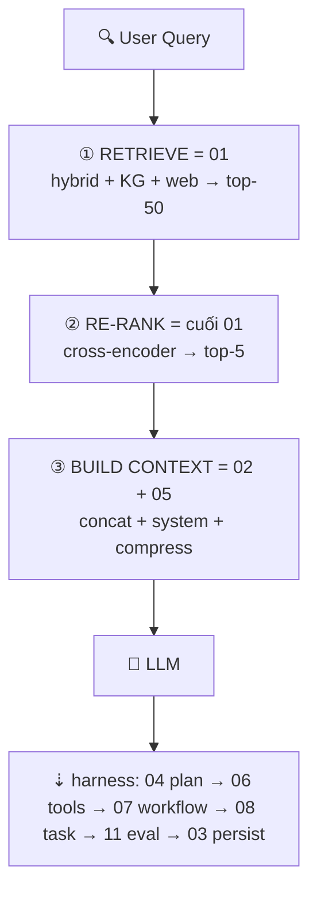

# ARCHITECTURE — Harness (01–15)

> Kiến trúc tổng của cụm `vi/harness/`. Tài liệu gốc tiếng Anh mirror ở `en/harness/`.
>
> * `README.md` — bản đồ: mỗi folder nằm ở đâu trong harness thật.
> * `ARCHITECTURE.md` (file này) — thiết kế tổng: phân tầng, luồng dữ liệu, contract, phụ thuộc, cách build/debug.
> * `../HARNESS_ENGINEERING.md` — lý thuyết đầy đủ: 7 components, SOLID, 10 commandments, case studies.

## 1. Harness là gì

Phần này giải thích từ "harness" nghĩa là gì — vì mọi thứ phía sau đều dựa trên ý này.

Harness là **mọi thứ xung quanh LLM** (LLM = large language model, mô hình ngôn ngữ lớn như GPT hay Claude) biến một lần gọi đơn lẻ
`prompt → completion` thành hệ thống đáng tin cậy `request → verified outcome` (tức là: từ yêu cầu của người dùng đến kết quả đã được kiểm chứng, chứ không chỉ là một câu trả lời).

Hai vòng lặp phân biệt rõ chủ sở hữu:

* **Inner loop** (harness runtime sở hữu, ví dụ Claude Code / opencode — vòng lặp agent tự hỏi-tự-làm):
  `LLM → tool_call → observation → LLM → … → stop`.
* **Outer loop** (bạn sở hữu, loop engineer — vòng lặp bạn thiết kế bên ngoài):
  `plan → execute → validate → fix → persist → evaluate`.

> **Tóm gọn 1 câu (§1):** Harness = mọi thứ quanh LLM, biến một lần gọi đơn lẻ thành hệ thống đáng tin cậy — gồm vòng trong (runtime tự chạy) và vòng ngoài (bạn thiết kế).

```
┌──────────────────────── VÒNG ĐỜI HARNESS THẬT ───────────────────────────────┐
│  User request                                                                │
│      ▼                                                                       │
│  ┌────────┐  ┌────────┐  ┌────────┐  ┌────────┐  ┌────────┐  ┌────────┐        │
│  │01 Retri│─▶│02 Build│─▶│04 Plan │─▶│05 Promp│─▶│06 Tools│─▶│ LLM    │        │
│  │eve     │  │Context │  │Decompo │  │Builder │  │Decide  │  │ call   │        │
│  └────────┘  └────────┘  └────────┘  └────────┘  └────────┘  └────┬───┘        │
│       ▲                                                        │              │
│       │                                                   tool outputs        │
│       │                                                        │              │
│       │         ┌────────┐  ┌────────┐  ┌────────┐  ┌────────▼───┐            │
│       │         │03 Updat│◀─│11 Evalu│◀─│07 Workf│◀─│08 Task     │            │
│       │         │e Memory│  │ate     │  │low     │  │Execute    │            │
│       │         └────────┘  └────────┘  └────────┘  └────────────┘            │
│       │              ▲            ▲            │                              │
│       │              │            │            ▼                              │
│       │         ┌────┴────────────┴─────┐  ┌────────┐  ┌────────┐             │
│       └─────────│09 Multi-Agent (mở    │  │10 Autom│  │Guardrai│             │
│                 │   rộng khi cần)      │  │ation   │  │ls+Perms│             │
│                 └──────────────────────┘  └────────┘  │ (mọi   │             │
│                                                       │ bước)  │             │
│                                                       └────────┘             │
└──────────────────────────────────────────────────────────────────────────────┘
```

## 2. Phân tầng: 7 components → 15 modules

Harness có 7 thành phần logic, chia thành 11 modules stage + 4 modules cross-cutting
để mỗi phần học và test độc lập.

Cách đọc bảng này: cột **#** là số thứ tự thư mục; cột **Thư mục** là tên folder trong repo; cột **Component** là vai trò logic; cột **Input → Output** là nhận gì, trả gì; cột **Đọc khi nào** là khi nào bạn cần mở folder đó. Ví dụ, module 04 nhận một mục tiêu lớn và trả về DAG (DAG = sơ đồ việc, nơi việc sau chỉ chạy khi việc trước xong).

| # | Thư mục | Component | Input → Output | Đọc khi nào |
|---|---|---|---|---|
| 01 | `01-retrieve-memory-knowledge/` | Memory (đọc) | query → ranked chunks (score) | Cần tìm thông tin: vector + BM25 hybrid, RRF fusion, rerank, GraphRAG |
| 02 | `02-build-context/` | Context | chunks + goal + history + files → `BuiltContext` trong token budget | Window, compression, routing, caching, hierarchy 5 tầng |
| 03 | `03-update-memory-store/` | Memory (ghi) | run result → versioned facts/patterns | Write-back, consolidation/dedupe, KB CRUD, event sourcing |
| 04 | `04-plan-decompose-task/` | Orchestration (plan) | goal → DAG `TaskNode` | Decomposition, Plan-and-Solve, ToT, ReWOO, ReAct, replanning |
| 05 | `05-prompt-builder/` | Guardrails (nắn input) | `BuiltContext` + template → prompt cuối | Template registry, few-shot, CoT, schema, chống injection |
| 06 | `06-decide-tools-mcp/` | Tools + Permissions | intent → tool call được duyệt → observation | Registry, intent classifier, MCP client, RBAC, executor (timeout/retry) |
| 07 | `07-workflow/` | Orchestration (run) | DAG → kết quả có bù lỗi | Sequential/parallel/DAG/HSM, saga, circuit breaker, tracing |
| 08 | `08-task/` | Orchestration (đơn vị việc) | định nghĩa 1 unit track được | Lifecycle, DAG deps, priority, budget, timeout/cancel. Mỏng nhất — lạc thì bắt đầu ở đây |
| 09 | `09-multi-agent/` | Orchestration (scale-out) | 1 task → N agents phối hợp | Roles, message protocol, shared memory. Chỉ khi 04+07 quá tải. Chi tiết sub-agent: `09-multi-agent/SUBAGENT.md` |
| 10 | `10-automation/` | Feedback (định kỳ) | lịch/event → run tự động | CI/CD, scheduler, code-gen, test automation, self-healing có guard cost |
| 11 | `11-evaluation/` | Feedback (đo) | run → pass/fail + metrics | Rubric, quality metrics, benchmark, LLM-judge, regression |
| 12 | `12-sandbox-execution/` | Cross-cutting: thực thi | untrusted code → kết quả cách ly | Threat model, blast radius, tiers: language → container → syscall filter |
| 13 | `13-trajectory-observability/` | Cross-cutting: quan sát | mọi bước → `TrajectoryEvent` stream | Event contract, session stream, fork/replay/resume, join keys |
| 14 | `14-compaction-context/` | Cross-cutting: context | context dài → context gọn còn đúng | Trigger 70% (không đợi 90%), pin set, summarization vs pruning, prompt compaction-safe |
| 15 | `15-approval-gates/` | Cross-cutting: kiểm soát | op rủi ro → human decision | Risk tier, gate payload, timeout-deny, pause/resume, audit |

Guardrails + Permissions **không phải stage** — bọc mọi mũi tên
(check input, approve tool, validate output).

> **Tóm gọn 1 câu:** Harness là bộ máy quanh LLM gồm 11 chặng nối tiếp (tìm dữ liệu → dựng ngữ cảnh → lập kế hoạch → gọi công cụ → chạy → chấm điểm → ghi nhớ) cộng 4 lớp bao ngoài (sandbox, quan sát, nén ngữ cảnh, cổng duyệt).

## 3. Luồng end-to-end của một request

Phần này đi qua 10 bước của một yêu cầu thật, để bạn thấy 15 module trên ghép vào nhau ở đâu.

Ví dụ *"Fix login bug"*:

1. **Retrieve (01).** Embed query (embed = biến câu hỏi thành dãy số để máy so sánh độ giống), hybrid-search (tìm kết hợp hai cách: theo nghĩa và theo từ khóa) vector DB + BM25 (BM25 = thuật toán tìm theo từ khóa chính xác, kiểu Google cũ), rerank top-k (rerank = chấm lại và xếp hạng lại các kết quả). Fallback khi rỗng (fallback = đường dự phòng khi tìm không ra gì).
2. **Build context (02).** Merge system + goal + chunks + summary + files hiện tại vào budget (vd 100k). Cắt ưu tiên thấp trước. Đánh dấu untrusted content.
3. **Plan (04) → Task graph (08).** Sinh DAG `reproduce → locate → patch → test`, mỗi node có id, input, budget, timeout, cờ approval.
4. **Build prompt (05).** Render từng task từ template có version, gắn few-shot, kèm output schema.
5. **Decide tools (06).** Intent classifier chọn `read_file`, `run_tests`, … Check permission (được ghi ngoài `src/` không?). Op nguy hiểm → pause xin approval (15).
6. **Execute workflow (07).** Chạy DAG: nối tiếp chỗ phụ thuộc, song song chỗ độc lập. Retry backoff (thử lại với khoảng nghỉ tăng dần), circuit-break khi fail liên tục (circuit breaker = "ngắt mạch": hỏng liên tục thì dừng gọi, khỏi đốt tài nguyên), saga compensation khi thành công một phần (saga = nếu làm dở nửa chừng thì tự hoàn tác phần đã làm).
7. **Inner tool loop (06 ↔ sandbox 12).** LLM gọi tools, harness chạy cách ly, trả observation. Memoize call trùng, cap size kết quả.
8. **Validate (11).** Syntax check, chạy test, chấm rubric LLM-judge, đo trajectory metrics (steps, tool precision, recovery). Fail → replan hoặc escalate.
9. **Persist (03).** Ghi cái đáng giữ: success pattern, fact mới, file summary (có version). Bỏ noise.
10. **Automate (10) / Scale-out (09) — optional.** Schedule regression hoặc fan-out reviewer/tester agents qua shared memory (regression = chạy lại bộ test cũ để chắc không phá gì; fan-out = tách việc cho nhiều agent làm cùng lúc).

> **Tóm gọn 1 câu:** Một yêu cầu đi qua 10 chặng: tìm dữ liệu → dựng ngữ cảnh → lập kế hoạch → dựng prompt → chọn công cụ → chạy → gọi tool trong sandbox → kiểm chứng → ghi nhớ → (tùy chọn) tự động hoá hoặc chia cho nhiều agent.

### 3.1. RAG nằm ở đầu lifecycle

RAG (Retrieval-Augmented Generation = "tìm tài liệu rồi nhét vào prompt để trả lời") là ba bước mở màn — phần này cho biết nó nằm ở đâu trong 10 chặng trên.



RAG **không chạy một lần** — chạy lại mỗi task / mỗi vòng inner-loop khi query đổi
(replan ở `04` → retrieve lại ở `01`). Chỉ có RAG thì được chatbot một lần;
muốn agent end-to-end cần phần còn lại.

> **Tóm gọn 1 câu:** RAG chỉ là ba bước mở màn của lifecycle (tìm → xếp hạng → dựng ngữ cảnh) và phải chạy lại mỗi khi câu hỏi đổi; muốn agent làm việc thật thì cần nốt các chặng kế hoạch, công cụ, kiểm chứng.

## 4. Ba contract dùng chung

Phần này nói về 3 "khung dữ liệu" mà mọi module phải dùng chung nếu muốn ghép được với nhau (contract = bản cam kết về hình dạng dữ liệu giữa các phần).

Nếu 11 modules không share gì khác, hãy share 3 shapes này:

> 📄 **Code ví dụ:** [`examples/01-4-ba-contract-dung-chung.ts`](examples/01-4-ba-contract-dung-chung.ts)

> **Tóm gọn 1 câu (§4):** Ba contract dùng chung là mối nối giữa các module: sự kiện đường chạy, ngữ cảnh đã dựng, và node việc — thống nhất chúng trước đã.

## 5. Mặt phẳng kiểm soát 12–15 (bọc mọi stage)

Phần này nói về 4 module "lớp bảo vệ" — chúng không nằm trên dây chuyền chính mà bọc quanh mọi chặng.

Cách đọc bảng này: cột **Module** là lớp bảo vệ nào; cột **Câu hỏi** là vấn đề nó giải quyết; cột **Cơ chế chính** là cách nó giải quyết. Ví dụ, module 14 trả lời câu hỏi "run dài sống sao khi token gần đầy" bằng cách nén ở mốc 70%.

| Module | Câu hỏi | Cơ chế chính |
|---|---|---|
| 12 Sandbox | Code không tin cậy chạy ở đâu? | Tầng cách ly + 5 controls bắt buộc + ma trận theo role. Mọi `tool_call` ở 06 đều đi qua đây |
| 13 Trajectory | Ghi lại run thế nào để replay/audit? | Event contract + session stream (ghi bền vững + tail trực tiếp) + fork/replay/resume. Engine mẫu ở `03-update-memory-store/trajectory-fork-replay.md` |
| 14 Compaction | Run dài sống qua trần token thế nào? | Trigger 70% (không đợi 90%), pin set (system/goal không cắt), pruning + summarization, prompt compaction-safe |
| 15 Approval | Ai duyệt hành động không đảo ngược? | Risk tier gắn lúc plan (04), gate payload cho human, timeout-deny, pause/resume, audit trail |

> **Tóm gọn 1 câu:** Bốn module 12–15 (sandbox, quan sát, nén ngữ cảnh, cổng duyệt) là các lớp bảo vệ chạm tới mọi chặng — thiếu một trong bốn thì hệ thống vẫn chạy nhưng thiếu mắt, tai, phanh, và chỗ xoá an toàn.

## 6. Đọc, build, debug

Phần này chỉ đường: đọc thứ tự nào nếu mới học, ghép module nào nếu muốn chạy nhanh, và tra từ đâu nếu run hỏng.

* **Mới học:** `08 → 07 → 02 → 06 → 01 → 03 → 04 → 05 → 11 → 10 → 09`, rồi `12 → 13 → 14 → 15`.
* **Harness minimal:** `02 + 05 + 06 + 07 + 11` là đủ. Thêm `01/03` khi cần memory, `04/08` khi task phức tạp, `09/10` cuối cùng.
* **Debug run dở:** trajectory (`03/trajectory-fork-replay.md` — trajectory = bản ghi từng bước agent đã làm) → `02` (sai context?) → `06` (sai tool?) → `11` (sai rubric?).

> **Tóm gọn 1 câu:** Mới học thì đọc theo thứ tự 08 → 07 → 02 → 06 → 01 → 03 → 04 → 05 → 11 → 10 → 09 rồi 12 → 15; muốn chạy nhanh chỉ cần 02+05+06+07+11; run hỏng thì tra trajectory trước.

## 7. Docs đi kèm trong cụm này

Phần này liệt kê các tài liệu chi tiết nằm trong từng thư mục module.

Cách đọc bảng này: cột **File** là đường dẫn tài liệu; cột **Thêm gì ngoài README module** là nội dung nó có mà README thường không có.

| File | Thêm gì ngoài README module |
|---|---|
| `03-update-memory-store/trajectory-fork-replay.md` | Engine session event stream, fork/replay/resume |
| `06-decide-tools-mcp/code-mode-sdk.md` | Pattern code-mode vs JSON tool-call + sandbox sketch |
| `07-workflow/cordis-kernel-plugin.md` | Micro-kernel + plugin lifecycle, 4 runtime modes |
| `09-multi-agent/SUBAGENT.md` | Spec sub-agent: lifecycle, spawn API, permission thu hẹp, budget, gộp kết quả |
| `11-evaluation/minimal-benchmark-harness.md` | Harness isolation minimal để eval không bias |

> **Tóm gọn 1 câu (§7):** Mỗi thư mục module có thêm 1-2 tài liệu chuyên sâu (trajectory engine, code-mode SDK, micro-kernel, sub-agent spec, benchmark harness) — tra bảng trên để tìm đúng file.

## 8. Gap đã biết

Phần này liệt kê những việc chưa module nào nhận phụ trách — biết trước để khỏi tưởng đã phủ hết.

Cross-cutting cũ đã có nhà (`12–15`). Còn lại chưa module nào sở hữu:
pipeline scrub PII/secret (scrub = tự dò và xoá dữ liệu cá nhân/mật khẩu khỏi văn bản; PII = Personally Identifiable Information, thông tin nhận diện cá nhân), tenant isolation (cách ly dữ liệu giữa các khách hàng), SLO cost-per-task (SLO = cam kết chất lượng; ở đây là cam kết trần chi phí cho mỗi nhiệm vụ).
Gap từng module nằm trong mục bổ sung của mỗi README.

> **Tóm gọn 1 câu:** Bốn việc chưa ai phụ trách: dò-xoá dữ liệu cá nhân/mật khẩu, cách ly dữ liệu giữa các khách hàng, và cam kết trần chi phí theo từng nhiệm vụ.
