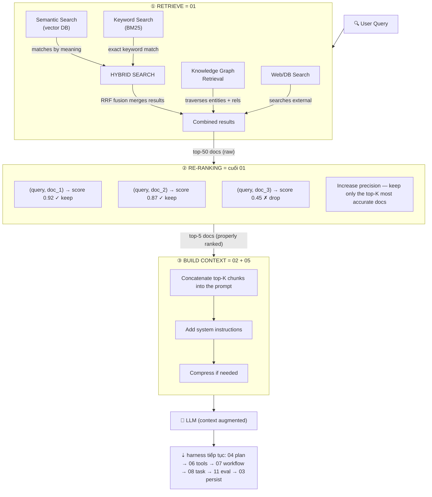

# Kiến Trúc Harness — Toàn Cảnh (01–15)

> Coi file này như tấm bản đồ xưởng: mỗi thư mục nằm ở đâu trong một harness thật, đi đường nào cho khỏi lạc.
> Muốn đọc lý thuyết gốc thì mở `../HARNESS_ENGINEERING.md`; muốn xem code tay thì vào `01/`–`15/`.
> Các modules `01–11` là từng chặng trên dây chuyền; `12–15` là lớp bao ngoài, chặng nào cũng chạm tới.

## 1. Harness Là Gì, Trong Một Sơ Đồ

Nếu gọi LLM một phát ăn ngay giống như hỏi đường người lạ — nhanh nhưng hên xui,
thì harness là **cả bộ máy dựng quanh LLM** để biến một câu hỏi lẻ
`prompt → completion` thành một kết quả có kiểm chứng, đi được tới nơi tới chốn:
`request → verified outcome`.

```
┌──────────────────────── VÒNG ĐỜI HARNESS THẬT ───────────────────────────────┐
│                                                                              │
│  User request                                                                │
│      │                                                                       │
│      ▼                                                                       │
│  ┌────────┐  ┌────────┐  ┌────────┐  ┌────────┐  ┌────────┐  ┌────────┐        │
│  │01 Retri│─▶│02 Build│─▶│04 Plan │─▶│05 Promp│─▶│06 Tools│─▶│ LLM    │        │
│  │eve     │  │Context │  │Decompo │  │Builder │  │Decide  │  │ call   │        │
│  └────────┘  └────────┘  └────────┘  └────────┘  └────────┘  └────┬───┘        │
│       ▲                                                        │              │
│       │                                                   tool outputs        │
│       │                                                        │              │
│       │         ┌────────┐  ┌────────┐  ┌────────┐  ┌────────▼───┐            │
│       │         │03 Updat│◀─│11 Evalu│◀─│07 Workf│◀─│08 Task     │            │
│       │         │e Memory│  │ate     │  │low     │  │Execute    │            │
│       │         └────────┘  └────────┘  └────────┘  └────────────┘            │
│       │              ▲            ▲            │                              │
│       │              │            │            ▼                              │
│       │         ┌────┴────────────┴─────┐  ┌────────┐  ┌────────┐             │
│       └─────────│09 Multi-Agent (mở    │  │10 Autom│  │Guardrai│             │
│                 │   rộng khi cần)      │  │ation   │  │ls+Perms│             │
│                 └──────────────────────┘  └────────┘  │ (mọi   │             │
│                                                       │ bước)  │             │
│                                                       └────────┘             │
└──────────────────────────────────────────────────────────────────────────────┘
```

Nói nôm na có hai vòng quay lồng nhau. Vòng trong (mấy tool như Claude Code / opencode lo giùm bạn):
`LLM → tool_call → observation → LLM → … → stop`.
Vòng ngoài (việc của bạn, người thiết kế loop):
`plan → execute → validate → fix → persist → evaluate`.

## 2. Map 7 Components → 15 Modules

Về mặt logic, harness chỉ có 7 mảnh ghép. Repo này chẻ ra thành 11 modules theo chặng
cộng thêm 4 modules bao ngoài, để mỗi phần học riêng, test riêng cho đỡ rối.

| # | Thư mục module | Component harness | Trả lời câu hỏi |
|---|----------------|-------------------|-----------------|
| 01 | `01-retrieve-memory-knowledge/` | Memory (đọc) | Agent nhớ gì cho relevant? Embedding, chunking, hybrid vector + BM25, rerank, các biến thể RAG. |
| 02 | `02-build-context/` | Context management | Nhồi gì vào token window, thứ tự nào, budget nào? Hierarchy 5 tầng, compression, routing, caching. |
| 03 | `03-update-memory-store/` | Memory (ghi) | Giữ lại gì sau task? Write-back, consolidation, versioning, audit. Đọc kèm: `trajectory-fork-replay.md`. |
| 04 | `04-plan-decompose-task/` | Orchestration (plan) | Chia mục tiêu lớn thành bước nhỏ verify được thế nào? Decomposition patterns, ReAct/ReWOO/ToT, replanning. |
| 05 | `05-prompt-builder/` | Guardrails (nắn input) | Ghép prompt cuối an toàn thế nào? Template, few-shot, CoT, schema enforcement, chống injection. |
| 06 | `06-decide-tools-mcp/` | Tools + Permissions | Agent được làm gì, qua tool nào? Registry, intent classification, MCP client, RBAC, sandbox. Đọc kèm: `code-mode-sdk.md`. |
| 07 | `07-workflow/` | Orchestration (run) | Bước chạy thứ tự nào, retry, bù lỗi ra sao? Sequential/parallel/DAG/HSM, saga, circuit breaker, tracing. Đọc kèm: `cordis-kernel-plugin.md`. |
| 08 | `08-task/` | Orchestration (đơn vị việc) | Một đơn vị track được là gì? Lifecycle, DAG deps, priority, budget, timeout/cancel. Module mỏng nhất — nếu lạc thì bắt đầu ở đây. |
| 09 | `09-multi-agent/` | Orchestration (scale-out) | Khi nào 1 agent thành 1 team? Role, protocol, shared memory, conflict resolution. Chỉ cần khi 04+07 quá tải. |
| 10 | `10-automation/` | Feedback (chạy định kỳ) | Cái gì chạy mà không cần human hỏi? CI/CD, scheduler, self-healing loop có guard iteration/cost. |
| 11 | `11-evaluation/` | Feedback (đo lường) | Có thực sự work không? Rubric, trajectory metrics, LLM-judge, regression, benchmark. Đọc kèm: `minimal-benchmark-harness.md`. |
| 12 | `12-sandbox-execution/` | **Cross-cutting: thực thi** | Code không tin cậy chạy ở đâu? Tầng cách ly, 5 controls bắt buộc, ma trận theo role. Nhà chính của khái niệm sandbox. |
| 13 | `13-trajectory-observability/` | **Cross-cutting: quan sát** | Mọi run ghi lại thế nào? Event contract, session stream, fork/replay/resume, join key. Bản đồ tới `03/.../trajectory-fork-replay.md` (engine). |
| 14 | `14-compaction-context/` | **Cross-cutting: context** | Run dài sống sót qua trần token thế nào? Policy 70%, pruning, contract memory, prompt compaction-safe. |
| 15 | `15-approval-gates/` | **Cross-cutting: kiểm soát** | Ai duyệt hành động không đảo ngược? Risk tier, gate payload, timeout-deny, pause/resume, audit. |

Nhớ một ý này là đủ: Guardrails + Permissions **không phải một chặng đứng riêng** — nó như lớp bảo vệ
bọc quanh mọi mũi tên trong sơ đồ trên (soi đầu vào, duyệt lúc gọi tool, chấm lại đầu ra).

## 3. Lifecycle Của Một Request, End to End

Lấy ví dụ gần gũi là request *"Fix login bug"* — khách báo không đăng nhập được, mình lần theo từng chặng xem harness làm gì:

1. **Retrieve (01).** Mang câu hỏi đi embed, lục cả kho vector lẫn BM25 kiểu lai,
    rồi xếp hạng lại để lấy top-k. Kết quả là mấy đoạn chunks có điểm số. Trường hợp tìm không ra gì thì có đường dự phòng.
2. **Build context (02).** Gom hết đồ nghề vào một giỏ token (ví dụ 100k): lời dặn hệ thống + mục tiêu task + chunks
    mới tìm được + tóm tắt đoạn hội thoại trước + mấy file đang mở. Cái nào ít quan trọng thì bỏ trước. Nội dung lạ, chưa tin được thì dán nhãn riêng.
3. **Plan (04) → Task graph (08).** Chẻ việc lớn thành sơ đồ DAG dễ kiểm từng bước:
    `reproduce → locate → patch → test`. Mỗi task có id, đầu vào, ngân sách,
    timeout, cờ báo có cần duyệt không.
4. **Build prompt (05).** Với từng task, đổ prompt ra từ template đã chốt version,
    kèm vài ví dụ mẫu, kèm luôn khung output phải theo.
5. **Decide tools (06).** Bộ phân loại ý định chọn xem task này xài tool nào
    (`read_file`, `run_tests`, …). Rồi soát quyền: task này có được ghi
    ra ngoài `src/` không? Gặp thao tác nguy hiểm thì dừng lại xin người duyệt.
6. **Execute workflow (07).** Cho DAG chạy. Việc nào dính nhau thì chạy nối tiếp, việc nào độc lập
    thì chạy song song. Lỗi thì thử lại kiểu backoff, hỏng liên tục thì ngắt mạch, dở dang một nửa
    thì có cơ chế đền bù kiểu saga.
7. **Inner tool loop.** LLM gọi tools, harness cho chạy trong sandbox rồi trả
    kết quả quan sát về. Cuộc gọi nào giống nhau thì lấy từ cache, kết quả trả về quá to thì cắt bớt.
8. **Validate (11).** Soi lại: cú pháp ổn không, test có xanh không, chấm theo rubric bằng LLM-judge,
    đo thêm chỉ số đường chạy (bao nhiêu bước, gọi tool chuẩn không, tự phục hồi tốt không). Rớt thì quay lại lập kế hoạch
    hoặc đẩy lên người xử lý.
9. **Persist (03).** Cái gì đáng nhớ thì cất vào kho: mẹo làm đúng, fact mới biết,
    tóm tắt file. Có đánh version. Mấy thứ linh tinh, dùng một lần thì bỏ.
10. **Automate (10) / Scale out (09) — optional.** Muốn thì hẹn lịch chạy regression định kỳ, hoặc
     tách team reviewer/tester cùng xài chung trí nhớ.

Vì mỗi chặng đều nhả ra **trajectory events** (xem §4), nên một lần chạy đều tua lại, rẽ nhánh thử,
hay lôi ra kiểm toán được (`03-update-memory-store/trajectory-fork-replay.md`).

### 3.1. RAG Pipeline Nằm Ở Đâu

Pipeline RAG quen thuộc (tìm → xếp hạng lại → dựng context → gọi LLM) thực ra chỉ là
**mấy bước mở màn của lifecycle** — nó dừng ngay ở lần gọi LLM đầu tiên, còn harness
thì chạy tiếp từ đó về sau:



| Stage RAG | Module harness | Ghi chú |
|-----------|----------------|---------|
| ① Retrieve (hybrid + KG + web, top-50) | `01-retrieve-memory-knowledge` | Embedding, chunking, hybrid + RRF fusion, biến thể GraphRAG, nguồn external |
| ② Re-ranking (cross-encoder, top-5) | Cuối `01` (đầu vào `02`) | Chỉ lọc precision — chưa có gì vào prompt |
| ③ Build context (concat + system + compress) | `02-build-context` (+ `05-prompt-builder` render) | Merge system/goal/chunks/history/immediate vào token budget, đánh dấu untrusted content |
| 🧠 LLM | Inner tool loop (`06` → `07` → `08`) | RAG kết thúc ở đây; vòng harness (plan → execute → validate → persist) tiếp quản |

Chỗ này dễ hiểu nhầm nên nhấn mạnh: RAG **không phải làm một lần cho xong**. Cứ mỗi task mới, mỗi vòng
lặp trong mà câu hỏi đổi (ví dụ `04` lập lại kế hoạch → `01` đi tìm lại) là RAG chạy lại.
Chỉ có RAG không thì được con chatbot trả lời một câu cho hay; còn muốn agent làm trọn gói từ đầu tới cuối
thì phải có nốt phần còn lại của lifecycle.

## 4. Ba Contract Dùng Chung

Nếu các modules chẳng thống nhất được gì khác, thì ít nhất hãy thống nhất 3 hình dạng này:

**A. Trajectory event** — cuốn sổ cái duy nhất để lần ra lỗi:

> 📄 **Code ví dụ:** [`examples/01-4-ba-contract-dung-chung.ts`](examples/01-4-ba-contract-dung-chung.ts)

**B. Context object** — bên 02 dựng lên, bên 05 mang đi nấu thành prompt:

> 📄 **Code ví dụ:** [`examples/02-4-ba-contract-dung-chung.ts`](examples/02-4-ba-contract-dung-chung.ts)

**C. Task node** — bên 04 đẻ ra, bên 07 cho chạy, bên 08 ngồi theo dõi:

> 📄 **Code ví dụ:** [`examples/03-4-ba-contract-dung-chung.ts`](examples/03-4-ba-contract-dung-chung.ts)

## 5. Đọc Thư Mục Này Thế Nào

- **Mới làm quen harness, chưa biết bắt đầu đâu?** Cứ đi theo lối này cho nhẹ đầu: `08` → `07` → `02` → `06` →
  `01` → `03` → `04` → `05` → `11` → `10` → `09`, rồi tới nhóm bao ngoài:
  `12` → `13` → `14` → `15`.
- **Muốn ráp một harness gọn nhẹ xài được ngay?** Ghép `02 + 05 + 06 + 07 + 11` là đủ chạy.
  Khi nào cần nhớ lâu thì thêm `01/03`, việc rắc rối hơn thì thêm `04/08`, `09/10` để dành cuối cùng.
- **Kẹt ở một lần chạy dở dang, không biết mò từ đâu?** Mở cuốn băng trajectory trước (`03/trajectory-fork-replay.md`),
  rồi lần tiếp: coi chừng `02` nấu context sai không, `06` chọn tool trật không, `11` chấm điểm lệch không.

## 6. Docs Đi Kèm

| File | Thêm gì ngoài README của module |
|------|----------------------------------|
| `03-update-memory-store/trajectory-fork-replay.md` | Session event stream, implementation fork/replay/resume |
| `06-decide-tools-mcp/code-mode-sdk.md` | Pattern Code-mode vs JSON tool-call + sandbox sketch |
| `07-workflow/cordis-kernel-plugin.md` | Micro-kernel + plugin lifecycle, 4 runtime modes |
| `11-evaluation/minimal-benchmark-harness.md` | Harness isolation minimal để eval capability không bias |
| `../HARNESS_ENGINEERING.md` | Lý thuyết đầy đủ: 7 components, SOLID, 10 commandments, case studies (SWE-agent, Anthropic, Claude Code leak, Cursor, DeepSeek) |

## 7. Gap Đã Biết (Welcome Contributions)

Mấy lỗ hổng bao ngoài hồi trước giờ đã có chỗ ở mới: sandbox dọn qua `12`, trajectory qua `13`,
compaction qua `14`, approval qua `15`. Còn mấy món chưa ai nhận: lọc PII/secret trong pipeline,
cách ly tenant cho sạch, trần chi phí tính theo task (SLO cost-per-task). Còn gap lẻ của từng module
thì nằm trong mục bổ sung ở README của module đó.

## 8. AI Coding Workflow Hiện Đại (2026)

Harness trong repo này không phải lý thuyết suông — nó chính là cách các AI coding tool đang chạy thật trong IDE:

| Tool | Harness trong đó |
|------|-----------------|
| **Claude Code** | Agentic loop + Agent Skills (SKILL.md) + compaction + subagents. Có SDK chính thức (**Claude Agent SDK**, trước đây là Claude Code SDK — đổi tên 09/2025) để embed loop này vào app riêng. |
| **GitHub Copilot (agent mode)** | 2025-2026: từ autocomplete → agent mode sửa nhiều file, chạy terminal, tự verify; Copilot coding agent nhận issue → mở PR. |
| **Cursor** | Multi-tab agent, Composer chạy nhiều file song song, background agents. |
| **opencode / OSS harness** | Pattern tương tự: MCP tools + approval gates + session trajectories. |

**Điểm chung 2026 (từ Anthropic, OpenAI, IBM, Google):**
1. **Multi-agent orchestration** là pattern chủ đạo — lead agent + subagents (xem `09-multi-agent/`), mỗi subagent có context riêng, trả về summary ngắn.
2. **Agent control plane**: một nơi điều phối nhiều agent chạy song song trên nhiều môi trường (browser, editor, CI) — hướng tới "Agentic OS".
3. **Giao thức chuẩn hoá**: MCP (agent↔tool, spec `2026-07-28`) + A2A (agent↔agent, Linux Foundation) — coding agent nào cũng chạy cả hai.
4. **Trust by Design**: security + approval gates wire vào mọi layer ngay từ đầu, thay vì audit sau (xem `15-approval-gates/`).

> Muốn hiểu sâu từng phần: `09-multi-agent/` cho orchestration, `10-automation/` cho loop tự chạy trong CI, `06-decide-tools-mcp/` cho MCP.
