# Workflow Diagram (Human Reference Only)

> This file is for humans to visualize the 5-phase flow. It is NOT part of
> phase-gated loading — Copilot loads phases per the index in
> `phases/README.md`, not this diagram. Keep it in sync with
> `copilot-instructions.md` routing table and `phases/session.json`.
> **Display simplification**: New Feature, Bug Fix, Refactor, and Unit Test
> render as one `Implementation Workflow` node below because they share an
> identical 5-phase flow (full P1→P5, no skipped phases) — this is a visual
> grouping only. Routing, skill files (`skills/new-feature|bug-fix|refactor
> |unit-test/SKILL.md`), and report templates/filenames stay distinct per
> type in `session.json` and `skills/report-generation/SKILL.md`; nothing
> about report generation changes.

## Flowchart

```mermaid
flowchart TD
    Request[Developer Request]
    Decision{Request Type}

    Request --> Decision

    Decision -->|Jira Ticket Investigate| JiraInvestigateWF[Jira Investigate Workflow]
    Decision -->|Implementation| ImplementationWF["Code Delivery Workflow<br/>(New Feature / Bug Fix / Refactor / Unit Test)"]
    Decision -->|Code Review| CodeReviewWF[Code Review Workflow]

    subgraph Phase1["Phase 1 - Understanding (MCP w/ Fallback)"]
        LoadGuidelines[Load Guidelines & Core Rules]
        CheckJira{Jira MCP Available?}
        LoadJira[Fetch Jira Ticket via MCP]
        AskJira[Ask Dev for Ticket Summary]
        LoadReportContext[Load Relevant Report Context]
        Investigation[Investigation]
        ContradictionScan[Identify Contradictions & Ambiguities]
        ApplyRules[Apply Stack Rules]

        LoadGuidelines --> CheckJira
        CheckJira -->|Yes| LoadJira
        CheckJira -->|No| AskJira
        LoadJira --> LoadReportContext
        AskJira --> LoadReportContext
        LoadReportContext --> Investigation
        Investigation --> ContradictionScan
        ContradictionScan --> ApplyRules
    end

    JiraInvestigateWF --> LoadGuidelines
    ImplementationWF --> LoadGuidelines
    CodeReviewWF --> LoadGuidelines

    ApplyRules --> RoutingCheck{Workflow Type?}
    RoutingCheck -->|Jira Ticket Investigate / Code Review| Phase5Direct[Proceed to Phase 5 — Analysis-Only]
    RoutingCheck -->|Implementation| ContradictionGate

    subgraph Phase2["Phase 2 - Planning"]
        ContradictionGate{Contradictions Resolved?}
        Clarify[Clarify & Freeze Decisions with Developer]
        Clarified{Developer Clarified?}
        Blocked[Blocked: Waiting for Developer Clarification]
        Plan[Draft Implementation Plan]
        Approval{Developer Approval Gate*}
        Refine[Refine Plan]

        ContradictionGate -->|No| Clarify
        Clarify --> Clarified
        Clarified -->|No| Blocked
        Clarified -->|Yes| ContradictionGate
        Blocked --> Clarify
        ContradictionGate -->|Yes| Plan
        Plan --> Approval
        Approval -->|Rejected| Refine
        Refine --> Plan
    end

    subgraph Phase3["Phase 3 - Execution & Formatting"]
        TaskList[Create Task List]
        ExecuteTasks[Implement Code Changes]
        WriteTests[Write/Update Unit Tests]
        FormatCode[Run npm run lint & format]

        TaskList --> ExecuteTasks
        ExecuteTasks --> WriteTests
        WriteTests --> FormatCode
    end

    Approval -->|Approved| TaskList

    subgraph Phase4["Phase 4 - Validation & PR (AC + Contradictions + Build + Tests)"]
        CompileCheck[Run npm run build]
        TestCheck[Run npm run test]
        ACCheck[Verify Acceptance Criteria vs Jira Ticket]
        ContradictionCheck[Verify Frozen Contradiction Decisions]
        ValidationGate{Build OK & Tests OK & AC Met & Contradictions Applied?}
        PreparePR[Prepare PR Description]
        Reviewer[Review Code Diffs]

        FormatCode --> CompileCheck
        CompileCheck --> TestCheck
        TestCheck --> ACCheck
        ACCheck --> ContradictionCheck
        ContradictionCheck --> ValidationGate
        ValidationGate -->|No| TaskList
        ValidationGate -->|Yes| PreparePR
        PreparePR --> Reviewer
    end

    subgraph Phase5["Phase 5 - Report Generation & Jira Sync (w/ Fallback)"]
        GenerateReport[Generate Final Report]
        ArchiveReport[Archive & Publish Report]
        CheckJiraS{Jira MCP Available?}
        SyncJira[Sync Jira: Status + Comment + PR Link]
        ManualJira[Provide Manual Jira Update Steps]

        GenerateReport --> ArchiveReport
        ArchiveReport --> CheckJiraS
        CheckJiraS -->|Yes| SyncJira
        CheckJiraS -->|No| ManualJira
    end

    Reviewer --> GenerateReport
    Phase5Direct --> GenerateReport

    %% Visual styling
    classDef analysisOnly fill:#ffe082,stroke:#f57f17,stroke-width:2px
    classDef codeDelivery fill:#c8e6c9,stroke:#2e7d32,stroke-width:2px
    class JiraInvestigateWF,CodeReviewWF,Phase5Direct analysisOnly
    class ImplementationWF codeDelivery
```

## Notes (from copilot-instructions.md)

> **Notes:**
> - The diagram groups **New Feature / Bug Fix / Refactor / Unit Test** into
>   one `Implementation Workflow` node (identical full 5-phase flow, no
>   skipped phases). Each still uses its own skill file and report template
>   — see `phases/README.md`.
> - `*` **Approval Gate** is mandatory for **non-trivial tasks** (multiple files, behavior changes, or significant implementation work). For trivial/no-code queries, Copilot presents the draft plan and may proceed without an explicit pause.
> - **Contradiction Gate** runs before planning: if ticket/design/clarification inputs conflict, Copilot must list the conflicts, obtain developer decisions, and freeze the final interpretation before drafting implementation details.
> - **Analysis-only workflows** (Code Review, Jira Ticket Investigate): execute only Phase 1 + Phase 5. Skip Phases 2-4 entirely — no planning, no code changes, no build/test gates, no PR creation.
> - **Code-delivery workflows** (New Feature, Bug Fix, Refactor, Unit Test): execute all 5 phases in order with the Phase 2 approval gate mandatory for non-trivial tasks.
> - The routing decision is driven by `session.json` → `workflow_phase_config.workflows.<type>.skip_phases`. An empty list means full 5-phase execution; a non-empty list means analysis-only (P1 + P5 only).
> - **Reviewer** (Review Code Diffs) runs for **all** workflows during Phase 4 before PR submission — not only for the Code Review workflow. It is an in-place check gate, not a separate pass.
> - **Phase 4 Validation Gate requires all four**: Build passes, Tests pass, all Jira ticket Acceptance Criteria are explicitly met, AND frozen contradiction decisions are applied (each item traced to implementation/tests). Build+Test green alone is NOT sufficient to proceed.
